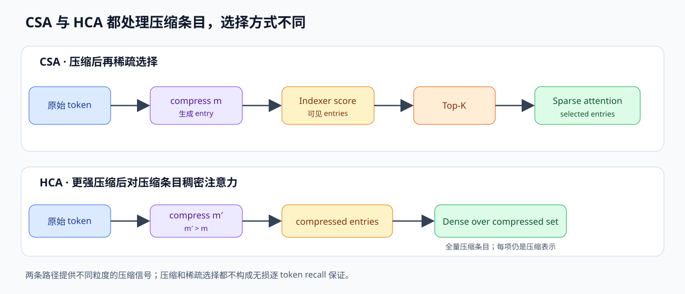
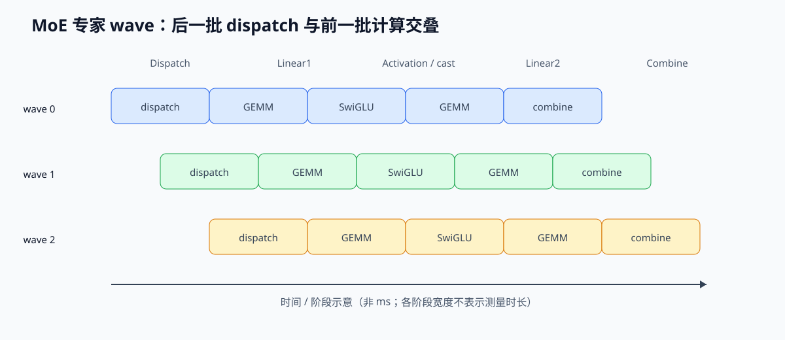

<span id="deepseek-v4-csa-hca-主线-a-增量笔记" aria-hidden="true"></span>

# DeepSeek-V4：CSA + HCA 混合注意力

> DeepSeek-V4 的公开结构与版本数字按官方技术报告、模型卡和配置来源区分；本篇解释 CSA/HCA、mHC、Muon 与精度路径。

## 0. 这篇笔记回答什么问题

V4 的长上下文路径先改变历史表示，再决定哪些压缩条目参与注意力。CSA 对压缩条目做 learned sparse selection；HCA 对更强压缩后的条目做 dense attention。模型还配置局部 SWA、mHC residual mixing、Muon 与分层量化，分别影响局部信息、残差流、优化器状态和数值精度。



## 1. 发布线（先分清版本，别把三个日期混成一条新闻）

| 日期 | 事件 | 内容 |
|---|---|---|
| 2026-04-24 | V4 系列预览发布 + 开源 | V4-Pro（约 1.6T 总参 / 约 49B 激活）、V4-Flash（官方模型卡列 285B / 约 13B 激活）；原生 1M 上下文 |
| 2026-07-31 | V4-Flash-0731 正式版 | Flash 线转正 |
| 2026-08-13 | V4-Pro-0813 正式版 | 架构/参数与预览版一致（fingerprint `fp_v4pro_20260812`），变化全在后训练：DeepSWE 12.8→62.7、NL2Repo 38.5→61.5、DSBench-Hard 67.2；API 新增 Responses + Anthropic 协议；推理三档 none/high/max；官方预告近期涨价 |

两个值得记住的判断：

- **预览版和正式版架构一样**：正式版晚三个月，涨的是后训练能力，不是结构。学架构以 04-24 的技术内容为准，学能力以 08-13 的榜单为准。
- **参数口径有出入**：1.6T 和 1.5T 都有人用，说明"总参"这个数本身就依赖计数口径（是否含 embedding、是否含 MTP）。学习时记"约 1.6T / 49B active"就够，别在精确值上较劲。

## 2. V3.2 还差什么，V4 补了什么

V3.2 已经沿两条不同路径降低成本：

- MLA：KV 不按 head 存，压成低维 latent，KV cache 从几百 GB 降到个位数 GB。
- DSA：indexer 为可见历史条目打分，主 Attention 再对 top-k（V3.2 配置 K=2048）位置做完整 attention。主 Attention 的交互规模随选中条目数变化；全路径还包含 indexer 扫描、Top-K 与 gather。

在百万 token 场景，V3.2 仍需处理两类成本：

1. **粒度还是 token**：DSA 的 top-k 在原始 token 上做，1M 个历史 token 光做索引、维护 indexer 的 KV 也不便宜；而且每个请求的 KV 即使 MLA 压缩后也还是线性涨。
2. **稀疏选错就丢信息**：top-k 是近似，万一选漏了关键内容，没有兜底。

V4 的思路是先将多个 token 映射为压缩条目，再分别用 sparse CSA 和 dense HCA 处理这些压缩表示。压缩降低条目数，Top-K 限制 CSA 访问集合；两条路径都在压缩表示上计算，HCA 不构成无损的原 token 回看。

官方给的账（1M 上下文，对比 V3.2）：

```text
V4-Pro：   prefill FLOPs ≈ V3.2 的 27%    KV cache ≈ V3.2 的 10%
V4-Flash： prefill FLOPs ≈ V3.2 的 10%    KV cache ≈ V3.2 的 7%
V4-Pro vs BF16 GQA-8 基线：KV ≈ 2%
```

这些是报告在 1M 上下文设定下相对 V3.2 的 FLOPs 与 KV cache 口径，不等于端到端延迟或吞吐倍数；V4 与 V3.2 的参数量和激活配置也不同。

## 3. CSA：压缩稀疏注意力（核心零件）


### 3.1 一个 CSA 层干两件事：压缩 + 稀疏选择

先看名字：CSA = Compressed Sparse Attention。它把"注意力"拆成两个阶段：

**阶段一：压缩（Compress）**

- 粒度 m=4：每 4 个连续 token 压成 1 个 compressed entry。
- 窗口 2m：压缩不是 4 个 token 硬分一组，而是以长度 2m=8 的相邻窗口形成重叠压缩条目，并在窗口内做 joint-softmax 加权求和。
- 形状变化：`[seq, d_model] → [seq/4, d_model]`（近似看；实际带 overlap，条目数略多）。

为什么重叠？单个 4-token 硬切会丢失边界上下文；重叠窗口让每个压缩条目都看到邻居信息，压缩质量更高。

**阶段二：稀疏选择（Sparse attend）**

- Lightning Indexer：一个轻量打分器，对全部压缩条目打分，选 top-k（Pro k=1024，Flash k=512）。
- 核心 attention 是 **shared-KV 多 query**：所有 head 共用同一组压缩 KV（MLA 风格低秩 latent 的延续），但每个 head 的 Q 各自算。
- 形状：`[num_queries, d] × [k, d]`，而不是 `[num_queries, 1M] × [1M, d]`。

### 3.2 为什么这样省（形状账）

1M 上下文，压缩后约 250K 个条目，再由 indexer 对可见条目评分并选择 top-k=1024。选中集合限制的是主 Attention 的读取规模；indexer 全历史评分及其自身的数据流仍属于总成本：

```text
DSA（V3.2）：  对 1M 个原始 token 选 top-k，KV 条目 1M 级别
CSA（V4）：    对 250K 个压缩条目选 top-k=1024，KV 条目降到 250K 级别
主 Attention：queries × (k + 滑窗)；全路径另含压缩与 indexer 扫描
```

省的是两笔：KV cache 存储（条目少 4 倍 + 低精度，见第 9 节）和 prefill 的 QK^T/PV 计算（只对选中的条目算）。

### 3.3 代价与取舍（面试要能说清）

- **压缩有损**：4 个 token 压成 1 个向量，细节必然丢。所以 V4 不能只有 CSA，必须有 HCA + 滑窗兜底（下一节）。
- **top-k 是近似**：indexer 的质量决定召回。官方给的数据：indexer 的 QK 全程 FP4、打分量化到 BF16，top-k 快 2 倍，KV recall 99.7%。这个"快 2 倍 + 99.7% 召回"就是取舍的量化表达。
- **多了一组算子**：压缩、解压、indexer 都是新 kernel，不是白省。省的是显存和 attention 主计算，多的是压缩管线的工程复杂度。
- **和 DSA 的区别要讲清**：DSA 在原始 token 上选 top-k（粒度 token，K=2048）；CSA 先压缩再选（粒度 compressed entry，k=1024）。CSA 的 KV 更小、预填充更省，但需要压缩质量做前提。

## 4. HCA：压缩稠密注意力（兜底）

HCA = Compressed Dense Attention（官方叫法里 HCA 的"稠密"指对压缩条目全量做）。

- 粒度 m'=128：每 128 个 token 压 1 个条目（比 CSA 粗得多）。
- 没有 indexer、没有 overlap：对**所有**压缩条目做 dense attention，不选。
- 作用：对全部 HCA compressed entries 计算 dense attention，提供比稀疏选取更广的压缩上下文路径。每个 entry 仍是多个 token 的压缩表示，HCA 不会逐 token 重建未压缩历史，也不提供无损召回保证。

这和之前见过的两个思想同源：

- DSA 的 anchor 层：少数层做 exact，其余层复用索引。
- Kascade：anchor 层算 exact top-k，跨层复用。

V4-Pro 配置前 2 层为 HCA，之后按 `compress_ratios` 交错 CSA/HCA；层型和具体条目数以对应 checkpoint 为准。

## 5. 层排布与滑窗（config 里怎么读）

- 每层保留最近 128 个**未压缩 token** 的滑窗分支（`sliding_window=128`）：当前位置附近用原始 token 精确注意力，细节不依赖压缩。
- V4-Pro：61 层 + MTP；前 2 层纯 HCA，之后 CSA/HCA 交替，最后一层不压缩。
- V4-Flash：43 层；报告配置的前两层为纯 SWA，其余层按 CSA/HCA 交错。
- 官方把每层压缩粒度写成 `compress_ratios` 数组（V4-Pro 形如 `[128, 128, 4, 128, 4, ..., 4, 0]`）：128=HCA 层、4=CSA 层、0=不压缩层。

阅读这个数组时，128 表示该层的 HCA 压缩率，4 表示 CSA 压缩率，0 表示不压缩；层型顺序来自配置，功能效果还需结合对应层实现与训练目标理解。

## 6. 三个注意力细节（在 config 里能看到的新字段）

### 6.1 partial RoPE（只旋最后 64 维）

- `qk_rope_head_dim=64`：Q/K 只有最后 64 维做旋转位置编码，其余维度不带位置信息。
- 输出端用负位置逆旋转：把绝对位置去掉、只留相对位置差，对位置偏移更鲁棒。
- Infra 影响：K 的 RoPE 维和非 RoPE 维精度需求不同 → 这是 KV cache 混合精度（第 9 节）的直接原因。

### 6.2 attention sink（可学习 logit）

- 每个 head 一个可学习标量，直接加到 attention score 上。
- softmax 行和可以 < 1：注意力不需要"用完"所有概率质量，模型可以学会对不相关内容不给权重。
- 这是把"attention sink token"从工程技巧变成可学习参数；长上下文下更稳定。

### 6.3 grouped output projection（分组输出投影）

- 128 heads × head_dim 512；分成 16 组 × 8 heads。
- 组内先压到 bottleneck（`o_lora_rank=1024`）再投影回 hidden。
- 参数账：约 184M 替代原来约 470M 的平铺输出投影——输出投影是 Decode 阶段的大头权重之一，这里直接砍掉一半以上。

config 快照里能看到的 V4 新字段（与 V3.2 的 `kv_lora_rank` 不兼容，别混用）：

```text
q_lora_rank=1024    head_dim=512    qk_rope_head_dim=64
o_groups=8          o_lora_rank=1024    sliding_window=128
compress_ratios=[128,128,4,128,4,...,4,0]
```

## 7. mHC：流形约束超连接（残差流改造）

mHC = manifold-constrained HyperConnectivity。

- 普通残差是一条直路 `x + attn(x)`；mHC 是 4 条并行残差流（超连接），每层输出由多条流融合。
- 关键约束：每条流的 B 矩阵被约束为**双随机矩阵**（20 步 Sinkhorn-Knopp 迭代），谱范数 ≤ 1。
- 作用：防止深模型 + 长序列下残差累积爆炸，让 61 层（Flash 43 层）和 1M 上下文能稳定训练。
- 工程开销：约 1F1B（一个前向 + 一个后向）的 6.7%——是训练侧的投资，推理时几乎不额外花钱。

面试口径：mHC 解决"深 + 长"的数值稳定性，Muon 解决优化器效率和显存，两个一起让 V4 敢把上下文拉到 1M。

## 8. 优化器：Muon（替代 AdamW 的大矩阵部分）

V4 训练不再只用 AdamW：

- **大矩阵参数**（attention/FFN 的权重矩阵）用 Muon：动量方向做正交化（Newton-Schulz 混合迭代：前 8 步系数 `(3.4445, -4.7750, 2.0315)`，后 2 步 `(2, -1.5, 0.5)`），再按 RMS 缩放到 γ=0.18。
- **小参数**（embedding、lm_head、mHC bias、RMSNorm）仍用 AdamW。

为什么这么做（和 [Adam/AdamW 显存账](optimizers-adam.md) 连起来看）：

- AdamW 对每个参数维护 m、v 两份状态，大矩阵参数多时显存可观（约 2 倍参数量）。
- Muon 只维护一份动量，更新方向用正交化替代逐元素缩放；对矩阵参数来说，正交方向比逐元素缩放更符合"矩阵优化"的几何。
- 显存之外还有工程收益：ZeRO 兼容性靠 knapsack 分桶解决——把参数按桶打包，既保持 Muon 需要的全局正交结构，又能做 ZeRO 的切分。

学习顺序：先在第 7 步（serving 后）补 AdamW 的显存账，现在只需理解"Muon = 动量 + 正交化 + 一次缩放，替代 AdamW 的逐元素二阶矩"。

## 9. 精度：MXFP4 权重 + FP8 非专家 + 混合 KV

V4 的量化不是单一方案，是按"哪里敏感"分层：

| 部分 | 精度 | 原因 |
|---|---|---|
| MoE 专家权重 | MXFP4（E2M1，微缩放格式），量化感知训练 | 专家权重是显存和带宽大头，压到 0.5 字节/参数 |
| 非专家权重 | FP8 | 需要保精度的地方不用 4 bit |
| Lightning Indexer 的 QK | 全程 FP4 | 打分本身是近似操作，低精度换速度 |
| indexer 打分输出 | 量化到 BF16 | 保住 top-k 选择质量（KV recall 99.7%） |
| KV cache | 混合：RoPE 维 BF16、其余 FP8 | RoPE 维对位置误差敏感，非 RoPE 维可以更激进 |

要点：

- MXFP4 的 E2M1 = 2 bit 指数 + 1 bit 尾数 + 微缩放因子，不是简单 4 bit 定点。学的时候把它归到 [数值格式笔记](quantization-int8-fp8.md) 的延伸，先理解"微缩放"是给一小块共享一个 scale。
- 量化感知训练（QAT）意味着 FP4 不是推理时才压的，是训练时就带着量化误差练的——这和 AWQ/GPTQ 这种"训练后量化"是两条路线。

## 10. 训练与后训练（为什么正式版晚三个月）

预训练的关键设计：

- **32T+ tokens，序列 4K → 16K → 64K → 1M 渐进**：先短后长，避免 1M 上下文直接训不稳。
- **前 1T tokens 纯 dense attention，之后再切 sparse**：先学会"满注意力"再学"省注意力"，稀疏路线有个好老师。
- **Anticipatory Routing**：用 t−Δt 的 hidden state 算路由、θt 算 feature；loss spike 时启用，缓解 MoE/稀疏训练的路由抖动。
- **SwiGLU Clamping**：激活裁剪到 [−10, 10]，配合 mHC 控数值范围。

超参对照（训练成本的口径）：

```text
V4-Pro：   61 层，hidden 7168，384 experts / 6 active，峰值 LR 2.0e-4
V4-Flash： 43 层，hidden 4096，256 experts / 6 active，峰值 LR 2.7e-4
```

后训练：OPD（专家模型分域培养 + 蒸馏合并）：

1. 分域培养：每个专家模型在自己的领域 SFT + GRPO（领域特化）。
2. 多教师蒸馏：用全词表逆 KL，把多个专家模型的知识合并回主模型。
3. 工程细节：教师权重 offload 到分布式存储、只缓存最后一层 hidden state、数据按 teacher 排序——都是在"显存放不下多个教师"前提下的省钱做法。

这条对学习的意义：V4-Pro-0813 架构没变、benchmark 大涨，说明**后训练已经是能力增量的大头**。学模型不能只看架构，还要看数据/训练配方。

<span id="11-推理系统侧v4的工程闭环" aria-hidden="true"></span>

## 11. 推理系统侧：V4 的工程机制

### 11.1 Expert Parallelism 的波次流水

V4 把每个 MoE 层拆成 Dispatch All-to-All、Linear-1 GEMM、SwiGLU 与 FP8 cast、Linear-2 GEMM、Combine All-to-All。MoE 负载较碎时，等所有专家完成一次完整 dispatch 才开始计算会留下设备空档。报告的 MegaMoE2 将专家分成 waves：某 wave 的通信完成后就启动计算，同时传输下一 wave 的 token，并回传已完成 wave 的结果。



报告在 NVIDIA GPU 与 Huawei Ascend NPU 上验证了这套 fine-grained EP，对强非融合 baseline 报告通用推理 1.50–1.73×、RL rollout 与高速度 agent 服务最高 1.96×。这些数字属于报告指定工作负载与比较配置；开源的 CUDA MegaMoE2 属于 DeepGEMM 项目。

### 11.2 TileLang、Host Codegen 与整数分析

报告使用 TileLang 将大部分细粒度 Torch ATen 运算融合为 kernel，保留在同一 DSL 内从快速原型迭代到性能优化的路径。这说明 TileLang 在该项目替换了大部分 ATen 运算，并没有声称所有手写 CUDA kernel 都被替换。

Host Codegen 把 kernel 与轻量 host launcher 一起生成，将运行时 shape/stride contract 检查和参数整理从 Python 路径移到生成代码。报告测得 CPU 侧 validation overhead 从每次调用的数十到数百微秒降至不足 1 微秒；该数据指调用校验开销，不是 device kernel latency。

TileLang 将索引表达式转换为 Z3 的 QF_NIA 做编译期整数分析，支持 layout inference、memory hazard 与边界分析等 pass；报告称在合理资源限制下相关编译开销为数秒。Z3 在这里分析整数表达式，不代表已经形式化证明 kernel 的数值输出正确。

### 11.3 Batch-invariant kernel 与矩阵库选择

V4 将 batch invariance 和确定性作为训练、后训练与推理的一致性目标。报告指出，标准 cuBLAS 与常见 split-K 实现不能直接保证所需的 batch invariance；因此在这一目标下使用 DeepGEMM，并设计兼顾满 wave 与尾部 wave 的 attention kernel。这里描述的是 V4 指定的 batch-invariant 路径，不是对所有 GEMM 都以 DeepGEMM 替代 cuBLAS 的结论。

### 11.4 磁盘 KV 与 SWA 存储策略

V4 将已压缩的 CSA/HCA KV 写入 disk cache；prefix 命中时读回完整压缩块，未完成的尾块仍需重算。SWA KV 另有三种 on-disk 方案：Full 缓存全部 SWA KV；Periodic Checkpointing 每隔 p 个 token 保存最近窗口状态，命中后只重算 checkpoint 到前缀尾部；Zero SWA Caching 不存 SWA KV，利用各层窗口依赖重算最近 $n_{win}L$ 个 token。三者交换磁盘写读量与命中时的重算量，需结合请求复用模式选择。

<span id="12-数字账记住这组数" aria-hidden="true"></span>

## 12. 架构配置与成本对比

| 指标 | V3.2 | V4-Pro | V4-Flash |
|---|---|---|---|
| 总参数 | 671B（V4 报告 Table 1） | 1.6T | 284B（V4 报告 Table 1） |
| 激活参数 | 37B | ~49B | ~13B |
| 层数 | ~61 | 61 + MTP | 43 |
| 注意力 | MLA + DSA | CSA + HCA（MLA 骨架） | 同左 |
| KV 粒度 | token（top-k 2048） | compressed entry（top-k 1024） | compressed entry（top-k 512） |
| 1M ctx KV cache | 基准 100% | ~10% | ~7% |
| 1M ctx prefill FLOPs | 基准 100% | ~27% | ~10% |

表中模型参数量来自 V4 报告 Table 1；1M 上下文下的单 token FLOPs 与 KV cache 比例来自报告 Figure 1/摘要。它们是长上下文指定口径，不直接等同于服务延迟、吞吐或所有 shape 的成本。

## 13. 与 V3.2 的关系 & 学习挂载点

V3.2 的 `kv_lora_rank` 表示 MLA latent 的宽度；V4 用 `compress_ratios` 表示 CSA/HCA 的序列压缩率，二者不是可互换的 cache 参数。V4-Pro 与 V4-Flash 的 attention/head/config 也不同，手算时按各自 checkpoint 的层型、压缩率、RoPE 与 cache dtype 核对。

两代的主要差别可沿三个量看：V3.2 在 latent entry 上稀疏选择；V4 先改变 entry 粒度，再按 CSA 或 HCA 处理；两代都保留各自模型定义的局部窗口和 MoE 计算路径。GDN 则用递归状态替换部分逐 token KV 表示，状态更新规则与 CSA/HCA 不同。

## 14. 验证入口（等学到这里再深挖）

- HF Transformers docs: DeepSeekV4（config 字段）
- llama.cpp PR #24162（社区实现，能看 kernel 怎么落地）
- vLLM recipe: DeepSeek-V4-Pro（serving 配置和显存估算）
- SGLang Day 0 博客（推理栈支持状态）
- Megatron-LM issue #4468（Muon / FP4 QAT 的训练侧讨论）

## 15. 参考

主要结构与训练配置：[DeepSeek-V4 原论文](https://arxiv.org/abs/2606.19348) · [官方模型卡](https://fe-static.deepseek.com/chat/transparency/deepseek-V4-model-card-EN.pdf) · [DeepSeek API 更新记录](https://api-docs.deepseek.com/updates/) · [作者 V4 仓库与技术报告](https://huggingface.co/deepseek-ai/DeepSeek-V4-Pro/tree/main) · [DeepGEMM 作者实现](https://github.com/deepseek-ai/DeepGEMM)。
