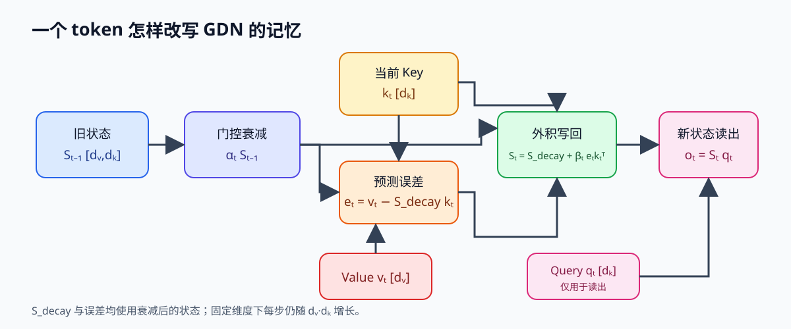

# Gated Delta Network（GDN）与 Qwen3.5 混合注意力

> 模型架构类 · 线性注意力 + 门控 + delta rule · Qwen3.5 是公开的大规模案例
> 挂靠：主线 B Qwen3.5 第 1-3 步 · 长上下文方案对比

---

## 解决了什么问题

对长度 N 的序列，稠密注意力需要处理随 N 平方增长的 Query–Key 对；自回归生成时，历史 KV 又占用随长度增长的缓存。线性注意力类递推把历史贡献压进固定维度状态，因此状态存储不随 N 增长；固定的是状态形状，不代表每步工作量为常数而与 head 维度无关，也不保证有限状态保留所有历史细节。

Gated DeltaNet 将门控遗忘与 delta rule 的误差更新结合，控制历史状态如何保留和修正。Qwen3.5 的部分公开配置进一步交错使用 GDN 与稠密注意力层；两类层的计算和存储应分别分析。

## 核心思路

### 1. 线性注意力的递推形式

先固定状态的方向：S 将 Key 空间映射到 Value 空间，因此形状为 [d_v,d_k]。下面给出 Gated DeltaNet 的一次更新，省略输入投影、卷积和归一化细节：

```text
每个 head 维护一个记忆矩阵 S: [d_v, d_k]

对每个 token:
  q, k ∈ R^{d_k}, v ∈ R^{d_v} = 输入 x 的投影
  S_decay = alpha × S         # 先做门控衰减
  e = v - S_decay @ k          # 衰减后状态对 v 的预测误差
  S ← S_decay + beta × e ⊗ k^T
  o = S @ q ∈ R^{d_v}          # 读出结果
```

合并写法是

$$
S_t=\alpha_t S_{t-1}(I-\beta_t k_tk_t^\top)+\beta_t v_tk_t^\top.
$$

沿一个 token 追踪这段式子：先以 `S_decay = alpha * S` 衰减旧记忆，再用 `S_decay @ k` 预测当前 value，误差 `e` 通过外积 `e ⊗ k` 写回状态。这里 `k` 决定沿哪个 key 方向修正，`e` 决定 value 方向修多少；`q` 只在状态更新后读取结果。固定维度下每步主更新约为 `O(d_v d_k)`，扫描 N 个 token 为 `O(N d_v d_k)`，不是不含维度的常数时间。



实现中应保持公式的计算次序：

~~~python
S_decay = alpha[..., None, None] * S
prediction = S_decay @ k[..., None]       # [d_v, 1]
error = v[..., None] - prediction         # [d_v, 1]
S = S_decay + beta[..., None, None] * error @ k[..., None, :]
out = (S @ q[..., None]).squeeze(-1)      # [d_v]
~~~

这段是按论文递推写出的短伪码，未包含实际实现的 head/batch 维、卷积、归一化与 fused scan。若把 `prediction` 改成旧状态 `S @ k`，就改变了 delta 更新，因为衰减会同时影响当前预测误差。

把 `e` 写成 `v-S@k` 后再做 `alpha*S+beta*e kᵀ` 会漏掉 `alpha` 作用于误差项前的事实；只有先得到 `S_decay=alpha*S`，上面的两步写法才与该公式一致。

关键性质：

- **复杂度 O(N)**：在 head 维度固定时，每 token 只做固定大小的矩阵运算，不需要和全部历史做点积
- **线性层不保存逐 token 的历史 KV**：decode 时携带固定大小的 S 和卷积状态；但混合架构中的 full-attention 层仍然需要自己的 KV cache

### 2. Gated Delta Network 的改进

普通线性注意力是把历史贡献累积到状态，GDN 将更新写成“保留旧状态 + 按误差修正”，并增加三类控制：

- **门控**：衰减系数控制旧状态的保留程度，更新系数控制当前误差的写入幅度；这些系数由模型计算，不是人工给 token 标注重要性。
- **delta rule**：先用衰减后的状态预测当前 Value，再沿 Key 方向写入预测误差。它改变状态的更新方式，并不增加状态矩阵的物理容量。
- **输入与输出处理**：具体模型还包含短卷积、Q/K 归一化和输出门控。它们影响局部信息、数值行为及读出，应与核心递推式区分。

GDN、Mamba 和其他线性注意力都可能把序列处理写成 scan，但不能因此互换更新公式。这里的 GDN 维护 `[d_v,d_k]` 的 delta-rule 状态；Mamba 则从输入生成 Δ、B、C，并把学习得到的 A 经 Δ 离散化为 dA。三者保存的状态含义和 scan 的组合规则需要分别说明。

### 3. Qwen3.5 的混合方案


Qwen3.5-397B-A17B 的公开配置包含 60 层，每四层中有三层 Gated DeltaNet 和一层 full attention。hidden state 按层顺序依次经过这两类模块；每个 GDN 层读取并更新自己的 recurrent/conv state，每个 full-attention 层读取其配置定义的历史 KV。训练共同形成各层表示，因此“哪类层负责召回”不能从层型或 3:1 比例直接推出。

- 总参 397B、激活 17B；MoE：512 routed experts + 1 shared，每 token 激活 10 个
- full attention 层维护自己的 KV cache；GDN 层维护固定形状的 recurrent state 与卷积状态
- 结果应按两类层分别计算：GDN 层的序列状态大小不随长度增长，full-attention 层仍按窗口/历史处理 KV；因此不能把整模型不加条件地写成“纯 O(N)”或“只有四分之一层有 KV 就等于四分之一缓存”。

## 关键数据与取舍

| 方案 | 长序列计算 | KV cache | 长程召回 |
|---|---|---|---|
| Full attention | O(N²) | 随 N 增长 | 可显式访问可见历史，效果依模型与任务 |
| 纯线性注意力 | 固定维度下 O(N) | 固定维度状态，不是逐 token KV | 受状态容量、更新规则与训练影响 |
| Qwen3.5 混合 3:1 | 线性层按 O(N) 扫描，整网需按 full-attention 层的可见范围计算 | 线性层保存 recurrent state，full-attention 层另有 KV | full-attention 层提供另一条精确注意力路径，但质量不能由层数比例单独保证 |

取舍：

- **比例 3:1 不是质量保证**：它描述配置中的层型频率。长程信息如何分配到各层由训练形成，召回质量要结合任务评测判断。
- **recurrent state 对批量不友好**：递推沿序列有依赖，训练和 prefill 需要 chunked/parallel scan；部署还要保存每个请求、每个线性层的状态。Transformers 官方实现提示快速路径依赖 `causal_conv1d` 和 `fla`，不同 serving 引擎的支持不能一概而论。
- **架构层选择，不是规模特例**：Qwen3.5-397B-A17B 的官方配置为 60 层、每 4 层一个 full-attention 层、512 个 routed experts、每 token 10 个专家；其它尺寸应以各自 checkpoint 的 `layer_types` 和 config 为准，不能由 397B 配置外推。

## 与我何干

- **理论线**：把"线性注意力"从 Mamba/SSM 一路接到 GDN；和 [MLA](mla-deepseek.md) 对比记：**MLA 压缩逐 token KV，GDN 在线性层改用固定状态**，但混合模型的 full-attention 层仍保留 KV。
- **C 阶段**：面试问"长上下文方案有哪些"，标准答法覆盖四类：KV 压缩（GQA/MLA/KV 量化）、稀疏注意力（DSA/Kascade）、线性注意力（Mamba/GDN）、系统技巧（chunked prefill/PD 分离）
- **算子线**：GDN 的 conv1d + 门控 + 状态递推是典型的 Triton 可写算子（B4 之后可以试），也是理解"attention 之外的算子"的好样本

## 求职核对题

- 给定 `S:[d_v,d_k]`、`q/k:[d_k]`、`v:[d_v]`，写出一次 gated-delta update 的读写 shape，并说明为什么它不能像 dense Attention 那样直接复用逐 token KV。
- Qwen3.5 的 60 层、每 4 层一次 full attention 时，线性状态与 full-attention KV 的生命周期分别是什么？不要把“3:1 层比例”直接当成显存比例。
- prefill 为什么需要 parallel scan，而 decode 可以沿单 token 更新？回答要指出两者共享的递推状态和不同的并行边界。

---

*配套：[模型追踪表](model-tracker.md) · [最新模型与结构](latest-model-architectures.md) · [DSA](dsa-sparse-attention.md) · [Gated Delta Networks 原论文](https://arxiv.org/abs/2412.06464) · [Qwen3.5 官方配置](https://huggingface.co/Qwen/Qwen3.5-397B-A17B/blob/main/config.json)*
