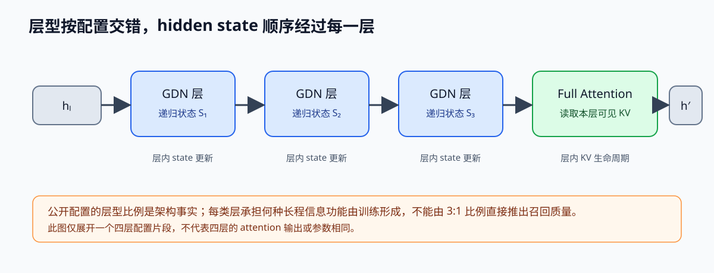
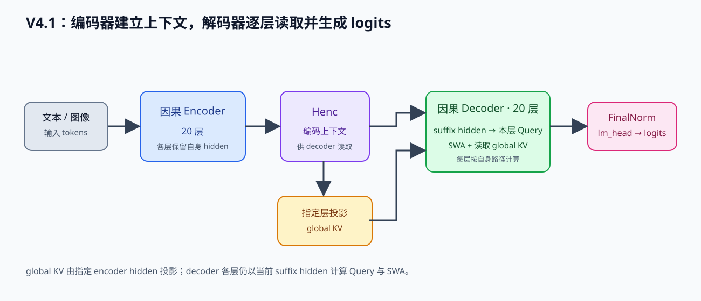

# 最新模型与结构：从基础设施视角读懂大模型架构

> 目标：不是背模型名字，而是能对着 HuggingFace config 读懂一个模型的 attention、norm、位置编码、FFN/MoE、KV cache 和推理代价。
> 定位：理论线“模型架构”主笔记，配套 [MoE 推理挑战](moe-inference.md)、[MLA](mla-deepseek.md)、[Flash Attention 机制](flash-attention-mechanism.md)。
> 状态：生成稿，需要逐节消化后才能算进度。

---

## 目录

1. [为什么 Infra 工程师要学模型结构](#1-为什么-infra-工程师要学模型结构)
2. [Transformer block 骨架](#2-transformer-block-骨架)
3. [组件拆解：Embedding / Norm / 位置编码](#3-组件拆解)
4. [Attention 家族：MHA / MQA / GQA / MLA](#4-attention-家族)
5. [FFN 与 MoE](#5-ffn-与-moe)
6. [SSM / Mamba 与混合架构](#6-ssm--mamba-与混合架构)
7. [现代模型常见“新零件”](#7-现代模型常见新零件的实现影响)
8. [KV cache 深挖](#8-kv-cache-深挖)
9. [模型家族地图](#9-模型家族地图)
10. [用 HuggingFace config 解码模型](#10-用-huggingface-config-解码模型)
11. [显存与 FLOPs 手算](#11-显存与-flops-手算)
12. [对推理系统的五个影响](#12-对推理系统的五个影响)
13. [怎么学：从 config 到 benchmark](#13-怎么学从-config-到-benchmark)
14. [面试高频题库](#14-面试高频题库)
15. [参考与配套材料](#15-参考与配套材料)
16. [2026 新架构：混合注意力与稀疏注意力](#16-2026-新架构混合注意力与稀疏注意力)

---

## 1. 为什么 Infra 工程师要学模型结构

面试和日常优化里，真正被反复追问的不是“这个模型叫 XX”，而是“这个结构会带来什么计算、显存、带宽代价”。

举例：

- GQA 和 MLA 为什么影响 Decode？当 KV 读取位于关键路径时，缓存字节数会影响访存时间与容量；权重流量、batch、算术强度和 kernel 也会共同决定结果。
- MoE 为什么难服务？因为激活参数少，但全部 expert 权重仍占显存；跨卡路由还会引入 AllToAll 通信。
- Mamba 为什么被讨论？它用输入选择的状态递推把扫描成本降为随序列长度线性增长；Attention、SSM、线性注意力有不同的状态和访问语义，混合模型也会保留部分 Attention 层。
- 为什么量化总是围绕 FFN 和 KV cache？因为权重读取和 KV cache 是 Decode 阶段最大的带宽来源。

所以这一篇不按“模型发布会”写，而是按“组件 + 模型家族 + 对推理系统的影响”写。

---

## 2. Transformer block 骨架

绝大多数 LLM 还是 Decoder-only Transformer。典型 pre-norm block 中，Attention 与 FFN/MoE 子层依次读取、更新同一条 hidden-state 流，各自有 residual 汇合：


整体模型通常由几十到上百个这样的 block 堆叠而成，前面有 token embedding，最后有 lm_head。

从 Infra 角度，这个 block 产生三类核心成本；瓶颈由实际形状和运行条件决定：

| 成本 | 来自哪里 | 典型瓶颈 |
|------|---------|---------|
| 激活计算 | Attention 的 QKᵀ/PV、FFN 矩阵乘 | 比较 FLOPs/byte 与硬件平衡点；长 prefill 常有较高算术强度 |
| 权重与 KV 读取 | FFN/attention 权重、历史 KV | 受 batch、上下文、复用、并行切分和互联影响 |
| KV 容量 | 每层缓存 K/V、latent 或递归状态 | 受层型、序列长度、并发和存储 dtype 影响 |

“Prefill 算力受限、Decode 带宽受限”适合作为待验证的起点。短输入、小 batch、跨卡通信、权重读取或 kernel launch 都可能改变瓶颈；判断时固定 batch、prompt/output 长度、并行策略与计时范围，再用 Roofline 和 profiler 数据核对。

---

## 3. 组件拆解

### 3.1 Token Embedding 与 lm_head

- 输入 token 通过 embedding 变成 `[seq_len, hidden_size]` 的向量。
- 最后用 lm_head 把 hidden state 映射回 vocab 概率。
- 很多模型做 tied embedding：embedding 和 lm_head 共享权重，省显存，但也不是所有模型都这么做。

Infra 影响：

- embedding/lm_head 的矩阵大小约 `vocab_size * hidden_size`，vocab 很大的模型（如多语言、多模态）权重占比不小。
- 推理时要算 `hidden @ lm_head^T`，输出层可能是 memory-bound。

### 3.2 Norm：LayerNorm vs RMSNorm

LayerNorm 会减去均值再除以方差；RMSNorm 只做缩放，不做减均值。

```text
LayerNorm: y = (x - mean) / sqrt(var + eps) * gamma + beta
RMSNorm:   y = x / sqrt(mean(x^2) + eps) * gamma
```

RMSNorm 省去均值中心化，只需归约平方均值并缩放。模型是否使用它是架构和训练选择，效果通过训练稳定性及任务评测判断。

- 少一次 mean 计算，reduce 更简单。
- 经验上训练稳定性够用。
- 算子侧对每行计算均方根并缩放，具体瓶颈取决于行宽、batch、融合方式和设备。

Infra 影响：

- Norm 常由输入读取与行规约组成；可考察减少往返、规约映射和与 residual 的融合。
- 手写 kernel 时，LayerNorm 需要算 mean 和 var；RMSNorm 只算 mean(x²)，代码更短。

### 3.3 位置编码：从绝对位置到 RoPE

Transformer 本身不知道 token 顺序，需要位置信息。

位置编码主要分几类：

| 类型 | 思路 | 例子 |
|------|------|------|
| Learned absolute | 学一个 position embedding | BERT、GPT-2 |
| Sinusoidal | 固定频率的三角函数 | 原始 Transformer |
| ALiBi | 在 attention score 上加线性偏置 | BLOOM、部分 MPT |
| RoPE | 把 Q/K 按位置旋转 | LLaMA、Qwen、Mistral、DeepSeek |

RoPE 的思路：把 Q/K 的向量在高维空间里按位置旋转，让两个位置的距离体现在点积上。

```text
score(q, k, pos_q, pos_k) 里，实际计算 q^T R(pos_q - pos_k) k
```

Infra 影响：

- RoPE 只影响 Q/K，不需要额外大矩阵。
- 支持“外推”：训练短上下文，推理长上下文，但要配合插值/NTK 等方法。
- 很多长上下文优化都和 RoPE 的缩放策略有关。
- 实现上 RoPE 是 elementwise 旋转 + 合并，是简单但容易写错的算子。

### 3.4 Attention 家族

数学核心都一样：

```text
score = QK^T / sqrt(d)
weight = softmax(score)
out = weight @ V
```

区别在 K/V 是否被多个 query head 共享：

| 变体 | K/V head 数 | KV cache 趋势 | 代表 |
|------|------------|--------------|------|
| MHA | 每个 query head 一组 K/V | 基准取决于 H 个 KV heads | 早期 GPT、BERT |
| MQA | 所有 query head 共享一组 K/V | KV heads 最少；质量取决于训练与适配 | PaLM 等 |
| GQA | 一组 K/V 供多个 query heads 使用 | 介于 MHA 与 MQA，取决于组数 | LLaMA 2/3、Qwen、Mistral |
| MLA | 多个 head 共享低秩 KV latent，另有位置相关分支 | 取决于 latent/RoPE 宽度、dtype 和布局 | DeepSeek-V2/V3 |


KV cache 大小估算：

```text
KV_bytes = 2 * num_kv_heads * head_dim * seq_len * num_layers * dtype_bytes
```

缓存示例应固定 head dimension、层数、上下文长度、并发和 dtype，再按 head 数核算；模型名本身不足以确定字节数。

对推理的意义：

- Decode 是逐 token 生成，每个 token 都要读已生成的 KV。
- KV cache 越小，单卡能服务的并发越高，PagedAttention 的 block 管理也越轻松。
- MLA 的朴素参考路径会逐历史位置恢复完整 K/V；高效 Decode 可把内容 Key 投影吸收到 Query 侧，把 Value 投影吸收到输出侧，并保留独立 RoPE 分支。额外计算和速度收益应按具体权重形状、kernel 与硬件核算。

GQA/MLA 改变 KV 的共享方式或缓存表示。FlashAttention 是 IO-aware 的计算算法与 kernel 实现，可配合不同 attention 结构；它与 MHA→MQA→GQA 的变化属于不同维度，不能排成一条结构演进链。

### 3.5 FFN 与 SwiGLU

标准 FFN：

```text
FFN(x) = act(x @ W_up) @ W_down
```

SwiGLU 是当前最常用的门控变体：

```text
gate = x @ W_gate
up = x @ W_up
SwiGLU(x) = (silu(gate) ⊙ up) @ W_down
```

这里 `gate` 经 SiLU 后与 `up` 做逐元素乘法；有些实现交换投影变量名，按实际乘法式辨认两支。

为什么 FFN 重要：

- FFN 通常占模型参数的一半以上。
- 每个 token 都要过 FFN，是 Decode 阶段权重读取的主要来源。
- 量化、稀疏化、MoE 都先拿 FFN 开刀，因为收益最大。

### 3.6 MoE

MoE 把一个大 FFN 拆成多个 expert：

```text
router(x) 选出 top-k expert
输出 = sum(router_prob[i] * expert_i(x))
```

MoE 的 Infra 关键点：

- 激活计算少：每个 token 只走 top-k 个 expert。
- 权重容量：完整 expert 集合要有存储位置；全 GPU 常驻时占用设备显存，容量不足也可 offload，代价是路由后的传输与预取。
- 路由不均衡：有些 expert 忙、有些闲，需要 auxiliary loss 或调度手段。
- 跨卡推理：expert 放在不同 GPU 上时，token 要 AllToAll 到对应卡。

详细内容见 [MoE 推理挑战](moe-inference.md)。

### 3.7 SSM / Mamba

连续状态空间模型可以写成：

```text
h'(t) = A h(t) + B x(t)
y(t) = C h(t)
```

优势：

- 固定状态维度时，扫描工作量随序列长度线性增长；完整 self-attention 的 prefill 交互量则随可见 token 对增加。
- 这一层的推理状态不保存逐 token KV；若模型混合了 attention 层，那些层仍有自己的 KV cache。

代价：

- 状态容量有限，长距离记忆不一定比 Attention 强。
- 当前主流的做法是混合架构，例如部分层用 Attention，部分层用 SSM。
- Mamba 的 selective scan 在 GPU 上不是天然易写，需要专门 kernel。

代表：Mamba / Mamba-2、Jamba（SSM + Attention 混合）、RWKV、xLSTM。

### 3.8 现代模型常见“新零件”

| 概念 | 一句话 | Infra 影响 |
|------|--------|-----------|
| MTP / Multi-Token Prediction | 一次预测多个未来 token | 训练和投机解码相关 |
| MoD / Mixture-of-Depths | 不是每个 token 都经过每一层 | 减少激活计算，但调度和 kernel 更复杂 |
| Sliding Window Attention | 只看附近窗口，限制 attention 范围 | 显存和计算降为 O(seq)，但长距离能力下降 |
| Cross-Attention | query 来自一个模态/序列，K/V 来自另一个 | 多模态、RAG、encoder-decoder 都会用到 |
| KV cache 压缩/量化 | 把 K/V 用更低精度或低秩存 | 省显存，可能掉精度 |
| Speculative Decoding | 小模型先 draft，大模型再 verify | 降低 Decode 延迟，见 [投机解码](speculative-decoding.md) |
| Ring Attention | 长序列时把 attention 分块并流水通信 | 解决单卡放不下完整序列 |

---

## 4. Attention 家族

### 4.1 形状对照

假设 `H` 个 query head，每个 head 维度 `d`，GQA 组数 `G`：

| 变体 | Q shape | K/V head 数 | 每 token KV 参数量 |
|------|---------|-------------|---------------------|
| MHA | `[H, d]` | `H` | `2 * H * d` |
| MQA | `[H, d]` | `1` | `2 * d` |
| GQA | `[H, d]` | `G` | `2 * G * d` |
| MLA | `[H, d]` | latent `d_c` 与 RoPE `d_r` | `d_c + d_r` 元素/每层每 token |

### 4.2 KV cache 计算公式

```text
KV_bytes = 2 * num_kv_heads * head_dim * seq_len * num_layers * dtype_bytes
```

例子：`seq=4096, layers=32, head_dim=128, fp16`

| 变体 | num_kv_heads | KV |
|------|-------------|-----|
| MHA | 32 | `2*32*128*4096*32*2 = 2 GiB` |
| GQA(8) | 8 | `2*8*128*4096*32*2 = 512 MiB` |
| MQA | 1 | `2*1*128*4096*32*2 = 64 MiB` |
| MLA(latent=512, RoPE=64) | 1 latent + 1 RoPE 向量 | `(512+64)*4096*32*2 = 144 MiB` |

> 该教学算例把每个元素按 2 bytes 计，不含页表、scale 与运行时对齐等开销；实际配置应从 latent/RoPE 宽度和缓存 dtype 逐项核算。

### 4.3 为什么 GQA/MLA 对 Decode 重要

Decode 每生成一个 token：

- 只需要新 token 的 Q。
- 需要读取全部历史 K/V。
- 因此更紧凑的 KV 表示会减少对应的缓存流量；端到端吞吐仍受权重读取、batch、投影和 kernel 效率影响。

这也是“KV cache 是并发上限”的原因。

---

## 5. FFN 与 MoE

### 5.1 参数占比

一个 7B 模型里，FFN 通常占大头：

```text
attention 参数 ≈ 4 * hidden_size^2
FFN 参数（SwiGLU）≈ 3 * hidden_size * intermediate_size
```

`intermediate_size` 通常是 `hidden_size` 的 2-4 倍，所以 FFN 更重。

### 5.2 MoE 的推理账本

假设模型有 `E` 个 expert，每个 token 激活 top-k：

| 项目 | 数量 |
|------|------|
| 总权重 | `E * expert_size`，全部要放显存 |
| 每个 token 激活 | `k * expert_size` |
| 跨卡路由 | AllToAll，通信量与 token 数量、expert 分布有关 |
| 负载均衡 | 需要 auxiliary loss 或调度约束 |

面试重点：

- “MoE 参数量大”不等于“推理计算量大”。
- 显存瓶颈仍在权重，计算瓶颈只在激活 expert。
- Expert parallelism 和 Tensor Parallelism 的取舍要看通信拓扑。

### 5.3 路由公式

```text
logits = x @ W_router
probs = softmax(logits)
topk_indices = argmax_k(probs)
output = sum_i probs[topk_i] * expert_i(x)
```

---

## 6. SSM / Mamba 与混合架构

<span id="61-状态方程" aria-hidden="true"></span>

### 6.1 连续状态方程与离散更新

```text
h'(t) = A h(t) + B x(t)
y(t) = C h(t)
```

- `A` 决定连续系统的状态转移，`B` 把输入写入状态，`C` 从状态读出结果。离散化后另有 `dA`、`dB` 等 token-step 系数。
- 长度为 N 的序列被压入固定形状的状态；状态大小不随 N 增长，计算仍随状态维度增加。

<span id="62-mamba-的关键点" aria-hidden="true"></span>

### 6.2 Mamba 的输入选择与离散状态更新

在作者的 `mamba_ssm/modules/mamba_simple.py` 中，`x_proj` 把输入特征投影后拆成 `dt` 的低秩表示、`B` 与 `C`；独立学习参数 `A_log` 则构造 `A = -exp(A_log)`。可以把实现主线写成：

```python
dt_low_rank, B, C = split(x_proj(u), [dt_rank, d_state, d_state])
delta = softplus(dt_proj(dt_low_rank) + dt_bias)
A = -exp(A_log)
dA = exp(delta * A)
dB = delta * B
```

输入产生 token-dependent `Δ_t/B_t/C_t`，而连续系统的 `A` 保持为学习参数。代码块只摘录分支关系和主要运算，未复制作者内核实现。

简化离散关系为：

$$
\Delta_t=\operatorname{softplus}(W_\Delta u_t+b_\Delta),\quad
dA_t=\exp(\Delta_t A),\quad dB_t\approx\Delta_t B_t,\quad
h_t=dA_t\odot h_{t-1}+dB_t\odot u_t,\quad y_t=C_t h_t.
$$

`u_t` 表示输入投影及局部卷积后的特征。`dA_t` 是离散状态更新系数，与参数 `A` 分属连续系统和 token 更新两层。作者的 fused selective-scan 路径会实现并融合这些运算；此处的式子用于解释参数依赖关系。来源：[官方 Mamba 实现](https://github.com/state-spaces/mamba/blob/main/mamba_ssm/modules/mamba_simple.py)。


Mamba-2 的结构化状态空间对偶给出 SSM 与 attention-like 计算之间的数学联系；这不等于 SSM 都是线性 Attention。混合模型里模块分工与信息保留由训练形成，不能仅凭层数比例预测质量。

### 6.3 Infra 影响

- SSM 将逐 token 历史缓存替换为递归状态；状态更新、序列 scan 与完整 Attention 的成本仍取决于状态维度、chunking 和硬件，kernel 常需 scan 专用实现。
- 现有 serving 框架对 SSM 的支持比 Attention 少，需要看具体后端。
- 面试不要只说“线性复杂度”，要能讲状态容量和 kernel 复杂度。

---

## 7. 现代模型常见“新零件”的实现影响

这些结构经常一起出现，不能只背名字：

- **MTP / Multi-Token Prediction**：训练时一次预测多个未来 token；推理时可配合 speculative decoding 提高吞吐，代价是训练目标和服务结构更复杂。
- **MoD / Mixture-of-Depths**：router 决定 token 是否跳过某层；省激活计算，但 serving 调度和 kernel 负载更难预测。
- **Sliding Window Attention**：每个 token 只看固定窗口，KV cache 和计算线性化；长距离信息靠多层堆叠或额外全局 token 补偿。
- **Cross-Attention**：query 来自当前序列，K/V 来自上下文/另一个模态；多模态和 RAG 常见，KV cache 管理和 multimodal batching 更复杂。
- **KV cache 压缩/量化**：GQA/MLA 之外的低成本手段，但每层敏感度不同，需要校准和精度测试。
- **Speculative Decoding**：draft 模型生成多个候选，目标模型一次验证；收益依赖接受率，见 [投机解码](speculative-decoding.md)。
- **Ring Attention**：长序列分块后跨设备流水传递 KV，把显存压力转成通信压力。

---

## 8. KV cache 深挖

<span id="81-为什么-kv-cache-是瓶颈" aria-hidden="true"></span>

### 8.1 何时 KV cache 会成为瓶颈

- Prefill 对长输入通常有较高算术强度；短输入、小 batch、权重读取或跨卡通信可改变主导瓶颈。
- Decode 每步读取可见历史 KV；当这部分流量进入关键路径时，KV dtype、head 数/latent 宽度和读取布局会影响时间及并发容量。
- KV 容量影响可容纳并发数；实际延迟还会随 batch、序列长度、调度和 kernel 改变。

### 8.2 PagedAttention 与 block table

- 传统 KV cache 是连续分配，容易碎片化。
- PagedAttention 把 KV 切成固定 block，用 block table 管理虚拟到物理映射。
- 支持 prefix sharing 和 copy-on-write，让多轮对话/RAG 复用前缀。

详细见 [PagedAttention 论文笔记](../../papers/inference/paged-attention.md)。

### 8.3 KV cache 优化方向

| 方向 | 思路 | 代价 |
|------|------|------|
| GQA/MQA | 减少 KV head | 表达能力略降 |
| MLA | 低秩压缩 | 增加投影计算 |
| 量化 | INT8/FP8 存 KV | 精度损失，需校准 |
| 驱逐/压缩 | 丢弃旧 token、摘要历史 | 信息丢失 |
| prefix cache | 复用相同前缀 | 管理复杂度 |

---

## 9. 模型家族地图

> 截止 2026-08，闭源模型内部细节以官方技术报告为准。下面的表格重点列“公开可验证的组件”和“推理影响”，不猜未公开实现。

| 家族 | 公开度 | 关键结构 | 对 Infra 的启示 |
|------|--------|---------|----------------|
| LLaMA | 开源权重 | Dense Transformer；GQA、RoPE、SwiGLU、RMSNorm；新一代开始走 MoE/多模态 | 最常用的学习样本，config 简单，适合手写推理和对比 kernel |
| Qwen | 开源权重 | Dense 和 MoE 路线都有；GQA、SwiGLU、RoPE | 适合练多尺寸模型、量化、vLLM 部署 |
| DeepSeek | 开源权重/论文 | MLA + DeepSeekMoE；V3 用 FP8 训练；R1 用强化学习 | MLA 和 MoE 是当前最重要的两个结构考点 |
| Mistral / Mixtral | 开源权重 | GQA、sliding window attention、MoE | sliding window 和 MoE 是面试常考实现 |
| GPT / o-series | 闭源 | Decoder-only Transformer；o-series 增加推理时思考；公开结构信息有限 | 面试关注训练后 RL、推理时 token 预算、服务 API，不猜内部 |
| Claude | 闭源 | 未见完整结构公开；核心是 Transformer 路线 + 训练后对齐 | 关注长上下文、工具调用、服务形态 |
| Gemini | 闭源为主 | 多模态 Transformer；规模化 MoE/TPU 路线 | 关注多模态输入、长上下文、分布式训练视角 |
| Mamba/Jamba/RWKV | 部分开源 | SSM 或 SSM+Attention 混合 | 关注线性时间推理、长序列、混合架构取舍 |

学习建议：不要平均用力。先精读 LLaMA 和 DeepSeek，因为它们把 GQA、SwiGLU、MLA、MoE 都摊开了；闭源模型只用来做“业界趋势”和面试叙事。

---

## 10. 用 HuggingFace config 解码模型

打开模型 config，重点看这些字段：

| 字段 | 含义 | 影响 |
|------|------|------|
| `hidden_size` | 每层 hidden 维度 | 显存、FLOPs 基础 |
| `num_hidden_layers` | 层数 | KV cache、延迟 |
| `num_attention_heads` | query head 数 | 计算并行度 |
| `num_key_value_heads` | KV head 数 | KV cache 大小 |
| `head_dim` | 每个 head 维度 | QK^T 计算量 |
| `intermediate_size` | FFN 中间维度 | 权重、显存 |
| `num_experts` / `num_experts_per_tok` | MoE 配置 | 权重、路由、通信 |
| `rope_theta` | RoPE 频率 | 长上下文外推 |
| `vocab_size` | 词表大小 | embedding/lm_head 大小 |

最小练习：

```python
# 用 HF 读结构，不训练只分析
from transformers import AutoConfig
cfg = AutoConfig.from_pretrained("meta-llama/Llama-3.1-8B-Instruct")
print(cfg.num_attention_heads, cfg.num_key_value_heads, cfg.num_hidden_layers)
print(cfg.hidden_size, cfg.intermediate_size)
```

然后手算：

```text
seq = 4096, layers = 32, GQA 8 组, head_dim = 128, fp16
KV = 2 * 8 * 128 * 4096 * 32 * 2 bytes = 512 MB
```

这个数能直接解释“为什么长上下文必须做 KV 优化”。

---

## 11. 显存与 FLOPs 手算

### 11.1 推理显存三部分

```text
总显存 ≈ 权重 + KV cache + 激活/临时 buffer
```

### 11.2 Decode 单 token 读取量

```text
每 token HBM 读取 ≈ 全部权重 + 全部 KV
```

所以 Decode 的优化就是两条路：

- 把权重变小：量化、稀疏、MoE 激活稀疏。
- 把 KV 变小：GQA/MLA、KV 量化、prefix cache。

### 11.3 Prefill FLOPs 估算

```text
Attention FLOPs ≈ 4 * seq^2 * head_dim * layers（粗略）
FFN FLOPs ≈ 2 * token * hidden * intermediate * layers * 3（SwiGLU 粗略）
```

面试只要能说清“Attention 随 seq²，FFN 随 token 数线性”就够了。

---

## 12. 对推理系统的五个影响

### 12.1 KV cache 决定并发上限

```text
单请求 KV = 每层 KV head 数 * head_dim * seq_len * 2 * layer 数 * dtype_bytes
```

GQA/MLA 可降低每 token KV 容量，影响并发上限、PagedAttention 分配和 prefix cache 容量；实际 TTFT/TPOT 还取决于调度与关键路径。

### 12.2 MoE 决定权重显存和通信

MoE 模型“总参数大，激活参数小”。服务时：

- 单卡放不下所有 expert，通常要 tensor parallel 或 expert parallel。
- 跨卡路由有 AllToAll，延迟取决于通信拓扑。
- 量化 MoE 时，router 精度要保，expert 可以更激进。

### 12.3 Attention 变体决定 Decode 带宽

小 batch、长历史时，Decode 可能受权重与 KV 读取限制；固定配置下可先比较：

```text
算术强度 = FLOPs / 实际读写字节数
```

GQA 与 MLA 以不同机制改变 KV 表示；FlashAttention 改变分块计算和中间状态驻留。几种方法可以组合，比较时固定 batch、序列形状、精度与硬件。

### 12.4 长序列结构决定是否能线性扩展

标准全局 Attention 的 prefill 成对交互量随序列长度平方增长，常规 KV cache 容量则随缓存 token 数线性增长。百万级上下文需要分别控制计算、容量和搬运：

- Flash Attention / Ring Attention
- 分块 prefill / chunked prefill
- 线性注意力或 SSM 结构

### 12.5 位置编码和归一化决定算子形状

RoPE 引入 Q/K 的旋转操作，RMSNorm 引入 row-wise reduce。两者都会落到具体 kernel 优化，也解释了为什么 Triton/CUDA 里 softmax、reduce、elementwise 算子这么重要。

---

## 13. 怎么学：从 config 到 benchmark

推荐一条可执行路径：

1. 打开一个开源模型 config，找出 `num_attention_heads`、`num_key_value_heads`、`num_hidden_layers`、`hidden_size`、`intermediate_size`、`num_experts`。
2. 读模型代码，定位 attention、norm、FFN/MoE 的调用链。
3. 手算三层账：KV cache 大小、激活显存、单 token Decode 的 HBM 读取量。
4. 用一个小模型跑 forward，对比 PyTorch / vLLM 的输出和显存。
5. 对其中一个组件写简化实现：GQA 或 MoE 路由或 RoPE。
6. 用 vLLM benchmark 记录 TTFT / TPOT / 并发。

---

## 14. 面试高频题库

### 14.1 GQA 为什么比 MHA 省显存？

“KV cache 按 KV head 数增长。GQA 让多个 query head 共享一组 K/V，所以 KV cache 大致从 H 降到 H/G，Decode 阶段每 token 读取的 KV 字节也按比例减少。”

### 14.2 MLA 和 GQA 的区别？

“GQA 仍按 token 存完整 K/V，只是减少 KV head 数；MLA 缓存共享 latent 与独立位置分支，Decode 可把内容 Key 投影吸收到 Query、Value 投影吸收到输出侧，避免逐历史位置展开完整 K/V。”

### 14.3 MoE 为什么推理难？

"MoE 的单 token 只计算被选专家；完整专家权重需要有存储位置，全 GPU 常驻会占设备显存，offload 会加入传输路径。跨卡路由还要统计 dispatch/combine 和负载尾部。"

### 14.4 Mamba 能替代 Attention 吗？

“在长序列和低内存上有优势，但状态容量有限，不能简单认为所有场景都赢；当前更多是 Attention + SSM 混合。”

### 14.5 RoPE 为什么能外推？

“RoPE 把位置信息编码成旋转角度，相对位置差可以写成旋转矩阵差；直接外推会掉精度，所以要配合插值、NTK 或 YaRN。”

<span id="146-为什么-decode-是-memory-bound" aria-hidden="true"></span>

### 14.6 Decode 什么时候受带宽限制？

“单 token、小 batch、长历史时，权重与 KV 读取可能主导关键路径。增大 batch 会摊薄权重读取并增加并发 KV 工作；用固定 shape 的 FLOPs/byte 和 profiler 判断。”

### 14.7 为什么 MoE 权重量化比 Dense 更敏感？

“router 决定 token 去哪个 expert，router 错了整个输出就偏了；expert 内部可以更激进量化，router 需要保精度。”

### 14.8 长上下文为什么难？

"全局 Attention 的 prefill 成对交互量随 seq²，逐 token KV 容量随 seq 线性增长。FlashAttention 改分块执行，PagedAttention 改分配布局，稀疏或状态递推改变历史访问/表示；按瓶颈选择方法。"

---

## 15. 参考与配套材料

- [MoE 推理挑战](moe-inference.md)
- [MLA（DeepSeek）](mla-deepseek.md)
- [Flash Attention 机制](flash-attention-mechanism.md)
- [剩余理论主题速览](remaining-theory-primer.md)
- [模型追踪表](model-tracker.md)
- AIInfraGuide 的 Transformer 与 GPU 章节，见 [roadmap/ai-infra-curriculum.md](../../roadmap/ai-infra-curriculum.md)

---

<span id="16-2026-新架构混合注意力与稀疏注意力" aria-hidden="true"></span>

## 16. 代表性混合注意力与稀疏注意力设计

本节按论文年份与对应配置记录结构变化。以下方法面向不同环节，不能合并成一条统一的 Attention 代际路线。

### Qwen3.5：GDN 线性注意力混合（省 KV + 近线性长序列）

- 60 层 = 15 组 ×（3 GDN + 1 full attention）；512+1 experts、每 token 激活 10 个；397B 总参 / 17B 激活
- 每个 GDN 层维护 recurrent state 与卷积状态；full-attention 层维护自己的 KV。hidden state 按层序传递，3:1 层比描述配置，不单独保证召回质量
- 
- 推理影响：长上下文成本接近线性，但 recurrent state 对 prefill 批量不友好（需要 chunked / parallel scan）
- 详细：[GDN（Qwen3.5）](gdn-linear-attention.md)

### DeepSeek-V3.2：MLA + DSA（压 KV + 只算 top-k）

- 官方 `config_671B_v3.2.json` 用于核对模型结构；激活参数口径与总参数计数应按各自报告来源读取。MLA 压缩缓存表示，DSA indexer 对可见历史选位置供主 Attention gather
- indexer 仍处理可见历史，选中后主 Attention 只 gather 所选位置；主分支的选中规模不代表全路径复杂度，部署支持按具体框架版本和模型配置确认
- 详细：[DSA](dsa-sparse-attention.md)

### DeepSeek-V4：CSA + HCA（MLA 骨架 + 压缩稀疏）

- V4 技术报告（arXiv:2606.19348，2026）：Pro 1.6T / 49B 激活，Flash 284B / 13B 激活，报告支持 1M 上下文；此处数字采用论文报告口径。
- 注意力 = **CSA + HCA 混合**，保留 MLA 低秩 latent 骨架：
  - **CSA（压缩稀疏注意力）**：每 m=4 个 token 用重叠窗口（2m）+ joint softmax 压成 1 个 compressed entry；Lightning Indexer 打分选 top-k（Pro k=1024 / Flash k=512）；核心 attention 是 shared-KV 多 query，所有 head 共用同一组压缩 KV
  - **HCA（压缩稠密注意力）**：m'=128、无 indexer，对全部 HCA compressed entries 做 dense attention；每个 entry 仍是压缩表示，不保证精确恢复原 token 细节
  - 每层另留最近 128 个未压缩 token 的滑窗分支（`sliding_window=128`）
- 层排布：V4-Pro 61 层 + MTP，前 2 层 HCA、之后 CSA/HCA 交替；V4-Flash 43 层，报告配置前 2 层为纯 SWA，其余采用 CSA/HCA 混合。具体层型以 checkpoint config 为准。
- 1M 上下文账（V4 报告 Figure 1）：相对 V3.2，Pro 单 token FLOPs 约 27%、KV cache 约 10%；Flash 约 10% / 7%。这是论文长上下文比较口径，不代表所有 shape 的服务延迟。
- 同代配套：partial RoPE（只旋最后 64 维）、attention sink（每 head 可学习 logit）、grouped output projection（组内 bottleneck 1024）、mHC 流形约束超连接（4 条残差流 + 双随机 B 矩阵）、Muon 优化器（替代 AdamW 大矩阵部分）、MoE 权重 MXFP4（E2M1）QAT + 非专家 FP8 + KV 混合精度
- 推理侧：报告介绍 MegaMoE2 专家波次调度、TileLang 融合 kernel、batch-invariant kernel 与磁盘 KV / SWA 存储取舍；速度数字和实现边界见 [DeepSeek-V4 专题](deepseek-v4.md)
- 注意：V4 config 与 V3.2 不兼容（无 `kv_lora_rank`，改用 `compress_ratios`），不要把 V3.2 手算公式直接套 V4
- 详细：[DeepSeek-V4（CSA + HCA）](deepseek-v4.md) · 对照基准：[DeepSeek-V3.2 / DSA](dsa-sparse-attention.md)

### 注意力实现侧同步更新

- FlashAttention-4（arXiv:2603.05451，2026-03-05）与 FlexAttention：FA4 是面向特定硬件的注意力 kernel/backend；FlexAttention 表达 score 与 mask 规则。它们改变计算实现，不改变 GQA 的 head-sharing 定义 → [FA4 + FlexAttention](fa4-flexattention.md)
- SageAttention3（arXiv:2505.11594，2025）：用 NVFP4 微缩放执行低精度注意力矩阵乘，并处理中间概率块的缩放与精度；4-bit payload 不等于总 HBM 字节或时间缩为四分之一 → [SageAttention3 与 Kascade](attention-2026-sage3-kascade.md)
- Kascade（arXiv:2512.16391，2025；[作者仓库](https://github.com/microsoft/kascade)）：anchor 层产生 top-k 位置，后续层复用该索引映射以省重选开销；稀疏 mask 仍改变各层的实际访问集合 → [SageAttention3 与 Kascade](attention-2026-sage3-kascade.md)

### DeepSeek-V4.1-Flash（arXiv:2609.19969，2026）

V4.1 把图文输入编码、跨层 global KV、逐层 SWA、稀疏选择、条件记忆和 speculative draft 放进一套模型与服务设计。CED 的 encoder 输出为 decoder 每层独立投影 global KV；decoder 的局部 SWA KV 仍由各层 hidden state 生成，缺失时用 bounded replay 近似恢复。CSA2 再分别控制 global KV 来源和 Top-K 索引是否共享。



同一报告还讨论 Single-Pass mHC、Engram、DSpark、FP4 main KV、训练共享状态和异步后训练。这些机制分别改变 residual mixing、条件记忆、候选验证、缓存表示与训练数据流，细节见 [V4.1 技术报告](https://arxiv.org/abs/2609.19969) 和 [DeepSeek API 2026-09-10 更新](https://api-docs.deepseek.com/news/news260910/)。
