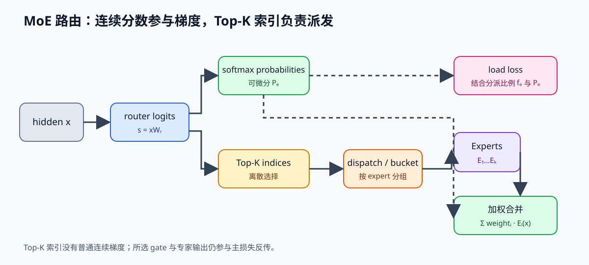
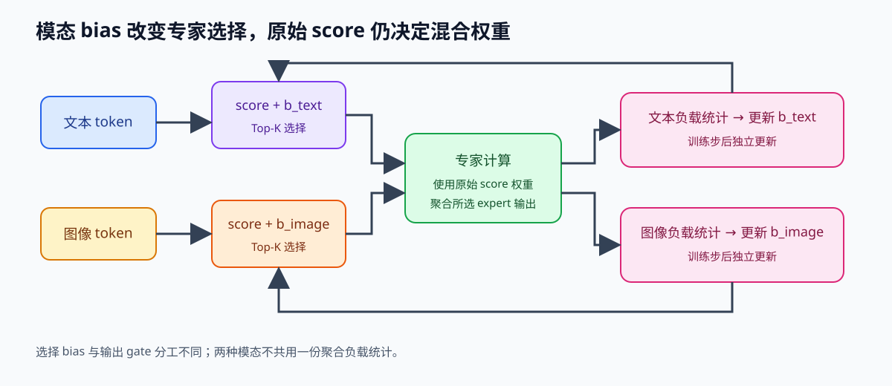
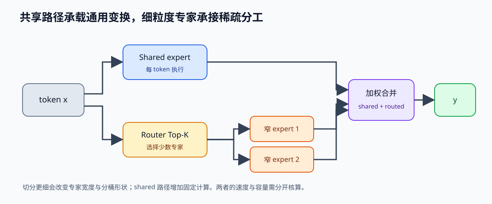

# MoE（混合专家模型）推理挑战

> 模型架构类 · 从路由、专家计算和通信理解 MoE 推理路径

---

## 解决了什么问题

**为什么大模型要用 MoE？**  
稠密（dense）模型在每个 token 上调用同一层的全部前馈网络参数；混合专家（MoE，Mixture of Experts）把这层拆成多个专家（expert），由路由器（router）为每个 token 选择少数专家。于是总参数容量可以增长，而单个 token 参与的专家矩阵乘数量由路由选择决定；这只描述计算路径，不等于未选专家不需要存储或不产生调度成本。

| 模型 | 总参数 | 激活参数 | KV Cache 大小 |
|------|:------:|:--------:|:------------:|
| LLaMA 3 70B (dense) | 70B | 70B | 由层数和 KV head 决定 |
| Mixtral 8×7B | 47B | 约 13B | 由层数和 KV head 决定 |
| DeepSeek-V3 | 671B | 约 37B | 由 MLA/层配置决定 |

**MoE 的推理挑战**：总专家参数可能超过单卡容量，且一个 batch 内的 token 会被分散到不同专家。执行器必须先按专家编号重排 token，再运行不同大小的专家 GEMM，最后按原 token 顺序合并；专家放置跨设备时还要加入 dispatch/combine 通信。是否更快取决于这些步骤与稠密基线的关键路径比较，而不是只看激活参数量。

---

## 核心思路

### 1. Expert Routing 机制

每个 token 经过一个 Router（小型线性层，通常产生路由分数），再按目标模型定义选择 Top-K 专家。下面的 Top-2 仅是示例，实际 K、归一化和共享专家规则必须从模型配置/论文读取：

```python
# Router: [d_model] → [num_experts]
router_logits = x @ W_router                    # [seq_len, num_experts]
top_k_scores, top_k_indices = topk(router_logits, k=2)  # Top-2

# Gating（每个专家的贡献权重）
gates = softmax(top_k_scores)   # [seq_len, 2]

# 路由：将每个 token 发到对应专家
output = sum(gates[t][i] * Expert[top_k_indices[t][i]](x[t]) for i in range(k))
```

路由里有一个训练时容易混淆的边界。`router_logits = x @ W_router` 与 softmax 概率对 logits 可微，所选专家的加权输出也把梯度传回被选中的专家和对应 gate；离散的 `topk_indices` 本身没有普通连续梯度，未选专家不会因为该 token 的主任务损失直接收到这条路由梯度。训练因此还需要处理专家负载，否则少数专家可能长期拥挤、另一些专家很少更新。

常见辅助负载损失会把硬路由占比和可微的平均概率结合，例如 `L_balance ∝ E · Σ_e f_e P_e`，其中 `f_e` 是分派到专家 e 的 token 比例，`P_e` 是 batch 中对专家 e 的平均 router probability。`f_e` 通常由离散分派统计，`P_e` 可对 router logits 反向传播。这个式子说明梯度如何推动概率分布趋于均衡；具体论文可能另加 z-loss、序列级损失或容量规则，不能把这一示例当所有 MoE 的训练目标。



可以把当前 batch 的执行压缩成下面的形状账：`topk_indices/topk_weights` 为 `[T,K]`，分桶后每个专家收到 `T_e` 行 `[D]`；专家输出按原 token 与 top-k 槽位恢复，再按 gate 加权求和。模型实现还可能对概率重新归一化、加入共享专家，或采用不同的溢出路径。

```python
logits = x @ W_router                         # [T, E]
weights, expert_ids = logits.softmax(-1).topk(K, dim=-1)  # [T, K]
tokens_by_expert = stable_bucket(x, expert_ids)           # each expert: [T_e, D]
y_slots = run_expert_grouped_gemm(tokens_by_expert)       # restore [T, K, D]
y = (weights[..., None] * y_slots).sum(dim=1)             # [T, D]
```

这是路由数据流的解释性伪码，不规定某个框架的 API，也没有覆盖 capacity、padding 或 fused grouped GEMM。

**问题 1：专家利用率不均（load imbalance）**  
如果大部分 token 都路由到少数几个热门专家，分桶后的 token 数就会偏斜：热门专家的 GEMM 排队，其他设备空闲，尾部完成时间由最慢的桶决定。均匀路由只改善一种负载形状，不能保证专家 GEMM 的矩阵尺寸已经适合硬件。

**负载均衡与容量不是同一机制**：
- **辅助损失**通过训练梯度改变 router 的概率与后续分派倾向。损失系数过大也会和主任务竞争；它不保证任意 batch 都均匀，也不能在推理时自动修复已经形成的路由偏斜。
- **无辅助损失的负载调节**也存在，例如按专家维护 bias 并根据近期负载更新。bias 可影响 Top-K 选择，而最终混合权重仍可能使用原 router score；这种更新不等同于对 `topk_indices` 反向传播。
- **Expert capacity**限制某批次每个专家可接收的 token 数。超过容量后的处理属于模型/实现语义：有的配置会丢弃溢出 token，有的尝试次选专家或保留残差路径；训练与推理必须使用兼容的规则。不能只说“有 capacity”，就推断一定丢 token 或一定保留输出。

DeepSeek-V4.1 报告给出多模态路由的具体设计例子：图像 token 与文本 token 各自使用独立的专家选择 bias，训练步后按本模态负载更新；混合输出仍用原 router scores 计算权重。校正 bias 调整选择集合，原始分数控制所选专家的贡献。



### 2. Expert Parallelism（EP）

MoE 天然支持跨 GPU 分布：每个 GPU 负责一部分专家。

```
4 GPU × 8 experts = 32 experts total
GPU 0: Expert 0-7
GPU 1: Expert 8-15
...

问题：token 要到它被路由的那个 GPU 上计算
解法：AllToAll 通信（每个 GPU 把 token 发给对应的 GPU，收回计算结果）
```

**AllToAll 的带宽开销**：每个 MoE 层通常有一次 dispatch 和一次 combine。若本轮有 T 个 token、每个 token 选择 K 个专家、隐藏宽度为 D、元素占 b bytes，所有选择都跨 rank 时，发送与回收的 payload 上界约为 `2 × T × K × D × b`；同一 rank 内的选择、打包格式、重复 token 合并和量化会改变实际链路字节数。先按专家所在 rank 统计本地与远端桶，再用通信 trace 计算有效流量和等待时间。

因此，不能仅凭层数和隐藏宽度断言通信成为瓶颈。需要把 router、排序/打包、专家 GEMM、两次 collective、反排序和残差合并放到同一时间线，比较哪一段位于关键路径。

### 3. Expert 权重的显存管理

专家权重是否常驻取决于模型总量、精度、设备容量和请求覆盖的专家集合。若需要 **offloading**，不常用专家可放到 CPU 或 NVMe，并在路由后预取；传输和预取会占用关键路径，必须与全 GPU 常驻基线比较。

一种待验证的系统策略是 **expert speculation**：根据历史路由预测下一步可能访问的专家并提前预取；它会引入预测错误、额外显存和调度成本，不能当作某个模型已采用的事实。

---

## 关键数据/取舍

### 细粒度专家与共享专家

把 FFN 切成更多、更窄的 routed experts，可在相近的激活计算预算下提高专家分工粒度。若同时增大每 token 的 K，分派次数、router 负载和 grouped GEMM 的小矩阵数量也会增加；因此专家更细不自动意味着推理更快，必须看每个专家实际收到多少 token 以及 GEMM 是否足够大。

共享专家则不参与 Top-K 竞争，通常对每个 token 都执行，用于承载多个 token/路由专家都可能需要的通用变换；routed experts 再表达更专门的路径。这样可以减少通用知识在多个专家间重复学习的压力，但共享路径本身增加每 token 计算和权重读取，不能视为免费的负载均衡器。DeepSeekMoE 报告的 fine-grained routed experts 与 shared experts 是模型设计选择，实际作用应按其训练配置和消融范围解释。

| 设计 | 计算图变化 | 需要核对的量 |
|---|---|---|
| 更多细粒度 routed experts | expert 数增加、单个 FFN 变窄；每 token 可能提高 K | 每专家 token 数、padding/capacity、GEMM 形状、EP 通信 |
| Shared expert | 每 token 增加一条固定专家路径，与 routed 输出合并 | shared FFN FLOPs/权重、合并位置、其是否与 routed 路径并行 |



| 方案 | 吞吐 | 延迟 | 显存 | 适用 |
|------|:----:|:----:|:----:|------|
| 全 GPU（所有专家常驻） | 避免换入 | 少一条传输路径 | 高 | 权重可驻留且通信不是主瓶颈 |
| Expert offloading | 受预取命中影响 | 可能增加恢复等待 | 较低 | 容量受限、专家访问有局部性 |
| Expert parallelism | 取决于桶大小 | 增加 collective 等待 | 分摊到各 GPU | 通信拓扑和负载可控 |
| Shared Expert（DeepSeek-V3）| 仍需测路由与共享层 | 取决于实现 | 由完整配置决定 | 需要共享能力且保留稀疏路由 |

DeepSeek-V3 报告了共享专家与路由专家并存的设计，并采用 auxiliary-loss-free load balancing。讨论其收益时，应分别统计共享路径、路由路径和通信；论文中的负载偏置更新属于训练时的路由调节，不意味着离散 Top-K 选择可微，也不代表推理时仍执行同一套更新。

---

## 在 Ascend 的对应

在 Ascend 迁移时，AllToAll 的数学语义可对应 HCCL 等通信原语；具体 MoE expert parallel、打包布局和 kernel 是否由目标 MindSpore/CANN 版本提供，需要查对应版本文档与 trace。可迁移的核心问题仍是 token 分桶、scatter/gather、专家 GEMM 和通信重叠。

---

## 与我何干

**C 线推理系统**：vLLM 支持 MoE（Mixtral 等），底层就是 Expert Parallelism + AllToAll。读 vLLM 的 `mixtral.py` 模型实现时会遇到。

**理论线后续**：MoE kernel 优化（grouped GEMM、排序 token、减少 AllToAll）是热门研究方向。

**求职追问段落见下方独立小节。**

## 求职追问与示范回答

以下是教学示例，不代表个人实测：
- “为什么不能只用激活参数量判断 MoE 更快？”——激活参数量只估算专家矩阵乘；还要把 router、按专家分桶、不同桶的 GEMM 效率、dispatch/combine、权重驻留或预取放入同一条关键路径。与 dense 基线比较时，要固定模型、请求形状、精度和 batch。
- “Expert Parallelism 的通信量怎么估？”——先记录每个 token 的 top-k 专家和专家所在 rank，再按本地/远端桶统计元素数；全跨 rank 的粗略上界是两次 `T×K×D×b`，实际值还受打包、重复目标和 collective 实现影响。用通信 trace 与每 rank 的等待时间核对。
- “如何定位负载不均？”——同时看每个专家 token 数、每个 rank 的 GEMM 时间、collective 时间和空闲区间；若只看平均吞吐，会掩盖最慢桶决定尾延迟的事实。

## 参考

- Mixtral 8×7B: [arxiv 2401.04088](https://arxiv.org/abs/2401.04088)
- DeepSeek-V3: [arxiv 2412.19437](https://arxiv.org/abs/2412.19437)
- Expert offloading: [Pre-gated MoE (2023)](https://arxiv.org/abs/2308.12066)
