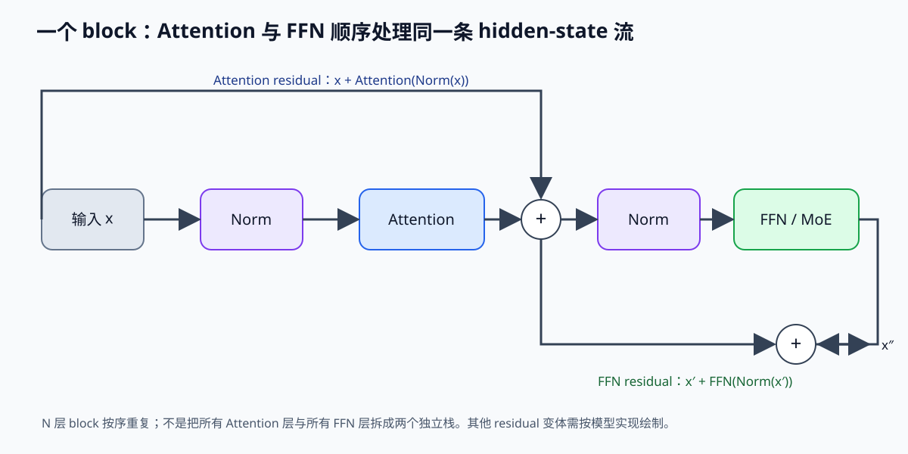
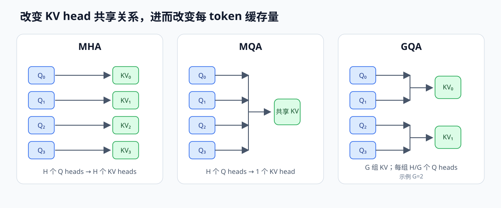
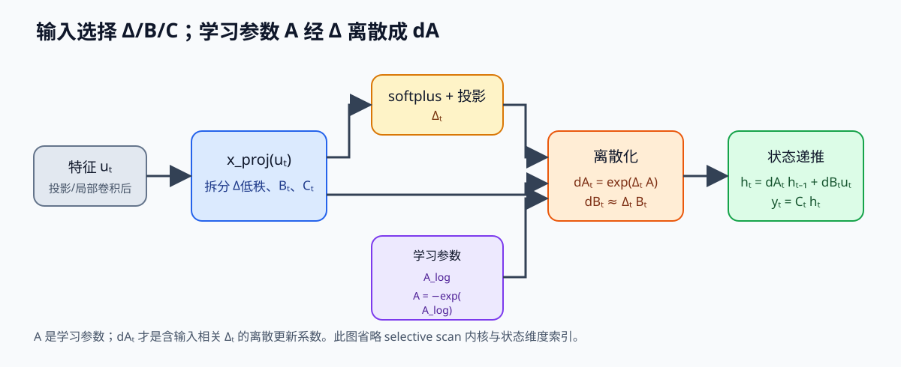

# 大模型板块：模型结构

> 子板块目标：能对着 HuggingFace config 讲清一个模型的 attention、norm、位置编码、FFN/MoE、KV cache 和推理代价。
> 状态：🚧 草稿，需要逐节消化。

---

## 1. 先建立骨架

绝大多数 LLM 是 Decoder-only Transformer：



图中每个 block 内，Attention 子层和 FFN/MoE 子层按顺序处理同一条 hidden-state 流，各自有 residual 汇合。模型通常重复整个 block，而不是先堆完 N 层 Attention 再单独堆 N 层 FFN。并行 residual、不同归一化位置或混合层型要按模型代码核对。

从 Infra 角度，成本主要来自三处：

| 成本 | 来源 | 典型瓶颈 |
|------|------|---------|
| 计算 | QKᵀ、PV、FFN | 取决于 shape、batch、精度和硬件算术强度 |
| 权重与 KV 读取 | attention/FFN 权重、历史 KV | 取决于并发、序列长度、批处理和数据复用 |
| KV 容量 | 每层保存的 K/V 或压缩状态 | 随上下文和并发增长，具体公式由架构与 dtype 决定 |

“Prefill 算力受限、Decode 带宽受限”是常见工作区间的概括。实际归属要比较该 kernel 的 FLOPs/byte 与设备 Roofline 平衡点；短输入、小 batch、跨卡通信、权重读取或 kernel launch 都可能改变瓶颈。

---

## 2. 核心组件

### 2.1 Embedding 与 lm_head

- embedding 把 token 变成 `[seq, hidden_size]`。
- lm_head 把 hidden state 映射回 `vocab_size`。
- 很多模型 embedding 和 lm_head 共享权重，省显存。

### 2.2 Norm

```text
LayerNorm: y = (x - mean) / sqrt(var + eps) * gamma + beta
RMSNorm:   y = x / sqrt(mean(x^2) + eps) * gamma
```

RMSNorm 省去均值中心化，只需归约平方均值并缩放；模型是否采用它是架构与训练选择，数值表现需看训练稳定性和任务评测。

### 2.3 位置编码

| 类型 | 思路 | 例子 |
|------|------|------|
| Learned absolute | 学 position embedding | BERT、GPT-2 |
| Sinusoidal | 固定频率三角函数 | 原始 Transformer |
| ALiBi | score 加线性偏置 | BLOOM、部分 MPT |
| RoPE | Q/K 按位置旋转 | LLaMA、Qwen、Mistral、DeepSeek |

RoPE 是当前主流。长上下文通常需要 RoPE 插值、NTK 或 YaRN。

### 2.4 Attention 变体

```text
score = QK^T / sqrt(d)
weight = softmax(score)
out = weight @ V
```

| 变体 | KV head 数 | KV cache | 代表 |
|------|-----------|----------|------|
| MHA | 每个 Q head 一组 | 最大 | GPT-2、BERT |
| MQA | 共享 1 组 | 最小 | PaLM |
| GQA | 分 G 组共享 | 折中 | LLaMA、Qwen、Mistral |
| MLA | 共享低秩 KV latent，并单独存位置相关分支 | 取决于 latent/RoPE 维度、head 数、存储精度与布局 | DeepSeek-V2/V3 |



MHA、MQA、GQA 的 KV 元素数按 `2 × H_kv × d_h` 计算；MLA 则分别统计 latent 与位置向量。缓存字节数要结合 dtype 和每层具体宽度计算，Decode 延迟还取决于投影吸收、kernel 与硬件。

### 2.5 FFN 与 MoE

```text
标准 FFN: y = φ(x W_up) W_down
SwiGLU:  y = (silu(x W_gate) ⊙ (x W_up)) W_down
MoE:     y = Σ_i gate_i(x) · expert_i(x)
```

SwiGLU 中 `gate` 分支经 SiLU 后与 `up` 分支逐元素相乘，再投影回 hidden 维。不同代码库可能交换 `gate/up` 命名，判断时看公式和实际乘法顺序。

MoE 每个 token 只计算被路由到的专家，但完整模型仍要保存所有专家参数。若全 GPU 常驻，所有权重占用设备显存；容量不足时也可以把冷专家 offload 到主机或存储，代价是路由后的传输、预取与等待。跨卡 Expert Parallelism 会发生 token dispatch/combine 通信。

### 2.6 SSM / Mamba

```text
连续系统：  h'(t) = A h(t) + B x(t),  y(t) = C h(t)
离散更新：  h_t = dA_t h_{t-1} + dB_t x_t,  y_t = C_t h_t
```

Mamba 的输入投影产生随 token 变化的 Δ、B、C；A 来自学习参数 A_log，经 `A = -exp(A_log)` 参数化。离散化后 `dA_t = exp(Δ_t A)`，所以 dA 随输入相关的 Δ 变化；`dB_t` 则由 Δ 与 B_t 构造。应把学习参数 A 与离散系数 dA 分开记。



长序列扫描的时间复杂度随 N 线性增长，但状态大小、通道宽度与 scan 的并行化仍影响成本。SSM 是状态递推模型，不是线性注意力的总称；线性注意力、门控递推和状态空间模型可能有相似的 scan 形式，但状态定义与更新算子不同。

---

## 3. KV cache 手算

```text
KV_bytes = 2 * num_kv_heads * head_dim * seq_len * num_layers * dtype_bytes
```

例：`seq=4096, layers=32, head_dim=128, fp16`

| 变体 | num_kv_heads | KV |
|------|-------------|-----|
| MHA | 32 | 2 GiB |
| GQA | 8 | 512 MiB |
| MQA | 1 | 64 MiB |
| MLA | 1 latent | 约 256 MiB（示意） |

这解释了为什么长上下文和 Decode 阶段对 KV cache 优化这么敏感。

---

## 4. 模型家族

| 家族 | 关键结构 | 学习重点 |
|------|---------|---------|
| LLaMA | GQA、RoPE、SwiGLU、RMSNorm；4 代有 MoE/多模态 | 最完整的 Dense 样本 |
| Qwen | Dense/MoE 都有，GQA、SwiGLU | 量化、vLLM 部署实验 |
| DeepSeek | MLA、DeepSeekMoE、MTP、FP8 | 当前最重要的结构考点 |
| Mistral/Mixtral | GQA、sliding window、MoE | sliding window 和 MoE |
| GPT/o | 闭源，decoder-only + 推理时思考 | 关注服务形态，不猜内部 |
| Claude | 闭源，Transformer + 对齐 | 长上下文、工具调用 |
| Gemini | 多模态、MoE/TPU 路线 | 多模态、长上下文 |
| Mamba/Jamba | SSM / SSM+Attention | 线性时间、混合架构 |

---

## 5. 用 HF config 解码

重点字段：

| 字段 | 含义 | 影响 |
|------|------|------|
| `hidden_size` | hidden 维度 | 显存、FLOPs |
| `num_hidden_layers` | 层数 | KV、延迟 |
| `num_attention_heads` | Q head | 并行度 |
| `num_key_value_heads` | KV head | KV cache |
| `head_dim` | head 维度 | QK^T 计算 |
| `intermediate_size` | FFN 中间维度 | 权重 |
| `num_experts` | MoE | 权重、路由 |
| `rope_theta` | RoPE 频率 | 长上下文 |
| `vocab_size` | 词表 | embedding/lm_head |

```python
from transformers import AutoConfig
cfg = AutoConfig.from_pretrained("meta-llama/Llama-3.1-8B-Instruct")
print(cfg.num_attention_heads, cfg.num_key_value_heads, cfg.num_hidden_layers)
```

---

## 6. 学习任务

1. 选一个开源模型，读 config 和模型代码。
2. 手算 KV cache，和 `torch` 或 vLLM 实测显存对比。
3. 写一个简化 GQA 或 MoE router。
4. 用 vLLM 跑 benchmark，记录 TTFT/TPOT。
5. 更新 [模型追踪表](../algorithms/model-tracker.md) 学习状态。

## 7. 关联材料

- [最新模型与结构](../algorithms/latest-model-architectures.md)：更完整的主笔记。
- [模型追踪表](../algorithms/model-tracker.md)：模型家族状态表。
- [MLA（DeepSeek）](../algorithms/mla-deepseek.md)
- [MoE 推理挑战](../algorithms/moe-inference.md)
- [Flash Attention 机制](../algorithms/flash-attention-mechanism.md)
