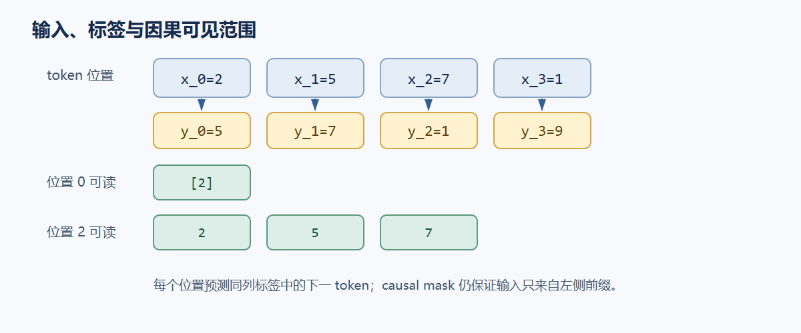

# 01. 语言模型如何预测下一个 token

语言模型把文本转换为离散 token，再根据前缀估计下一个 token 的条件概率。训练时，同一段文本同时提供输入和目标：输入位置 `t` 只使用当前位置及其之前的信息，目标序列从原序列的第二个 token 开始。切片后，每个输入位置都以其后的 token 为目标。

## 从文本到 token ID

字符、词和 token 不是同一层单位。分词器先把字节或字符片段映射到 token，再把 token 映射为整数 ID。一个 token 可以是完整单词、词的一部分、标点或空白组合；ID 只是查表索引，不带大小或语义顺序。

下面用一个刻意构造的 toy BPE（Byte Pair Encoding，字节对编码）词表说明合并过程。合并规则按给出的顺序应用：`c+a→ca`、`t+s→ts`、`r+u→ru`、`n+s→ns`。例如输入符号 `c a t` 经第一条规则得到 `ca t`；`c a t s` 得到 `ca ts`。这组规则只是解释“子词由合并形成”的人工例子，不声称它是某个自然语料或生产分词器的实际输出。真实分词器会在大规模语料上学习合并优先级，并处理字节覆盖、空白约定和特殊 token。

| 构造片段 | 初始符号 | 应用上列规则后的 token | toy ID |
|---|---|---|---:|
| `cat` | `c a t` | `ca`, `t` | `2, 5` |
| `cats` | `c a t s` | `ca`, `ts` | `2, 7` |
| `!` | `!` | `!` | `1` |
| `runs` | `r u n s` | `ru`, `ns` | `9, 4` |

若文本按这个 toy 词表编码为 `[2, 5, 7, 1, 9]`，模型看到的只是五个整数。改变词表或合并优先级，同一段文本就可能得到另一串 ID；因此，token ID 不能直接解释为词频、距离或语义相似度。

## 条件概率与自回归分解

令 token 序列为 $x_1,\ldots,x_n$。链式法则给出联合概率的精确分解：

$$
P(x_1,\ldots,x_n)=\prod_{t=1}^{n}P(x_t\mid x_{<t}),\qquad
\log P(x_1,\ldots,x_n)=\sum_{t=1}^{n}\log P(x_t\mid x_{<t}).
$$

自回归语言模型用参数化函数近似每一项条件分布。给定前缀 $x_1,\ldots,x_{t-1}$，模型输出词表上 $V_{vocab}$ 个未归一化分数（logits）$z_t\in\mathbb R^{V_{vocab}}$，再对词表轴归一化：

$$
P(x_t=v\mid x_{<t})=\operatorname{softmax}_{v\in[0,V_{vocab})}(z_t)_v
=\frac{\exp(z_{t,v})}{\sum_{u=0}^{V_{vocab}-1}\exp(z_{t,u})}.
$$

这里的 Softmax 轴是词表 `V_vocab`：它回答“下一个 token 的概率如何分给所有候选 token”。Attention 内部另有一个 Softmax，沿可见历史位置 `T` 归一化，回答“当前 query 从哪些位置取信息”。两个运算都叫 Softmax，但归一化对象不同。

## 输入与下一 token 目标如何对齐

训练样本 `[2,5,7,1,9]` 展开为四个“根据当前 token 及其前缀预测下一 token”的任务：

| 输入位置 | 可用前缀 | 该位置的 logits 目标 |
|---:|---|---:|
| 0 | `[2]` | `5` |
| 1 | `[2,5]` | `7` |
| 2 | `[2,5,7]` | `1` |
| 3 | `[2,5,7,1]` | `9` |

因此 `inputs=tokens[:-1]` 得到 `[2,5,7,1]`，`targets=tokens[1:]` 得到 `[5,7,1,9]`。数组切片的目标部分从原序列索引 1 开始；对齐后，每个输入位置的监督标签是它后面的 token。虽然一次前向能并行产生四个位置的 logits，因果注意力仍要求位置 `t` 看不到 `t+1` 及之后的输入。这样位置 0 的预测只依赖 token `2`，不会偷看目标 `5`；位置 3 才能使用完整的四 token 前缀。



对一批样本，模型 logits 形状为 `[B,T,V_vocab]`。交叉熵先在每个位置沿 `V_vocab` 计算目标 token 的负对数概率，再对有效的 `B×T` 个位置求平均：

$$
\mathcal L=-\frac{1}{BT}\sum_{b=0}^{B-1}\sum_{t=0}^{T-1}
\log \operatorname{softmax}(z_{b,t,:})_{y_{b,t}}.
$$

若使用 padding，需要把无效位置从平均值中排除。概念上，训练在所有位置共享同一组参数，但每个位置的上下文长度不同。

## 从 ID 到可学习的向量

最直接的表示方法是 one-hot。ID $i$ 对应向量 $e_i\in\mathbb R^{V_{vocab}}$，仅第 $i$ 项为 1；若嵌入矩阵 $E\in\mathbb R^{V_{vocab}\times D}$，则行向量 $e_i^\mathsf T E$ 取出矩阵第 $i$ 行。实现时直接查表 `E[i]`，避免构造稀疏 one-hot 向量。

嵌入把整数索引映射成稠密向量：

$$
X_{b,t,:}=E[x_{b,t},:],\qquad E\in\mathbb R^{V_{vocab}\times D},\quad X\in\mathbb R^{B\times T\times D}.
$$

以项目统一的矩阵记法，线性层写作 $Y=XW^\mathsf T+b$，权重 $W\in\mathbb R^{D_{out}\times D_{in}}$，与 `torch.nn.Linear(Din,Dout)` 的 `weight[out,in]` 一致。one-hot 作为行向量时，查表写作 $e_i^\mathsf T E$；实现仍以 `Embedding` 查表为准。

训练通过交叉熵的梯度调整嵌入行、Transformer 参数和输出投影，使正确标签的 logit 相对于其他词表项上升。共享的 token embedding 和输出矩阵有时会绑权重；这是模型设计选项，不是概率定义所要求的条件。模型也不会为 token 分配固定释义：一个 token 的向量先作为上下文计算的输入，层层变换后的状态才用于预测。

假设某位置的词表只有 `V_vocab=4`，logits 是 `[0, ln 3, 0, 0]`。指数值为 `[1,3,1,1]`，归一化和为 `6`，所以沿词表轴 `V_vocab` 的概率为 `[1/6, 1/2, 1/6, 1/6]`。若正确标签是 ID `1`，该位置的交叉熵为 $-\ln(1/2)=\ln 2$。实际模型通常有数万 token，但计算定义相同。

下面的 CPU 代码同时检查输入和目标的对齐、one-hot 乘嵌入矩阵与索引查表相同，以及单个位置的交叉熵结果。张量保留 batch 维度：token 输入是 `[B,T+1]`，切片后 `inputs` 和 `targets` 为 `[B,T]`，Embedding 输出 `[B,T,D]`，one-hot 为 `[B,T,V_vocab]`。

```python
import math
import torch
import torch.nn.functional as F

tokens = torch.tensor([[2, 5, 7, 1, 9]], dtype=torch.long)  # [B=1,T+1=5]
inputs, targets = tokens[:, :-1], tokens[:, 1:]
assert inputs.tolist() == [[2, 5, 7, 1]]
assert targets.tolist() == [[5, 7, 1, 9]]

embedding = torch.nn.Embedding(num_embeddings=16, embedding_dim=8)
looked_up = embedding(inputs)
one_hot = F.one_hot(inputs, num_classes=16).to(embedding.weight.dtype)
torch.testing.assert_close(looked_up, one_hot @ embedding.weight)

logits = torch.tensor([[0.0, math.log(3.0), 0.0, 0.0]])
target = torch.tensor([1])
loss = F.cross_entropy(logits, target)
assert math.isclose(loss.item(), math.log(2.0), rel_tol=1e-6)
print("inputs", tuple(inputs.shape), "embedding", tuple(looked_up.shape), "loss", loss.item())
```

语言建模目标由分词器、因果上下文中的 next-token logits 和沿词表轴 `V_vocab` 归一化的交叉熵组成。对于 `[B,T+1]` 的 token batch，`tokens[:,:-1]` 提供输入位置，`tokens[:,1:]` 提供每个位置对应的下一 token 标签。

参考：Sennrich et al., [Neural Machine Translation of Rare Words with Subword Units](https://aclanthology.org/P16-1162/)；Radford et al., [Improving Language Understanding by Generative Pre-Training](https://cdn.openai.com/research-covers/language-unsupervised/language_understanding_paper.pdf)。
