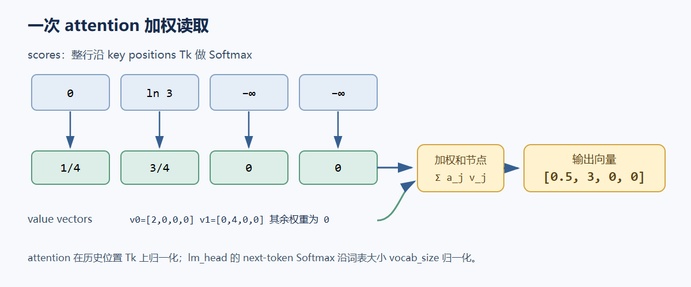
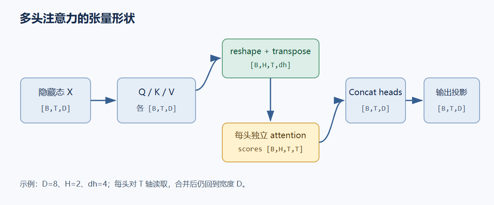

# 02. Attention：按内容从历史读取信息

Attention（注意力）对序列中的每个位置生成 query（查询向量），用它同可见位置的 key（键向量）做匹配，再按匹配权重汇总 value（值向量）。因果语言模型中的 query 只能读取当前位置及其左侧位置；归一化沿历史位置轴 `T` 进行。attention 的 value 矩阵记作粗体 $\mathbf V$，每头 value 宽度为 $d_v$；语言模型词表大小记作 $V_{vocab}$。attention Softmax 沿 key 位置 `T_k`，词表 Softmax 沿 `V_vocab`，二者归一化对象不同。

## 从一个 query 的数值例子开始

设单个 query 对四个位置得到分数 $s=[0,\ln 3,-\infty,-\infty]$。负无穷表示这些位置被 mask，Softmax 后权重为 $a=[1/4,3/4,0,0]$。令两个可见位置的 value 向量分别为 $v_0=[2,0,0,0]$、$v_1=[0,4,0,0]$，其余 value 对结果没有贡献，则加权和为：

$$
o=\sum_{j=0}^{3}a_jv_j
=\tfrac14[2,0,0,0]+\tfrac34[0,4,0,0]
=[0.5,3,0,0].
$$

每个 query 得到一个输出向量；它不会直接复制某个 value，而是按输入相关的分数混合多个 value。若换一组 query、key 或 mask，权重也会变化。



## 从点积到矩阵

先讨论同一序列的 self-attention。输入隐藏状态 $X\in\mathbb R^{B\times T\times D}$，三个独立的线性投影都作用于这个 $X$，所以 Q、K、V 的序列长度相同。本文统一使用数学形式 $Y=XW^\mathsf T+b$，其中 $W\in\mathbb R^{D_{out}\times D_{in}}$；它与 `nn.Linear(Din, Dout).weight[out, in]` 的存储形状相同。

$$
Q=XW_Q^\mathsf T+b_Q,\quad
K=XW_K^\mathsf T+b_K,\quad
\mathbf V=XW_V^\mathsf T+b_V.
$$

单头 self-attention 中，$Q\in\mathbb R^{B\times T\times d_k}$，$K\in\mathbb R^{B\times T\times d_k}$，$\mathbf V\in\mathbb R^{B\times T\times d_v}$。矩阵乘法 $QK^\mathsf T$ 对每个 query 与每个 key 做点积，所以分数形状为 $[B,T,T]$。在最后一维 `T_k=T` 上做 Softmax，得到每个 query 对所有可见 key 的权重；再乘 $\mathbf V$ 得到 $[B,T,d_v]$：

$$
S=\frac{QK^\mathsf T}{\sqrt{d_k}}+M,\qquad
A=\operatorname{softmax}_{T_k}(S),\qquad
O=A\mathbf V.
$$

`M` 是加到分数上的 mask：可见项取 0，不可见项取 $-\infty$。Softmax 对不可见项的指数为 0。实现中通常用布尔 mask 并在 Softmax 前把被屏蔽分数写成 dtype 可表达的极小值；需要确保每行至少有一个可见位置，否则整行归一化没有定义。

## 为什么除以 $\sqrt{d_k}$

若 query 和 key 的每个分量近似独立、均值为 0、方差为 1，则点积 $q^\mathsf Tk=\sum_{i=1}^{d_k}q_ik_i$ 的方差约为 $d_k$。维度增大时，未缩放的分数绝对值随典型尺度 $\sqrt{d_k}$ 增大，Softmax 更容易集中在少数项，进入梯度较小的饱和区。除以 $\sqrt{d_k}$ 会把分数方差恢复到约 1 的量级。

这是独立、单位方差近似下的初始化解释，不是对训练后分数分布的恒等结论。缩放项是该注意力参数化的设计选择，实际网络还会通过投影权重和训练改变分布。

## 多头如何分工并合并

标准多头自注意力（multi-head self-attention，MHA）把模型宽度 $D$ 拆成 $H$ 个头，每头宽度 $d_h=D/H$。每个头拥有自己的投影子空间：$Q,K,\mathbf V$ 先重排成 `[B,H,T,dh]`，每个头分别计算 $[B,H,T,T]$ 分数和 $[B,H,T,dh]$ 输出。拼接头维后恢复 $D$，再经过输出投影：

$$
\operatorname{MHA}(X)=
\operatorname{Concat}(O_1,\ldots,O_H)W_O^\mathsf T+b_O,
\qquad d_h=D/H.
$$



toy 配置为 $B=1,T=4,D=8,H=2,d_h=4$：输入 `[1,4,8]`；每个 Q/K/V 投影输出 `[1,4,8]`；重排后 `[1,2,4,4]`；分数为 `[1,2,4,4]`；加权输出 `[1,2,4,4]`；合并为 `[1,4,8]` 后做 `8→8` 输出投影。$D$ 必须能被 $H$ 整除，且本例每头的 Q、K、V 宽度都取 $d_h$。Cross-attention 则从两个来源产生 Q 与 K/V：例如 decoder 隐藏态长度为 $T_q$，encoder 输出长度为 $T_k$；分数形状为 $[B,T_q,T_k]$，不要求两个长度相同。

## PyTorch 参考实现

下面实现的是训练模式无 dropout 的因果 self-attention。`scores.softmax(dim=-1)` 明确沿 key 历史轴 `T_k` 归一化；输出 logits 的词表 Softmax 在模型头部另行计算。

```python
import math
import torch
from torch import nn


class CausalSelfAttention(nn.Module):
    def __init__(self, d_model=8, n_heads=2):
        super().__init__()
        assert d_model % n_heads == 0
        self.n_heads = n_heads
        self.d_head = d_model // n_heads
        self.qkv = nn.Linear(d_model, 3 * d_model)
        self.out = nn.Linear(d_model, d_model)

    def forward(self, x):  # x: [B,T,D]
        batch, time, width = x.shape
        q, k, v = self.qkv(x).chunk(3, dim=-1)

        def split_heads(t):
            return t.view(batch, time, self.n_heads, self.d_head).transpose(1, 2)

        q, k, v = map(split_heads, (q, k, v))  # [B,H,T,dh]
        scores = (q @ k.transpose(-2, -1)) / math.sqrt(self.d_head)
        causal = torch.tril(torch.ones(time, time, device=x.device, dtype=torch.bool))
        scores = scores.masked_fill(~causal, float("-inf"))  # [B,H,Tq,Tk]
        weights = scores.softmax(dim=-1)  # softmax over visible key positions Tk
        context = weights @ v  # [B,H,T,dh]
        context = context.transpose(1, 2).contiguous().view(batch, time, width)
        return self.out(context)  # [B,T,D]


if __name__ == "__main__":
    x = torch.randn(1, 4, 8)
    y = CausalSelfAttention()(x)
    assert y.shape == (1, 4, 8)
    print("input", tuple(x.shape), "output", tuple(y.shape))
```

合并 Q/K/V 投影只是在工程上把三个线性运算合成一次矩阵乘法；切分后每段仍有独立参数。示例里的 `torch.tril` 只适用于 query 与 key 序列起点相同、`Tq=Tk` 的整段因果前向。增量解码时 query 带有绝对位置偏移，mask 必须按真实 query/key 位置构造；缓存路径会在第 05 章给出。

## 注意力在 Transformer 中做什么

注意力让位置表示根据内容从其他位置读取信息。因果 mask 决定信息可达范围，query/key 的相似性决定读取权重，value 携带被汇总的内容。注意力本身不负责把输出词表概率化；残差、前馈网络、归一化和 `lm_head` 会在后续结构中完成各自的工作。

参考：Vaswani et al., [Attention Is All You Need](https://arxiv.org/abs/1706.03762)；PyTorch 官方 [`nn.Linear`](https://docs.pytorch.org/docs/stable/generated/torch.nn.Linear.html) 与 [`scaled_dot_product_attention`](https://docs.pytorch.org/docs/stable/generated/torch.nn.functional.scaled_dot_product_attention.html)。
