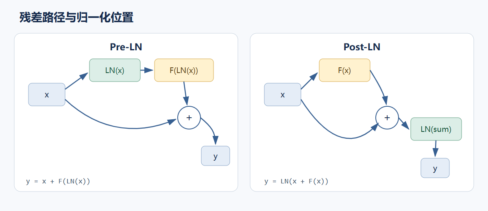

# 03. Transformer block：残差、归一化与前馈变换

一个 decoder block 通常先用 self-attention 混合序列位置的信息，再用逐 token 的前馈网络变换每个位置的特征。残差支路把输入直接送到子层输出相加；归一化控制每个 token 的特征尺度。前置层归一化（pre-layer normalization，Pre-LN）把归一化放在子层之前；后置层归一化（post-layer normalization，Post-LN）把它放在残差相加之后。两种顺序会改变前向路径和梯度路径。

## FFN 把每个位置送入同一小型 MLP

对隐藏张量 $X\in\mathbb R^{B\times T\times D}$，前馈网络独立处理每个 `[D]` 向量，但在所有 batch 和位置共享同一组参数。两层 GELU FFN 为：

$$
\operatorname{FFN}(X)=\operatorname{GELU}(XW_1^\mathsf T+b_1)W_2^\mathsf T+b_2,
\quad W_1\in\mathbb R^{D_{ff}\times D},\quad
W_2\in\mathbb R^{D\times D_{ff}}.
$$

主线 toy 配置取 $D=8,D_{ff}=32$，所以中间张量为 `[B,T,32]`，投影后回到 `[B,T,8]`。GELU 通过平滑门控保留不同幅度的激活；准确实现可写为 $x\Phi(x)$，实践中常用 tanh 近似。

现代 decoder 也常用 SwiGLU。它用两条 $D\to D_{ff}$ 投影产生 gate 与 value，再逐元素相乘并投影回 $D$：

$$
\operatorname{SwiGLU}(X)=
\bigl(\operatorname{SiLU}(XW_g^\mathsf T+b_g)\odot
(XW_u^\mathsf T+b_u)\bigr)W_d^\mathsf T+b_d.
$$

GELU 两层 FFN 有 `D→Dff→D` 两个大矩阵；SwiGLU 有 `D→Dff` 的 gate、up 两个矩阵和 `Dff→D` 的 down 矩阵，因此参数量和算力取决于 `Dff` 如何选。若希望两者参数规模接近，SwiGLU 的中间宽度通常要小于 GELU FFN 的宽度。二者都逐位置计算，不引入跨 token 通信；跨位置交互发生在 attention 子层。

## 残差让输入保留一条直接路径

一个残差子层可写为 $y=x+F(x)$。前向有两条路：主支路计算 $F(x)$，跳连把 $x$ 原样送到加法节点。设上游梯度为 $g=\partial L/\partial y$，链式法则给出：

$$
\frac{\partial L}{\partial x}
=g+J_F(x)^\mathsf T g
=(I+J_F(x)^\mathsf T)g.
$$

其中 $J_F$ 是子层对输入的 Jacobian。梯度包含显式的恒等项 $g$，所以即使子层 Jacobian 的乘积很小，仍有直接梯度路径。它不保证所有梯度都不消失，也不等价于把 $F$ 删除；它让网络可学习对输入表示的增量更新。



### Post-LN

原始 Transformer 采用的典型 Post-LN 子层形式是 $y=\operatorname{LN}(x+F(x))$。残差加法之后再归一化，下一子层接收归一化结果。梯度需穿过 LN 的 Jacobian：

$$
\frac{\partial L}{\partial x}
=\bigl(I+J_F(x)^\mathsf T\bigr)
J_{\mathrm{LN}}(x+F(x))^\mathsf T g.
$$

### Pre-LN

Pre-LN 先归一化子层输入，再把子层结果加回未归一化的残差流：$y=x+F(\operatorname{LN}(x))$。梯度为：

$$
\frac{\partial L}{\partial x}
=g+J_{\mathrm{LN}}(x)^\mathsf T J_F(\operatorname{LN}(x))^\mathsf T g.
$$

恒等残差项不经过 LN 或 $F$。深层网络中这条路径常有利于优化；Pre-LN 模型通常还会在堆叠结束后追加最终归一化，再送到输出头。具体位置需按模型实现核对。

## LayerNorm 与 RMSNorm 归一化哪些量

在 `[B,T,D]` 张量上，LayerNorm 对每个 batch、每个位置独立计算最后一维 $D$ 的均值和方差：

$$
\mu=\frac1D\sum_{i=1}^D x_i,\quad
\sigma^2=\frac1D\sum_{i=1}^D(x_i-\mu)^2,\quad
\operatorname{LN}(x)_i=\gamma_i\frac{x_i-\mu}{\sqrt{\sigma^2+\epsilon}}+\beta_i.
$$

这里的 `1/D` 是总体方差定义（`unbiased=False`），与 PyTorch `LayerNorm` 对 `normalized_shape=D` 的行为一致。可学习的逐通道 $γ,β\in\mathbb R^D$ 让模型在标准化后恢复所需的缩放和平移。统计量在训练和推理时都由当前 token 的特征计算，不跨 batch 或序列位置聚合。

RMSNorm 不减均值，只按均方根缩放：

$$
\operatorname{RMSNorm}(x)_i=
\gamma_i\frac{x_i}{\sqrt{\frac1D\sum_{j=1}^D x_j^2+\epsilon}}.
$$

常见形式没有可学习偏置。两种归一化都按特征维 `D` 工作；换成其中一种会改变模型的函数和训练路径，需按 checkpoint 架构配置，不能只替换算子名称。

## 一个逐 token 的 Pre-LN block

下面的代码展示结构而非主模型完整实现。Attention 模块接收 `[B,T,D]` 并应用因果 mask；FFN 逐 token 计算。`nn.Linear` 的权重形状遵守 `weight[out,in]`，等价于前文统一公式 $Y=XW^\mathsf T+b$。

```python
import torch
from torch import nn


class PreLNBlock(nn.Module):
    def __init__(self, attention, d_model=8, d_ff=32):
        super().__init__()
        self.ln_attn = nn.LayerNorm(d_model)
        self.attention = attention
        self.ln_ffn = nn.LayerNorm(d_model)
        self.ffn = nn.Sequential(
            nn.Linear(d_model, d_ff),
            nn.GELU(),
            nn.Linear(d_ff, d_model),
        )

    def forward(self, x):
        x = x + self.attention(self.ln_attn(x))
        x = x + self.ffn(self.ln_ffn(x))
        return x
```

主模型选择 Pre-LN、LayerNorm、GELU 和 dropout 0，以固定一个容易逐步核对的教学基线，并便于比较 full-sequence 与 KV cache。

参考：Ba et al., [Layer Normalization](https://arxiv.org/abs/1607.06450)；Shazeer, [GLU Variants Improve Transformer](https://arxiv.org/abs/2002.05202)；Vaswani et al., [Attention Is All You Need](https://arxiv.org/abs/1706.03762)；PyTorch 官方 [`LayerNorm`](https://docs.pytorch.org/docs/stable/generated/torch.nn.LayerNorm.html)。
