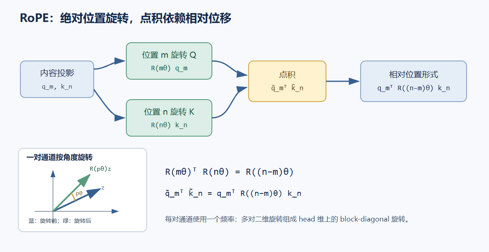

# 04. 位置表示：让 attention 知道 token 的顺序

不带位置表示、也不带固定位置 mask 的 self-attention 对 token 置换是等变的：同时置换输入行与输出行，结果只会按同样顺序重排。若 mask 也随 token 一起置换，这个性质仍成立。自回归模型使用的固定 causal mask 不会随输入内容移动，因此本身带有顺序约束；即使没有显式位置编码，模型也能从“位置 0 只看一个 token、位置 1 看两个 token、位置 2 看三个 token”的前缀结构学习顺序线索。

例如三 token 序列 `[A,B,C]` 的位置 1 只能读取 `[A,B]`，位置 2 读取 `[A,B,C]`；改为 `[A,C,B]` 后，位置 1 读取 `[A,C]`，位置 2 读取 `[A,C,B]`。固定下三角 mask 让模型看到的前缀内容随顺序改变。显式位置方法提供额外的坐标线索：学习式绝对 embedding 将位置向量加到 token 表示，RoPE 则按位置旋转 Q/K。它们改变模型表示顺序的方式，但不是 causal mask 的同义替代。

## 三种常见位置方法

**学习式绝对位置 embedding** 为最大上下文中的每个位置保存一个向量 $P_p\in\mathbb R^D$，并与 token embedding 相加：

$$
X_p=E[x_p]+P_p.
$$

它能直接学习位置相关特征，查表成本低；表的长度给出训练时的位置范围。超出范围时需要扩展或插值，位置向量的行为不会自动保证可外推。toy decoder 使用此方法，最大长度设为 64。

**正弦位置编码**用多组不同频率的正弦和余弦构造固定向量。原始 Transformer 对维度索引 $2i$ 与 $2i+1$ 定义为：

$$
PE(p,2i)=\sin\left(p/10000^{2i/D}\right),\qquad
PE(p,2i+1)=\cos\left(p/10000^{2i/D}\right).
$$

频率随维度变化，不需要训练位置表。不同位置被映射为不同相位组合；用加法把该信号放入 token 表示后，attention 通过学习投影利用这些模式。

**RoPE（Rotary Position Embedding）**在每个 attention head 内按二维分量对旋转 Q 和 K，不把位置向量直接加到隐藏态。它对每个 head dimension 的成对通道使用不同频率。令一对分量为 $z=(z_0,z_1)^\mathsf T$，位置 $p$ 的旋转角为 $p\theta_i$：

$$
R(p\theta_i)=\begin{bmatrix}\cos(p\theta_i)&-\sin(p\theta_i)\\
\sin(p\theta_i)&\cos(p\theta_i)\end{bmatrix},\qquad
\begin{bmatrix}z'_0\\z'_1\end{bmatrix}=R(p\theta_i)\begin{bmatrix}z_0\\z_1\end{bmatrix}.
$$

标准频率常写成 $\theta_i=10000^{-2i/d_h}$。实际 checkpoint 可能使用不同基数、频率缩放或长上下文扩展方案，必须以对应模型配置为准。

## RoPE 的点积为什么包含相对位移

设 query 在位置 $m$，key 在位置 $n$。先由内容投影得到未旋转向量 $q_m,k_n$，再分别乘位置旋转矩阵。旋转矩阵满足 $R(m\theta)^\mathsf T=R(-m\theta)$ 且旋转可加，因此：

$$
\begin{aligned}
\tilde q_m^\mathsf T\tilde k_n
&=(R(m\theta)q_m)^\mathsf T(R(n\theta)k_n)\\
&=q_m^\mathsf T R(m\theta)^\mathsf T R(n\theta)k_n\\
&=q_m^\mathsf T R((n-m)\theta)k_n.
\end{aligned}
$$

二维情形先得到这个恒等式；高维 RoPE 将多个二维旋转块组合成 block-diagonal 矩阵。点积中的位置变换只依赖差值 $n-m$，所以相对位置进入 attention 分数。内容向量仍参与点积，RoPE 不会把注意力变成只按距离查表。



## 因果 mask 与位置编码的职责

因果 mask 对 query 位置 $m$ 只开放 key 位置 $n\le m$。它确保预测位置 $m+1$ 时看不到未来 token；绝对位置编码或 RoPE 则区分已可见位置的顺序与距离。没有因果 mask 的 RoPE self-attention 仍会读到未来；有因果 mask 但没有位置线索时，模型仍受限于辨认相对次序的能力。

整段训练中，query 和 key 都带有显式的位置编号。自回归生成时，若已有 `past_len` 个 token，新 token 的位置是 `past_len`，而不是在每次单 token 调用中重新从 0 开始。学习式绝对 embedding 用这个位置查表；RoPE 用它计算新 Q/K 的旋转角。

## 位置偏移决定 KV cache 的正确性

缓存保存各层已经计算的 K 和 V。若 prompt 长度为 `P`，新 token 的绝对位置为 `P`，本次 query 的 `Tq=1`，缓存加新 key 后总 key 长度为 `Tkv=P+1`。允许关系由真实位置决定：

$$
\operatorname{allow}(i,j)=[j\le past\_len+i],
\quad i\in[0,T_q),\quad j\in[0,T_{kv}).
$$

对 `Tq=1`，唯一 query 应看到所有 `P+1` 个 key。直接对 shape `[1,P+1]` 调用普通 `tril` 会只保留首列，造成缓存路径的因果错误。分块 query 的起始位置同样是 `past_len`，因此 mask 必须使用偏移后的 query 位置。

下面给出 mask 与 RoPE 核心计算的参考片段。RoPE 输入是 `[B,H,T,dh]`，采用相邻通道成对旋转；实际模型若使用 split-half pairing，应按其 checkpoint 布局调整通道配对。

```python
import torch


def offset_causal_mask(past_len, query_len, key_len, device):
    query_positions = past_len + torch.arange(query_len, device=device)
    key_positions = torch.arange(key_len, device=device)
    return key_positions[None, :] <= query_positions[:, None]  # [Tq,Tkv]


def apply_rope_adjacent(x, position_ids, theta=10000.0):
    # x: [B,H,T,dh], dh must be even; position_ids: [T]
    batch, heads, time, width = x.shape
    if width % 2 != 0:
        raise ValueError("RoPE requires an even head dimension")
    if position_ids.ndim != 1 or position_ids.numel() != time:
        raise ValueError("position_ids must contain one ID per token")
    pair_index = torch.arange(0, width, 2, device=x.device, dtype=x.dtype)
    inv_freq = theta ** (-pair_index / width)
    angle = position_ids.to(x.dtype)[:, None] * inv_freq[None, :]  # [T,dh/2]
    cos = angle.cos()[None, None, :, :]
    sin = angle.sin()[None, None, :, :]
    even, odd = x[..., 0::2], x[..., 1::2]
    rotated = torch.stack((even * cos - odd * sin,
                           even * sin + odd * cos), dim=-1)
    return rotated.reshape(batch, heads, time, width)


past_len, query_len = 5, 1
mask = offset_causal_mask(past_len, query_len, key_len=6, device="cpu")
assert mask.tolist() == [[True, True, True, True, True, True]]
```

缓存中已保存的 key 必须保持其原始绝对位置对应的 RoPE 旋转结果；重新把历史 key 按当前分块局部位置旋转会改变 attention 分数。每层的投影参数不同，因此各层缓存彼此独立。

参考：Vaswani et al., [Attention Is All You Need](https://arxiv.org/abs/1706.03762)；Su et al., [RoFormer: Enhanced Transformer with Rotary Position Embedding](https://arxiv.org/abs/2104.09864)。
