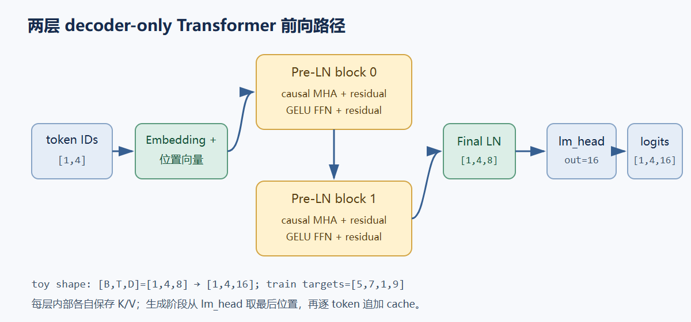
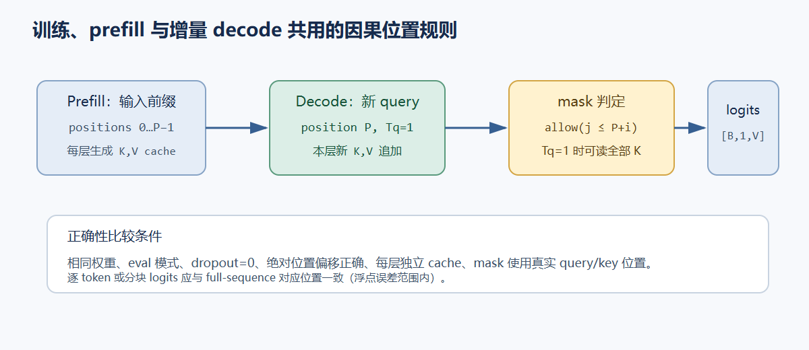

# 05. 两层 decoder-only Transformer：从 token 到生成

这一章把 token embedding（词元嵌入）、学习式绝对位置、两个 Pre-LN（pre-layer normalization，前置层归一化）block、因果多头 attention（注意力）、GELU（Gaussian Error Linear Unit，高斯误差线性单元）FFN（feed-forward network，前馈网络）、最终 LayerNorm 和 `lm_head` 接成一个可以复制运行的 PyTorch 程序。配置固定为 $B=1,T=4,D=8,H=2,d_h=4,D_{ff}=32,vocab\_size=16,L=2$；输入 token 序列为 `[2,5,7,1,9]`，训练输入是 `[2,5,7,1]`，目标是 `[5,7,1,9]`。模型随机初始化，训练数据为一条五 token 序列。



## 数据如何经过模型

训练输入形状为 `[B,T]=[1,4]`。Embedding 查表后得到 `[1,4,8]`，再加上位置 0–3 的可学习位置向量。每个 block 先 LayerNorm，再做一次合并 QKV 投影；`nn.Linear(8,24)` 的输出拆成三个 `[1,4,8]` 张量，reshape 为 `[1,2,4,4]`。分数张量是 `[1,2,4,4]`，最后一维是可见 key 位置 `T_k`；沿该轴 Softmax 后乘 value 张量 $\mathbf V$，并合并两个 head 回 `[1,4,8]`。残差相加后，第二个 Pre-LN 子层用 `8→32→8` 的 GELU FFN 逐位置变换。

两个 Softmax 的轴不同。attention weights 的形状为 `[B,H,T_q,T_k]`，`softmax(dim=-1)` 沿可见历史位置 `T_k` 归一化；`lm_head` 把最后隐藏状态投影成 `[B,T,vocab_size]=[1,4,16]` logits，推理时 `softmax(dim=-1)` 沿词表轴 `vocab_size` 归一化下一个 token 的概率。本文把 attention 的 value 张量写作粗体 $\mathbf V$、每头 value 宽度写作 $d_v$，把词表大小写作 `vocab_size` 或 $V_{vocab}$。训练用交叉熵直接接 logits，不需要先显式算概率。

## 完整可复制源码

代码里的矩阵权重由 PyTorch `nn.Linear` 保存为 `[out,in]`；数学上对应 $Y=XW^\mathsf T+b$。主模型使用 Pre-LN、LayerNorm、GELU 和 dropout 0。attention mask 依据绝对 query 位置 `past_len+i` 和 key 位置 `j` 构造，因此整段训练、首轮 prefill、单 token decode 与多 token 分块复用同一关系 $j\le past\_len+i$。

<!-- source-check: examples/tiny_transformer.py -->
~~~python
"""Small CPU-first decoder-only Transformer for shape and cache study.

This is a randomly initialized teaching model, not a trained language model.
It uses B=1, T=4, D=8, H=2, dh=4, Dff=32, vocab_size=16, L=2, learned absolute
positions, Pre-LN, LayerNorm, GELU, and dropout=0.
"""
import math

import torch
from torch import nn
from torch.nn import functional as F


class CausalSelfAttention(nn.Module):
    def __init__(self, d_model=8, n_heads=2):
        super().__init__()
        if d_model % n_heads:
            raise ValueError("d_model must be divisible by n_heads")
        self.n_heads = n_heads
        self.d_head = d_model // n_heads
        self.qkv = nn.Linear(d_model, 3 * d_model)
        self.out = nn.Linear(d_model, d_model)

    def forward(self, x, past_kv=None, past_len=0):
        batch, query_len, width = x.shape
        q, k, v = self.qkv(x).chunk(3, dim=-1)

        def split_heads(tensor):
            return tensor.view(batch, query_len, self.n_heads, self.d_head).transpose(1, 2)

        q, k, v = map(split_heads, (q, k, v))  # [B,H,Tq,dh], new K/V [B,H,Tq,dh]
        if past_kv is not None:
            past_k, past_v = past_kv
            k = torch.cat((past_k, k), dim=2)
            v = torch.cat((past_v, v), dim=2)
        key_len = k.shape[2]

        scores = (q @ k.transpose(-2, -1)) / math.sqrt(self.d_head)
        query_positions = past_len + torch.arange(query_len, device=x.device)
        key_positions = torch.arange(key_len, device=x.device)
        allowed = key_positions[None, :] <= query_positions[:, None]
        scores = scores.masked_fill(~allowed[None, None, :, :], float("-inf"))
        weights = scores.softmax(dim=-1)  # normalize over visible history positions Tk
        context = weights @ v
        context = context.transpose(1, 2).contiguous().view(batch, query_len, width)
        return self.out(context), (k, v)


class DecoderBlock(nn.Module):
    def __init__(self, d_model=8, n_heads=2, d_ff=32):
        super().__init__()
        self.ln_attn = nn.LayerNorm(d_model)
        self.attn = CausalSelfAttention(d_model, n_heads)
        self.ln_ffn = nn.LayerNorm(d_model)
        self.ffn = nn.Sequential(
            nn.Linear(d_model, d_ff),
            nn.GELU(),
            nn.Linear(d_ff, d_model),
        )

    def forward(self, x, past_kv=None, past_len=0):
        attn_out, new_kv = self.attn(self.ln_attn(x), past_kv, past_len)
        x = x + attn_out
        x = x + self.ffn(self.ln_ffn(x))
        return x, new_kv


class TinyDecoderLM(nn.Module):
    def __init__(self, vocab_size=16, d_model=8, n_heads=2, d_ff=32,
                 n_layers=2, max_context=64):
        super().__init__()
        self.vocab_size = vocab_size
        self.max_context = max_context
        self.n_heads = n_heads
        self.d_head = d_model // n_heads
        self.token_embedding = nn.Embedding(vocab_size, d_model)
        self.position_embedding = nn.Embedding(max_context, d_model)
        self.blocks = nn.ModuleList(
            DecoderBlock(d_model, n_heads, d_ff) for _ in range(n_layers)
        )
        self.final_ln = nn.LayerNorm(d_model)
        self.lm_head = nn.Linear(d_model, vocab_size)

    def forward(self, token_ids, cache=None, use_cache=False):
        if token_ids.ndim != 2 or token_ids.shape[1] == 0:
            raise ValueError("token_ids must have nonempty shape [B,Tq]")
        if token_ids.dtype not in (torch.int32, torch.int64):
            raise TypeError("token_ids must contain integer IDs")
        if torch.any(token_ids < 0) or torch.any(token_ids >= self.vocab_size):
            raise ValueError("token ID outside vocabulary")
        if (use_cache or cache is not None) and self.training:
            raise ValueError("KV cache comparison and generation require eval() mode")
        if cache is not None and not use_cache:
            raise ValueError("pass use_cache=True when consuming a KV cache")

        if cache is None:
            past_len = 0
        else:
            if len(cache) != len(self.blocks):
                raise ValueError("cache must contain one K/V pair per layer")
            past_len = cache[0][0].shape[2]
            expected_batch = token_ids.shape[0]
            for key, value in cache:
                if key.shape != value.shape or key.shape[:2] != (expected_batch, self.n_heads):
                    raise ValueError("cache batch/head/feature shapes do not match")
                if key.shape[2] != past_len or key.shape[3] != self.d_head:
                    raise ValueError("cache lengths or head dimensions do not match")
        query_len = token_ids.shape[1]
        if past_len + query_len > self.max_context:
            raise ValueError("sequence exceeds learned position table")

        positions = past_len + torch.arange(query_len, device=token_ids.device)
        x = self.token_embedding(token_ids) + self.position_embedding(positions)[None, :, :]
        new_cache = []
        for index, block in enumerate(self.blocks):
            past = None if cache is None else cache[index]
            x, layer_cache = block(x, past, past_len)
            new_cache.append(layer_cache)
        logits = self.lm_head(self.final_ln(x))  # [B,Tq,vocab_size]
        return logits, new_cache if use_cache else None


@torch.no_grad()
def greedy_generate(model, prompt, max_new_tokens=4):
    if max_new_tokens < 0:
        raise ValueError("max_new_tokens must be nonnegative")
    if max_new_tokens == 0:
        return prompt.clone()
    model.eval()
    logits, cache = model(prompt, use_cache=True)
    next_id = logits[:, -1, :].argmax(dim=-1, keepdim=True)
    result = torch.cat((prompt, next_id), dim=1)
    for _ in range(1, max_new_tokens):
        logits, cache = model(next_id, cache=cache, use_cache=True)
        next_id = logits[:, -1, :].argmax(dim=-1, keepdim=True)
        result = torch.cat((result, next_id), dim=1)
    return result


def main():
    torch.manual_seed(7)
    model = TinyDecoderLM()
    tokens = torch.tensor([[2, 5, 7, 1, 9]], dtype=torch.long)
    inputs, targets = tokens[:, :-1], tokens[:, 1:]
    assert inputs.shape == targets.shape == (1, 4)

    optimizer = torch.optim.AdamW(model.parameters(), lr=0.02, weight_decay=0.0)
    model.train()
    first_loss = None
    for step in range(80):
        optimizer.zero_grad(set_to_none=True)
        logits, _ = model(inputs)
        loss = F.cross_entropy(logits.reshape(-1, model.vocab_size), targets.reshape(-1))
        if first_loss is None:
            first_loss = loss.item()
        loss.backward()
        assert all(p.grad is None or torch.isfinite(p.grad).all() for p in model.parameters())
        optimizer.step()
    final_loss = loss.item()
    assert final_loss < first_loss, (first_loss, final_loss)
    print(f"loss: {first_loss:.4f} -> {final_loss:.4f}")

    model.eval()
    with torch.no_grad():
        full_logits, full_cache = model(inputs, use_cache=True)
        token_cache = None
        token_logits = []
        for index in range(inputs.shape[1]):
            part_logits, token_cache = model(
                inputs[:, index:index + 1], cache=token_cache, use_cache=True
            )
            token_logits.append(part_logits)
        torch.testing.assert_close(torch.cat(token_logits, dim=1), full_logits,
                                   rtol=1e-5, atol=1e-6)

        first, chunk_cache = model(inputs[:, :2], use_cache=True)
        second, chunk_cache = model(inputs[:, 2:], cache=chunk_cache, use_cache=True)
        torch.testing.assert_close(torch.cat((first, second), dim=1), full_logits,
                                   rtol=1e-5, atol=1e-6)
        assert len(full_cache) == len(model.blocks) == 2
        assert all(k.shape == v.shape == (1, 2, 4, 4) for k, v in full_cache)
        model.train()
        try:
            model(inputs[:, :1], cache=full_cache)
        except ValueError:
            pass
        else:
            raise AssertionError("consuming a cache in training mode must fail")
        model.eval()

        changed = inputs.clone()
        changed[:, 3] = (changed[:, 3] + 1) % model.vocab_size
        changed_logits, _ = model(changed)
        torch.testing.assert_close(full_logits[:, :3], changed_logits[:, :3],
                                   rtol=1e-5, atol=1e-6)

        # This probability distribution is over vocab_size, unlike attention over Tk.
        next_token_probabilities = full_logits[:, -1, :].softmax(dim=-1)
        assert next_token_probabilities.shape == (1, model.vocab_size)
        prompt = inputs[:, :2]
        generated = greedy_generate(model, prompt, max_new_tokens=4)
        assert torch.equal(greedy_generate(model, prompt, max_new_tokens=0), prompt)
        try:
            greedy_generate(model, prompt, max_new_tokens=-1)
        except ValueError:
            pass
        else:
            raise AssertionError("negative generation length must fail")

        custom = TinyDecoderLM(vocab_size=16, d_model=12, n_heads=3, d_ff=24,
                               n_layers=1, max_context=8).eval()
        _, custom_cache = custom(torch.tensor([[2, 5]]), use_cache=True)
        assert custom_cache[0][0].shape == (1, 3, 2, 4)
        _, custom_cache = custom(torch.tensor([[7]]), cache=custom_cache, use_cache=True)
        assert custom_cache[0][0].shape == (1, 3, 3, 4)

    print("logits:", tuple(full_logits.shape))
    print("attention/cache per layer:", [tuple(k.shape) for k, _ in full_cache])
    print("next-token probabilities:", tuple(next_token_probabilities.shape))
    print("greedy continuation:", generated.tolist())
    print("PASS: training gradients, causal prefix, full/token/chunk cache equality")


if __name__ == "__main__":
    main()
~~~

## 训练、因果性和 cache 检查

训练片段把每个位置的 logits reshape 为 `[B*T,vocab_size]`，目标 reshape 为 `[B*T]`，因此 PyTorch 交叉熵的类别轴是最后的 `vocab_size`。模型对所有位置并行算 logits，但因果 mask 让位置 0–3 分别只能访问长度为 1–4 的前缀。脚本用这条序列执行 80 次 AdamW 更新，报告首末 loss，并检查各参数梯度有限。

KV cache（key/value 缓存）equality 有几个必要条件：模型处于 `eval()`，dropout 为 0，full 与 cached 路径使用相同权重和位置定义；新 token 的 learned position index 从 `past_len` 开始；每层各存一对 K/V；因果 mask 使用绝对 query offset。单 token decode 时 `Tq=1` 而 `Tkv>1`，该 query 应能读取整个历史和当前 key；对 `[1,Tkv]` 直接做普通 `tril` 会错误遮掉后续历史列。



代码中先对完整四 token 输入做一次 full pass，再分别按单 token 和两块输入复算，逐位置比较 logits。随后改变输入位置 3，检查前 3 个 logits 不变。每层 cache shape 应为 `[B,H,Tkv,dh]=[1,2,4,4]`。这些检查同时覆盖位置偏移和 causal prefix；完整模型里两个 block 的缓存互不共享。

## 运行与检查

从仓库根目录运行。NumPy 检查依赖 `numpy`，完整训练示例依赖 `torch`；脚本默认使用 CPU。

```powershell
python papers/foundations/examples/validate_foundations.py
python -m py_compile papers/foundations/examples/tiny_transformer.py
python papers/foundations/examples/tiny_transformer.py
```

第一条命令检查 NumPy full/token/chunk cache、因果前缀、logits 梯度、Post-LN 有限差分和源码同步。第二条检查完整 PyTorch 示例的 Python 语法。第三条训练 toy 序列，并检查梯度、生成、因果性及 full/token/chunk cache logits 一致性。

参考：Vaswani et al., [Attention Is All You Need](https://arxiv.org/abs/1706.03762)；PyTorch 官方 [`nn.Embedding`](https://docs.pytorch.org/docs/stable/generated/torch.nn.Embedding.html)、[`nn.LayerNorm`](https://docs.pytorch.org/docs/stable/generated/torch.nn.LayerNorm.html)、[`nn.Linear`](https://docs.pytorch.org/docs/stable/generated/torch.nn.Linear.html) 与 [`CrossEntropyLoss`](https://docs.pytorch.org/docs/stable/generated/torch.nn.CrossEntropyLoss.html)。
