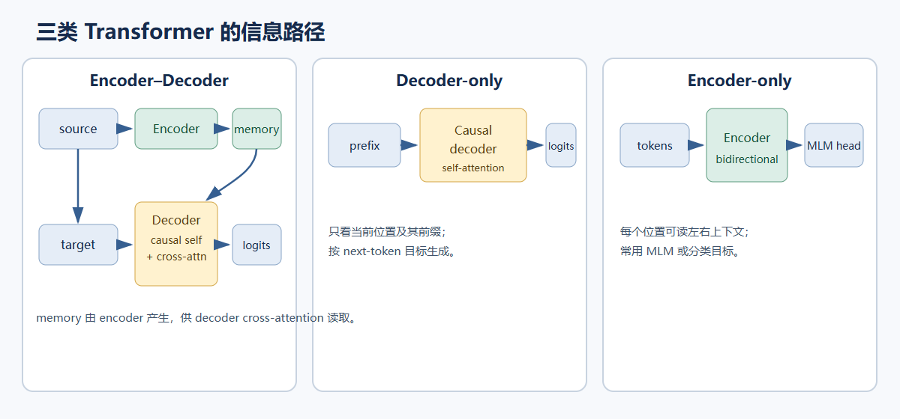
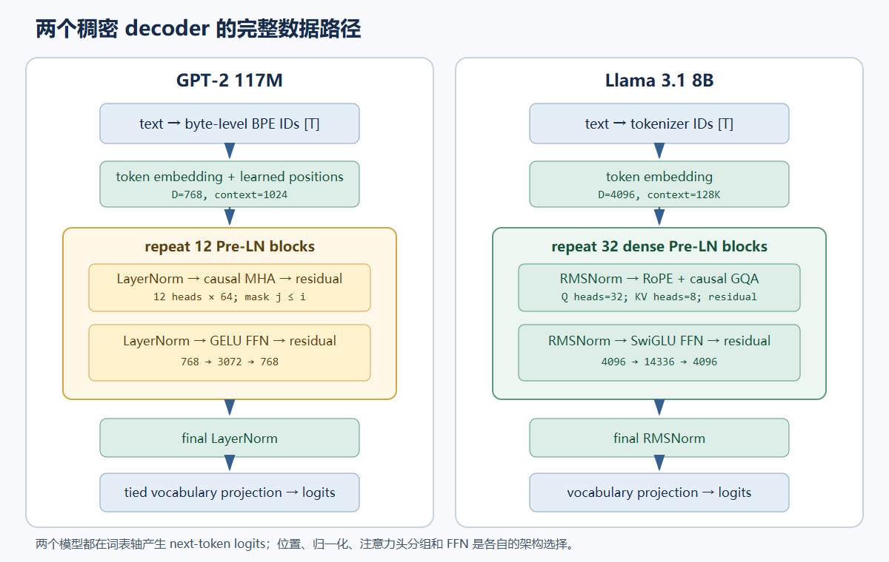

# 06. Transformer 家族：Encoder–Decoder、Decoder-only 与 Encoder-only

Transformer 共享 attention、前馈网络、残差和归一化等部件，但不同任务需要不同的信息通路。原始 Transformer 用 encoder 读完整 source、decoder 自回归地产生 target，并用 cross-attention 把两者连接起来。GPT-2 省去 encoder memory，用 causal decoder 直接建模文本序列。Encoder-only 模型则让每个位置读取双向上下文，适合生成单个序列表示或 token 表示。



## 三种结构共享什么、分在哪里

| 家族 | Self-attention 可见范围 | 是否有 cross-attention | 常见训练目标与输出 |
|---|---|---|---|
| Encoder–Decoder | encoder 双向；decoder causal | decoder 读取 encoder 输出 | source→target 序列转换；输出 target token logits |
| Decoder-only | causal prefix | 标准纯文本模型没有 | next-token 语言建模；按左到右生成 |
| Encoder-only | 通常双向 | 通常没有 | 掩码语言建模（Masked Language Modeling, MLM）或分类/检索目标；输出上下文表示 |

Attention 的矩阵计算可以相同，变化的是 Q/K/V 来自哪些状态以及 mask 允许哪些边。Encoder–Decoder 中，decoder self-attention 的 Q/K/V 来自 decoder 当前状态；cross-attention 的 Q 来自 decoder，K/V 来自 encoder 最终状态。Decoder-only 的每层只在当前序列上做带 causal mask 的 self-attention。Encoder-only 通常在输入全序列上使用双向 mask，让任一位置读取左右上下文。

## 原始 Transformer：机器翻译的 Encoder–Decoder

Vaswani 等人在 2017 年提出的 Transformer 面向序列到序列转导。encoder 输入 source token embedding 与正弦位置编码之和，经过 6 层 encoder。每层依次计算多头 self-attention 和逐位置 FFN，两个子层都采用残差相加再 LayerNorm 的 Post-LN 形式。decoder 也有 6 层：先用 causal mask 做 masked self-attention，再对 encoder 输出做 cross-attention，最后经过 FFN。每个子层都带残差和 Post-LN。最终 decoder 状态通过线性投影和词表 Softmax 预测下一个 target token。

论文 base 配置为 $D=512,H=8,D_{ff}=2048$。Encoder 自注意力分数形状为 `[B,H,S,S]`，其中 $S$ 是 source 长度，双向 mask 允许所有 source 位置彼此读取。Decoder 的 masked self-attention 分数形状为 `[B,H,T,T]`，只允许 key 位置 $j\le i$。Cross-attention 的分数形状为 `[B,H,T,S]`：每个 target query 都能读取完整 source memory。两个序列长度可以不同。

$$
\begin{aligned}
H_{enc}&=\operatorname{Encoder}(X_{src}),\\
Z_1&=\operatorname{LN}\left(X+\operatorname{MaskedSelf}(X)\right),\\
Z_2&=\operatorname{LN}\left(Z_1+\operatorname{CrossAttention}(Q=Z_1,K=H_{enc},V=H_{enc})\right),\\
Z_3&=\operatorname{LN}\left(Z_2+\operatorname{FFN}(Z_2)\right),\\
\operatorname{logits}&=Z_3W_{lm}^{\mathsf T}+b_{lm},\\
P(y_t=v\mid y_{<t},X_{src})&=\operatorname{softmax}_{V_{vocab}}(\operatorname{logits}_t)_v.
\end{aligned}
$$

这里 `X` 表示进入 decoder 当前层的 target 状态；原始 Transformer 的每个子层都使用 Post-LN。target 长度为 $T$、source 长度为 $S$ 时，cross-attention 的 $Q$ 来自 $Z_1$，形状为 `[B,H,T,dh]`；$K,V$ 来自 encoder memory，形状为 `[B,H,S,dh]`；分数形状为 `[B,H,T,S]`。Cross-attention 通常允许每个 target query 读取所有未 padding 的 source 位置。最终线性投影先产生 `[B,T,V_vocab]` logits，再沿词表轴计算 Softmax。

Cross-attention 的设计理由直接来自条件生成问题：decoder 每生成一步，都要结合输入 source 的编码表示。翻译里 source 与 target 是两条不同序列，使用 cross-attention 可让 target query 按内容选择 source token，而不把两段 token 拼成一个共享因果序列。下面代码给出这个模块的核心 shape 路径，所有线性层权重仍按 `[out,in]` 保存。

```python
import math
import torch
from torch import nn


class CrossAttention(nn.Module):
    def __init__(self, d_model=512, n_heads=8):
        super().__init__()
        assert d_model % n_heads == 0
        self.n_heads = n_heads
        self.d_head = d_model // n_heads
        self.q_proj = nn.Linear(d_model, d_model)
        self.k_proj = nn.Linear(d_model, d_model)
        self.v_proj = nn.Linear(d_model, d_model)
        self.out_proj = nn.Linear(d_model, d_model)

    def forward(self, target, memory, source_valid=None):
        # target [B,T,D]; encoder memory [B,S,D]
        batch, target_len, width = target.shape
        source_len = memory.shape[1]

        def split_heads(tensor, length):
            return tensor.view(batch, length, self.n_heads, self.d_head).transpose(1, 2)

        q = split_heads(self.q_proj(target), target_len)  # [B,H,T,dh]
        k = split_heads(self.k_proj(memory), source_len)  # [B,H,S,dh]
        v = split_heads(self.v_proj(memory), source_len)  # [B,H,S,dh]
        scores = (q @ k.transpose(-2, -1)) / math.sqrt(self.d_head)  # [B,H,T,S]
        if source_valid is not None:  # [B,S], True marks a real source token
            scores = scores.masked_fill(~source_valid[:, None, None, :], float("-inf"))
        weights = scores.softmax(dim=-1)  # normalize across source positions S
        context = weights @ v  # [B,H,T,dh]
        context = context.transpose(1, 2).contiguous().view(batch, target_len, width)
        return self.out_proj(context)  # [B,T,D]
```

## GPT-2：把语言建模写成统一的 next-token 任务

GPT-2 采用 decoder-only Transformer。以公开代码中的 GPT-2 117M 配置为例，模型有 12 层、12 个 attention heads、隐藏宽度 768、上下文长度 1024；每层 FFN 将宽度扩展到 $4D=3072$ 再投影回 768。输入文字经 byte-level BPE（byte-level Byte Pair Encoding，字节级字节对编码）得到 token ID，与学习式绝对位置向量相加，然后通过 12 个 Pre-LN block。每个 block 先 LayerNorm（layer normalization，层归一化）和 masked multi-head self-attention，再走残差；随后 LayerNorm、GELU FFN 和残差。末尾 LayerNorm、词表线性投影与 Softmax 给出下一个 token 分布。

GPT-2 的完整数据路径及 Llama 3.1 8B 的单层数据路径见图。GPT-2 把 token embedding 与 learned position embedding 相加；每个 Pre-LN block 先执行 causal MHA 和 residual，再执行 GELU FFN 和 residual；final LayerNorm 后用与输入 token embedding 共享的词表权重产生 logits。



因果 mask 与训练标签共同定义每个位置的预测上下文；共享输入 embedding 与输出投影能复用同一词表参数。GPT-2 论文的核心设定是从多样文本做 next-token 生成式预训练，再观察单一语言模型在多种任务提示下呈现的迁移能力。

## Llama 3.1 8B：现代稠密 decoder 的具体路径

Llama 3.1 8B 是文本输入、文本输出的自回归稠密 Transformer。Meta 官方模型页给出 8B 参数、128K 上下文和 GQA（grouped-query attention，分组查询注意力）；参考实现配置包括 `dim=4096`、`n_layers=32`、`n_heads=32`、`n_kv_heads=8`、`rope_theta=500000`，并启用 scaled RoPE（rotary position embedding，旋转位置编码）。模型使用 RMSNorm（root mean square normalization，均方根归一化）和 SwiGLU（SiLU-gated linear unit，SiLU 门控线性单元）前馈网络。Dense 表示每个 token 都经过同一组 FFN 权重，没有 MoE（mixture of experts，专家混合）的 token 路由分支。

图中 Llama 3.1 8B 路径展示完整的 embedding、32 层重复 block 和词表输出。每层先做 RMSNorm，再由不同 head 数的 Q/K/V 投影产生分组查询注意力所需张量；RoPE 作用于 Q/K，causal mask 只开放已出现位置；注意力输出投影后与残差相加。第二个 RMSNorm 后，gate/up 两条 4096→14336 投影经 SiLU 门控逐元素相乘，再由 14336→4096 的 down 投影回到模型宽度并与残差相加。最后做 RMSNorm 和词表投影。

查询头有 32 个、KV 头有 8 个，所以每 4 个 query heads 共用一组 K/V。相对于同宽度的 32-head MHA，缓存的 K/V head 数是四分之一；这是由 shape 直接得到的存储差异，Meta 模型卡也说明该系列使用 GQA 以改善推理可扩展性。RoPE 将位置作用到 Q/K，并可按模型配置扩展位置频率；RMSNorm 以均方根缩放特征，SwiGLU 使用门控乘法扩展 token-wise 表达。每一项都改变 block 的计算与参数路径，加载 checkpoint 时必须匹配它们，而不是只对齐层数和 hidden width。

## 架构决定信息路径，目标函数决定监督方式

同为 Transformer block，encoder 双向读取适合一次编码完整输入；decoder-only 用固定 causal mask 让训练目标和生成过程共享左到右的条件分布；encoder-decoder 保留两套状态，并用 cross-attention 连接条件输入和输出序列。选型首先看任务要输出什么、生成时需要哪些上下文，再核对位置方法、归一化、FFN、词表和 mask。模型大小或吞吐量本身不能说明这些信息路径为何不同。

参考：Vaswani et al., [Attention Is All You Need](https://arxiv.org/abs/1706.03762)；Radford et al., [Language Models are Unsupervised Multitask Learners](https://cdn.openai.com/better-language-models/language_models_are_unsupervised_multitask_learners.pdf)；GPT-2 官方仓库 https://github.com/openai/gpt-2，参考文件 `src/model.py`；Meta, [Llama 3.1 8B 官方模型页](https://huggingface.co/meta-llama/Llama-3.1-8B) 和 [llama-models 仓库](https://github.com/meta-llama/llama-models)，结构核对文件 `models/llama3_1/MODEL_CARD.md`、`models/sku_list.py`；Grattafiori et al., [The Llama 3 Herd of Models](https://arxiv.org/abs/2407.21783)。
