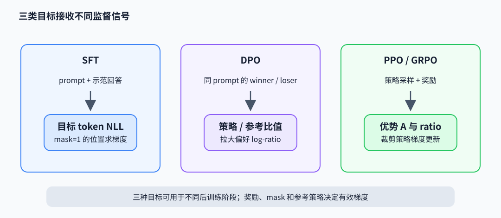

# 对齐与强化学习：目标函数如何改变回答

后训练通过监督示范和偏好信号改变模型分布。理解目标函数时要看哪些 token 获得梯度、奖励如何归一化，以及裁剪或掩码改变了哪些样本的贡献。

## SFT：只对目标回答位置求交叉熵

监督微调（supervised fine-tuning，SFT）把 prompt 与目标回答拼成序列，但常只对 assistant token 求 next-token loss：

$$
\mathcal L_{\mathrm{SFT}}=-\frac{1}{\sum_t m_t}\sum_t m_t\log\pi_\theta(y_t\mid x,y_{<t}),\qquad m_t\in\{0,1\}.
$$

mask $m_t$ 决定目标范围。若 prompt 有 20 token、回答 5 token，仅监督回答时归一化分母为 5；错误地对整段求平均会把 prompt 也作为标签，改变训练目标。截断、packing 和多轮对话边界也必须与 mask 同步。

## DPO：由偏好概率得到隐式奖励差

直接偏好优化（direct preference optimization，DPO）用同一 prompt 下的优选 $y_w$ 与拒选 $y_l$ 构造目标。Bradley–Terry 模型写成 $P(y_w\succ y_l)=\sigma(r(x,y_w)-r(x,y_l))$。在 Kullback–Leibler 散度（KL 散度）约束的奖励最优化下，最优策略与参考策略满足 $r(x,y)=\beta\log(\pi(y\mid x)/\pi_{\mathrm{ref}}(y\mid x))+c(x)$。代回偏好概率并最大化偏好似然，得到 DPO 损失：

$$
\mathcal L_{\mathrm{DPO}}=-\log\sigma\left(\beta\left[\log\frac{\pi_\theta(y_w\mid x)}{\pi_{\rm ref}(y_w\mid x)}-\log\frac{\pi_\theta(y_l\mid x)}{\pi_{\rm ref}(y_l\mid x)}\right]\right).
$$

括号是策略相对参考模型对“好回答相对坏回答”的 log-ratio 提升。$\beta$ 控制偏离参考策略的尺度；DPO 无需单独训练在线奖励模型，但偏好数据质量、序列 log-prob 求和/平均口径和参考策略仍决定行为。

序列概率要从每个目标 token 的 log-softmax 中 gather，再按 assistant mask 求和。下面 PyTorch 风格片段中 logits 预测下一个 token，`labels[:,1:]` 与 `logits[:,:-1]` 对齐；参考策略只计算常数 log-prob 并 detach：

~~~python
def sequence_logp(logits, labels, answer_mask):
    target = labels[:, 1:]
    mask = answer_mask[:, 1:].bool()
    safe_target = target.masked_fill(~mask, 0)  # 兼容padding=-100等忽略标签
    token_logp = logits[:, :-1].log_softmax(-1).gather(
        -1, safe_target[..., None]
    ).squeeze(-1)
    return (token_logp * mask).sum(-1)

# winner / loser 有不同 token prefix，必须分别做条件前向
policy_w = sequence_logp(policy_logits_w, labels_w, mask_w)
policy_l = sequence_logp(policy_logits_l, labels_l, mask_l)
with torch.no_grad():
    ref_w = sequence_logp(ref_logits_w, labels_w, mask_w)
    ref_l = sequence_logp(ref_logits_l, labels_l, mask_l)
margin = beta * ((policy_w - ref_w) - (policy_l - ref_l))
loss = -torch.nn.functional.logsigmoid(margin).mean()
~~~

mask 必须遮掉 padding 与非目标 token；若一条回答含 3 个有效 token，其 token log-prob 为 `[-0.2,-0.3,-0.1]`，序列 log-prob 求和为 `-0.6`。将求和改成平均会把长度缩放掉，形成不同的偏好目标。

## PPO 与 GRPO：奖励如何分配给 token

近端策略优化（proximal policy optimization，PPO）使用旧策略采样，再优化概率比 $r_t(\theta)=\pi_\theta(a_t\mid s_t)/\pi_{\rm old}(a_t\mid s_t)$。裁剪目标为

$$
L^{\rm clip}=\mathbb E_t\left[\min\left(r_tA_t,\operatorname{clip}(r_t,1-\epsilon,1+\epsilon)A_t\right)\right],
$$

其中 $A_t$ 是相对基线的优势。裁剪限制单次更新的概率比影响，不保证策略永远不偏离参考模型。KL 惩罚、价值函数、采样温度与数据新鲜度仍需单独处理。

组相对策略优化（group relative policy optimization，GRPO）对同一 prompt 采样 $G$ 个回答，按组内奖励构造优势，例如 $A_i=(R_i-\operatorname{mean}(R))/[\operatorname{std}(R)+\epsilon]$，再用裁剪策略目标更新回答 token。它用组统计作为基线，省去 PPO 的独立 critic；奖励设计与组内样本差异会直接决定梯度方向。

若一组奖励为 `[1,0,-1]`，用总体标准差 $0.8165$ 归一化后优势约为 `[1.225,0,-1.225]`。PPO/GRPO 的裁剪项逐 token 计算 $\min(rA,\operatorname{clip}(r,0.8,1.2)A)$。取 $r=1.3,A=1.225$，未裁剪项为 1.5925，裁剪项为 1.47，目标取较小的 1.47；取 $r=0.7,A=-1.225$，两项为 -0.8575 和 -0.98，目标取 -0.98。正负优势都受限，但负优势的最小值方向不同。

## 长回答的奖励案例

DeepSeek-V4.1 技术报告给出按 effort 档位控制长答案惩罚的例子。对同一 prompt $x$、同一档位 $b$ 采样的回答组成子组，奖励按该子组均值中心化；不同 $b$ 不互相比较。长度项为 $r_{\mathrm{len}}=-\min(C_{\max},k(b)\ell/L_{\mathrm{norm}})$，其中 $\ell$ 是 reasoning token 数，且

$$
k(b)=k_0\exp\left(-\frac{b-b_{\min}}{\tau}\right),\qquad \tau=\lambda\Delta_b.
$$

提高 $b$ 会降低单位长度惩罚系数，改变奖励与优势对长推理回答的相对评价；它不是直接指定输出长度，也不是调度吞吐的优化。报告还分别处理异步 rollout 的短样本长度偏差，以及对过期 token 做 loss mask；前者调整进入批次的长度分布，后者移除陈旧 token 的梯度贡献。

## 论文阅读

- Ouyang et al., *Training language models to follow instructions with human feedback*（2022），[论文](https://arxiv.org/abs/2203.02155)：SFT、奖励模型与 PPO 对齐流程。
- Rafailov et al., *Direct Preference Optimization: Your Language Model is Secretly a Reward Model*（2023），[论文](https://arxiv.org/abs/2305.18290)：从 KL 约束最优策略到 DPO 分类目标的推导。
- Schulman et al., *Proximal Policy Optimization Algorithms*（2017），[论文](https://arxiv.org/abs/1707.06347)；Shao et al., *DeepSeekMath*（2024），[论文](https://arxiv.org/abs/2402.03300)：分别查看 clipped objective 和 GRPO 组相对优势。
- [DeepSeek-V4.1 技术报告](../../downloads/DeepSeek_V41_Tech_Report.pdf)：effort 分档奖励、长度项与 stale-token 处理案例。
