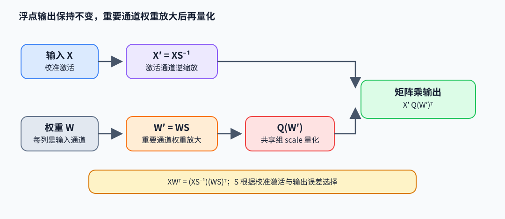

# AWQ：用激活重要性选择权重量化缩放

AWQ（Activation-aware Weight Quantization）在权重低比特量化前做逐输入通道的等价缩放，让高激活通道的权重在共享量化组里获得更合适的动态范围。关键是用逆缩放输入保持浮点线性层不变，再依据校准误差搜索缩放强度。

## 等价缩放与误差

令输入 $x\in\mathbb R^{d_{in}}$、权重 $W\in\mathbb R^{d_{out}\times d_{in}}$，输出 $y=xW^T$。对正对角矩阵 $S$，有

$$
xW^T=(xS^{-1})(WS)^T.
$$

因此可先构造 $x'=xS^{-1}$、$W'=WS$ 再量化 $W'$。设量化误差为 $E=Q(W')-W'$，则量化输出误差为 $xS^{-1}E^T$。输入通道 $j$ 的误差被 $1/s_j$ 缩放；同时 $W'$ 的该通道权重放大 $s_j$，在组共享 scale 下可占用更多整数格点。两种作用共同影响误差，不能把 AWQ 简化成“重要通道的量化 scale 变小”。

例：某通道校准激活峰值约为普通通道 4 倍，但同一量化组的权重范围由其它通道决定。取 $s_j=2$ 并对输入除以 2，浮点输出保持不变；该通道权重分量扩大 2 倍，而对应输入也缩小 2 倍。量化后其权重舍入扰动在输出里的有效幅度还会被输入侧的 $1/2$ 缩小。若其他通道或组 scale 改变，净收益需在校准数据上测量。

下面代码先断言未量化等价，再比较共享 scale 的量化输出误差。示例只检查代数和一组数值，不代表所有校准分布都会因缩放受益：

~~~python
import numpy as np

def fake_quant_symmetric(w, qmax=7):
    scale = np.max(np.abs(w)) / qmax
    return np.clip(np.round(w / scale), -qmax, qmax) * scale

x = np.array([[0.2, 1.0], [0.4, -0.5]])
W = np.array([[0.3, 0.7], [0.2, -0.4]])  # [d_out,d_in]
s = np.array([2.0, 1.0])
xp, Wp = x / s, W * s[None, :]
y = x @ W.T
assert np.allclose(xp @ Wp.T, y)              # 浮点等价
yq_base = x @ fake_quant_symmetric(W).T
yq = xp @ fake_quant_symmetric(Wp).T
err_base = np.linalg.norm(yq_base - y)
err_q = np.linalg.norm(yq - y)
~~~

## 如何确定通道缩放

AWQ 从激活统计估计显著通道，参数化 $s_j\propto a_j^\alpha$，其中 $a_j$ 是校准激活幅度统计，$\alpha$ 控制权重动态范围与输入缩放的折中。对一组候选 $\alpha$ 执行等价变换，量化权重，比较校准层输出重构误差 $\lVert XW^T-X'Q(W')^T\rVert$，再选误差较低的尺度。实际实现会把 scales 折叠进相邻线性层/归一化参数，避免推理新增逐通道缩放算子；跨残差、归一化和分组边界时需保持函数等价。

## 适用范围与阅读

AWQ 主要处理权重量化范围与激活显著性，不等同于激活也量化成 INT8 的 W8A8。它的质量依赖校准样本能覆盖目标输入、分组粒度与量化格式；显著通道统计是代理，不能保证每个任务的敏感方向都被捕获。

- Lin et al., *AWQ: Activation-aware Weight Quantization for LLM Compression and Acceleration*（2023），[论文](https://arxiv.org/abs/2306.00978)：重点读等价缩放、激活显著性实验和校准误差搜索。
- 作者代码入口：[mit-han-lab/llm-awq](https://github.com/mit-han-lab/llm-awq)，追踪 scale 搜索、相邻层缩放折叠与 weight-only kernel 的权重布局。
