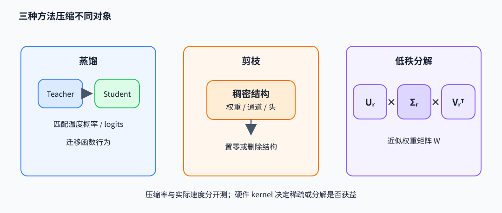

# 蒸馏与压缩：迁移函数、删结构与低秩近似

压缩方法减少模型表示或计算成本，但它们约束模型的方式不同。蒸馏用 teacher 的行为监督 student；剪枝移除参数或结构；低秩分解近似权重矩阵。三者可组合，也会引入不同的质量损失。

## 温度蒸馏的目标

teacher 与 student 在 token 位置输出 logits $z^T,z^S\in\mathbb R^V$。温度 $T$ 下概率分布为 $p_T=\operatorname{softmax}(z^T/T)$、$p_S=\operatorname{softmax}(z^S/T)$，常见蒸馏目标为

$$
L_{KD}=T^2\,D_{KL}(p_T\Vert p_S)
=T^2\sum_{v=1}^{V}p_T(v)\log\frac{p_T(v)}{p_S(v)}.
$$

较高温度显露非最大类别间的相对概率，$T^2$ 用来补偿温度缩放对梯度幅度的影响。KL 散度（Kullback–Leibler divergence）$D_{KL}(p_T\Vert p_S)$ 衡量 teacher 分布相对 student 分布的交叉熵增量。常与硬标签交叉熵混合：$L=\lambda L_{CE}+(1-\lambda)L_{KD}$。例：teacher 对两类 logits `[2,0]`，$T=2$ 时概率约 `[0.731,0.269]`；student `[1,0]` 的温度分布约 `[0.622,0.378]`。蒸馏惩罚分布差异，而只学 argmax 标签会丢失 teacher 对第二类的信心信息。NumPy 代码对应温度 softmax 与 KL：

~~~python
import numpy as np

def softmax(logits, temperature):
    z = logits / temperature
    e = np.exp(z - np.max(z))
    return e / e.sum()

teacher = softmax(np.array([2.0, 0.0]), 2.0)
student = softmax(np.array([1.0, 0.0]), 2.0)
kl = np.sum(teacher * (np.log(teacher) - np.log(student)))
loss_kd = 2.0**2 * kl
~~~

前缀来源决定蒸馏目标的状态分布。真实数据 prefix 做 teacher forcing，目标覆盖数据轨迹；teacher 生成 prefix 让 student 学 teacher 自己走出的轨迹，但不等于 student 部署时会产生的前缀分布；on-policy 蒸馏由 student 当前策略采样 prefix，再在这些位置取得 teacher 全词表分布或奖励，让监督覆盖 student 实际访问的状态。对应的全词表目标可写为

$$
L_{\mathrm{OPD}}=\mathbb E_{x,\,y\sim\pi_S(\cdot\mid x)}\sum_t
D_{KL}\!\left(\pi_T(\cdot\mid x,y_{<t})\,\Vert\,\pi_S(\cdot\mid x,y_{<t})\right).
$$

这里 teacher 为 student 采样得到的每个 prefix 提供 token 分布；student 采样路径通常停止梯度，梯度作用于该 prefix 上的 student 全词表 log-prob。teacher 与 student tokenizer 不同时，逐 token KL 不能直接对齐，需通过共同 tokenization、序列级或奖励目标处理。

DeepSeek-V4.1 报告描述末阶段使用跨领域数据、40 多个异构 teacher 的 full-vocabulary OPD，并说明后训练提升主要来自任务、数据与环境可验证性，而非新后训练算法。这个案例区分了算法目标和数据/环境供给：OPD 定义如何在 student 状态上匹配 teacher 分布，数据管线则决定 student 学到哪些任务。报告还将异步训练里的短序列先到偏差与 stale token 分开处理；前者调整样本分布，后者对过期 token 的 loss 做 mask。

核心数据依赖可写成下面的 PyTorch 风格片段：student 先采出自己的 prefix，teacher 再对相同 prefix 给全词表分布，student 在该位置拟合 teacher；rollout token 本身停止梯度：

~~~python
prefix = sample_prefix(student_policy, prompt).detach()  # 来自当前 student
with torch.no_grad():
    teacher_logits = teacher(prompt, prefix)
student_logits = student(prompt, prefix)
loss = kl_div(student_logits.log_softmax(-1), teacher_logits.softmax(-1))
~~~

| Prefix 来源 | 采样分布 | 在哪种状态上监督 |
|---|---|---|
| 真实数据 | 数据集 $p_{data}$ | 真实文本轨迹 |
| teacher 生成 | $\pi_T$ | teacher 自己的轨迹 |
| student 当前策略 | $\pi_S$ | student 自身可能访问的状态 |

## 剪枝与低秩压缩改变什么

非结构化剪枝将低幅权重置零，参数数值下降但稀疏 kernel 若无硬件支持未必更快；结构化剪枝删除通道、头或层，可形成更规整的稠密形状，但影响更大。低秩近似对 $W\in\mathbb R^{m\times n}$ 做 $W\approx U_r\Sigma_rV_r^T$，保留最大奇异方向，参数从 $mn$ 降至约 $r(m+n)$，前向通常变成两次矩阵乘。LoRA 学习的是相对冻结底座的任务增量 $BA$，不等于对已有权重做截断 SVD；蒸馏则可把不同架构或大模型的函数行为转给小模型。

压缩率、平均层误差与任务质量应同时报告。剪枝后的微调、蒸馏数据覆盖、低秩 rank 和量化位宽会改变结果；只给参数量不能证明延迟或显存下降，实际速度取决于 kernel 和批次形状。

低秩分解可通过奇异值分解（SVD）截断得到：

~~~python
W = np.array([[3.0, 0.0], [0.0, 1.0]])
U, singular, Vt = np.linalg.svd(W, full_matrices=False)
rank = 1
W_rank1 = U[:, :rank] @ np.diag(singular[:rank]) @ Vt[:rank, :]
frobenius_error = np.linalg.norm(W - W_rank1)  # 1.0，舍弃第二方向
~~~

剪枝通过置零或删结构约束权重支持集；LoRA 训练低秩增量；SVD 截断则近似固定矩阵，三者的优化对象不同。

## 代表论文

- Hinton et al., *Distilling the Knowledge in a Neural Network*（2015），[论文](https://arxiv.org/abs/1503.02531)：软目标、温度与 student 训练。
- Gu et al., *On-Policy Distillation of Language Models*（2024），[论文](https://arxiv.org/abs/2306.13649)：student rollout 上的 teacher 分布监督。
- Sanh et al., *DistilBERT*（2019），[论文](https://arxiv.org/abs/1910.01108)：语言模型预训练蒸馏的目标组合。
- LeCun et al., *Optimal Brain Damage*（1989），[论文入口](https://proceedings.neurips.cc/paper/1989/hash/6c9882bbac1c7093bd25041881277658-Abstract.html)；Eckart–Young 低秩近似可作为矩阵压缩基础。
- 代码入口：[huggingface/transformers](https://github.com/huggingface/transformers) 的蒸馏示例与 [pytorch/pytorch](https://github.com/pytorch/pytorch) SVD 接口；阅读时把 logits 对齐、mask、温度与实际张量维度对应起来。V4.1 案例见[本地技术报告](../../downloads/DeepSeek_V41_Tech_Report.pdf)。
