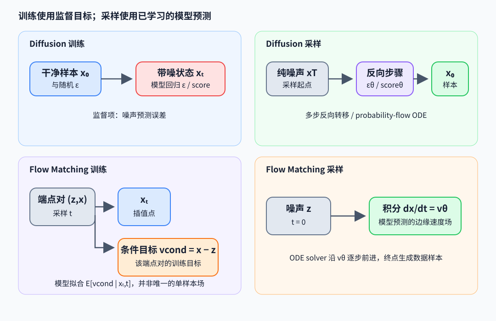

# Diffusion 与 Flow Matching：从训练噪声到生成轨迹

Diffusion（扩散生成）模型学习在不同噪声尺度恢复数据方向，再用反向随机过程或常微分方程（ordinary differential equation，ODE）把噪声逐步变成样本。Flow Matching（流匹配）直接回归一条概率路径上的速度场。两者都训练向量场类预测器，但路径参数化、训练目标与采样积分方法不同。

## 前向加噪与噪声预测

离散扩散定义 $\alpha_t=1-\beta_t$、$\bar\alpha_t=\prod_{s=1}^t\alpha_s$。从干净样本 $x_0$ 直接采样任意时间步：

$$
q(x_t\mid x_0)=\mathcal N(\sqrt{\bar\alpha_t}x_0,(1-\bar\alpha_t)I),\qquad
x_t=\sqrt{\bar\alpha_t}x_0+\sqrt{1-\bar\alpha_t}\,\epsilon,\;\epsilon\sim\mathcal N(0,I).
$$

常见训练目标为 $L_\epsilon=\mathbb E_{x_0,t,\epsilon}\lVert\epsilon-\epsilon_\theta(x_t,t)\rVert^2$。由高斯条件分布可得对数密度梯度（score）$\nabla_{x_t}\log q(x_t\mid x_0)=-\epsilon/\sqrt{1-\bar\alpha_t}$；噪声预测因而能估计 score 的方向与尺度。例：若 $\bar\alpha_t=0.64$，则 $x_t=0.8x_0+0.6\epsilon$。预测噪声误差同时影响恢复的 $x_0$ 估计与反向步长。

DDPM（去噪扩散概率模型）采样根据学习的反向转移逐步从 $x_T\sim\mathcal N(0,I)$ 走回 $x_0$，每一步可加入随机噪声。减少步数意味着用更稀疏的时间网格近似反向过程，质量与稳定性受模型、schedule 和 sampler 共同影响。随机微分方程（stochastic differential equation，SDE）描述连续时间带噪声过程；probability-flow ODE 是具有相同边缘分布的一种确定性流，其向量场包含 score 项。ODE solver 可用不同阶数和自适应步长积分。

## Flow Matching 的速度目标

取简单直线路径，令 $z\sim\mathcal N(0,I)$ 为噪声、$x\sim p_{data}$ 为样本，$t\in[0,1]$，定义

$$
x_t=(1-t)z+tx,\qquad v_{\mathrm{cond}}(x_t,t;z,x)=\frac{d x_t}{dt}=x-z,
\quad L_{FM}=\mathbb E\lVert v_\theta(x_t,t)-v_{\mathrm{cond}}\rVert^2.
$$

训练时随机取 $(z,x,t)$，条件回归目标是 $v_{\mathrm{cond}}=x-z$。若用平方误差，固定 $(x_t,t)$ 时的总体最优预测是 $v^*(x_t,t)=\mathbb E[x-z\mid x_t,t]$；同一个中间点可由不同端点对产生，因此单个样本的 $x-z$ 不是唯一的 marginal 向量场。生成时从 $x_{t=0}=z$ 出发解 $dx_t/dt=v_\theta(x_t,t)$。Euler（欧拉）一步为 $x_{t+\Delta t}=x_t+\Delta t\,v_\theta(x_t,t)$；实际多步积分用更细网格或更高阶 solver。例：若 $z=-1,x=3,t=0.25$，则 $x_t=0$、该端点对的条件目标速度为 4；走 $\Delta t=0.25$ 到条件直线上的下一点 $x=1$。模型学习的是给定 $(x_t,t)$ 的条件平均速度，不应据单条样本认定 marginal 场恒为 4。

NumPy 代码对应两类训练 target 与一步 Euler 更新。扩散处以真噪声代替预测器输出，用于检查前向公式；flow 的速度针对指定端点对：

~~~python
import numpy as np

x0, noise, alpha_bar = 2.0, -1.0, 0.64
xt = np.sqrt(alpha_bar) * x0 + np.sqrt(1 - alpha_bar) * noise  # 1.0
x0_hat = (xt - np.sqrt(1 - alpha_bar) * noise) / np.sqrt(alpha_bar)

z, data, t = -1.0, 3.0, 0.25
xt_flow = (1 - t) * z + t * data                              # 0
v_cond = data - z                                             # 4
xt_next = xt_flow + 0.25 * v_cond                             # 1
~~~

## 图像、视频与音频生成

扩散常在像素、潜空间或时空 latent 上工作；latent diffusion 先由 autoencoder 压缩，再在较小张量上建模。条件可以是文本、类别、图像或控制信号。视频把时间维纳入去噪张量或分块处理，音频可在波形、频谱或 codec latent 上生成。表示、条件注入和路径目标各自不同，不能由“用了 diffusion”推断网络结构一致。

## 论文与代码阅读

- Ho et al., *Denoising Diffusion Probabilistic Models*（2020），[论文](https://arxiv.org/abs/2006.11239)：前向边缘分布、噪声预测和反向采样。
- Song et al., *Score-Based Generative Modeling through Stochastic Differential Equations*（2021），[论文](https://arxiv.org/abs/2011.13456)：SDE、score 与 probability-flow ODE。
- Lipman et al., *Flow Matching for Generative Modeling*（2023），[论文](https://arxiv.org/abs/2210.02747)：路径条件速度回归和采样流。
- 代码入口：[openai/guided-diffusion](https://github.com/openai/guided-diffusion) 与 [facebookresearch/flow_matching](https://github.com/facebookresearch/flow_matching)：定位训练 target、time embedding 和 sampler；不要把离散 schedule 公式当作代码唯一实现。
