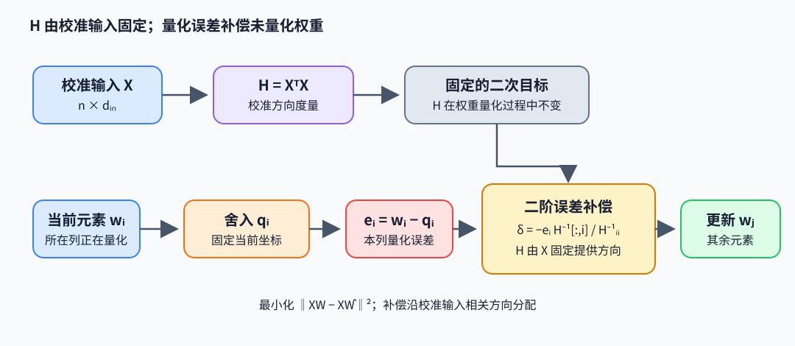

# GPTQ：校准输入上的权重重构

GPTQ 是 Generative Pre-trained Transformer Quantization 的逐层权重量化方法，目标是让校准输入经过量化层后的输出尽量接近原层输出。它利用输入协方差近似 Hessian 信息，并在量化一个权重列后补偿其误差对尚未量化列的影响。

## 从层输出误差到二次型

给定校准激活 $X\in\mathbb R^{n\times d_{\mathrm{in}}}$ 与线性层权重 $W\in\mathbb R^{d_{\mathrm{in}}\times d_{\mathrm{out}}}$，输入输出约定为 $Y=XW$。量化後 $\hat W$ 的层重构目标是

$$
\min_{\hat W\in\mathcal Q}\lVert XW-X\hat W\rVert_F^2
=\min_{\hat W\in\mathcal Q}\operatorname{tr}\left((W-\hat W)^T H(W-\hat W)\right),\quad H=X^TX.
$$

$H$ 是校准输入列之间的未归一化 Gram 矩阵；除以样本数只改变整体尺度。它让每个权重误差按实际激活方向加权，所以目标不是不加条件的 $\lVert W-Q(W)\rVert_F^2$。例：若输入两维恒相同，$H$ 的两个方向高度相关，单独惩罚两个权重元素误差会忽略它们在 $XW$ 中可能互相抵消或叠加。

## 二阶误差补偿

先考虑一个输出列 $w$。要把第 $i$ 项固定为量化值 $q_i$，其余坐标的补偿可由受约束二次最小化得到：

$$
\min_{\delta}\;\delta^TH\delta\quad\text{s.t. }\delta_i=q_i-w_i=-e_i,\qquad e_i=w_i-q_i.
$$

Lagrange 条件 $2H\delta+\lambda e_i^{(basis)}=0$ 给出

$$
\delta=-e_i\frac{H^{-1}_{:,i}}{[H^{-1}]_{ii}},\qquad
\min\delta^TH\delta=\frac{e_i^2}{[H^{-1}]_{ii}}.
$$

向量第 $i$ 項恰為 $-e_i$，所以新權重落在 $q_i$；其餘分量按校准输入的相关方向调整。例：取 $H=\begin{bmatrix}4&2\\2&2\end{bmatrix}$，则 $H^{-1}=\begin{bmatrix}0.5&-0.5\\-0.5&1\end{bmatrix}$。$w=[1.3,0.7]$，第一项舍入到 $q_0=1.0$，$e_0=0.3$，得到 $\delta=[-0.3,0.3]$、$w'=[1.0,1.0]$，二次误差 $\delta^TH\delta=0.18$。单纯独立舍入为 $[1.0,0.7]$，在该 $H$ 下没有利用输入相关性补偿。

~~~python
import numpy as np

H = np.array([[4.0, 2.0], [2.0, 2.0]])
Hinv = np.linalg.inv(H)
w = np.array([1.3, 0.7])
q0 = 1.0
error = w[0] - q0
delta = -error * Hinv[:, 0] / Hinv[0, 0]
w_compensated = w + delta
loss = delta @ H @ delta
~~~

该代码显式使用稠密数学逆矩阵，只用于两维推导核对。作者实现先对阻尼后的 $H$ 做 Cholesky，再求出 $H^{-1}$，随后又将其分解为上三角因子 $U$（$U^TU=H^{-1}$）；变量名 `Hinv` 此时保存的是因子 $U$，不是稠密矩阵 $H^{-1}$。循环用 $U$ 的行、对角和 blockwise 更新实现对应的贪心补偿，不能把那几行逐字解释成上面的 dense-inverse 列公式。

## 量化格式与误差来源

权重按 group 估计 scale/zero-point，映射到低比特整数，再在 kernel 中解包与反量化。group 大小、对称/非对称格式、校准样本、阻尼、列排序及 kernel 布局共同影响精度和速度。层输出重构误差低不必然保证端到端任务指标不变；误差会经过后续层非线性累积。报告 perplexity、任务质量、模型大小和真实推理 kernel 才能评估完整方案。

## 论文与作者代码

- Frantar et al., *GPTQ: Accurate Post-Training Quantization for Generative Pre-trained Transformers*（2022），[论文](https://arxiv.org/abs/2210.17323)。重点看 OBQ 的二阶误差更新如何扩展成 blockwise GPTQ，以及校准数据和排序实验。
- 作者代码：[IST-DASLab/gptq](https://github.com/IST-DASLab/gptq)，关注 `gptq.py` 中 Hessian 累积、阻尼、Cholesky 与列更新；量化目标应结合校准输入解释。
