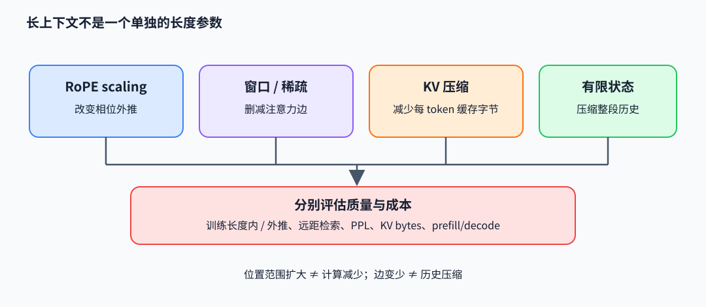

# 长上下文：位置外推、局部注意力与记忆压缩

长上下文设计需要分别解决位置编码可外推、每层注意力计算可承受，以及历史信息能否保留。RoPE scaling 改变位置相位；窗口/稀疏注意力减少可见边；键值（key-value，KV）缓存压缩减少保存内容；有限状态递归把历史压进固定维状态。这些方案的质量和成本不能用单一“支持多少 token”概括。

## RoPE 与位置缩放

RoPE（旋转位置编码，Rotary Position Embedding）将 query/key 每两维视作平面向量，位置 $p$ 乘旋转矩阵 $R(p\omega)$。其内积满足

$$
(R(p\omega)q)^T(R(s\omega)k)=q^TR((s-p)\omega)k,
$$

因此注意力分数依赖相对位置。超出训练长度后，频率相位随位置增大而旋转到训练中少见的范围。线性位置插值将位置缩为 $p'=p\cdot L_{train}/L_{target}$，压缩相位变化范围，但会降低短距离分辨率。NTK（neural tangent kernel，神经切线核）感知缩放、YaRN 等采用不同频率段缩放与幅度校准，目标是在短距离精度和长距离稳定性间折中；不能只写一个扩大后的 max position 就断言模型已学会长程信息。

下面的 NumPy 算例直接检验相对位置内积恒等式：

~~~python
import numpy as np

def rotate(v, position, omega):
    angle = position * omega
    R = np.array([[np.cos(angle), -np.sin(angle)],
                  [np.sin(angle),  np.cos(angle)]])
    return R @ v

q, k = np.array([1.0, 0.0]), np.array([0.0, 1.0])
p, s, omega = 2, 5, np.pi / 4
lhs = rotate(q, p, omega) @ rotate(k, s, omega)
rhs = q @ rotate(k, s - p, omega)
assert np.isclose(lhs, rhs)
~~~

## 少算、少存与压缩状态

滑动窗口让每个 query 只看最近 $w$ 个 token，长序列注意力边数由 $O(L^2)$ 降至约 $O(Lw)$，但窗口外 token 无法直接被当前层读取。块稀疏模式按局部窗口加少量全局/检索边连接，效果取决于图结构和任务需要的跨区依赖。它们主要减少计算边。

KV 压缩或量化继续保留可寻址历史，但减少每个 token 的缓存字节；合并 token/latent 会损失细节。Mamba 类固定状态不按 token 留独立缓存，计算与状态大小可保持线性/固定，但长历史必须由递归状态概括。三种机制的关键差异分别是“少读哪些位置”“每个位置少存多少”“历史如何压成状态”。

## 用短上下文外推评价长依赖

评测至少应分开报告训练长度内和外推长度上的 next-token loss、needle retrieval、跨段复制/检索、长文问答及位置分布。改变 context length 时要固定模型权重、RoPE 参数、KV 精度、batch 与生成策略；记录 prefill/decode 延迟和实际 KV bytes。短上下文困惑度（perplexity，PPL）稳定不保证远距离检索正确，单个 needle 命中也不足以说明长文推理质量。

## 原论文与实现

- Su et al., *RoFormer: Enhanced Transformer with Rotary Position Embedding*（2021），[论文](https://arxiv.org/abs/2104.09864)：旋转相对位置性质。
- Chen et al., *Extending Context Window of Large Language Models via Positional Interpolation*（2023），[论文](https://arxiv.org/abs/2306.15595)：线性位置插值与长上下文微调。
- Peng et al., *YaRN: Efficient Context Window Extension of Large Language Models*（2023），[论文](https://arxiv.org/abs/2309.00071)：频率分段与注意力缩放。
- 局部/稀疏注意力可读 Longformer [论文](https://arxiv.org/abs/2004.05150)；KV 压缩可与本册 MLA 机制比较。作者代码入口：[jquesnelle/yarn](https://github.com/jquesnelle/yarn) 与 [allenai/longformer](https://github.com/allenai/longformer)。
