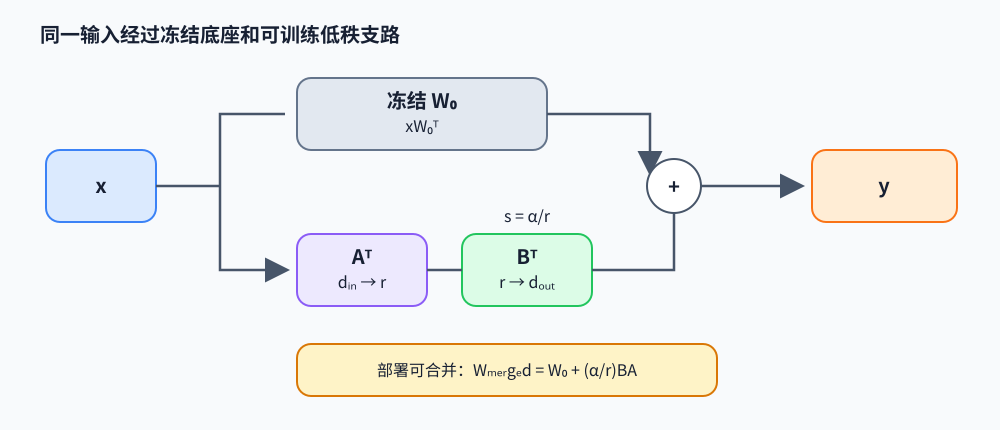

# LoRA：冻结底座上的低秩增量

低秩适配（low-rank adaptation，LoRA）将微调权重写成冻结底座加可训练低秩更新。它减少需要保存和更新的参数量；可训练空间受 rank 限制，因此参数高效不等于与全参数微调等价。

## 从全量更新到低秩因子

对线性层 $y=xW_0^T$，设输入宽度 $d_{\text{in}}$、输出宽度 $d_{\text{out}}$，则 $W_0\in\mathbb R^{d_{\text{out}}\times d_{\text{in}}}$。LoRA 保持 $W_0$ 冻结，令

$$
W=W_0+\Delta W,\qquad \Delta W=sBA,
$$

其中 $A\in\mathbb R^{r\times d_{\text{in}}}$、$B\in\mathbb R^{d_{\text{out}}\times r}$、$r\ll\min(d_{\text{in}},d_{\text{out}})$，常用 $s=\alpha/r$。前向为 $y=xW_0^T+s(xA^T)B^T$。原权重有 $d_{\text{out}}d_{\text{in}}$ 个参数，adapter 只有 $r(d_{\text{in}}+d_{\text{out}})$ 个。例：4096×4096 层取 $r=8$，可训练参数从约 16.8M 降至 65.5K。

典型初始化令 $A$ 随机、$B=0$，因此起始时 $\Delta W=0$，底座函数不变。反向传播仍要穿过冻结权重计算前层梯度，但不为 $W_0$ 保存参数梯度和优化器状态。rank 控制更新矩阵的秩上限，也影响不同任务可表达的方向数量；目标模块选择、数据量、学习率和 rank 都影响质量。

下例是可直接运行的 NumPy 线性旁路。$x:[1,2]$、$A:[1,2]$、$B:[2,1]$，底座 $W_0:[2,2]$：

~~~python
import numpy as np

x = np.array([[1.0, 2.0]])
W0 = np.zeros((2, 2))
A = np.array([[1.0, -1.0]])       # [r,d_in]
B = np.zeros((2, 1))              # [d_out,r]
scale = 1.0
base = x @ W0.T
adapter = scale * (x @ A.T) @ B.T
y = base + adapter                 # 起始时与 base 相同

grad_y = np.array([[1.0, -2.0]])   # 上游 dL/dy
grad_B = scale * grad_y.T @ (x @ A.T)
grad_A = scale * (grad_y @ B).T @ x
W_merged = W0 + scale * B @ A
assert np.allclose(y, x @ W_merged.T)
~~~

这个数值例中 $xA^T=-1$。由于 $B=0$，前向 adapter 输出为 0，$\nabla_A L=(B^T\nabla_yL)^Tx=0$；但 $\nabla_B L=\nabla_yL^T(xA^T)=[[-1],[2]]$ 非零。第一步更新先让 $B$ 离开零点，之后梯度才能进入 $A$。若把 $A,B$ 都初始化为零，两个因子在第一步都会收到零梯度，adapter 无法启动。

对 batch row 输入 $X\in\mathbb R^{B\times d_{in}}$、上游梯度 $G=\partial L/\partial Y\in\mathbb R^{B\times d_{out}}$，矩阵梯度为

$$
\nabla_B L=sG^T(XA^T),\qquad
\nabla_A L=s(G B)^T X.
$$

这与上面 NumPy 代码的 row-vector 约定一致；冻结底座权重 $W_0$ 不接收参数梯度。

## 合并与部署

推理时可预先将 $W_{\text{merged}}=W_0+sBA$ 写入权重，使前向不额外增加 adapter 矩阵乘；上例 `W_merged` 与旁路在实数运算下相同。代价是需要生成任务专属权重副本。多个 adapter 可分别保存并在运行时选择，但动态切换会引入额外读写和 kernel 路径。若底座量化，先合并再量化与保持量化底座并旁路执行 adapter 会有不同的舍入误差和延迟，需按部署路径评测。

LoRA 的 $BA$ 是任务训练出的参数增量；DeepSeek MLA 的低秩 latent 则是模型架构中对每个 token 的 KV 表示压缩，再通过投影恢复注意力所需表示。前者改变权重，后者改变激活与缓存结构，矩阵乘法形式相似不代表语义相同。

## 阅读原论文与代码

- Hu et al., *LoRA: Low-Rank Adaptation of Large Language Models*（2021），[论文](https://arxiv.org/abs/2106.09685)。重点看 rank-deficiency 动机、初始化、目标模块和不同 rank 的实验。
- 作者代码：[microsoft/LoRA](https://github.com/microsoft/LoRA)，阅读 `loralib/layers.py` 中线性层的旁路与 merge/unmerge；PEFT 还提供更广泛的 adapter 配置，但不等同于原论文实现。
