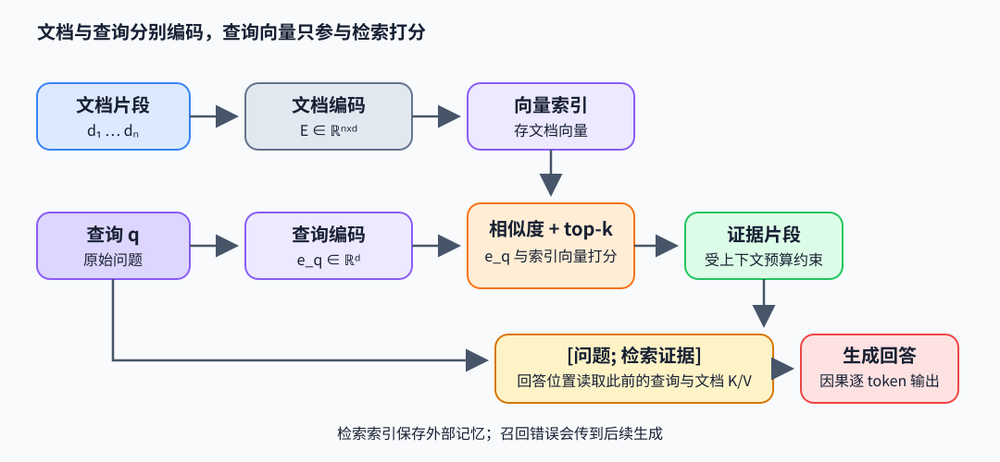

# 检索与记忆：把外部证据接入生成

检索增强生成（RAG）先从语料找候选片段，再将片段作为上下文交给生成模型。算法核心在表示、打分、筛选与条件生成；检索减少模型参数记住事实的压力，却不能保证候选完整、相关或可信。

## 从查询到可用证据

语料切成文档片段 $d_i$，编码器生成向量 $e_i=f_\phi(d_i)$；查询 $q$ 得到 $e_q$。双编码器常用余弦相似度 $s_i=e_q^Te_i/(\lVert e_q\rVert\lVert e_i\rVert)$，取 top-$k$ 形成 $D_q$。稠密检索擅长语义近邻，词法检索保留精确术语；混合检索会合并候选，再用交叉编码器或生成器相关性打分重排。top-$k$ 是候选预算，不能修复语料缺失或错误切分。

例：一个问题问“某论文里 Δ 如何控制状态遗忘”，向量检索找出多个含 selective state 的段落，再按论文段落、公式与出处筛选。若 top-2 都来自同一泛化摘要，答案仍可能缺少离散化条件；加入原论文算法段落能提高证据覆盖。这个例子说明召回内容会限制后续回答，不代表任何检索器固定有此质量。

## 检索结果怎样影响注意力

通用检索后拼 prompt 的做法将 $[q;d_1;\dots;d_k]$ 作为一个上下文，模型只对拼接后的上下文条件生成。Lewis 等人的原始 RAG 则把文档 $z$ 视作潜变量并对 top-$K$ 文档边缘化。RAG-sequence 在整条输出序列共享同一潜文档：

$$
p_{\mathrm{RAG-seq}}(y\mid x)=\sum_{z\in\operatorname{topK}(p_\eta(\cdot\mid x))}
p_\eta(z\mid x)\,p_\theta(y\mid x,z),\qquad
p_\theta(y\mid x,z)=\prod_i p_\theta(y_i\mid x,z,y_{<i}).
$$

这里的 $p_\eta(z\mid x)$ 在选中的 top-$K$ 文档集合内重新归一化；若直接使用全库概率而不归一化，top-$K$ 求和只是全库边缘化的截断近似，概率质量等于召回文档的总概率。

RAG-token 则在每个输出位置重新对文档概率求和：

$$
p_{\mathrm{RAG-tok}}(y\mid x)=\prod_i\sum_{z\in\mathrm{topK}}
p_\eta(z\mid x)\,p_\theta(y_i\mid x,z,y_{<i}).
$$

所以 RAG-sequence 的一条完整回答由一个文档解释，RAG-token 可在不同 token 的边缘化中组合多个文档。简单拼 prompt 不会自动实现这两个潜变量边缘化目标。

对生成输入 $[q;d_1;\dots;d_k]$，回答位置的 Query 可读取它之前的查询与文档 K/V；因果 mask 不允许位于文档之前的问题 token 反向读取后续文档。self-attention 在每层按

$$
\operatorname{Attn}(Q,K,V)=\operatorname{softmax}(QK^T/\sqrt{d_k}+M)V
$$

将 query token 与可见文档 token 交互。文档越长，prefill 的注意力计算和 KV cache 越大；片段过短会丢上下文，过长会稀释相关证据。RAG 的“外部记忆”由检索索引保存并按需读取，不是 Transformer 隐藏状态本身；模型仍需通过当前输入把证据写入有限层的激活和 KV 表示。

另一类记忆直接在模型状态里累积历史摘要，例如递归 SSM 的固定状态，或压缩缓存的 latent。检索式记忆可按内容寻址、更新外部条目，但依赖索引覆盖和召回；参数记忆不需每次访问文档库，却难以逐条更新事实；有限状态记忆容量稳定，但细粒度的任意历史查找受压缩损失限制。系统可以组合这几种表示。

一个检索边缘化实现可先取每份文档的生成 log-prob，再按 retriever 权重做 log-sum-exp；RAG-sequence 在完整序列结束后合并，RAG-token 在每个位置合并：

~~~python
import torch

# docs: [K, ...], log_p_doc: [K], log_p_y_given_doc: [K, T]
log_weight = log_p_doc - log_p_doc.logsumexp(dim=0)
rag_sequence = torch.logsumexp(log_weight + log_p_y_given_doc.sum(dim=-1), dim=0)
rag_token = torch.logsumexp(log_weight[:, None] + log_p_y_given_doc, dim=0).sum()
~~~

例：两份文档权重为 `[0.7,0.3]`。若某 token 在两份文档下概率为 `[0.2,0.8]`，RAG-token 的边缘概率为 $0.7(0.2)+0.3(0.8)=0.38$。对两 token 完整序列，sequence 目标先各自相乘再加权；若文档 A 两 token 概率 `[0.2,0.9]`、B 为 `[0.8,0.1]`，则序列概率 $0.7(0.18)+0.3(0.08)=0.15$，不同于逐 token 边缘相乘 $0.38\times0.66=0.2508$。

## 一个小型算法路径

给定文档向量矩阵 $E\in\mathbb R^{N\times d}$ 与 query $q\in\mathbb R^d$，最简稠密召回是 $s=E q$ 并取最大 $k$ 个索引；随后将片段与原始来源一起拼入提示。实际系统还需处理过滤、去重、权限、上下文预算与证据冲突，这些步骤改变候选集合，不能被“向量检索”四字概括。

## 代表论文与实现入口

- Lewis et al., *Retrieval-Augmented Generation for Knowledge-Intensive NLP Tasks*（2020），[论文](https://arxiv.org/abs/2005.11401)：参数化生成器与非参数检索器的组合，以及检索条件化目标。
- Karpukhin et al., *Dense Passage Retrieval for Open-Domain Question Answering*（2020），[论文](https://arxiv.org/abs/2004.04906)：双编码器对比学习与检索排序。
- 作者代码入口：[facebookresearch/DPR](https://github.com/facebookresearch/DPR) 的 `dpr/models/biencoder.py`；[facebookresearch/atlas](https://github.com/facebookresearch/atlas) 展示检索与生成训练组合。读代码时追踪 query/doc 表示、负例、top-k 与生成条件，不把索引后端当作检索目标本身。
