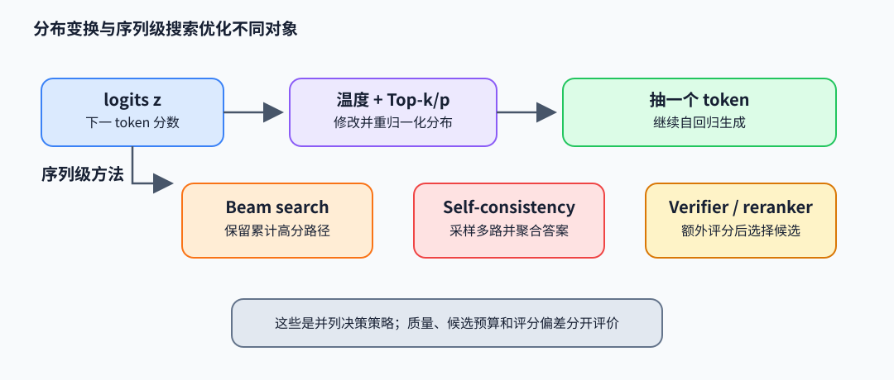

# 采样与搜索：从概率分布到候选决策

解码算法决定如何把模型的 next-token 分布变成输出序列。随机采样保留概率不确定性；搜索方法显式比较多条候选路径。两者优化的目标和成本不同，不能只按“确定”或“多采几条”判断质量。

## Temperature、Top-k 与 Top-p

logits $z_i$ 经温度缩放得到 $p_i=\exp(z_i/T)/\sum_j\exp(z_j/T)$。$T\to0^+$ 时分布集中于最大 logit；较大 $T$ 拉平分布。Top-k 只保留最高的 $k$ 个 token 并重新归一化。Top-p（nucleus）按概率从高到低取最小集合 $S$，满足 $\sum_{i\in S}p_i\ge p$，再在 $S$ 内归一化。常见实现先温度缩放，再筛 token；顺序不同会得到不同集合，需明确采样配置。计算过程可直接写为：

~~~python
import numpy as np

def top_p_distribution(logits, temperature, p):
    z = logits / temperature
    probs = np.exp(z - z.max())
    probs /= probs.sum()
    order = np.argsort(probs)[::-1]
    sorted_p = probs[order]
    keep = np.cumsum(sorted_p) - sorted_p < p  # 保留跨过阈值的那一项
    kept = sorted_p * keep
    kept /= kept.sum()
    return order[keep], kept
~~~

例：概率为 `[0.60, 0.25, 0.10, 0.05]`，取 `top_p=0.8`，代码保留前两项（累计 0.85），归一化后为 `[0.706, 0.294]`。如果再做 top-k=1，则输出退化为最大项。筛选减少尾部低概率 token，但会改变原始模型分布，可能截掉合法但少见的延续。

## Beam search 与候选重排序

Beam search 每步扩展 beam 中各序列的 token 候选，保留累计 log probability 较高的 $K$ 条路径。因序列概率连乘会偏好短序列，常用长度归一化或长度惩罚；它改变排序目标，未必对应真实任务效用。束宽增大提高搜索覆盖，但成本随候选数、词表和长度增长，且高概率文本不一定事实正确。

Self-consistency 对同一问题采样多条推理链，再聚合最终答案（多数票或规范化答案票数）。它利用路径多样性，但若所有路径共享系统偏差，多数票不会纠错；采样数量也增加推理成本。Verifier/reranker 用单独评分模型或规则选择候选，可优化指定评价信号，却可能被评分器偏好或奖励黑客影响。

## 目标、分布与代价

对单次解码，temperature/top-k/top-p 改变局部 token 分布；beam 近似搜索模型序列分数；self-consistency 估计多个采样路径中答案共识；verifier 则引入额外评分函数。评估时应固定 prompt、随机种子策略、tokenizer、长度上限和采样参数，分别记录任务质量、重复性、拒答率与生成 token 数。不同解码器若使用不同候选预算或重排序成本，不能直接把质量差异归因于模型权重。

## 论文与参考实现

- Holtzman et al., *The Curious Case of Neural Text Degeneration*（2020），[论文](https://arxiv.org/abs/1904.09751)：nucleus sampling 与重复退化分析。
- Wang et al., *Self-Consistency Improves Chain of Thought Reasoning in Language Models*（2022），[论文](https://arxiv.org/abs/2203.11171)：多条推理路径及答案聚合。
- Hugging Face Transformers 的[生成策略说明](https://huggingface.co/docs/transformers/generation_strategies)与 `generation` 实现可用于核对参数组合；它是工程接口说明，不替代对具体搜索目标的分析。
