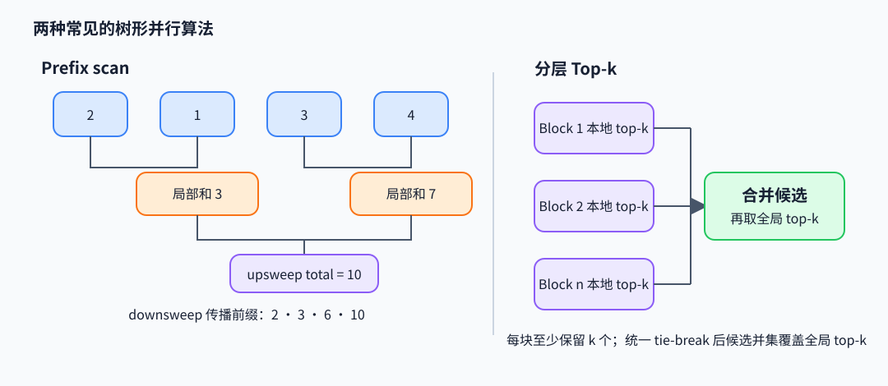

# 并行 Scan 与 Selection：前缀、统计量和 Top-k

Scan 把一个结合运算沿序列做前缀累积；Selection 从大量候选中找出满足排序或筛选规则的元素。它们常出现在 attention、排序、稀疏路由和归约 kernel 中，算法组织决定数据移动、同步和临时存储。

## Prefix scan 的结合运算

给定 $x_0,\ldots,x_{n-1}$ 和结合运算 $\oplus$，inclusive scan 输出 $y_i=x_0\oplus\cdots\oplus x_i$。加法例 `[2,1,3,4]` 的结果是 `[2,3,6,10]`。结合律允许改变括号，不允许交换顺序，因此通用 scan 是有序并行算法；非交换运算需要保留左到右的元素次序。

Blelloch scan 先做 upsweep 构造树形部分归约，再将根置为单位元并 downsweep 传播 exclusive 前缀。它用 $O(n)$ 运算、$O(\log n)$ 并行深度；设备实现通常用 warp shuffle 或 shared memory 完成块内 scan，再对块和递归 scan，最后加回块前缀。块间协议需要显式解决发布、可见性和同步，单个 block 的 barrier 不能同步整个 grid。

## Welford 方差的可合并统计量

直接累加 $\sum x$ 与 $\sum x^2$ 再相减，在均值很大、方差很小时可能发生灾难性消减。Welford 每段保存 $(n,\mu,M_2)$，其中 $M_2=\sum_i(x_i-\mu)^2$。两段 $A,B$ 的统计可结合为

$$
\delta=\mu_B-\mu_A,\quad n=n_A+n_B,\quad
\mu=\mu_A+\delta\frac{n_B}{n},\quad
M_2=M_{2,A}+M_{2,B}+\delta^2\frac{n_An_B}{n}.
$$

最终总体方差为 $M_2/n$，样本方差为 $M_2/(n-1)$。例：段 A 为 `[1,3]`，得 $(2,2,2)$；段 B 为 `[5]`，得 $(1,5,0)$；合并得 $n=3,\mu=3,M_2=8$，总体方差 $8/3$。这个 merge 把稳定在线统计转成可并行树归约。

~~~python
def merge_welford(a, b):
    na, ma, m2a = a
    nb, mb, m2b = b
    n = na + nb
    delta = mb - ma
    mean = ma + delta * nb / n
    m2 = m2a + m2b + delta * delta * na * nb / n
    return n, mean, m2

assert merge_welford((2, 2.0, 2.0), (1, 5.0, 0.0)) == (3, 3.0, 8.0)
~~~

## Top-k 不是完整排序

全排序 $n$ 个值通常需要 $O(n\log n)$ 比较；若只需 k 个最大值，可用堆维持 $O(k)$ 候选（$O(n\log k)$），选择算法用分区寻找第 k 阈值，再局部排序候选。并行实现可先让每个 tile 留本地 top-k，再合并这些候选：全局 top-k 包含在各块本地 top-k 的并集中。若一个元素在本块内排到 k 名之外，本块至少有 k 个元素不小于它，因此它不可能进入全局前 k。若每块保留少于 k 个则一般不保证正确。并列值需采用一致的索引 tie-break，否则边界候选可能不稳定。

每块保留 k 个值后合并候选，可用数值例验证全局 Top-k 确实位于本地候选并集中：

~~~python
shards = [[9, 1, 8, 2], [7, 6, 3, 5]]
k = 2
local = [sorted(part, reverse=True)[:k] for part in shards]
candidates = [value for part in local for value in part]
assert sorted(candidates, reverse=True)[:k] == sorted(
    [value for part in shards for value in part], reverse=True
)[:k]
~~~

## 论文与实现

- Blelloch, *Prefix Sums and Their Applications*（1990），[章节稿](https://www.cs.cmu.edu/~guyb/papers/Ble93.pdf)：work-efficient scan 与应用。
- Welford, *Note on a Method for Calculating Corrected Sums of Squares and Products*（1962），[论文入口](https://doi.org/10.1080/00401706.1962.10490022)：在线矩与稳定合并。
- GPU primitives 可参考 [NVIDIA CUB](https://github.com/NVIDIA/cccl/tree/main/cub) 的 DeviceScan/DeviceSelect，以及 [Thrust](https://github.com/NVIDIA/cccl/tree/main/thrust) 的排序和选择接口。阅读时确认稳定性、临时存储与跨 block 语义。
