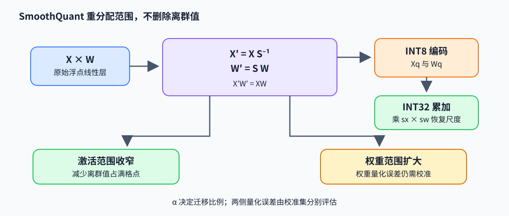

# SmoothQuant：把激活离群值迁移到权重

SmoothQuant（平滑量化）将激活中的通道离群值通过等价缩放迁移到权重侧，让 activation 与 weight 都能落入较易量化的 8 位整数（INT8）动态范围。核心是改变两侧的量化难度分配，同时保持矩阵乘的浮点函数不变。

## $XW$ 的等价通道变换

令输入 $X\in\mathbb R^{m\times d}$、权重 $W\in\mathbb R^{d\times n}$。对正对角 $S=\operatorname{diag}(s_1,\dots,s_d)$，有

$$
XW=(XS^{-1})(SW)=X'W'.
$$

若第 $j$ 个激活通道最大幅度 $a_j$ 远高于其它通道，直接逐 tensor INT8 scale 会让普通通道使用很少整数格点。取较大的 $s_j$ 可令 $X'_j=X_j/s_j$ 更容易量化，同时 $W'_j=s_jW_j$ 的范围增大；二者相乘仍等于原结果。SmoothQuant 在 activation 与 weight 的可量化性之间移动动态范围，不是剪掉离群值。

## 平滑系数 $\alpha$

一种通道尺度设定为

$$
s_j=\frac{a_j^\alpha}{w_j^{1-\alpha}},\qquad
a_j=\max_{r}|X_{rj}|,\quad w_j=\max_c|W_{jc}|.
$$

$\alpha\in[0,1]$ 控制迁移程度：较大 $\alpha$ 更积极地把激活离群幅度移到权重，可能令权重更难量化；较小 $\alpha$ 留更多范围给激活。校准集用于估计 $a_j$ 与候选 $\alpha$ 下的误差。实际模型会把 $S^{-1}$ 与 $S$ 融合到相邻线性层或 LayerNorm/RMSNorm 的参数，避免增加独立浮点缩放 kernel。

例：若某通道 $a_j=16$、$w_j=0.5$，取 $\alpha=0.5$ 得 $s_j=\sqrt{16}/\sqrt{0.5}\approx5.657$。输入峰值缩至约 2.83，权重峰值放大至约 2.83，浮点乘积保持不变。该算例展示尺度迁移，不足以判定量化误差；还需考虑整个张量/通道的取整、对称范围和累加精度。

## W8A8 校准与误差

部署时先用 scale 将 $X'$、$W'$ 编码成整数 $X_q=\operatorname{round}(X'/s_x)$、$W_q=\operatorname{round}(W'/s_w)$ 并裁剪到 INT8 范围。32 位整数（INT32）累加后再恢复量纲：

$$
Y_{\mathrm{int32}}=X_qW_q,\qquad
\hat Y=(s_xs_w)Y_{\mathrm{int32}}.
$$

这里 $X_q,W_q$ 是整数编码，$Q_a(X')=s_xX_q$、$Q_w(W')=s_wW_q$ 才是反量化近似值；上式中的 scale 也可按 token、通道或硬件支持的分组广播。W8A8 表示权重和激活均采用 8 位编码。以下代码使用逐 tensor activation scale 和权重 scale 展示 INT8 编码、INT32 累加及输出缩放，并对照等价浮点路径：

~~~python
import numpy as np

def encode_int8(a, scale):
    return np.clip(np.round(a / scale), -127, 127).astype(np.int8)

X = np.array([[1.0, 0.25], [-0.5, 2.0]])       # [m,d]
W = np.array([[0.5, -1.0], [2.0, 0.25]])       # [d,n]
smooth = np.array([2.0, 1.0])
Xp, Wp = X / smooth, smooth[:, None] * W
assert np.allclose(Xp @ Wp, X @ W)               # 只验证浮点重参数化
sx, sw = np.max(np.abs(Xp)) / 127, np.max(np.abs(Wp)) / 127
Xq = encode_int8(Xp, sx).astype(np.int32)
Wq = encode_int8(Wp, sw).astype(np.int32)
acc32 = Xq @ Wq
Yhat = acc32.astype(np.float32) * (sx * sw)     # 恢复实数尺度
Yfloat = Xp @ Wp
quant_error = np.linalg.norm(Yhat - Yfloat)
~~~

校准应覆盖层输入的真实分布，检查每层输出误差和端到端质量。激活 scale 的粒度改变精度、元数据与 kernel 代价。浮点等价不意味着量化后仍完全等价，误差来自两侧取整和后续层传播。

## 论文与作者代码

- Xiao et al., *SmoothQuant: Accurate and Efficient Post-Training Quantization for Large Language Models*（2022），[论文](https://arxiv.org/abs/2211.10438)：阅读 activation outlier、等价缩放、校准和 W8A8 结果。
- 作者实现入口：[mit-han-lab/smoothquant](https://github.com/mit-han-lab/smoothquant)，追踪平滑因子估计、scale 折叠与 INT8 GEMM 调用；不同 kernel 后端的 scale 粒度须按代码确认。
