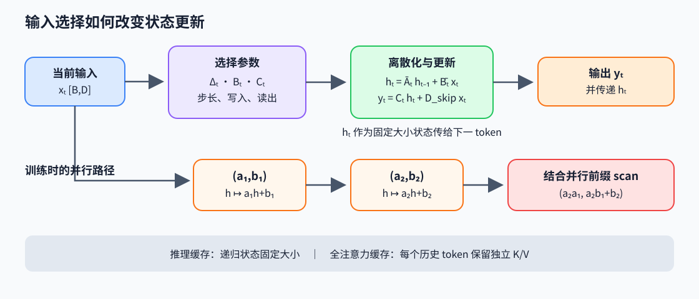

# Mamba：输入选择的状态空间模型

Mamba 是一种状态空间模型（state-space model，SSM），用一个由当前输入控制的递归状态代替显式保存全部历史 Key/Value。每个 token 更新固定大小的状态，因此推理时状态容量不随上下文长度增长；代价是历史信息必须压进状态，不能像全注意力那样为任意旧 token 保留独立地址并做内容寻址。

## 从连续系统到离散递推

线性状态空间模型用隐藏状态 $h(t)\in\mathbb R^N$ 接收输入 $x(t)\in\mathbb R^D$，再投影为输出：

$$
\dot h(t)=Ah(t)+Bx(t),\qquad y(t)=Ch(t)+D_{\text{skip}}x(t).
$$

$A\in\mathbb R^{N\times N}$ 决定状态如何衰减和混合，$B\in\mathbb R^{N\times D}$ 把输入写入状态，$C\in\mathbb R^{D\times N}$ 读出状态，$D_{\text{skip}}$ 是直连项。固定采样间隔 $\Delta$ 下，零阶保持（ZOH）假设认为输入在一个区间内不变；下面是精确离散化推导。

$$
\bar A=e^{\Delta A},\qquad
\bar B=\left(\int_0^\Delta e^{\tau A}\,d\tau\right)B,
\qquad h_t=\bar A h_{t-1}+\bar Bx_t,\quad y_t=Ch_t+D_{\text{skip}}x_t.
$$

若 $A$ 可逆，积分项可写作 $A^{-1}(e^{\Delta A}-I)B$；实现不应因此假定任意参数化下都显式求逆。Mamba 的通道化状态空间常将 $A$ 约束为对角形式，使每个通道的离散递推可并行计算。作者 `Mamba` 简化模块的单步路径采用 $dA=e^{\Delta A}$、$dB=\Delta B$；此处 $dB$ 是简化输入离散化，不等于 ZOH 积分得到的 $\bar B$。

## 选择性让递推依赖输入

固定 $\bar A,\bar B,C$ 的线性时不变系统可以预先生成卷积核，再用卷积计算整段序列。但固定卷积无法按 token 内容选择写入和读取。Mamba 从当前输入产生步长和读写参数：

$$
\Delta_t=\operatorname{softplus}(W_\Delta x_t+b_\Delta),\qquad
B_t=s_B(x_t),\qquad C_t=s_C(x_t),
$$

并用 $\Delta_t$ 离散化 $A$，形成逐 token 更新

$$
h_t=\bar A_t h_{t-1}+\bar B_t x_t,\qquad y_t=C_t h_t+D_{\text{skip}} x_t.
$$

当 $\Delta_t$ 较大时，$e^{\Delta_t A}$ 对稳定的负特征值会更强地衰减旧状态；$B_t$ 决定当前输入如何写入，$C_t$ 决定当前位置读出哪些状态方向。它们让网络根据内容控制保留、写入和读取。这里的“选择”是由网络学习的连续门控，不是从历史 token 表中选出若干离散位置。

以标量状态 $A=-1$、$B=1$、$h_{t-1}=3$、$x_t=2$ 为例，令 $\Delta_t=\ln2$。精确 ZOH 给出 $\bar A_t=1/2$、$\bar B_t=1/2$，所以 $h_t=2.5$。作者简化 step 则使用 $dA=e^{\Delta A}=1/2$、$dB=\Delta B=\ln2$，所以 $h_t=0.5\cdot3+(\ln2)\cdot2\approx2.8863$。两个值来自不同离散化，2.5 不是作者 step 路径的数值。较小步长会保留更多旧状态；较大步长会衰减旧状态并提高当前输入相对影响。

## 递推、scan 与 GPU 并行

递推看起来必须按时间串行，但每一步是仿射变换 $h_t=a_t h_{t-1}+b_t$。把区间表示为 $(a,b)$，先执行 $(a_1,b_1)$、再执行 $(a_2,b_2)$，合并结果为

$$
(a_2,b_2)\circ(a_1,b_1)=(a_2a_1,\;a_2b_1+b_2).
$$

这个运算满足结合律，因此可以对整段变换做并行前缀扫描（scan），得到每个位置的状态表达式。对角状态下它能逐状态维展开；实现需在分块、重计算、临时存储与寄存器占用之间取舍。Mamba 的硬件友好点不是“递推天然并行”，而是利用结合运算把扫描映射到并行算法，同时融合参数生成、状态更新和输出投影，避免把整个 $L\times D\times N$ 中间状态写回显存。

作者简化模块的单步计算对应下面三行。`delta:[B,D]`、`A:[D,N]`、`B_t:[B,N]`、`x_t:[B,D]`、`state:[B,D,N]`。这展示作者 step 的离散路径，不是完整 CUDA kernel：

~~~python
dA = exp(delta[..., None] * A[None, :, :])
dB = delta[..., None] * B_t[:, None, :]
state = dA * state + x_t[..., None] * dB
~~~

其中 `dB=delta*B_t` 是简化输入离散化，与精确 ZOH 积分的 $\bar B$ 有别。

## Mamba block 的完整前向

递推是 SSM mixer 的核心，但一个 Mamba block 还包含输入分支、局部因果卷积、门控和输出映射。令输入 hidden 为 $H:[B,L,D_{model}]$，扩展宽度 $D_i=\text{expand}\cdot D_{model}$，状态宽度为 $N$：

~~~python
x, z = in_proj(H).chunk(2, dim=-1)                 # 各 [B,L,Di]
x = silu(causal_conv1d(x))                         # [B,L,Di]
delta, B_t, C_t = make_selective_params(x)          # delta:[B,L,Di], B/C:[B,L,N]
y = selective_scan(x, softplus(delta), A, B_t, C_t, D_skip)  # [B,L,Di]
mixer = out_proj(y * silu(z))                      # [B,L,Dmodel]
H_next = H + mixer                                 # 残差由 block 组合层加入
~~~

`in_proj` 同时产生 SSM 输入分支和门控分支；深度卷积沿序列维提供局部混合，`make_selective_params` 从卷积后的内容生成输入依赖参数。SiLU（sigmoid linear unit，Sigmoid 线性单元）门控将扫描结果逐通道乘上 $\operatorname{SiLU}(z)$，再经 `out_proj` 回到模型宽度。实际 `B_t,C_t` 可按组共享或广播，具体分组由实现配置决定；残差与归一化也可能由外层 block 统一安排。

下面的解释性代码展示计算语义，不代表论文 CUDA kernel 的布局或调度。张量约定为 `delta, x: [B,L,D]`、`A: [D,N]`、`Bsel,Csel: [B,L,N]`，其中 `N` 为状态维；省略卷积、分组投影和门控支路：

~~~python
state = zeros([B, D, N])
for t in range(L):                         # 语义递推；不是并行实现
    d = softplus(delta[:, t, :])            # [B,D]
    a_bar = exp(d[..., None] * A[None])      # [B,D,N]
    b_bar = discretize_input(A, Bsel[:, t], d)  # [B,D,N]
    state = a_bar * state + b_bar * x[:, t, :, None]
    y[:, t] = (state * Csel[:, t, None, :]).sum(-1) + D * x[:, t]
~~~

## Mamba-2 的结构化状态空间对偶

Mamba-2 把状态递推展开为输入间的因果交互。对标量状态通道，令 $a_t$ 为离散转移、$b_t,c_t$ 为写入与读出，则

$$
h_t=a_t h_{t-1}+b_t x_t
\quad\Longrightarrow\quad
y_t=\sum_{s\le t} c_t\left(\prod_{j=s+1}^{t}a_j\right)b_sx_s.
$$

括号中的系数在这个标量递推例子里构成因果半可分矩阵（semiseparable matrix）。Mamba-2 的 SSD 推导将关系推广到受结构约束的状态空间参数，并据此得到块矩阵计算；本例不是一般矩阵值 SSM 的证明。递推与矩阵块计算是结构化问题的两种求值方式，不意味着模型变成普通 softmax attention。实际优势取决于序列长度、状态宽度、精度和硬件矩阵单元效率。

## 与 Attention 的记忆差异

全注意力在位置 $t$ 直接计算 $q_t k_s^T$，并从每个历史 $v_s$ 读取内容；KV cache 因而随 $L$ 增长，但旧 token 保持独立、可寻址。Mamba 在固定状态里递归压缩历史，缓存大小主要由层数、通道和状态维决定；逐 token 更新不需要扫描完整 KV cache，但状态容量有限，多个远距离事实会竞争同一组状态自由度。两者的质量差异不能只由复杂度判定，要看任务是否依赖精确检索、长程组合与可覆盖的状态容量。混合模型可把固定状态的序列处理与少量全注意力层结合。

## 原论文与作者实现

- Gu 与 Dao，*Mamba: Linear-Time Sequence Modeling with Selective State Spaces*（2023），[原论文](https://arxiv.org/abs/2312.00752)。重点阅读选择性参数化、离散化、硬件感知 scan 与消融实验。
- Dao 与 Gu，*Transformers are SSMs: Generalized Models and Efficient Algorithms Through Structured State Space Duality*（2024），[Mamba-2 原论文](https://arxiv.org/abs/2405.21060)。重点阅读 SSM/attention 对偶、半可分结构和块算法。
- 作者代码：[state-spaces/mamba](https://github.com/state-spaces/mamba)，关注 `mamba_ssm/modules/mamba_simple.py`、`mamba_ssm/ops/selective_scan_interface.py` 与 CUDA selective scan 实现；[Mamba-2 代码](https://github.com/state-spaces/mamba/tree/main/mamba_ssm/modules) 中的 SSD 模块与分块扫描对应论文的对偶计算。
