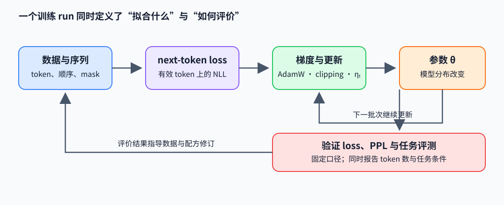

# 训练目标、优化与 Scaling Law

大模型训练把数据分布、参数化、优化器和评价方法连成一个系统。训练损失下降表示模型更好地拟合训练 token；只有固定数据处理与评测口径后，验证损失、任务结果和训练成本才能解释泛化变化。

## 从 next-token 目标到交叉熵

给定 token 序列 $x_{1:T}$，自回归模型按因果分解估计，其训练目标常写成负对数似然（negative log-likelihood，NLL）：

$$
p_\theta(x_{1:T})=\prod_{t=1}^{T}p_\theta(x_t\mid x_{<t}),\qquad
\mathcal L_{\mathrm{NLL}}=-\sum_{t=1}^{T}\log p_\theta(x_t\mid x_{<t}).
$$

若批次含 $M$ 个有效目标 token，平均交叉熵为 $\mathcal L=\mathcal L_{\mathrm{NLL}}/M$，困惑度（perplexity，PPL）定义为 $\mathrm{PPL}=e^{\mathcal L}$。padding、prompt 或被 mask 的位置不进入 $M$，因此应同时记录有效 token 数与 loss mask 规则。例：平均 NLL 为 2 nat/token 时，PPL 为 $e^2\approx7.39$；它是测试分布上的几何平均预测难度，不等于回答准确率。

对一个位置的 logits $z\in\mathbb R^V$、one-hot 目标 $e_y$，softmax 交叉熵的 logit 梯度为 $\partial L/\partial z=p-e_y$。若 $z=XW$，$X\in\mathbb R^{M\times d}$、$W\in\mathbb R^{d\times V}$，则 $\nabla_W L=X^T(P-Y)/M$。NumPy 片段把因果模型已产生的 logits 当输入，展示目标 gather、mask 与线性输出梯度：

~~~python
import numpy as np

def masked_ce_and_linear_grad(logits, labels, mask, hidden):
    shifted = logits - logits.max(axis=-1, keepdims=True)
    logp = shifted - np.log(np.exp(shifted).sum(axis=-1, keepdims=True))
    valid = mask.astype(bool)
    safe_labels = np.where(valid, labels, 0)  # 避免padding标签 -100 被当作数组负索引
    count = valid.sum()
    if count == 0:
        raise ValueError("batch must contain at least one valid target token")
    rows = np.indices(labels.shape)
    nll = -logp[rows[0], rows[1], safe_labels] * valid
    probs = np.exp(logp)
    probs[rows[0], rows[1], safe_labels] -= 1.0
    probs *= valid[..., None]
    dW = hidden.reshape(-1, hidden.shape[-1]).T @ probs.reshape(-1, probs.shape[-1]) / count
    return nll.sum() / count, dW
~~~

例：$z=[\log3,0]$、目标类别为 0，则 $p=[0.75,0.25]$，logit 梯度为 $[-0.25,0.25]$。若该位置线性层输入 $x=2$，权重行梯度为 $[-0.5,0.5]$；一个 mask=0、label=-100 的位置先替换成安全索引 0，再由 mask 令 loss 和权重梯度贡献为零。batch 至少要有一个有效目标 token。

训练梯度为 $g_t=\nabla_\theta\mathcal L_t$。随机梯度下降（stochastic gradient descent，SGD）更新 $\theta_{t+1}=\theta_t-\eta_t g_t$；Adam 维护一阶与二阶矩 $m_t=\beta_1m_{t-1}+(1-\beta_1)g_t$、$v_t=\beta_2v_{t-1}+(1-\beta_2)g_t^2$，经偏差修正后按 $m_t/(\sqrt{v_t}+\epsilon)$ 缩放更新。AdamW 另以 $-\eta_t\lambda\theta_t$ 执行解耦 weight decay。梯度裁剪通过 $g\leftarrow g\min(1,\tau/\lVert g\rVert_2)$ 限制全局范数；它能约束异常大更新，不能修复错误数据或不合适的目标。

梯度累积应对 token loss 的分子求和，再除以多个 microbatch 的总有效 token 数。假设 microbatch A 有 2 个 token，梯度和为 $[2,0]$；B 有 1 个 token，梯度和为 $[0,3]$。正确合并梯度是 $[2,3]/3=[0.667,1]$。先分别取平均再平均会得到 $[0.5,1.5]$，因为两个 microbatch 的 token 数不同。

## 初始化、批次与学习率

残差网络每层反复叠加更新，初始化需控制信号和梯度尺度；归一化、残差缩放与深度相关初始化共同影响训练早期的稳定性。有效 batch size 为每步累计的样本 token 总数；梯度累积改变每次更新聚合的数据量，不等价于增加独立数据覆盖。学习率常采用 warmup 后衰减：warmup 把 $\eta_t$ 从小值逐渐升至峰值，cosine 或线性 schedule 再随 token 数降低。schedule 应按实际训练 token 进度计算，重启任务若按 step 误复位，便会改变有效优化轨迹。

数据混合决定模型看到什么。重复、污染、过滤和来源比例会改变有效分布；同样的 token 数不代表同样的信息量。Scaling law 常用幂律拟合损失随参数量 $N$、训练 token $D$ 与计算量 $C$ 的变化，例如 $L(N,D)=L_\infty+aN^{-\alpha}+bD^{-\beta}$。这个经验拟合用于指定算力预算下选择模型规模与数据量，外推受数据质量、训练配方、架构和评测范围限制，不能单凭拟合宣称具体产品能力。

## 可解释的缩放与评价

比较训练方案要固定 tokenizer、训练数据筛选、有效 token 计数、模型定义与验证集，报告学习曲线而非只报最终 loss。大模型评测还需按任务类型拆分，并检查数据污染、提示格式、采样设置、重复运行和置信区间。小模型上的趋势可指导下一次实验，但模型规模变化、数据分布变化或训练目标变化都会破坏直接外推条件。

## 论文与代码阅读

- Hoffmann et al., *Training Compute-Optimal Large Language Models*（Chinchilla，2022），[论文](https://arxiv.org/abs/2203.15556)：关注固定计算预算下参数与 token 的权衡，以及原始实验的拟合范围。
- Kaplan et al., *Scaling Laws for Neural Language Models*（2020），[论文](https://arxiv.org/abs/2001.08361)：阅读幂律关系与外推假设，并与后续 compute-optimal 结论比较。
- Loshchilov 与 Hutter, *Decoupled Weight Decay Regularization*（2017），[论文](https://arxiv.org/abs/1711.05101)：对应 AdamW 的更新拆分。
- 代码位置：[nanoGPT](https://github.com/karpathy/nanoGPT) 的 `train.py`（训练循环、gradient accumulation、eval loss 与学习率 schedule）；它适合追踪一份实现，不代表所有生产训练系统。
