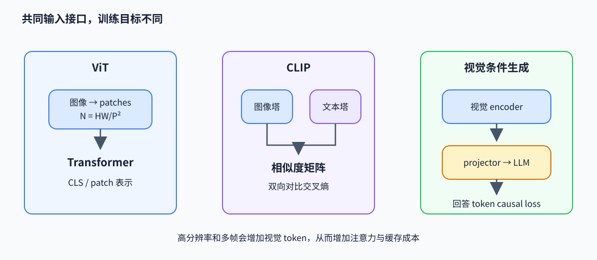

# 视觉语言模型：从图像 patch 到文本 token

视觉语言模型（VLM）通常把图像编码成一组向量，再通过投影器送入语言模型的 token 序列。图像如何切块、视觉和文本如何对比训练，以及视觉 token 怎样进入因果 Transformer，决定了信息粒度和计算成本。

## ViT：patch 序列与自注意力

视觉 Transformer（Vision Transformer，ViT）把图像表示为 patch token 序列。对图像 $I\in\mathbb R^{H\times W\times C}$，以 $P\times P$ patch 切分并展平，每个 patch 维度为 $P^2C$，投影到 $d$ 维后得到 $N=HW/P^2$ 个 token：

$$
z_i=\operatorname{vec}(I_i)E+e_i^{pos},\qquad E\in\mathbb R^{P^2C\times d}.
$$

ViT 对序列执行 Transformer 编码。以 224×224 RGB、patch 16 为例，$N=196$，每 patch 有 768 个像素值；若 patch 8，则 token 数变为 784，空间粒度更细但注意力的 token-pair 数增至约 16 倍。分类任务可读 CLS token 或池化 patch 表示。

## CLIP：图文对比目标

CLIP（对比语言—图像预训练）将图像和文本分别编码并投影到相同 $d$ 维空间，归一化后计算 batch 内相似度 $s_{ij}=v_i^Tt_j/\tau$。对 $B$ 对匹配样本，图到文和文到图的对称交叉熵为

$$
L=\tfrac12\left[\operatorname{CE}(S,I)+\operatorname{CE}(S^T,I)\right].
$$

$I$ 是对角线正确配对标签，温度 $\tau$ 控制分布尖锐度。例：两张图和两条文本的相似度矩阵若对角元素最大，softmax 交叉熵会提高正确配对 logit、压低 batch 内不匹配项。CLIP 学到图文对齐表示，不直接教模型生成细致的图像描述。下面的 NumPy 代码可运行对称 batch loss，`image,text:[B,d]`：

~~~python
import numpy as np

def clip_loss(image, text, temperature):
    image = image / np.linalg.norm(image, axis=-1, keepdims=True)
    text = text / np.linalg.norm(text, axis=-1, keepdims=True)
    scores = image @ text.T / temperature       # [B,B]
    def row_ce(matrix):
        shifted = matrix - matrix.max(axis=-1, keepdims=True)
        logp = shifted - np.log(np.exp(shifted).sum(axis=-1, keepdims=True))
        return -np.diag(logp).mean()
    return 0.5 * (row_ce(scores) + row_ce(scores.T))
~~~

## LLaVA 类路径：投影视觉特征并条件生成

视觉 encoder 输出 $V\in\mathbb R^{N_v\times d_v}$，projector 转成语言模型宽度 $d_l$：$Z=VW_p$，其中 $W_p\in\mathbb R^{d_v\times d_l}$。将 $Z$ 放进提示序列，语言模型对回答 token 做 causal next-token loss。训练初期常冻结视觉和语言底座，先训练 projector；后续可联合微调。高分辨率、多 crop 或视频帧会增加视觉 token 数，扩大 prefill 注意力与 KV cache。一次前向的数据流可写成：

~~~python
vision = vision_encoder(images)              # [B,Nv,dv]
image_tokens = projector(vision)              # [B,Nv,dl]
text_tokens = token_embedding(input_ids)      # [B,T,dl]
inputs = splice_image_tokens(text_tokens, image_tokens, image_mask)
logits = language_model(inputs[:, :-1])       # causal next-token prediction
loss = masked_cross_entropy(logits, labels[:, 1:], assistant_mask[:, 1:])
~~~

视频通常按帧或时空 patch 编码并加入时间位置；音频可用声学 patch、离散 codec token 或专门 encoder，之后再与文本 token 对齐/拼接。它们沿用相似的跨模态接口，但前端目标和时间结构不同。

## 代表工作与代码阅读

- Dosovitskiy et al., *An Image is Worth 16x16 Words*（ViT，2020），[论文](https://arxiv.org/abs/2010.11929)：patch embedding、位置编码与分类头。
- Radford et al., *Learning Transferable Visual Models From Natural Language Supervision*（CLIP，2021），[论文](https://arxiv.org/abs/2103.00020)：双 encoder、对称 batch contrastive loss。
- Liu et al., *Visual Instruction Tuning*（LLaVA，2023），[论文](https://arxiv.org/abs/2304.08485)：视觉特征投影、指令数据和自回归目标。
- 作者实现入口：[openai/CLIP](https://github.com/openai/CLIP)、[huggingface/pytorch-image-models](https://github.com/huggingface/pytorch-image-models) 中的 ViT、[haotian-liu/LLaVA](https://github.com/haotian-liu/LLaVA)。阅读 patchify、对比 logits/labels 和 projector 接入点。
