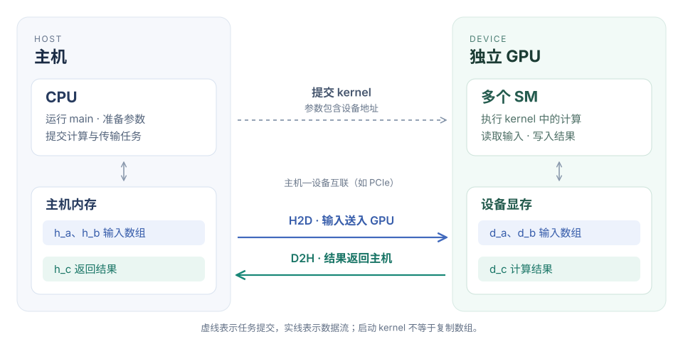
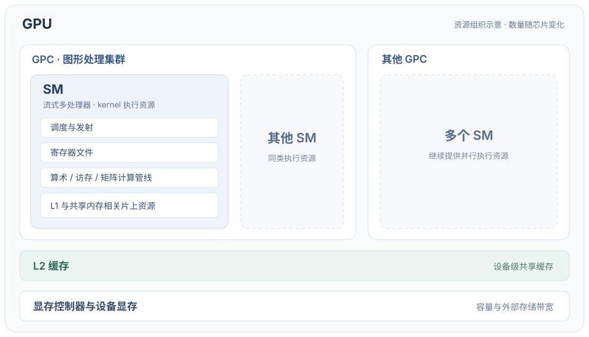
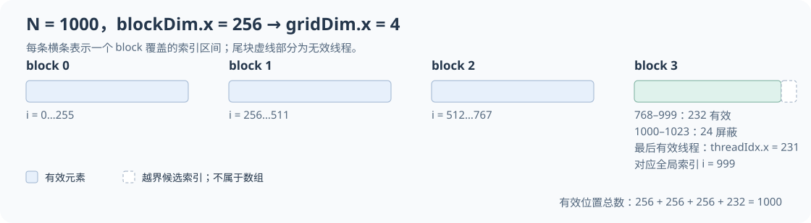
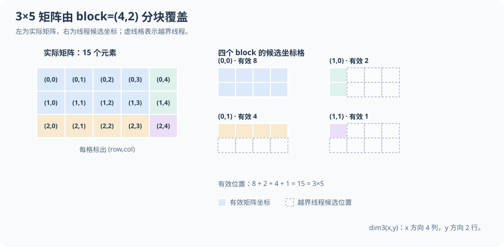
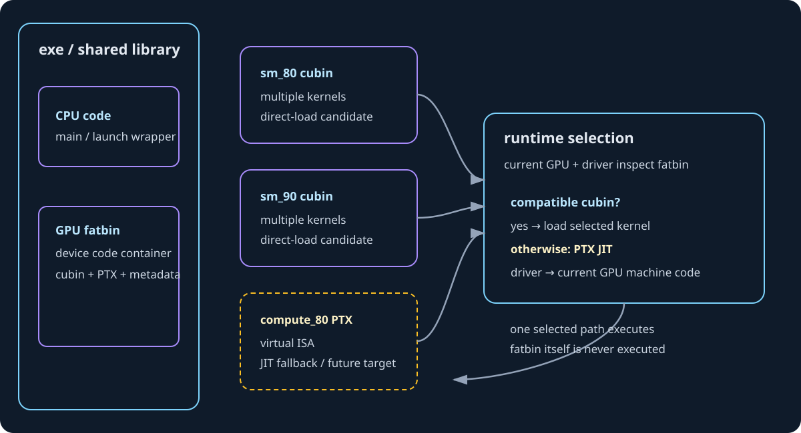

# 第一章 从 CUDA 程序看 GPU 的整体结构

本章沿一次长度为 1000 的向量加法，依次看 CPU 准备输入、把数组送到 GPU、线程分工计算、取回结果，再查询设备与编译环境。先跟住数据和代码的去向，再认识线程、线程块、执行单元、存储资源与设备代码目标。

CPU（中央处理器）负责准备数据并提交工作；GPU（图形处理器）承接大量彼此独立的元素运算。迁移已有昇腾经验时，数据分块、片上复用和搬运分析仍有用；后文会逐步介绍 CUDA 的线程、线程块和执行单元。

## 1. CPU 与 GPU 的任务分工

### 1.1 延迟与吞吐

CPU（Central Processing Unit，中央处理器）和 GPU（Graphics Processing Unit，图形处理器）都能执行计算，但设计时面对的主要矛盾不同。CPU 要让一条具有复杂依赖、分支和不规则访问的指令流尽快向前推进；GPU 则要在功耗和面积约束下，让大量工作持续通过计算与存储资源。

以串行链 `x = f(x)` 为例，第 2 次计算要等第 1 次的结果，第 3 次再使用第 2 次的结果，步骤只能依次完成。向量加法 `c[i] = a[i] + b[i]` 中，每个索引 i 只读取自己的输入并写自己的输出，各元素之间没有数据依赖，因此可以分给不同线程同时处理。

延迟是单个任务从开始到完成所需的时间；吞吐是单位时间内完成的任务数。GPU 用多个可执行的工作交错推进计算，以维持较高吞吐；这不会缩短每条数据依赖链本身。

某些计算等待数据时，GPU 可推进其他输入已准备好的计算。若工作已经受带宽限制，增加线程不会增加数据传输能力；此时应减少数据搬运，或让读入的数据多次参与计算。

判断算子是否适合 GPU，要看独立工作量、工作组织是否规则，以及计算或数据复用能否抵消准备和搬运成本。向量加法中每个元素只有一次加法、两次读取和一次写入；矩阵乘法则可让输入参与多次乘加，因此两类算子可能受不同因素限制。GPU 程序也可以包含循环；循环本身不决定并行性，关键是循环迭代和不同线程之间是否存在数据依赖。

### 1.2 Host、Device 与数据传输

CUDA（Compute Unified Device Architecture，统一计算设备架构）采用异构计算模型。Host 指主机侧，通常包括 CPU 和主机内存；Device 指 GPU 及其资源。主机代码负责组织数据、调用运行时并提交设备工作。独立 GPU 系统中，输入常经 H2D（Host to Device，主机到设备）传入设备，结果再经 D2H（Device to Host，设备到主机）返回；互联可以是 PCIe（Peripheral Component Interconnect Express，外围组件高速互联）或系统提供的其他通道。

<figure class="diagram-frame">

<figcaption>任务提交和数组传输是两件事。CPU 与 GPU 执行计算，主机内存与设备显存保存数组，互联上的箭头表示数据方向。</figcaption>
</figure>

在 GPU 上由许多线程执行的函数称为核函数（kernel）。CPU 通过 CUDA 运行时库提交核函数；运行时库负责常用的设备选择、内存分配和任务提交接口。执行 `kernel<<<...>>>(d_a)` 时传入的是设备指针的值，不会自动复制其指向的整个数组。数组必须已经位于 kernel 可访问的位置，或由相应内存机制保证可访问。

集成 GPU、映射内存、统一内存和一致性平台有不同的访问与迁移机制，因此独立显卡图只表示一种常见系统。

### 1.3 GPU 内部的执行与存储资源

GPU 的计算工作最终由 SM（Streaming Multiprocessor，流式多处理器）承载。一个 SM 有保存线程状态的寄存器、指令调度资源、计算与访存管线，以及片上缓存和共享内存。线程块（block）是程序定义的协作线程组；一次核函数启动中的所有 block 组成 grid。

设备把 block 安排到可用 SM。资源允许时，一个 SM 可同时驻留多个 block；grid 较大时，block 会分批安排。每个 block 对寄存器、共享内存和线程数的需求，以及设备相应上限，共同决定驻留数量。

读本章代码时先用到三种资源：寄存器保存线程自己的值，共享内存供同一 block 的线程协作，显存保存数组。普通 block 即使驻留在同一 SM，也不因此共享一份共享内存。L1 和 L2 是缓存，可能减少对更远存储的访问；它们与程序显式使用的共享内存职责不同。

Tensor Core 是执行受支持矩阵乘加运算的硬件单元，接受特定输入类型、矩阵形状和累加类型。普通算术、地址计算和条件判断由其他执行管线处理。编译器是否生成矩阵指令，取决于数据类型、代码表达、指令支持和目标架构；可从编译产物确认。

<details>
<summary>延伸：GPU 内部组织与显存技术</summary>

<figure class="diagram-frame">

<figcaption>嵌套区域表示资源归属，不表示每次访问都经过图中的每一级。</figcaption>
</figure>

GPC（Graphics Processing Cluster，图形处理集群）与其中可能存在的 TPC（Texture Processing Cluster，纹理处理集群）属于更高层组织。普通 CUDA 程序通常不按 TPC 编号分配任务。支持线程块集群的硬件另有显式的分布式共享内存机制。

设备显存通常由 DRAM 实现。HBM（High Bandwidth Memory，高带宽存储器）和 GDDR（Graphics Double Data Rate，图形双倍数据速率存储器）是两种显存技术，NVIDIA GPU 产品会按设计选用。显存容量表示可保存的数据量，带宽表示单位时间内可传输的数据量。

</details>

下一章会沿本章建立的 block→SM 关系继续追踪：资源分配后，warp 何时就绪，调度器何时发出指令。

### 1.4 Kernel 流量与端到端耗时

两个长度为 N 的 float 数组执行向量加法时，只按有效载荷计算，H2D 为 `2×N×4` 字节，D2H 为 `N×4` 字节；kernel 读取两个输入并写一个输出，逻辑流量为 `3×N×4` 字节。主机—设备传输和 GPU 内部访问经过不同路径。逻辑流量不一定等于显存总线的实际流量，缓存命中、访问粒度和写入行为都会影响它。

沿用本章的 N=1000 示例，两个输入合计经 H2D 传输 8000 字节，结果经 D2H 返回 4000 字节；kernel 的逻辑读写量为 12000 字节。这些是按 float 有效数据计算的字节数，不包含分配、传输协议或缓存等额外行为。

总耗时还可能包括分配、初始化、提交与同步。若 kernel 只占端到端时间的一小部分，即使 kernel 时间减半，整体收益也有限。多个算子连续在 GPU 上执行、输入只传一次且中间结果留在设备上时，传输成本可由多次计算共同承担。性能分析应区分 kernel 时间与端到端时间，并结合目标设备的编译结果和测量判断瓶颈。

## 2. 编程模型：kernel、线程和线程块

### 2.1 Kernel、grid、block 与 thread

kernel（核函数）定义线程执行的设备代码；启动时指定 grid（线程块网格）与 block（线程块）的尺寸。grid 中的每个 block 是可协作线程组；每个 thread（线程）带有自己的索引和局部状态。

论文和底层资料中的 CTA（Cooperative Thread Array，协作线程数组），在 CUDA 线程块语境中指 thread block。

~~~cpp
vector_add_kernel<<<4, 256>>>(d_a, d_b, d_c, 1000);
~~~

4 是 grid 中线程块的数量；256 是每个线程块的线程数。总共组织 1024 个逻辑线程，每个线程执行同一份核函数，但读取不同的内建索引，决定处理哪个元素。

每个线程执行相同的核函数代码，但使用自己的线程索引和局部状态。例如，各线程算出不同的 i，因此 `i < n` 对不同线程可以分别为真或假。

启动配置中的 1024 个线程按线程块分组，执行单元会依据可用资源分批推进线程块。每个线程根据自己的索引和数据依赖计算结果。

### 2.2 Block 与 SM 的驻留关系

普通线程块的线程在同一 SM 上执行，使块内共享内存和同步成为可能。资源允许时，一个 SM 可以同时驻留多个线程块；很大的 grid 则可以分批安排到有限数量的 SM 上。

例如，设备有 2 个 SM，grid 有 6 个 block，且每个 SM 此时只能驻留 1 个 block。开始时两个 SM 各承载一个 block；某个 block 释放资源后，另一个 block 才能进入。具体由哪个 SM 承载哪个 `blockIdx`，由设备调度决定。

若每个 SM 能驻留 2 个 block，两个 SM 可同时承载 4 个 block。`blockIdx` 始终表示程序网格中的块编号；用它计算矩阵输出块坐标即可。

若 block 0 持续轮询、等待 block 5 写入标志，而驻留资源被等待者占满，block 5 就无法进入 SM，等待因此停滞。跨 block 协作应使用能保证参与范围和进度的机制；普通 block 的调度顺序不提供全局同步。

需要跨 block 同步时，可使用 Cooperative Groups 支持的协作启动，或在兼容设备上使用 Thread Block Cluster。集群机制规定了参与 block 的协作范围；普通 kernel launch 不创建全 grid 屏障。集群的设备要求和用法见 CUDA Programming Guide §1.2.2.1.1。

### 2.3 Warp 组成与硬件线程调度

warp（线程束）把同一线程块中的线程按 32 个一组组织。SIMT（Single Instruction, Multiple Threads，单指令多线程）描述这种执行模型：硬件对参与线程发射指令，各线程使用自己的寄存器值和地址，得到各自结果。

256 个线程组成 8 个 warp。40 个线程组成 2 个 warp，第二个 warp 只有 8 个有效 lane；lane 编号仍按 0 到 31 计。

二维、三维线程块也要按线性线程编号分组。二维时：

~~~cpp
const unsigned linear_tid = threadIdx.x + blockDim.x * threadIdx.y;
const unsigned warp_id = linear_tid / 32;
const unsigned lane_id = linear_tid % 32;
~~~

因此 x 方向先变化。对二维 block，warp 按连续线性编号划分；`blockDim.x` 决定一排 x 坐标占多少线程，kernel 的下标公式再决定这些线程对应矩阵中的哪些元素。

例如，256 个 CUDA thread 分为 8 个 warp，由 SM 的有限执行管线分批推进。CUDA Core 描述算术执行资源，thread 则是带有自身索引和状态的逻辑执行实例；两者数量不按一对一关系换算。

同一 warp 遇到不同分支时，各路径由对应的活动线程执行。若线程通过共享内存交换数据，应在读写之间使用适用的同步原语；Volta 及之后的独立线程调度使隐式 warp 同步不足以建立内存顺序。

### 2.4 CUDA 的线程视角与 Triton 的 tile 视角

CUDA C++ 通常为每个线程计算标量索引。Triton 的 program（程序实例）一次描述一个逻辑数据块，再通过索引向量表达该块覆盖的元素：

下面是核函数内的片段。`tl` 是 `triton.language` 的常用导入别名；`x_ptr`、`y_ptr`、`out_ptr` 分别指向两个输入和一个输出数组，每个数组有 130 个元素。这里用固定长度说明索引、地址和数据值的区别。

~~~python
pid = tl.program_id(0)
offsets = pid * 128 + tl.arange(0, 128)
mask = offsets < 130
x_ptrs = x_ptr + offsets
x = tl.load(x_ptrs, mask=mask)
y = tl.load(y_ptr + offsets, mask=mask)
tl.store(out_ptr + offsets, x + y, mask=mask)
~~~

当 `pid=1` 时，`offsets` 为 128 到 255，其中 128、129 满足 mask。`offsets` 保存整数索引；`x_ptr + offsets` 得到地址。常规 NVIDIA Triton kernel 的一个 program 实例通常映射到一个 CUDA 线程块，元素如何分配给线程和寄存器由编译器决定。详见 [Triton 官方 Vector Add 教程](https://triton-lang.org/main/getting-started/tutorials/01-vector-add.html)。

CUDA block 组织线程执行；Triton program 内的 tile 描述一组逻辑数据。CUDA Tile 与 Triton 使用各自的 API。

索引向量说明程序请求的元素范围。要了解线程实际处理的地址和设备流量，应查看编译后的元素布局、访存指令及 profiler 数据。

## 3. 完整程序：沿着一次计算走一遍

### 3.1 Vector Add 完整程序

下面包含主机初始化、设备分配、输入复制、kernel 启动、两层错误检查、结果复制、参考比较和释放。输入选用可精确表示的二进制分数，因此本例可以逐位比较；浮点归约还需按运算顺序和误差要求比较。

<!-- BEGIN vector_add_walkthrough.cu -->
~~~cpp
#include <cuda_runtime.h>

#include <algorithm>
#include <cmath>
#include <cstddef>
#include <cstdlib>
#include <exception>
#include <iostream>
#include <limits>
#include <stdexcept>
#include <string>
#include <vector>

// 教学示例：展示显式分配、复制、启动、检查和释放的完整路径。
// 正常路径检查 CUDA 返回值；异常清理保留原始异常，不覆盖它。
#define CUDA_CHECK(call)                                                        \
  do {                                                                          \
    const cudaError_t error__ = (call);                                         \
    if (error__ != cudaSuccess) {                                               \
      throw std::runtime_error(std::string("CUDA error at ") + __FILE__ + ":" + \
                               std::to_string(__LINE__) + ": " +               \
                               cudaGetErrorString(error__));                    \
    }                                                                            \
  } while (false)

__global__ void vector_add_kernel(const float* a, const float* b, float* c,
                                  std::size_t n) {
  // 一个 thread 处理一个逻辑元素；block 是调度/资源分配单位。
  const std::size_t i = static_cast<std::size_t>(blockIdx.x) * blockDim.x +
                        threadIdx.x;
  if (i < n) {
    c[i] = a[i] + b[i];
  }
}

void vector_add_cpu(const std::vector<float>& a, const std::vector<float>& b,
                    std::vector<float>* c) {
  if (a.size() != b.size() || a.size() != c->size()) {
    throw std::invalid_argument("CPU vectors have different sizes");
  }
  for (std::size_t i = 0; i < a.size(); ++i) {
    (*c)[i] = a[i] + b[i];
  }
}

int main(int argc, char** argv) {
  try {
    const std::size_t n = argc > 1 ? std::stoull(argv[1]) : 1000;
    if (n == 0) {
      throw std::invalid_argument("N must be greater than zero");
    }
    if (n > std::numeric_limits<std::size_t>::max() / sizeof(float)) {
      throw std::invalid_argument("N * sizeof(float) overflows size_t");
    }

    int device_count = 0;
    CUDA_CHECK(cudaGetDeviceCount(&device_count));
    if (device_count == 0) {
      throw std::runtime_error("no CUDA-capable device is available");
    }
    CUDA_CHECK(cudaSetDevice(0));

    cudaDeviceProp device{};
    CUDA_CHECK(cudaGetDeviceProperties(&device, 0));
    constexpr unsigned int block_size = 256;
    const std::size_t grid_size = n / block_size + (n % block_size != 0);
    if (grid_size > static_cast<std::size_t>(device.maxGridSize[0])) {
      throw std::invalid_argument("N is too large for this 1D grid");
    }

    std::vector<float> h_a(n), h_b(n), h_c(n), h_reference(n);
    for (std::size_t i = 0; i < n; ++i) {
      h_a[i] = static_cast<float>((i % 97) * 0.25);
      h_b[i] = static_cast<float>((i % 53) * -0.5);
    }
    vector_add_cpu(h_a, h_b, &h_reference);

    float* d_a = nullptr;
    float* d_b = nullptr;
    float* d_c = nullptr;
    try {
      const std::size_t bytes = n * sizeof(float);
      CUDA_CHECK(cudaMalloc(&d_a, bytes));
      CUDA_CHECK(cudaMalloc(&d_b, bytes));
      CUDA_CHECK(cudaMalloc(&d_c, bytes));

      // 这里使用默认 stream 的普通 cudaMemcpy，展示阶段顺序：H2D → kernel。
      // 不把 cudaMemcpy 的“同步”泛化到所有方向和 pageable/pinned 情况。
      CUDA_CHECK(cudaMemcpy(d_a, h_a.data(), bytes, cudaMemcpyHostToDevice));
      CUDA_CHECK(cudaMemcpy(d_b, h_b.data(), bytes, cudaMemcpyHostToDevice));

      vector_add_kernel<<<static_cast<unsigned int>(grid_size), block_size>>>(
          d_a, d_b, d_c, n);
      CUDA_CHECK(cudaGetLastError());       // 检查 launch 配置/提交错误
      CUDA_CHECK(cudaDeviceSynchronize());  // 检查执行期异步错误

      // D2H 返回后，本例中的 h_c 已可由 CPU 读取并比较。
      CUDA_CHECK(cudaMemcpy(h_c.data(), d_c, bytes, cudaMemcpyDeviceToHost));

      double max_abs_error = 0.0;
      for (std::size_t i = 0; i < n; ++i) {
        if (!std::isfinite(h_c[i])) {
          throw std::runtime_error("GPU output contains a non-finite value");
        }
        max_abs_error = std::max(
            max_abs_error,
            static_cast<double>(std::fabs(h_c[i] - h_reference[i])));
      }
      if (max_abs_error != 0.0) {
        throw std::runtime_error("GPU result differs from CPU reference: " +
                                 std::to_string(max_abs_error));
      }

      std::cout << "device=" << device.name << " N=" << n
                << " block=" << block_size << " grid=" << grid_size
                << " max_abs_error=" << max_abs_error << " PASS\n";

      CUDA_CHECK(cudaFree(d_c));
      d_c = nullptr;
      CUDA_CHECK(cudaFree(d_b));
      d_b = nullptr;
      CUDA_CHECK(cudaFree(d_a));
      d_a = nullptr;
    } catch (...) {
      // 释放已成功分配的 device memory；不要让错误路径把显存永久留给进程。
      if (d_c != nullptr) cudaFree(d_c);
      if (d_b != nullptr) cudaFree(d_b);
      if (d_a != nullptr) cudaFree(d_a);
      throw;
    }
  } catch (const std::exception& error) {
    std::cerr << "FAILED: " << error.what() << '\n';
    return EXIT_FAILURE;
  }
  return EXIT_SUCCESS;
}
~~~
<!-- END vector_add_walkthrough.cu -->

### 3.2 main、主机数组与设备指针

`main` 在 CPU 上执行。`std::vector<float>` 保存本例的主机数组，`h_a.data()` 返回首元素地址；初始化循环和 CPU 参考计算也都在主机侧运行。

按初始化公式手算两个位置，可以核对随后 GPU 输出：`i=256` 时，`h_a=62×0.25=15.5`、`h_b=44×(-0.5)=-22`，所以结果为 `-6.5`；`i=999` 时，`h_a=29×0.25=7.25`、`h_b=45×(-0.5)=-22.5`，结果为 `-15.25`。这两项都落在有效索引范围内，其中 999 是尾块最后一个有效元素。

`__global__` 标记核函数。CPU 用三尖括号语法提交设备执行，指针参数的值随启动参数传入，设备线程通过它们访问数组。

`float* d_a = nullptr` 定义设备指针变量。`cudaMalloc(&d_a, bytes)` 申请设备内存，并把返回地址写入该变量；传入 `&d_a` 是为了让 API 更新指针值。

cudaMalloc 的大小单位为字节。1000 个 float 需要 4000 字节，三个设备数组合计占用 12000 字节；CUDA 上下文、代码和其他运行时资源还会使用额外显存。

两个 H2D 复制把输入值写入 d_a、d_b。本例没有初始化 d_c，因为 kernel 会覆盖每个有效输出；若改为对已有 d_c[i] 累加，则应先设置其初值。

### 3.3 复制顺序、启动异步性与结果可用性

本例输入复制与 kernel 使用默认 stream（执行流）。stream 按提交顺序执行任务，因此 kernel 在输入复制完成后读取数据。

本程序从主机内存把两个输入复制到设备，再在同一默认 stream 中启动 kernel；stream 顺序保证 kernel 在输入复制之后读取数组。对可分页主机内存，H2D 的 `cudaMemcpy` 可能在数据复制到暂存区后先返回，设备传输仍按 stream 顺序完成。D2H 的同步复制完成后，CPU 才读取 `h_c`。其他内存类型和复制方向的同步行为见 [Runtime API：同步行为](https://docs.nvidia.com/cuda/cuda-runtime-api/api-sync-behavior.html)。

kernel 启动后，CPU 可以继续执行其他主机代码。GPU 写入 d_c；设备工作完成并将结果复制回 h_c 后，CPU 才能读取输出。

本例调用 `cudaDeviceSynchronize`，等待当前设备上此前提交的工作完成，并在这里检查执行错误；之后再做 D2H。多 stream 程序通常按数据依赖在相关 stream 或 event 上同步。

本例的全设备同步让等待位置和 kernel 错误检查清楚可见。其他程序可用更窄的同步范围，只要确保 CPU 读取结果前，相关设备写入已经完成。

### 3.4 启动错误与执行期错误检查

三尖括号启动表达式不返回 cudaError_t。紧接着调用 cudaGetLastError，可以检查当时的错误状态，例如无效启动配置。它也可能报告先前异步操作留下的错误，因此诊断时需要知道前面的错误是否已经处理。

启动后立即检查提交状态；随后等待 kernel 完成并检查执行错误；最后比较输出与参考值：

| 检查点 | 本例采用的操作 | 能确认什么 | 随后检查什么 |
|---|---|---|---|
| 提交之后 | `cudaGetLastError()` | 是否存在启动配置或提交错误 | 等待设备工作并检查执行期错误 |
| 等待设备工作 | `cudaDeviceSynchronize()` 并检查返回值 | 此前设备工作已结束，执行期错误已返回 | 结果是否符合算法与数值要求 |
| 结果可读之后 | D2H 并与 CPU reference 比较 | 当前输入满足设定的数值要求 | 在其他形状与并发条件下测试 |

即使 API 调用均成功，索引或公式仍可能算错。例如把 `a[i]+b[i]` 写成 `a[i]+a[i]`，内存访问合法，数值结果仍不符合向量加法。

异常路径尝试释放已分配数组，并保留原始错误；正常路径检查释放结果。正式项目可以用资源所有权封装管理生命周期，这里保留显式操作，是为了能看见分配与释放的对应关系。

### 3.5 怎样编译和检查

在具有 CUDA Toolkit、支持的主机 C++ 编译器与兼容驱动的 Linux 服务器上，从仓库根目录执行：

~~~bash
nvcc -O2 -std=c++17 -lineinfo \
  roadmap/curriculum/gpu/01-gpu-hardware-map-and-generations/examples/vector_add_walkthrough.cu \
  -o /tmp/vector_add_walkthrough

/tmp/vector_add_walkthrough 1
/tmp/vector_add_walkthrough 256
/tmp/vector_add_walkthrough 257
/tmp/vector_add_walkthrough 1000
compute-sanitizer --tool memcheck /tmp/vector_add_walkthrough 1000
~~~

Windows 的输出文件后缀与主机编译器配置不同。nvcc 的默认设备目标取决于工具版本；使用前通过 `nvcc --list-gpu-code`、设备计算能力和版本确认支持范围，必要时显式指定匹配目标的 `-arch`，不照抄固定型号的目标。

示例检查正确性与执行过程，未包含性能计时器。进程启动时间还包含上下文初始化和可能的即时编译；kernel 延迟需用设备计时单独测量。

## 4. 索引与地址：把线程落到每一个元素

### 4.1 一维索引与尾部边界

若每个 block 负责长度为 B 的连续区间，第 p 块起点就是 p×B；块内第 t 个线程再偏移 t 个元素，所以：

~~~text
i = blockIdx.x × blockDim.x + threadIdx.x
~~~

这个公式把 block 起点与线程在 block 内的偏移相加，对应一线程处理一个元素的映射。其他 kernel 也可让一个线程循环处理多个元素。

对 N=1000、B=256，需要 `ceil(1000/256)=4` 个 block：

<figure class="diagram-frame">

<figcaption>每格表示一个索引位置。第四块仍有 256 个线程位置，其中 24 个索引越界；数组仍只有 1000 个元素。</figcaption>
</figure>

| blockIdx.x | 块内 threadIdx.x | 全局 i | 实际工作 |
|---|---|---|---|
| 0 | 0–255 | 0–255 | 全有效 |
| 1 | 0–255 | 256–511 | 全有效 |
| 2 | 0–255 | 512–767 | 全有效 |
| 3 | 0–231 | 768–999 | 有效 |
| 3 | 232–255 | 1000–1023 | 条件不成立，不访问数组 |

第四块仍按 256 个线程启动；`i < N` 让索引 768–999 的 232 个线程访问数组，索引 1000–1023 的 24 个线程跳过访问。

常见向上取整写法为 `(N+B-1)/B`。整除时不会多一块，有余数时进到下一整数。例如 1000+255=1255，整数除以 256 得 4。示例采用 `N/B+(N%B!=0)` 避免巨大 N 的加法溢出，并检查 N×sizeof(float) 是否可表示；N=0 单独拒绝，避免零大小 grid。

边界条件决定哪些索引会访问数组。归约时，无效位置应填符合运算定义的值：求和用 0，求最大值用负无穷。

### 4.2 二维线程块映射到 3×5 矩阵

设行数 M=3、列数 N=5，按 row-major（行优先）连续存储。选择 block=(4,2)，让 x 对应列、y 对应行：

<figure class="diagram-frame">

<figcaption>彩色实格是矩阵里的有效元素；虚线格表示候选线程坐标，不是给矩阵补 padding。四块有效元素数为 8、2、4、1。</figcaption>
</figure>

~~~cpp
dim3 block(4, 2);
dim3 grid((N + block.x - 1) / block.x,
          (M + block.y - 1) / block.y);

// kernel 内：
int col = blockIdx.x * blockDim.x + threadIdx.x;
int row = blockIdx.y * blockDim.y + threadIdx.y;
if (row < M && col < N) {
    int offset = row * N + col;
    // 对 a[offset] 等合法位置进行操作
}
~~~

grid=(2,2)，共 4 块，每块 8 线程，总计 32 个线程。warp 在 block 内按线程线性编号分组，因此每个 8 线程 block 各占一个未填满的 warp。此尺寸用于手算。

| blockIdx=(x,y) | 覆盖行 | 覆盖列 | 有效元素个数 |
|---|---|---|---|
| (0,0) | 0、1 | 0、1、2、3 | 8 |
| (1,0) | 0、1 | 4、5、6、7 | 2 |
| (0,1) | 2、3 | 0、1、2、3 | 4 |
| (1,1) | 2、3 | 4、5、6、7 | 1 |

四个 block 的有效元素数为 8+2+4+1=15，正好覆盖 M×N。右下 block 仍覆盖有效坐标 (2,4)；kernel 分别检查行和列范围。

具体算一个线程：blockIdx=(1,0)、threadIdx=(0,1)，得到 col=1×4+0=4，row=0×2+1=1，所以 offset=1×5+4=9，访问第 2 行第 5 列。另一个线程 blockIdx=(1,1)、threadIdx=(1,0) 得到 row=2、col=5，列已经越界。

row=0、col=5 的线性偏移为 5，落在下一行开头。二维 kernel 用行、列两个条件判断合法坐标，避免把越界列映射成下一行的元素。

### 4.3 元素偏移、字节偏移与 stride

| 行 / 列 | 0 | 1 | 2 | 3 | 4 |
|---|---|---|---|---|---|
| 0 | `a[0]` | `a[1]` | `a[2]` | `a[3]` | `a[4]` |
| 1 | `a[5]` | `a[6]` | `a[7]` | `a[8]` | `a[9]` |
| 2 | `a[10]` | `a[11]` | `a[12]` | `a[13]` | `a[14]` |

连续 row-major 布局中，每行有 N 个元素，因此元素偏移为 `row×N+col`。float 指针 `a+9` 指向后移 9 个 float 的位置，字节地址相应增加 `9×sizeof(float)`。

例如，若基地址为 0x1000 且 float 为 4 字节，`a+9` 对应字节地址 `0x1000+36=0x1024`。按字节寻址时，需将元素偏移乘以元素大小。

N 在这里既是逻辑列数，也是相邻行的元素步长，只因为布局连续。有 padding、转置视图或非连续布局时，两者可能不同，一般地址为：

~~~text
元素偏移 = row × stride_row + col × stride_col
~~~

stride（步长）说明相邻索引之间跨过多少元素或字节，使用时要注明单位。PyTorch 通常以元素计步长；部分 CUDA pitched allocation 接口以字节返回 pitch。形状给出元素数量，步长给出坐标到地址的间隔。

### 4.4 Triton 地址与数据值

MatMul LeetGPU 实现中的典型片段是：

~~~python
ptr_a = a + offset_m[:, None] * N + offset_n[None, :]
mask_a = (offset_m[:, None] < M) & (offset_n[None, :] < N)
tile_a = tl.load(ptr_a, mask=mask_a, other=0.0)
~~~

这是已保存的 Triton MatMul 平台代码片段。它先从行列索引计算元素地址，再用 mask 控制读取范围。

取 offset_m=[1,2]、offset_n=[3,4,5]、N=5，先算元素偏移：

~~~text
offset_m[:, None] * 5        offset_n[None, :]
         [ 5 ]                    [3  4  5]
         [10 ]

广播相加：
[ 8   9  10 ]
[13  14  15 ]
~~~

加上基址 a 后，得到每个 tile 位置的地址；`tl.load` 才从这些地址读取矩阵值。这里 `offset_n` 的第三项为 5，超出 5 列矩阵的有效列范围，即使线性地址仍落在数组分配范围内也应由 mask 排除。

若 M=3，mask 为：

~~~text
[ true  true  false ]
[ true  true  false ]
~~~

other=0.0 给无效位置提供零值，适合矩阵乘法的归约填充。mask 按 tile 位置控制访问，不改变 tile 形状。tl.store 同样如此：输出指针给出候选位置，输出 mask 决定实际写入的位置。

对于 `C=A@B`，累加器从零开始，计算完成后覆盖 C。对于需要结合旧输出的运算，才读取 C 的原值。

<details>
<summary>延伸：带 alpha、beta 的输出更新</summary>

另一种常见运算写成 `C=alpha×(A@B)+beta×C_old`。`alpha` 缩放本次乘积，`beta` 缩放调用前的输出 `C_old`；beta 非零时，结果包含旧 C。

</details>

### 4.5 一线程可以处理多个元素

常见的 grid-stride loop（网格步长循环）让线程从初始索引出发，每轮跨过整个 grid 的线程总数：

~~~cpp
std::size_t start =
    static_cast<std::size_t>(blockIdx.x) * blockDim.x + threadIdx.x;
std::size_t step =
    static_cast<std::size_t>(gridDim.x) * blockDim.x;
for (std::size_t i = start; i < n; i += step) {
    c[i] = a[i] + b[i];
}
~~~

若 2 个 block、每块 256 线程，步长为 512。全局线程 0 处理 0、512；线程 487 处理 487、999；线程 488 只处理 488，因为下一次到 1000 已越界。512 个逻辑线程同样覆盖 1000 个元素。片段假设 n 与步长处于不会使索引溢出的可用范围。

数组长度、每块数据覆盖量、逻辑线程总数、物理执行单元数量是四个不同的量。优化不断改变它们的对应关系，但正确性始终要求：有效输出被处理，输入访问合法，不发生遗漏或不受控制的写入冲突。

### LeetGPU：正确性与代码归档

在 [LeetGPU Vector Addition](https://leetgpu.com/challenges/vector-addition) 从空题面完成一维向量加法。练习使用本章刚推导的 block/thread 索引、向上取整计算 block 数和 `i < N` 尾部保护；平台提供设备指针，本例不负责分配或复制数组。

<!-- 教学整理自早期 LeetGPU Vector Addition 快照；并非 source-check 原始文件。 -->
~~~cpp
#include <cuda_runtime.h>

__global__ void vector_add(const float* A, const float* B, float* C, int N) {
    int idx = blockIdx.x * blockDim.x + threadIdx.x;
    if (idx < N) {
        C[idx] = A[idx] + B[idx];
    }
}

extern "C" void solve(const float* A, const float* B, float* C, int N) {
    constexpr int threadsPerBlock = 256;
    const int blocksPerGrid = (N + threadsPerBlock - 1) / threadsPerBlock;
    vector_add<<<blocksPerGrid, threadsPerBlock>>>(A, B, C, N);
    cudaDeviceSynchronize();
}
~~~

### 服务器：真实性能

记录中的 RTX 4090 Vector Add 测量为 1M FP32 元素、256 threads/block，带宽 696 GB/s，结果 0 error。有效带宽按每元素两次读取加一次写入，即 `3 × N × sizeof(float)` 计算；这是该次 kernel 计时口径下的单组结果。

服务器执行使用本节前面的完整 Vector Add 示例，按其编译命令运行，并核对设备名、输入长度和结果。该程序用于正确性检查，不含稳定的性能基准计时；重新测量时固定预热、迭代次数和同步范围，并把 kernel 时间与程序启动时间分开。

实测记录（`kernel ms` 和有效带宽需用 CUDA event 计时后填写）：

| N（FP32 元素） | block 线程数 | 实际 GPU | correctness | kernel ms | 有效带宽 GB/s |
|---:|---:|---|---|---:|---:|
| 1 | 256 | — | — | — | — |
| 256 | 256 | — | — | — | — |
| 257 | 256 | — | — | — | — |
| 1000 | 256 | — | — | — | — |

## 5. 架构、芯片、产品与软件版本

### 5.1 架构、芯片、产品与计算能力

分析性能与兼容性时，分别记录架构家族、芯片、产品型号、计算能力和软件环境；每一项回答不同问题：

| 层次 | 说明什么 | 还需核对 |
|---|---|---|
| 架构家族 | 主要设计与能力所属的代际 | 具体芯片及产品规格 |
| 芯片设计 | 芯片内的执行与存储组织 | 产品启用的资源数量 |
| 产品型号 | 系统识别到的 GPU 产品 | 测试形状下的实际性能 |
| CC：Compute Capability，计算能力 | CUDA 硬件功能版本与限制 | 目标 API、指令和编译目标 |
| 软件版本 | 编译器、运行时、驱动和库 | 各组件之间的版本兼容性 |

同属 Ampere 的 CC 8.0 与 8.6，在最大驻留 warp、共享内存容量和普通 FP32 吞吐特征上有差异；后续资源估算应使用目标设备属性和对应架构指南。

从昇腾迁移时，可以沿用“先确认硬件与编译目标，再估算资源”的步骤。资源分析时分别记录 CUDA block、SM、寄存器和共享内存的使用情况，再与原平台的对应层次比较。

### 5.2 GPU 架构阶段及能力差异

下表按架构代际概括后续课程会用到的能力；具体产品的功能与资源以计算能力和架构指南为准：

| 架构阶段 | 课程会用到的能力变化 | 阅读时关注 |
|---|---|---|
| Fermi、Kepler、Maxwell、Pascal | 通用计算、存储与执行组织逐代扩展 | 历史代码目标与当前工具链支持范围 |
| Volta | Tensor Core 与独立线程调度 | warp 内数据交换的同步要求 |
| Turing | 矩阵与执行能力扩展 | 具体产品方向和数据格式 |
| Ampere | 异步 global-to-shared 搬运、矩阵计算模式 | CC 8.0 与 8.6 的资源差异 |
| Ada | 计算、缓存与矩阵能力面向产品方向发展 | 目标产品实际提供的接口 |
| Hopper | 线程块集群、TMA 张量搬运 | 设备支持及同步协议 |
| Blackwell | 矩阵计算、低精度和执行/数据组织发展 | 具体计算能力分支与目标支持 |

TMA（Tensor Memory Accelerator，张量内存加速器）负责组织张量数据搬运；Tensor Core 执行受支持的矩阵乘加。后续章节会说明描述符以及传输完成和数据消费之间的同步。

Ada 与 Hopper 面向不同产品方向，在缓存、矩阵指令、互联与协作机制上各有设计。判断某项能力是否可用，应核对目标 GPU、计算能力、API/指令和编译目标。

查证入口：[Ampere 调优指南](https://docs.nvidia.com/cuda/ampere-tuning-guide/index.html)、[Ada 调优指南](https://docs.nvidia.com/cuda/ada-tuning-guide/index.html)、[Hopper 调优指南](https://docs.nvidia.com/cuda/hopper-tuning-guide/index.html)、[计算能力表](https://developer.nvidia.com/cuda-gpus)。本表建立方向，不代替硬件规格。

### 5.3 从 CUDA 源码到设备执行，中间有哪些软件

先区分四个对象：Toolkit 提供开发工具、头文件和库；`nvcc` 是协调主机与设备编译工具的编译驱动；GPU 的 Compute Capability（CC，计算能力）描述硬件支持的功能版本；驱动负责运行时访问 GPU、装载设备代码，并在需要时 JIT 编译 PTX。它们属于不同阶段，排错时要对应具体环节。

host（主机）代码和 device（设备）代码可以写在同一个 `.cu` 源文件里，但会走不同的编译路径。`main`、文件 I/O、指针管理和 kernel launch 属于 CPU 路径；标有 `__global__`、`__device__` 的函数及其设备调用属于 GPU 路径。

`nvcc`（NVIDIA CUDA Compiler）是编译驱动：它拆分 host/device 部分，调用主机编译器生成 CPU 代码，并协调设备编译器生成 PTX、`ptxas` 汇编为目标 GPU 二进制，再按需完成设备链接、主机链接和打包。CUDA Toolkit 提供这些开发工具、头文件和库；NVIDIA driver 在运行时管理设备访问、代码加载和 PTX 即时编译。

Runtime API（运行时应用程序编程接口）的 `cudaMalloc`、`cudaMemcpy` 和 kernel launch 由 CUDA Runtime library（运行时库）实现；运行时库通过 Driver API（驱动应用程序编程接口）完成底层设备操作。应用代码可按需要选择 Runtime 或直接调用 Driver。

#### 5.3.1 同一个 `.cu` 文件怎样走两条编译路径

host compiler 生成 CPU 代码；设备编译器生成 PTX，`ptxas` 可将 PTX 汇编成指定目标的 cubin；fatbin 收集一个或多个设备代码目标，并随最终程序或库交付。运行时按当前设备选择兼容 cubin，或把可用 PTX 即时编译为设备代码。

一份 CUDA 源码可以把 host wrapper、多个 kernel 和 device helper 放在一起。编译时可以把它想成两条在链接处重新汇合的流水线：

| 源码部分 | 编译路径 | 主要产物 |
|---|---|---|
| `main`、`launch_*`、普通 C++ 函数 | host compiler（如 GCC、Clang 或 MSVC） | CPU object code，再链接成可执行文件或库 |
| `__global__` kernel 及其 device call graph | GPU compiler → PTX → `ptxas` | PTX、cubin，或保留在 fatbin 中 |
| 不含 device symbol 的纯 host 编译单元 | 可直接交给 host compiler，也可和 `nvcc` 产生的 object 一起链接 | host object |
| 跨 `.cu` 文件的 device symbol | 按需使用 `-dc`/`-rdc=true` 做 device link | 重新组织后的 device code |

`nvcc -v` 会打印编译驱动调用的工具，`--keep` 会保留中间文件。通过这些文件可检查生成的 PTX、使用的 `ptxas` 和最终打包的设备目标；要查看 GPU 实际执行的指令，还需检查目标 cubin 的 SASS。

#### 5.3.2 PTX、cubin 和 fatbin 各自是什么

<strong>PTX（Parallel Thread Execution，并行线程执行）</strong>是 NVIDIA GPU 的版本化虚拟指令集。它比 CUDA C++ 更接近设备指令，但仍作为中间表示供离线编译或运行时 JIT 使用。GPU 编译器、领域专用语言和其他编译器都可生成 PTX，再由工具链为目标 GPU 生成可执行二进制。

运行时选择 PTX 时，driver 会把它编译成当前设备的机器代码；离线阶段由 `ptxas` 将 PTX 汇编为指定目标的 cubin。判断 PTX 目标时，要区分 PTX 指令集版本与虚拟计算能力：

| 名称 | 它描述什么 | 例子 |
|---|---|---|
| PTX ISA version | PTX 语言本身的语法、指令和语义版本；由工具链/driver 是否理解决定 | 某个 CUDA 工具链生成的 PTX ISA 版本 |
| `compute_XX` | 生成 PTX 时所针对的 virtual architecture（虚拟架构）和能力下限 | `compute_80` |
| `sm_XX` | 生成 cubin 时所针对的 real hardware ISA（真实硬件指令集） | `sm_86`、`sm_90` |

例如，`compute_80` 表示 PTX 以计算能力 8.0 为虚拟目标；`sm_86` 表示面向计算能力 8.6 的 cubin 目标。driver 还需支持所含的 PTX 指令集版本，才能执行相应 JIT 路径。

<strong>cubin（CUDA binary）</strong>是面向某个 SM 目标的 GPU 二进制代码对象，例如 `sm_86` cubin。一个 cubin 可包含该编译目标下的多个 kernel、设备函数、常量或全局设备数据，以及相关元数据。

<strong>fatbin（fat binary，胖二进制容器）</strong>保存设备代码，通常嵌入可执行文件或共享库，也可单独生成。一个 fatbin 可包含多个 `sm_XX` cubin，以及一个或多个 `compute_XX` PTX；最终程序还包含由主机处理器执行的 CPU 代码。

<figure class="diagram-frame">

<figcaption>图 5.3-1　可执行文件或库同时包含 CPU 代码与 GPU fatbin；CPU 通过 Runtime/Driver 发起加载，由 driver 从 fatbin 选择 GPU 目标代码。</figcaption>
</figure>

#### 5.3.3 一个 fatbin 怎样服务多个 kernel 和多个 GPU

假设程序有 `vec_add`、`softmax_row` 和 `matmul_tile` 三个入口。编译器可将它们针对 `sm_86` 和 `sm_90` 生成的 cubin，以及 `compute_80` PTX，放入同一个 fatbin。启动其中一个入口时，运行时只为该入口选择一条可执行代码路径。

当 CPU 启动 `softmax_row<<<...>>>` 时，Runtime/Driver 根据当前 GPU 和 fatbin 中的目标加载兼容 cubin；若没有可加载的 cubin，则在存在可用 PTX 时将该入口即时编译。`vec_add` 和 `matmul_tile` 也按入口分别选择目标代码。

运行时按以下顺序选择代码：

1. 有与当前 GPU 兼容的 cubin：driver 直接加载它，跳过 PTX JIT。
2. 没有兼容 cubin，但有设备能力足够的 PTX，且 driver 能理解该 PTX ISA version：driver JIT 生成当前 GPU 的机器码，再加载执行；JIT 结果通常进入 compute cache。
3. cubin 与 PTX 路径都不可用时，kernel 加载失败。PTX 路径要求设备满足 `compute_xx` 目标、driver 支持对应 PTX ISA version，且 JIT 已启用。

普通 cubin 在相同计算能力主版本内向较高次版本兼容：设备次版本须大于或等于 cubin 目标次版本。因此 `sm_86` cubin 可在 8.6 或 8.9 设备加载；8.0 次版本较低，9.0 主版本不同，均不满足此兼容规则。

`compute_80` PTX 可由支持其指令集版本的 driver 在计算能力 8.0 或更高的设备上 JIT。可使用的指令还受 PTX 虚拟目标声明的功能范围约束。

#### 5.3.4 用 `nvcc` 观察具体产物

以下命令使用 Linux POSIX shell，并在仓库根目录运行。完整 Vector Add 程序已保存于 `roadmap/curriculum/gpu/01-gpu-hardware-map-and-generations/examples/vector_add_walkthrough.cu`。先将它复制到仓库根目录并命名为 `vector_add.cu`，后续命令会读取该文件并把产物写入当前目录。

```bash
cp roadmap/curriculum/gpu/01-gpu-hardware-map-and-generations/examples/vector_add_walkthrough.cu vector_add.cu
```

先分别生成一个面向 `sm_86` 的 cubin 和一个面向 `compute_80` 的 PTX：

```bash
nvcc -std=c++17 -O2 \
  -arch=compute_80 -gpu-code=sm_86 \
  -cubin vector_add.cu -o vector_add_sm86.cubin

nvcc -std=c++17 -O2 \
  -arch=compute_80 \
  -ptx vector_add.cu -o vector_add_compute80.ptx
```

如果要制作一个可嵌入程序的多目标 fatbin，可以把多个 real target 和一个 PTX target 写进 `-gencode`：

```bash
nvcc -std=c++17 -O2 \
  -gencode=arch=compute_80,code=sm_86 \
  -gencode=arch=compute_80,code=sm_89 \
  -gencode=arch=compute_80,code=compute_80 \
  -fatbin vector_add.cu -o vector_add_multi.fatbin
```

每个 `-gencode` 指定虚拟架构和要保留的目标代码。`sm_86`/`sm_89` 是 cubin 目标，`compute_80` 是 PTX 目标。部署多个目标时，显式列出 `-gencode` 项便于检查构建内容。

去掉 `-fatbin` 并正常链接，便得到同时包含 CPU 程序和内嵌 fatbin 的可执行文件：

```bash
nvcc -std=c++17 -O2 \
  -gencode=arch=compute_80,code=sm_86 \
  -gencode=arch=compute_80,code=compute_80 \
  vector_add.cu -o vector_add
```

要观察 `nvcc` 的中间件和完整调用，可以保留当前构建的中间文件：

```bash
mkdir -p build/keep
nvcc -std=c++17 -O2 --keep --keep-dir build/keep -v \
  -gencode=arch=compute_80,code=sm_86 \
  -gencode=arch=compute_80,code=compute_80 \
  -fatbin vector_add.cu -o build/vector_add.fatbin
```

`--keep`/`--keep-dir` 保留中间 PTX、device object 和临时文件，`-v` 显示生成 fatbin 时调用的 host/device 编译工具。`-fatbin` 输出独立设备代码容器，不执行完整主机链接。上述命令用于离线检查；设备运行结果仍需在目标 GPU 上验证。

用 `cuobjdump` 检查设备代码容器时，分别看三类信息：

```bash
cuobjdump --list-elf vector_add
cuobjdump --dump-ptx vector_add
cuobjdump --dump-sass vector_add
```

`--list-elf` 列出容器内的 ELF/device code object，`--dump-ptx` 查看嵌入的 PTX，`--dump-sass` 查看面向具体 GPU 架构的机器指令反汇编（NVIDIA 工具称为 SASS）。在实际 executable 或 shared library 上也可以对该文件运行同样的检查。检查输出用于确认包含哪些目标、kernel 和 PTX；不同 Toolkit 版本的输出格式可能不同。

#### 5.3.5 JIT、cache 与诊断开关

首次加载 PTX 时，driver 会将其编译成当前设备机器码，增加应用加载时间。生成的 binary 通常写入 compute cache，后续相同条件下可复用；driver 升级可能使缓存失效。benchmark 应分别记录冷加载、首次 kernel launch、缓存预热后的 launch 和稳定迭代时间，并在相同计时范围内比较。

诊断 fatbin 是否包含 PTX、PTX JIT 是否可用时，可设置 `CUDA_FORCE_PTX_JIT=1`。这个开关忽略嵌入的 cubin，强制使用嵌入的 PTX；若 PTX 缺失、版本不受支持或 JIT 路径有问题，加载会失败。相反，`CUDA_DISABLE_PTX_JIT=1` 会禁用嵌入 PTX 的 JIT，只允许使用兼容 cubin，可用于检查每个 kernel 是否有直接可加载的 cubin。这两个变量用于诊断，不应用于生产性能测试；测量时应移除它们，并分别记录 cold load、cache warm 与稳定迭代。

在 Linux shell 中可以这样做：

```bash
CUDA_FORCE_PTX_JIT=1 ./vector_add
CUDA_DISABLE_PTX_JIT=1 ./vector_add
```

Windows PowerShell 使用对应的进程级写法，避免把 POSIX 的 `VAR=value command` 原样复制过去：

```powershell
$env:CUDA_FORCE_PTX_JIT = "1"; .\vector_add.exe
$env:CUDA_FORCE_PTX_JIT = $null
$env:CUDA_DISABLE_PTX_JIT = "1"; .\vector_add.exe
$env:CUDA_DISABLE_PTX_JIT = $null
```

禁用 PTX JIT 后若 kernel load 失败，检查 fatbin 是否含该入口的兼容 cubin。强制 PTX JIT 后若失败，检查 PTX 是否嵌入、`compute_XX` 是否满足设备能力，以及 driver 是否支持 PTX ISA version。

增加 cubin 目标可让覆盖范围内的 GPU 直接加载设备代码，减少首次 JIT；代价是程序体积和构建目标增加。只带 PTX 可由兼容 driver 为较新的 GPU JIT，但首次加载会增加编译时间。部署时可将常用 GPU 的 cubin 与适用的 PTX 一起打包，再按目标设备范围确定构建集合。

### 5.4 设备代码加载与目标架构优化

兼容 cubin 可直接加载，满足设备能力和 driver 版本要求的 PTX 可经 JIT 加载。架构专用 `a` 目标与 family-specific `f` 目标使用各自的兼容规则，部署时按目标设备查对应指南。加载方式确定后，再检查生成指令和资源使用情况，评估代码是否适合目标硬件。

新架构提供的张量搬运和矩阵计算能力，需要程序使用对应的数据布局与指令路径。检查编译结果可确认目标指令是否生成，实测可比较目标 GPU 上的运行时间。

排查 `no kernel image`、PTX 版本不受支持或编译目标不受支持时，分别检查库的设备支持范围、程序携带的 cubin/PTX、driver 能解析的 PTX 版本和当前编译目标。

### 5.5 查询设备、驱动与编译环境

`nvidia-smi` 是随 NVIDIA 驱动提供的系统管理工具，可查看驱动识别到的 GPU、驱动版本、显存占用和当前进程。输出中的 `CUDA Version`（部分版本显示为 `CUDA UMD Version`；UMD 指用户态驱动）表示驱动支持的 CUDA 版本范围；已安装的 Toolkit 版本可用 `nvcc --version` 查询。以下系统与编译器查询可从任意目录运行。字段定义见 [NVIDIA System Management Interface 官方文档](https://docs.nvidia.com/deploy/nvidia-smi/index.html)。

`nvcc` 是 CUDA Toolkit 中的编译驱动。`nvcc --version` 显示当前命令路径对应的编译器版本；`nvcc --list-gpu-code` 和 `nvcc --list-gpu-arch` 分别列出该编译器支持生成的 `sm_XX` 与 `compute_XX` 目标。设备清单和属性需从系统或 Runtime API 查询。详见 [NVCC 文档](https://docs.nvidia.com/cuda/cuda-compiler-driver-nvcc/index.html)。

```bash
nvidia-smi
nvcc --version
nvcc --list-gpu-code
nvcc --list-gpu-arch
```

程序要查询当前可见设备的属性，可用 Runtime API（CUDA 运行时接口）的 `cudaGetDeviceProperties`。该函数把设备属性写入 `cudaDeviceProp` 结构体；下表列出与硬件及线程块资源相关的字段：

| 字段 | 含义 | 关联主题 |
|---|---|---|
| `name` | 设备名称 | 识别实际测试设备；名称本身不说明全部资源 |
| `major`、`minor` | 计算能力的主、次版本 | 与 5.1 的 CC 对应；影响可用特性和目标代码 |
| `multiProcessorCount` | 设备上的 SM 数量 | 与每个 SM 的资源上限一起估算 block 驻留量 |
| `maxThreadsPerBlock` | 单个 block 可配置的最大线程数 | 检查第 2 节启动配置是否在设备上限内 |
| `regsPerMultiprocessor` | 每个 SM 可分配的寄存器数量 | 后续分析寄存器资源对驻留 block 的限制 |
| `sharedMemPerMultiprocessor` | 每个 SM 可用的共享内存容量 | 对应 1.3 的共享内存资源 |

`cudaGetDeviceProperties` 查询单个设备；下面的示例查询首个可见设备（编号 0）。NVIDIA 的 [cuda-samples `deviceQuery`](https://github.com/NVIDIA/cuda-samples/tree/5443602d89ed99aede2e4b7bf329daddeadb320e/cpp/1_Utilities/deviceQuery) 遍历可见设备，读取设备数量、各设备属性及 Runtime/Driver 版本。结合设备属性与 `nvcc --list-gpu-code` 输出，可分别确认设备配置和编译器目标支持范围。

```cpp
#include <cuda_runtime.h>
#include <cstdio>

int main() {
    int count = 0;
    cudaError_t status = cudaGetDeviceCount(&count);
    if (status != cudaSuccess) {
        std::fprintf(stderr, "cudaGetDeviceCount: %s\n", cudaGetErrorString(status));
        return 1;
    }
    if (count == 0) {
        std::fprintf(stderr, "No CUDA device is visible.\n");
        return 1;
    }
    cudaDeviceProp prop{};
    status = cudaGetDeviceProperties(&prop, 0);
    if (status != cudaSuccess) {
        std::fprintf(stderr, "cudaGetDeviceProperties: %s\n",
                     cudaGetErrorString(status));
        return 1;
    }
    int runtimeVersion = 0;
    int driverVersion = 0;
    status = cudaRuntimeGetVersion(&runtimeVersion);
    if (status != cudaSuccess) return 1;
    status = cudaDriverGetVersion(&driverVersion);
    if (status != cudaSuccess) return 1;
    std::printf("device=%s CC=%d.%d SMs=%d maxThreadsPerBlock=%d\n",
                prop.name, prop.major, prop.minor, prop.multiProcessorCount,
                prop.maxThreadsPerBlock);
    std::printf("registers/SM=%d sharedBytes/SM=%zu\n",
                prop.regsPerMultiprocessor,
                static_cast<std::size_t>(prop.sharedMemPerMultiprocessor));
    std::printf("runtime=%d driver-api=%d\n", runtimeVersion, driverVersion);
}
```

将上面代码保存为 `device_properties.cu`，在保存目录打开终端后编译并运行：

```bash
nvcc -std=c++17 device_properties.cu -o device_properties
./device_properties
```

若程序使用 PyTorch 或 Triton，还应查询实际导入的框架及其构建信息；框架携带或使用的 CUDA Runtime 版本可能与系统 `nvcc` 不同。例如 PyTorch 可运行 `python -c "import torch; print(torch.__version__, torch.version.cuda); print(torch.cuda.get_device_name(0) if torch.cuda.is_available() else 'no CUDA device')"`，并与 `nvcc --version` 的结果分别记录。

## 知识总结与延伸阅读

主要依据本地手册 §1.1、§1.2、§1.3、§2.1。在线入口：[Introduction](https://docs.nvidia.com/cuda/cuda-programming-guide/01-introduction/introduction.html)、[Programming Model](https://docs.nvidia.com/cuda/cuda-programming-guide/01-introduction/programming-model.html)、[The CUDA platform](https://docs.nvidia.com/cuda/cuda-programming-guide/01-introduction/cuda-platform.html)。API 同步边界另见正文 Runtime API 参考。

需要掌握的关系包括 CPU 与 GPU 的职责、grid/block/thread 与 SM 的层次、逻辑 tile 与物理执行、元素步长与字节步长，以及 Toolkit、驱动、计算能力和目标代码之间的区别。相关细节见 CUDA Programming Guide 的 Programming Model、CUDA C++ Memory Model 和对应架构调优指南。

## 参考阅读

[CUDA Programming Guide 13.3](../../../../downloads/cuda-programming-guide.pdf)。

## 章节导航

[返回第一篇](../README.md) · [CUDA Programming Guide](https://docs.nvidia.com/cuda/cuda-programming-guide/index.html) · [CUDA C++ Programming Guide: Programming Model](https://docs.nvidia.com/cuda/cuda-programming-guide/01-introduction/programming-model.html)
