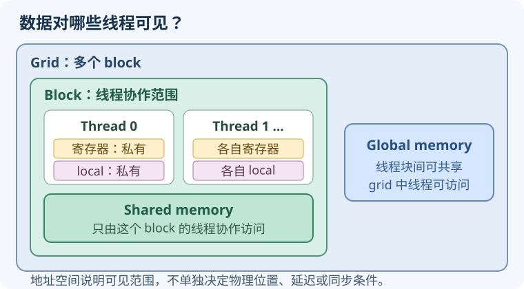
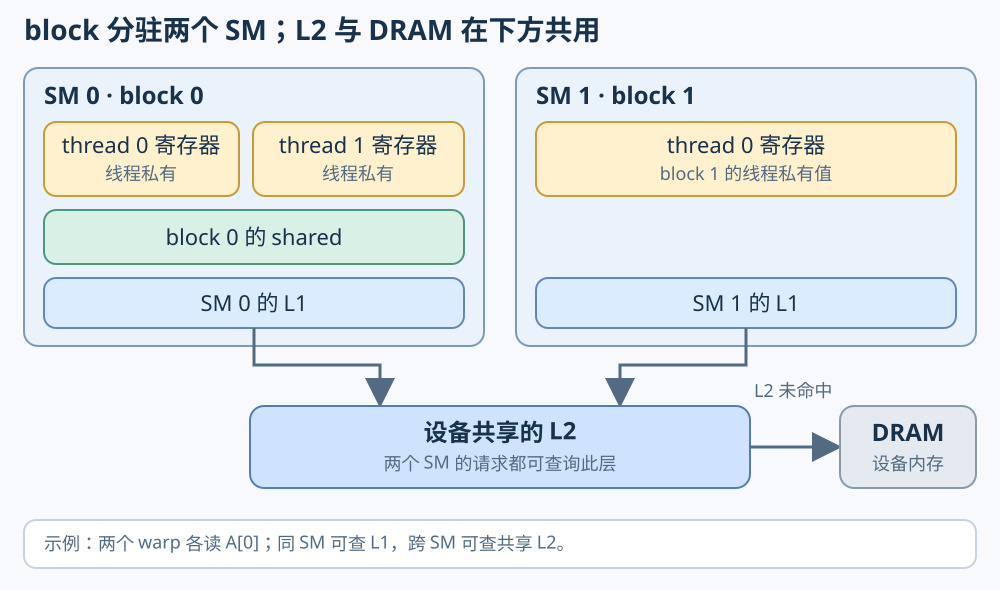
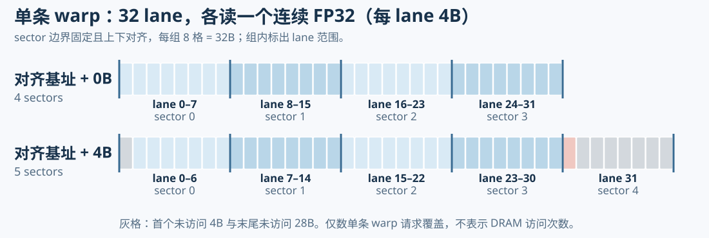
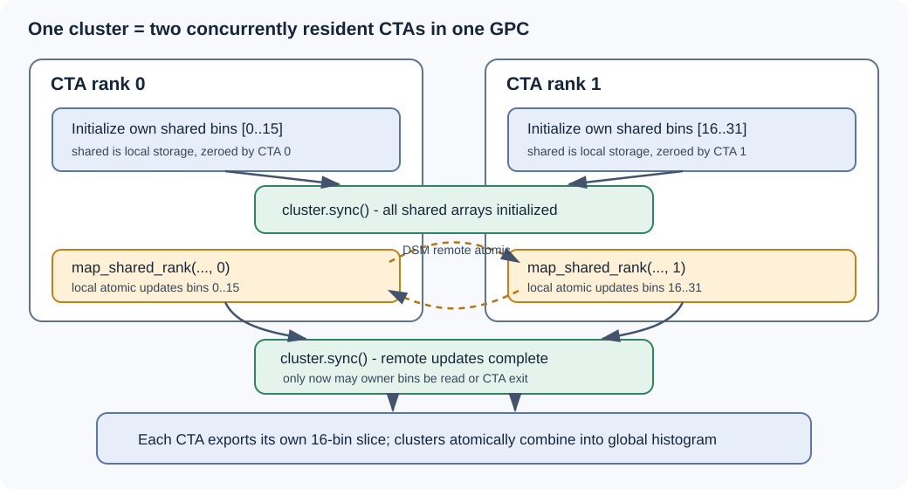

# 第 3 章：寄存器文件、地址空间与内存系统

一个 CUDA thread 读取一个 `float` 后，编译器通常把正在使用的值放进寄存器，计算完成后再把结果写回 global memory。寄存器按线程分配，但物理上来自该线程所在 SM 的寄存器文件；它不是每个 warp 一份的缓存。需要同一 block 多个线程复用或交换的数据，可以先放进 shared memory。

本章沿着数据走过的路径展开：线程私有值和寄存器、寄存器用量对 SM 驻留线程的影响、global memory 的缓存与访问区段、block 内 shared 交换、bank 映射，最后用转置把这些机制连起来。寄存器数、global sector 数和 shared bank 映射回答的是不同问题；后面的例子会从线程访问的具体元素推到对应结果。

## 1. 线程私有值与寄存器

先看单个线程如何处理一个元素。kernel 启动的线程数常会超过 `n`，所以要先检查索引；只有启动配置能保证每个线程都对应合法元素时，才能省去边界判断。

```cpp
__global__ void one_value(const float* x, float* y, int n) {
    int i = blockIdx.x * blockDim.x + threadIdx.x;
    if (i >= n) return;
    float a = x[i];
    float b = a * 2.0f;
    y[i] = b + 1.0f;
}
```

每个线程用自己的 `i` 读取 `x[i]`，计算 `a`、`b`，再写入 `y[i]`。线程不能直接访问其他线程的 `a` 或 `b`。这些局部值通常由寄存器承载，但一个源码变量不一定对应一个独立物理寄存器；编译器可以融合乘加、复用寄存器或消除中间值。

活跃区间（live range）指一个值从产生到最后一次使用之间的程序范围。下面的代码让多个值一直保留到末尾求和：

```cpp
__global__ void long_live_values(const float* x, float* y, int n) {
    int i = blockIdx.x * blockDim.x + threadIdx.x;
    if (i >= n) return;

    float p0 = x[i] + 0.0f;
    float p1 = p0 * 1.1f;
    float p2 = p1 + 2.0f;
    float p3 = p2 * 1.2f;
    float p4 = p3 + 3.0f;
    y[i] = p0 + p1 + p2 + p3 + p4;
}
```

这里的 `p0` 到 `p4` 都在末尾求和时使用，因而源码表达了较长、彼此重叠的活跃区间。编译器可能化简常量表达式，所以这段代码只用于说明概念；实际寄存器用量要看编译报告和生成指令。

图中比较不同地址空间的可见范围：寄存器和 local memory 属于单个线程，shared memory 由同一 block 共享，global memory 可由有权限的 grid 线程访问。源码作用域说明变量在哪里可见，地址空间说明哪些线程可以访问；实际存放位置由存储空间和编译结果决定。

<figure class="diagram-frame">

<figcaption>图：CUDA 地址空间的可见范围。寄存器/local memory 按线程私有，shared memory 按 block 共享，global memory 可由 grid 中有权限的线程访问。</figcaption>
</figure>

常见 CUDA 存储空间的访问范围、生命周期和典型位置如下。

| 类型 | 可见范围 | 生命周期 | 通常所在位置 |
|---|---|---|---|
| 寄存器（device 局部变量未指定其他存储空间） | 单个 thread | 单线程生命周期；物理寄存器槽由编译器分配和复用 | 所在线程所属 SM 的寄存器文件 |
| Local memory（线程私有对象被放入该地址空间时） | 单个 thread | 对象按其线程内生命周期有效 | device memory 路径，可能经缓存 |
| `__shared__` | 同一 block 的线程 | 存储随 block 执行期间存在 | SM 片上共享内存 |
| `cudaMalloc` 的 global allocation | 有权访问该分配的 device thread | 从分配到 `cudaFree` | device global memory |
| `__device__` 静态变量 | device thread；主机可通过 Runtime API 查询或复制 | program/CUDA context 生命周期 | device global memory |
| `__constant__` | device thread 只读；主机可通过 Runtime API 更新 | program/CUDA context 生命周期 | device constant memory 与只读缓存路径 |

CUDA 的 storage specifier 表将未指定存储空间的 device 变量列为单线程可见、单线程生命周期；`__shared__` 存储随 block 执行期间存在，`__constant__` 和静态 `__device__` 变量则属于 program/CUDA context。动态 `cudaMalloc` 数组的生命周期从分配持续到释放。shared 中的数据会保留到被覆盖或存储结束；寄存器则由编译器按值的活跃区间分配和复用。编译器报告的每线程寄存器数乘以 block 线程数，可先估出该 block 对 SM 寄存器文件的需求，实际分配还受硬件粒度影响。

## 2. 寄存器用量与计数单位

> [!IMPORTANT] 识别 register spill
> Register spill（寄存器溢出）指寄存器分配压力导致的值转存。线程私有数组进入 local memory 还有动态索引等其他原因；结合编译报告和生成指令判断具体来源。

字节（byte）用于表示地址跨度与数据大小；一个 32-bit word 是 4 byte。编译器报告的寄存器按 32 位为一个计数单位：一个 `float` 或 `int` 标量通常占一个，`double`、64 位指针和 `long long` 通常占多个。后文的 sector（地址区段）按 32B 对齐范围统计 global 请求覆盖；bank（存储分组）是 shared memory 并行服务请求的单位。两者都不是 C++ 元素或寄存器。

每线程寄存器数来自编译器报告；同一 SM 上所有驻留 block 都从该 SM 的寄存器文件取得资源。估算一个 block 的初始需求可从下式开始：

$$
R_{block} \approx T_{block} \times R_{thread}
$$

`T_block × R_thread` 先估算一个 block 的寄存器需求。硬件再按架构规定的分配粒度向上取整，得到每 block 的实际分配量。寄存器资源所允许的驻留 block 上限可先按 `floor(SM 可用寄存器数 / 每 block 实际分配量)` 估算，再与 warp、block 数及其他资源上限取较小值。以 256 个线程为例，这相当于 8 个 warp。每线程 64 个寄存器时，未计分配粒度的需求是 $256×64=16384$ 个 32 位寄存器；降到 48 时是 12288，少 4096 个寄存器/ block。这个差值本身不能推出多驻留几个 block：还要看目标 SM 的寄存器总量、分配粒度和其他资源。如果限制寄存器导致 spill，新增的 local 读写也会带来成本。

`ptxas` 的 `Used N registers` 报告目标代码的物理寄存器分配数量；PTX `.reg` 声明的是虚拟寄存器，两者不能直接等同。驻留估算应使用目标编译报告，并按该架构的分配粒度计算。

下面用线程私有数组观察运行时下标对存储分配的影响。代码先初始化数组，再按运行时计算出的 `slot` 更新一个元素。片段省略 kernel 外层；`i` 已通过输入边界检查，`step` 表示循环次数：

```cpp
float values[64];
for (int j = 0; j < 64; ++j) values[j] = input[i] + j;
int slot = (threadIdx.x + 13 * step) & 63;
values[slot] = fmaf(values[slot], 1.0001f, 0.25f);
```

索引若是编译期常量，编译器可能把 `values[0]`、`values[1]` 等拆成标量，甚至消去整个数组。索引依赖运行时数据时，代码需要保留“基址加偏移”的寻址方式，较难把所有元素固定到独立寄存器；但数组较小且优化充分时，仍可能寄存器化。应结合 `-Xptxas=-v`、`--resource-usage` 和 PTX/SASS 判断，不能只看数组写法下结论。

下面的命令先生成资源摘要，再用寄存器上限较低的版本观察 spill 变化，最后检查 PTX 和 SASS。先从仓库根目录切换到 `roadmap/curriculum/gpu/03-registers-and-memory-system/`，再运行命令；其中 `examples/...` 相对于该章目录。将 `sm_XX` 换成目标设备的计算能力版本，不同架构的寄存器数据按各自目标解释。

```powershell
nvcc -O3 -std=c++17 -lineinfo --resource-usage `
  examples/register_spill_probe.cu -o register_spill_probe.exe

nvcc -O3 -std=c++17 -lineinfo -Xptxas=-v -maxrregcount=32 `
  examples/register_spill_probe.cu -o register_spill_probe_r32.exe

nvcc -O3 -std=c++17 -ptx -arch=sm_XX `
  examples/register_spill_probe.cu -o register_spill_probe.ptx

nvcc -O3 -std=c++17 -cubin -arch=sm_XX `
  examples/register_spill_probe.cu -o register_spill_probe.cubin

cuobjdump --dump-resource-usage register_spill_probe.exe
cuobjdump --dump-ptx register_spill_probe.exe
nvdisasm --print-code --print-line-info register_spill_probe.cubin
```

`--maxrregcount` 限制每线程可分配的寄存器数。限制降低后，SM 可能容纳更多 block；无法留在寄存器的值也可能转存到 local memory，增加读写。对照时同时看寄存器、local 访问和运行时间；单看可驻留 block 数不能判断收益。

### 编译器报告中的寄存器数

```cpp
float a = x;
float b = a + 1.0f;
float c = b * 2.0f;
```

优化后，`b` 和 `c` 可能复用寄存器槽；地址计算、边界 predicate（谓词条件）或循环展开也会产生临时值。编译器报告的是生成代码实际分配的寄存器数。

缩小 `float values[64]` 不保证消除 spill。动态索引、循环展开、同时活跃的累加器、编译目标和寄存器分配粒度都会影响结果。比较两个版本的 `ptxas` 每线程寄存器数、local memory 字节数，以及 SASS 中的 local load/store，才能确认变化。

## 3. 活跃区间、依赖链与寄存器压力

寄存器压力取决于同一时刻仍需保留的值。第一种写法先加载四个值，再统一参与输出计算；第二种分批计算，尽早结束部分值的活跃区间：

```cpp
// 许多中间量同时存活到末尾
float a = load_a(i);
float b = load_b(i);
float c = load_c(i);
float d = load_d(i);
out[i] = (a + b) + (c + d);
```

```cpp
// 尽快消费中间量，缩短部分活跃区间
float ab = load_a(i) + load_b(i);
float cd = load_c(i) + load_d(i);
out[i] = ab + cd;
```

第一种写法要把四个输入值保留到输出计算；第二种让前一对尽早结束使用。编译器可能重排两种写法并生成相同机器码，因此仍要查看资源报告和指令。矩阵乘中，每个线程持有的输出累加值也占寄存器；tile 增大通常提高压力，实际 lane 映射和寄存器分配则由编译器决定。

依赖链影响单线程能同时推进多少计算。下面每一步都使用上一步的结果：

```cpp
float x = a;
x = x * w0;
x = x + b0;
x = x * w1;
x = x + b1;
```

后一条运算必须等前一条完成，因此单线程的 Instruction-Level Parallelism（指令级并行，ILP）有限。算法允许时，可以维护多个互不依赖的累加器来增加可并行调度的工作；代价是寄存器压力上升：

```cpp
float s0 = 0.0f, s1 = 0.0f, s2 = 0.0f, s3 = 0.0f;
for (int k = lane * 4; k < K; k += 4 * warpSize) {
    if (k + 0 < K) s0 = fmaf(a[k + 0], b[k + 0], s0);
    if (k + 1 < K) s1 = fmaf(a[k + 1], b[k + 1], s1);
    if (k + 2 < K) s2 = fmaf(a[k + 2], b[k + 2], s2);
    if (k + 3 < K) s3 = fmaf(a[k + 3], b[k + 3], s3);
}
```

片段逐项检查末尾元素，所以 `K` 不必是 4 的倍数。多个累加器可以打断单条依赖链；同时，每条加载在 lane 间的步长变成 4，可能增加 sector 覆盖、降低访存合并效率。四条链也改变 FP32 加法的分组和累加顺序，舍入结果不必与单链相同。独立链增多还可能提高每线程寄存器数、降低驻留 warp 数。要结合 ILP、地址映射、数值误差和计数器判断整体效果，不能把变化全归因于依赖链。

## 4. CUDA 地址空间与缓存

### 4.1 Global memory

Global memory 是 grid 中线程可寻址的设备内存，分配的生命周期由分配与释放管理。一次 global load 仍由每个执行该指令的线程发出，但数据可以从不同层级得到。L1（一级缓存）位于各 SM；L2（二级缓存）位于设备侧，由各 SM 共用。若两级缓存都没有所需数据，请求再从设备内存（DRAM）取数。设备内存可使用 GDDR 或 HBM（High Bandwidth Memory，高带宽内存）等类型。

例如 warp 0 和 warp 1 都读取 `A[0]`。如果两个 warp 在同一 SM 上运行，它们都执行 global load，第二次读取可能命中该 SM 的 L1；如果两个 warp 在不同 SM 上运行，它们不共用 L1，但可从设备共享的 L2 取得数据。每个 warp 的请求仍按自己的 lane 地址计算。缓存解释“数据从哪层提供”，合并访问解释“一条 warp 请求覆盖哪些地址区段”，两者要分开看。

<figure class="diagram-frame">

<figcaption>block 分处两个 SM；箭头沿 L1 → L2 → DRAM 表示请求查询方向。</figcaption>
</figure>

### 4.2 Shared memory

Shared memory（共享内存）是分配给一个 block 的片上存储，同一 block 的线程可以借它交换或复用数据。它与 L1 使用同一片 SM 物理资源，shared 占用会影响该 kernel 可用的 L1 容量。shared 又分成多个 bank，多个 lane 访问同一 bank 的不同 word 时，请求可能分批服务；第 6 节用 32 位标量例子说明其映射。矩阵转置先用 shared tile 调整 global 读写方向，再通过行跨度 padding 改变 bank 映射。

### 4.3 Constant memory

Constant memory 是设备端只读地址空间，适合较小且稳定的常量数据。同一 warp 的 lane 读取同一地址时可由广播服务；若读取不同地址，访问方式与收益会变化。因此，只读张量不一定适合放入 constant memory；较大权重仍需按复用方式、缓存和布局选择 global 或 texture 路径。

### 4.4 Local memory

Local memory 是每个 thread 私有的地址空间，数据走设备内存路径，也可能经过缓存。寄存器 spill、动态索引的局部数组和较大的线程私有对象都可能使用它；查看 `lmem` 报告与 local load/store 指令可判断具体来源。

### kernel 中的局部变量与 shared memory

```cpp
// 前提：仅启动一个 block，blockDim.x 为 32，且没有其他 block 访问 tile。
__global__ void wrong_memory_model(float* out) {
    float x = 1.0f;              // 每个 thread 的寄存器候选
    __shared__ float tile[32];   // block 共享，显式 shared
    tile[threadIdx.x] = x;
    __syncthreads();
    out[threadIdx.x] = tile[(threadIdx.x + 1) & 31];
}
```

若改变启动配置或增加 block，需另行检查索引范围、数组大小与跨 block 的数据归属。此例只对比 thread 私有的 `x` 和 block 共享的 `tile`。

`x` 和 `tile` 都在 kernel 函数体内声明，但可见范围不同：邻居 thread 不能直接读取 `x`；block 内跨线程读写 `tile` 则要用 barrier（同步屏障）建立生产者与消费者之间的先后关系。

L1/L2 为 global 地址请求提供缓存服务；跨线程交换数据仍要用 shared memory 或其他有明确定义的通信方式。

## 5. Global memory 的 32B sector 手算

这里按 CUDA global memory 常见的 32B sector 统计单条 warp 指令覆盖的地址区段。假设一个 warp 有 32 个 lane，每个 lane 读取一个 4B `float`，元素自然对齐，且首地址按 32B 对齐；偏移 4B 的例子会单独计算。sector 数表示该请求覆盖的地址区段，缓存和下游传输另按实际访问情况处理。

lane `l` 的字节地址为：

$$
addr(l)=base+4\times stride\times l
$$

把地址映射到 32B sector：

$$
sector(l)=\left\lfloor\frac{addr(l)}{32}\right\rfloor
$$

sector 数是地址映射后不同 32B 区段的数量。合并访问看同一条 warp 指令涉及哪些 sector，不看源码里 lane 编号是否按地址递增。该计数描述请求覆盖范围，不直接给出 L2 或 DRAM 的实际字节流量。

### stride = 1

<figure class="diagram-frame">

<figcaption>图：sector 边界上下对齐不动。下行在首格空出 4B 后放置 32 个 lane 的数据，再留 7 格；两行统计的是单条 warp 请求覆盖的地址区段，不是 DRAM 访问次数。</figcaption>
</figure>

`base=0` 时，地址 `0, 4, 8, ..., 124` 落在 sector 0–3，共 4 个 32B sector；32 个 lane 的有效数据共 128B。若首地址为 `base=4`，地址变为 `4, 8, ..., 128`，覆盖 sector 0–4，共 5 个。两种情况下每个 lane 仍只读一个 FP32；偏移使最后一个元素跨入第五个 sector。

### stride = 2

地址是 `0, 8, 16, ..., 248`。32 个 lane 各读 4B，有效数据量为 128B；从首地址到最后一个元素末尾覆盖 252B 地址范围，对应 8 个 32B sector。中间间隔的 float 不属于这条指令读取的数据。

### stride = 32

地址是 `0, 128, 256, ..., 3968`。每个地址落在不同的 sector，覆盖 32 个 sector；每个 sector 只使用一个 4B word，带宽利用率很低。这正是矩阵转置直接写出结果时常见的跨步模式。

### 连续 lane 不是必要条件

如果 32 个 lane 以任意顺序访问同一组地址 `{0, 4, 8, ..., 124}`，去重后的 sector 集仍是 `{0,1,2,3}`。因此判断请求覆盖范围，要看一条 warp 指令产生的地址集合；未对齐时，即使地址连续，也可能多跨一个 32B sector。

**完整算例。** 令 `base=64`、`stride=2`，第 0–3 个 lane 的地址为 64、72、80、88，都落在 sector 2；第 4–7 个 lane 地址为 96、104、112、120，都落在 sector 3。lane 31 读取地址 312，位于 sector 9。因此该 warp 指令覆盖 sector 2 到 9，共 8 个 32B sector。

分析 naive GEMM 的线程映射时，要区分单线程跨归约迭代的地址与同一条 warp 指令覆盖的地址。对 `B[n*K+k]`，若同一条指令中相邻 lane 的 `k` 连续，这次读取可以合并；单线程下一轮跨过 K 个元素，不会改变当前 warp 请求的 lane 地址分布。

下面的 tiled GEMM 计算 `A[M,K] × B[K,N] => C[M,N]`；本节的 naive GEMM 采用 `A[M,N] × B[N,K] => C[M,K]`。两者的矩阵维度约定不同：

<!-- source-check: solutions/cuda/gemm/tiled_fp16.cu -->
~~~cpp {8-10,16-27,29-35,39-42}
constexpr int tileLen = 32;

__global__ void kernel(const half* A, const half* B, half* C,
                       int M, int N, int K, float alpha, float beta) {
    int m = blockIdx.x * tileLen + threadIdx.x;
    int n = blockIdx.y * tileLen + threadIdx.y;
    float sum = 0.0f;

    // 每个线程先搬运暂存
    __shared__ half As[tileLen][tileLen];
    __shared__ half Bs[tileLen][tileLen];

    // 遍历 K
    for (int t = 0; t < (K + tileLen - 1) / tileLen; ++t) {
        // 每个线程搬运自己负责的那块
        // A 矩阵按列步进
        int aK = t * tileLen + threadIdx.y;
        As[threadIdx.x][threadIdx.y] = (m < M && aK < K)
            ? A[m * K + aK] : __float2half_rn(0.0f);

        // B 矩阵按行步进
        int bK = t * tileLen + threadIdx.x;
        Bs[threadIdx.x][threadIdx.y] = (n < N && bK < K)
            ? B[bK * N + n] : __float2half_rn(0.0f);

        // 同步
        __syncthreads();

        // 计算
        for (int k = 0; k < tileLen; k++) {
            sum += __half2float(As[threadIdx.x][k]) *
                   __half2float(Bs[k][threadIdx.y]);
        }

        // 同步
        __syncthreads();
    }

    if (m < M && n < N) {
        C[m * N + n] = __float2half_rn(
            alpha * sum + beta * __half2float(C[m * N + n]));
    }
}
~~~

第一处 `__syncthreads()` 保证数据准备好再使用：所有线程把当前 A/B tile 写完，其他线程才能读取。第二处保证读完再覆盖：所有线程结束当前 tile 的读取和累加，下一轮才能覆写同一片 shared memory。

原文件使用 `32×32` 线程块；按该二维 block 的线性排布，一个 warp 内 `threadIdx.x` 从 0 到 31 变化，`threadIdx.y` 不变。`threadIdx.x` 对应输出行 `m`，不是连续输出列。固定循环轮次时，相邻 lane 读取 A 的地址相差 `K` 个 half，读取 B 的地址相差 `N` 个 half，写 C 时也相差 `N` 个 half。因此这份线程映射仍有跨步 global 访问，不能套用 naive 版本中 x 映射连续列的结论。

这里 `As/Bs` 的元素是 16 位 half，访问宽度和 lane 地址映射均不同，不能直接套用 32 位 `float tile[32][32]` 的 32-way bank 手算。该 GEMM 用 shared memory 让 block 内线程复用输入；transpose 则用 shared tile 改变读写排列，使 global 读写更连续。判断 half 的 bank 行为需要结合目标架构和实际指令。

## 6. Shared memory 的 bank、广播和 `[32][33]`

在 32-bit bank mode（每 bank 按 32 位 word 编址）下，可把 shared memory 看成 32 个 bank。word 编号为 `word_index` 时，其 bank 编号是：

$$
bank(word\_index)=word\_index\bmod 32
$$

对连续的 `float`，下标每增加 1，bank 编号前进一格；到 31 后，下一个元素回到 bank 0。`A32` 与 `A0` 位于同一 bank 的不同位置，因此不会覆盖 `A0`；每个元素占一个 4B word。

<figure class="diagram-frame">
  
  <figcaption>连续 word 地址按 bank 交错分组；同一 bank 中可有多个独立位置。</figcaption>
</figure>

bank 编号按 32 位 word 的序号循环分配；它不是矩阵里固定的物理“第几列”。对 C/C++ 行主序的 `float tile[32][32]`：

$$
word\_index(tile[r][c])=r\times32+c
$$

### 跨列访问：`tile[lane][0]`

设 block 为 `32×32`，warp 0 中 `threadIdx.y=0`，lane `l` 对应 `threadIdx.x=l`。若各 lane 读取 `tile[l][0]`：

$$
bank(l)= (l\times32+0)\bmod32=0
$$

32 个 lane 都访问 bank 0，但地址对应 32 个不同 word，形成典型的 32 路 bank conflict。冲突来自行跨度 32 个 word 后 bank 编号回绕到同一位置，不是“按列读”本身造成的。

若每个 lane 读取 `tile[0][l]`：

$$
bank(l)=l
$$

32 个 lane 分散到 32 个 bank，无冲突。

### 加一列：`tile[32][33]`

把声明改为 `float tile[32][33]` 后，跨列访问的 bank 编号变为：

$$
bank(l)=(l\times33+0)\bmod32=l
$$

每个 lane 落到不同 bank。padding 不改变逻辑上的 `32×32` 数据，只把 shared 中相邻逻辑行的物理步长从 32 个 word 改为 33 个。

### 广播不是 bank conflict

> [!IMPORTANT] 冲突由 lane 到地址的映射决定
> 在这个 32 位模型中，行跨度为 32 时，列访问落到同一 bank；跨度为 33 时，分散到 32 个 bank。**数组声明不是唯一依据，实际索引和访问宽度也会改变映射。**

warp 中所有 lane 若读取**同一 bank 的同一 word**，例如都读 `tile[0][0]`，硬件可广播这个值，不构成多路冲突。若多个 lane 命中同一 bank 的不同 word，例如分别读 `tile[0][0]` 和 `tile[1][0]`，请求会竞争该 bank，不能按广播处理。

写访问需要单独分析。多个 lane 同时写同一地址不具备读广播语义；非原子写的最终结果没有保证。即使写入值相同，也不能视为广播写。应指定唯一 writer，或使用 atomic 与适当的同步协议。

### 访问边界

本节只按 32 位标量访问计算。64 位或向量化指令可能一次访问多个 word，需要按生成的访问宽度和目标架构重新映射。

## 7. 矩形转置：shared staging 与 padding

### 7.1 数学和布局

输入 `A` 为 `M×N` 的 row-major 矩阵，输出 `B` 为 `N×M`：

$$
B[c,r]=A[r,c],\quad 0\le r<M,\quad 0\le c<N
$$

输入地址是 `A[r*N+c]`，输出地址是 `B[c*M+r]`。warp 按连续 `c` 读取 A 时，lane 访问相邻元素；同一线程排列若直接写 B，相邻 lane 的输出地址可能相差 `M` 个元素。shared staging（共享内存暂存）先把一块输入放入 shared tile，再交换行列索引，让读入和写回采用不同的线程—地址映射。

### 7.2 矩形尾 tile 的关键

边界 tile 可能只覆盖部分行或列。此 kernel 让线程先承担输入装载，再在转置后承担输出写回，因此装载坐标和输出坐标要分别判断：

1. 每个线程计算 `in_bounds`。
2. 所有线程都写 shared：有效线程写输入值，无效线程写 0。
3. 所有线程到达第一次 `__syncthreads()`。
4. 有效输出线程读取 shared 并写回；无效输出线程不写。

若按输入坐标越界就提前退出，下面的写法会漏掉部分输出，并可能使 block 内线程无法共同到达 barrier：

```cpp
if (row >= M || col >= N) return;
tile[ty][tx] = input[row * N + col];
__syncthreads();
```

令输入为 `3×5` 矩阵 `A[r,c]=10r+c`，转置结果为：

$$
A=\begin{bmatrix}0&1&2&3&4\\10&11&12&13&14\\20&21&22&23&24\end{bmatrix},\qquad
B=A^T=\begin{bmatrix}0&10&20\\1&11&21\\2&12&22\\3&13&23\\4&14&24\end{bmatrix}.
$$

输入 tile 的线程先按 `row=blockIdx.y*32+ty`、`col=blockIdx.x*32+tx` 读 `A[row,col]`，并写到 `tile[ty][tx]`。第一次 `__syncthreads()` 等所有线程完成这一步。之后转置输出坐标改为 `output_row=blockIdx.x*32+ty`、`output_col=blockIdx.y*32+tx`，并从 `tile[tx][ty]` 读值。首个 tile 中，`ty=3, tx=0` 的输入行越界，所以它向 `tile[3][0]` 写 0；但它的输出坐标 `(3,0)` 在 `5×3` 输出内，读取的实际位置是 `tile[0][3]`，其中存着 `A[0,3]=3`，最后写入 `B[3,0]=3`。若它按输入坐标越界直接退出，就会漏掉这个输出。所有线程先写 tile 并通过屏障，再分别判断输出坐标；单次使用 tile 后 kernel 结束，不需要第二个屏障。若在循环中重用 tile，则覆盖下一块数据前还要确认上一轮读者已完成。

### 7.3 三条可比较的代码路径

三种实现共用 `kTile=32`。朴素版本直接从输入读一个元素并写到转置后的地址：

<!-- source-check: examples/transpose_tiled.cu -->
~~~cpp
constexpr int kTile = 32;
~~~

<!-- source-check: examples/transpose_tiled.cu -->
~~~cpp
__global__ void transpose_naive_kernel(const float* input, float* output,
                                       int rows, int cols) {
    const int row = blockIdx.y * blockDim.y + threadIdx.y;
    const int col = blockIdx.x * blockDim.x + threadIdx.x;

    if (row < rows && col < cols) {
        // input is rows x cols; output is cols x rows.
        output[col * rows + row] = input[row * cols + col];
    }
}
~~~

输入坐标中 `threadIdx.x` 连续变化，因此 `input[row*cols+col]` 的相邻 lane 读取相邻列。直接写 `output[col*rows+row]` 时，相邻 lane 地址相差 `rows` 个 float，形成跨步 global store。

shared-memory 版本先按输入坐标写入 `tile[threadIdx.y][threadIdx.x]`，同步后用交换后的索引读取，再按输出坐标连续写回：

<!-- source-check: examples/transpose_tiled.cu -->
~~~cpp
template <bool Padded>
__global__ void transpose_tiled_kernel(const float* input, float* output,
                                       int rows, int cols) {
    // Every thread executes both the load phase and the barrier.  The padded
    // layout changes only the physical shared-memory row stride.
    __shared__ float tile[kTile][Padded ? kTile + 1 : kTile];

    const int row = blockIdx.y * kTile + threadIdx.y;
    const int col = blockIdx.x * kTile + threadIdx.x;
    const bool input_valid = row < rows && col < cols;

    tile[threadIdx.y][threadIdx.x] =
        input_valid ? input[row * cols + col] : 0.0f;

    __syncthreads();

    // The logical transposed coordinate is (col, row).  A thread whose
    // transposed output is outside the rectangle simply skips the store; it
    // does not leave the block before the first barrier.
    const int output_row = blockIdx.x * kTile + threadIdx.y;
    const int output_col = blockIdx.y * kTile + threadIdx.x;
    if (output_row < cols && output_col < rows) {
        output[output_row * rows + output_col] =
            tile[threadIdx.x][threadIdx.y];
    }
}
~~~

线程先按输入坐标写入 `tile[threadIdx.y][threadIdx.x]`，再用 `tile[threadIdx.x][threadIdx.y]` 交换行列读取。`output_row` 和 `output_col` 是转置后的坐标，线性地址为 `output_row*rows+output_col`。写回阶段 `threadIdx.x` 连续改变 `output_col`，使相邻 lane 写入相邻位置。

模板参数只改 shared memory 的物理行跨度：`false` 为 32 列，`true` 为 33 列。在这个 FP32 标量例子中，输出 warp 的 lane `l` 读取 `tile[l][ty]`，对应 bank 为 `(l×stride+ty) mod 32`。stride 为 32 时，所有 lane 都落在 bank `ty`，但访问不同 word；stride 为 33 时，bank 变为 `(l+ty) mod 32`，lane 分散到 32 个 bank。这也把上一节的公式直接用到转置代码上。

[NVIDIA CUDA Samples 的转置示例](https://github.com/NVIDIA/cuda-samples/tree/5443602d89ed99aede2e4b7bf329daddeadb320e/cpp/6_Performance/transpose)用四条路径逐步隔离成本：`copy` 给出同类读写的带宽参照；`transposeNaive` 保留跨步 global 写；`transposeCoalesced` 通过 shared tile 让 global 读写都合并；`transposeNoBankConflicts` 再调整 shared 行跨度，减少列读取的 bank conflict。padding 只针对特定线程与地址的对应关系有效，并非任意矩阵访问的通用优化。

官方例程的逻辑 tile 为 32×32，线程块为 32×16，并要求矩阵尺寸整除 tile；本章实现用 32×32 线程块并处理矩形尾块。线程数、边界工作与 launch 数量不同，因此可以对照算法阶段和访存机制，不应直接把两份程序的毫秒数作横向性能结论。

未 padding 与 padding 版本都使用 `32×32` 线程块，模板参数只改变 shared 行跨度，可用于比较这一布局变化。naive 版本使用 `32×8` 线程块，因此两类实现的差值同时包含线程组织与访存布局的影响。程序以 CPU 转置作参考，检查三种输出的最大绝对误差，并用 CUDA event 计时；非有限结果或误差超过阈值都会使程序失败。打印的有效带宽按 `2×rows×cols×sizeof(float) / kernel time` 计算，表示读写逻辑字节数除以时间，不是 profiler 测得的 DRAM 带宽。

### 转置练习

在 [LeetGPU Matrix Transpose](https://leetgpu.com/challenges/matrix-transpose) 题面从空白实现转置。先处理整除尺寸，再覆盖矩形边界；检查输入、输出的 lane 地址顺序以及 shared tile 的索引交换。平台提交的原始 kernel 应单独归档。

服务器验证使用本章 `examples/transpose_tiled.cu`。命令从本章目录运行。固定矩阵尺寸、数据类型、预热和计时方式，比较 naive、未 padding 与 padding 三种实现。先核对 CPU 参考并运行 sanitizer，再记录 kernel 时间、按逻辑读写字节计算的有效带宽、寄存器/shared/local 用量，以及设备可提供的 sector 和 bank 指标。整除尺寸与矩形尾部尺寸分别报告。naive 与 tiled 的线程组织不同，因此差值包含线程组织和访存布局的共同影响；未 padding 与 padding 才只改变 shared 行跨度。

```bash
nvcc -O3 -std=c++17 -lineinfo --resource-usage examples/transpose_tiled.cu -o transpose_tiled
./transpose_tiled 1 1 5
./transpose_tiled 3 5 5
./transpose_tiled 37 65 5
compute-sanitizer --tool memcheck --error-exitcode=1 ./transpose_tiled 37 65 5
compute-sanitizer --tool racecheck --error-exitcode=1 ./transpose_tiled 37 65 5
./transpose_tiled 4096 4096 100
```

服务器结果按实际运行填写；未测项目保持空白：

| 输入 / 实现 | GPU / CC | 正确性（最大误差） | kernel time | 有效带宽 | global sectors / shared bank |
|---|---|---|---|---|---|
| `4096×4096` FP32；naive | — | — | — | — | — |
| `4096×4096` FP32；tile 32×32 | — | — | — | — | — |
| `4096×4096` FP32；tile 32×33 | — | — | — | — | — |

<details>
<summary>完整 CUDA C++ 转置程序：kernel、CPU 参考、计时与入口</summary>

<!-- source-check: examples/transpose_tiled.cu -->

```cpp
#include <cuda_runtime.h>

#include <algorithm>
#include <cmath>
#include <cstdint>
#include <cstdio>
#include <cstdlib>
#include <limits>
#include <vector>

namespace {

constexpr int kTile = 32;

#define CUDA_CHECK(call)                                                     \
    do {                                                                     \
        cudaError_t error__ = (call);                                        \
        if (error__ != cudaSuccess) {                                        \
            std::fprintf(stderr, "%s:%d CUDA error: %s\n",                  \
                         __FILE__, __LINE__, cudaGetErrorString(error__));    \
            std::exit(EXIT_FAILURE);                                         \
        }                                                                    \
    } while (false)

__global__ void transpose_naive_kernel(const float* input, float* output,
                                       int rows, int cols) {
    const int row = blockIdx.y * blockDim.y + threadIdx.y;
    const int col = blockIdx.x * blockDim.x + threadIdx.x;

    if (row < rows && col < cols) {
        // input is rows x cols; output is cols x rows.
        output[col * rows + row] = input[row * cols + col];
    }
}

template <bool Padded>
__global__ void transpose_tiled_kernel(const float* input, float* output,
                                       int rows, int cols) {
    // Every thread executes both the load phase and the barrier.  The padded
    // layout changes only the physical shared-memory row stride.
    __shared__ float tile[kTile][Padded ? kTile + 1 : kTile];

    const int row = blockIdx.y * kTile + threadIdx.y;
    const int col = blockIdx.x * kTile + threadIdx.x;
    const bool input_valid = row < rows && col < cols;

    tile[threadIdx.y][threadIdx.x] =
        input_valid ? input[row * cols + col] : 0.0f;

    __syncthreads();

    // The logical transposed coordinate is (col, row).  A thread whose
    // transposed output is outside the rectangle simply skips the store; it
    // does not leave the block before the first barrier.
    const int output_row = blockIdx.x * kTile + threadIdx.y;
    const int output_col = blockIdx.y * kTile + threadIdx.x;
    if (output_row < cols && output_col < rows) {
        output[output_row * rows + output_col] =
            tile[threadIdx.x][threadIdx.y];
    }
}

void transpose_cpu(const std::vector<float>& input, std::vector<float>& output,
                   int rows, int cols) {
    for (int row = 0; row < rows; ++row) {
        for (int col = 0; col < cols; ++col) {
            output[col * rows + row] = input[row * cols + col];
        }
    }
}

float max_abs_error(const std::vector<float>& actual,
                    const std::vector<float>& expected) {
    float error = 0.0f;
    for (std::size_t i = 0; i < actual.size(); ++i) {
        if (!std::isfinite(actual[i]) || !std::isfinite(expected[i])) {
            return std::numeric_limits<float>::infinity();
        }
        error = std::max(error, std::fabs(actual[i] - expected[i]));
    }
    return error;
}

template <typename Launch>
float run_and_measure(Launch launch, float* device_output, std::size_t output_size,
                      std::vector<float>& host_output, int repeats) {
    cudaEvent_t start = nullptr;
    cudaEvent_t stop = nullptr;
    CUDA_CHECK(cudaEventCreate(&start));
    CUDA_CHECK(cudaEventCreate(&stop));

    launch();
    CUDA_CHECK(cudaGetLastError());
    CUDA_CHECK(cudaDeviceSynchronize());

    CUDA_CHECK(cudaEventRecord(start));
    for (int i = 0; i < repeats; ++i) {
        launch();
    }
    CUDA_CHECK(cudaEventRecord(stop));
    CUDA_CHECK(cudaEventSynchronize(stop));

    float elapsed_ms = 0.0f;
    CUDA_CHECK(cudaEventElapsedTime(&elapsed_ms, start, stop));
    CUDA_CHECK(cudaMemcpy(host_output.data(), device_output,
                          output_size * sizeof(float), cudaMemcpyDeviceToHost));

    CUDA_CHECK(cudaEventDestroy(start));
    CUDA_CHECK(cudaEventDestroy(stop));
    return elapsed_ms / static_cast<float>(repeats);
}

bool report(const char* name, float ms, float error, int rows, int cols) {
    const double bytes = 2.0 * static_cast<double>(rows) * cols * sizeof(float);
    const double gb_per_second = bytes / (static_cast<double>(ms) * 1.0e6);
    constexpr float kTolerance = 1.0e-6f;
    const bool pass = std::isfinite(error) && error <= kTolerance;
    std::printf("%-8s  %.4f ms  %.3f GB/s  max_abs_error=%.8g  %s\n",
                name, ms, gb_per_second, error, pass ? "PASS" : "FAIL");
    return pass;
}

}  // namespace

int main(int argc, char** argv) {
    const int rows = argc > 1 ? std::atoi(argv[1]) : 37;
    const int cols = argc > 2 ? std::atoi(argv[2]) : 65;
    const int repeats = argc > 3 ? std::atoi(argv[3]) : 50;
    if (rows <= 0 || cols <= 0 || repeats <= 0 ||
        rows > std::numeric_limits<int>::max() - kTile ||
        cols > std::numeric_limits<int>::max() - kTile) {
        std::fprintf(stderr, "usage: %s [rows] [cols] [repeats]\n", argv[0]);
        return EXIT_FAILURE;
    }

    if (static_cast<std::int64_t>(rows) * cols >
        static_cast<std::int64_t>(std::numeric_limits<int>::max())) {
        std::fprintf(stderr, "rows*cols is too large for this example\n");
        return EXIT_FAILURE;
    }
    const std::size_t input_size = static_cast<std::size_t>(rows) * cols;
    const std::size_t output_size = static_cast<std::size_t>(cols) * rows;
    std::vector<float> host_input(input_size);
    std::vector<float> host_reference(output_size, 0.0f);
    std::vector<float> host_output(output_size, 0.0f);
    for (std::size_t i = 0; i < input_size; ++i) {
        host_input[i] = static_cast<float>(((i % 101) * 17 + 3) % 101) * 0.125f;
    }
    transpose_cpu(host_input, host_reference, rows, cols);

    float* device_input = nullptr;
    float* device_output = nullptr;
    CUDA_CHECK(cudaMalloc(&device_input, input_size * sizeof(float)));
    CUDA_CHECK(cudaMalloc(&device_output, output_size * sizeof(float)));
    CUDA_CHECK(cudaMemcpy(device_input, host_input.data(),
                          input_size * sizeof(float), cudaMemcpyHostToDevice));

    const dim3 naive_block(32, 8);
    const dim3 naive_grid((cols + naive_block.x - 1) / naive_block.x,
                          (rows + naive_block.y - 1) / naive_block.y);
    const dim3 tiled_block(kTile, kTile);
    const dim3 tiled_grid((cols + kTile - 1) / kTile,
                          (rows + kTile - 1) / kTile);

    const float naive_ms = run_and_measure(
        [&] { transpose_naive_kernel<<<naive_grid, naive_block>>>(
                  device_input, device_output, rows, cols); },
        device_output, output_size, host_output, repeats);
    bool all_ok = report("naive", naive_ms,
                         max_abs_error(host_output, host_reference), rows, cols);

    const float unpadded_ms = run_and_measure(
        [&] { transpose_tiled_kernel<false><<<tiled_grid, tiled_block>>>(
                  device_input, device_output, rows, cols); },
        device_output, output_size, host_output, repeats);
    all_ok = report("tile32", unpadded_ms,
                    max_abs_error(host_output, host_reference), rows, cols) && all_ok;

    const float padded_ms = run_and_measure(
        [&] { transpose_tiled_kernel<true><<<tiled_grid, tiled_block>>>(
                  device_input, device_output, rows, cols); },
        device_output, output_size, host_output, repeats);
    all_ok = report("tile33", padded_ms,
                    max_abs_error(host_output, host_reference), rows, cols) && all_ok;

    CUDA_CHECK(cudaFree(device_input));
    CUDA_CHECK(cudaFree(device_output));
    return all_ok ? EXIT_SUCCESS : EXIT_FAILURE;
}
```

</details>

## 8. 缓存复用与 shared staging

重复读取可由硬件缓存服务，也可由程序把数据搬入 shared memory，供同一 block 多次使用。缓存由硬件根据访问流处理；shared 暂存则需要程序安排数据布局、同步和复用时机。

例如一个 block 反复使用同一输入 tile 做多轮计算时，可先合并读取该 tile，再写入 shared，让后续计算从 shared 复用。若数据只读一次，或工作集已经能由缓存有效复用，额外搬运和同步就可能增加开销。是否使用 shared 暂存，要结合数据复用次数和实测时间判断。

比较实现时，固定设备、形状、数据类型和计时范围。跨步写对应 sector 覆盖，shared 列读对应 bank 映射；代码变化包括 tile、padding、线程布局和是否使用 shared 暂存。先核对结果，再看时间及缓存、sector、bank、寄存器和 local 访问数据。

```text
硬件机制：跨步写覆盖更多 32B sector，或 shared 列读落到同一 bank
代码改动：tile 形状、padding、block 线程布局、是否 staging
预期计数：global sectors 下降，或 shared bank conflict 下降
测量：正确性 -> kernel time -> memory sectors/cache -> shared conflicts -> registers/lmem
```

无 padding 与 padding 版本应使用相同的输入输出布局、边界尺寸和计时范围；两版只改变 shared 行跨度，便于判断 padding 对 bank 访问和时间的影响。

## 9. 编译产物检查：从 CUDA 源码到 PTX 与 SASS

转置代码从 global 读入 shared，再从 shared 读出并写回 global。看 PTX/SASS 时，可沿这条数据路径核对：输入阶段对应 global load 与 `st.shared`，同步点对应 `bar.sync`，转置读取对应 `ld.shared`，输出阶段对应 global store。具体指令可能因优化与目标架构改变，重点是确认地址空间、边界保护和同步顺序。

对这个 kernel，还要检查未 padding 与 padding 版本的 shared 地址计算是否体现 32/33 元素行跨度，并结合 lane 映射判断 bank 冲突是否减少。若编译器为某些值生成 local load/store，先查看 `ptxas` 的 local/spill 字节报告，再沿指令和源码对象确认来源；动态寻址局部数组可能使用 local memory，但不一定是 spill。静态机器码只能显示生成了什么，不能代替设备计数器或时间测量。

对转置例程可使用以下命令。先从仓库根目录切换到本章目录；命令中的 `examples/...` 相对于该目录。把 `sm_XX` 换成与目标 GPU 匹配的架构：

需要查看源码行对应关系时，生成被检查的 cubin 也要带 `-lineinfo`；`nvdisasm --print-line-info` 只显示产物中已有的行映射，不会为缺少行信息的 cubin 补写映射。

```powershell
nvcc -O3 -std=c++17 -lineinfo --resource-usage `
  examples/transpose_tiled.cu -o transpose_tiled.exe

nvcc -O3 -std=c++17 -ptx -arch=sm_XX `
  examples/transpose_tiled.cu -o transpose_tiled.ptx

nvcc -O3 -std=c++17 -cubin -arch=sm_XX `
  examples/transpose_tiled.cu -o transpose_tiled.cubin

cuobjdump --dump-ptx transpose_tiled.exe > transpose_tiled.ptx.txt
cuobjdump --dump-sass transpose_tiled.exe > transpose_tiled.sass.txt
nvdisasm --print-code --print-line-info transpose_tiled.cubin
```

比较两种布局时，把 PTX/SASS 的 shared 地址运算、load/store 与 barrier 对照 kernel 阶段；同时查看编译资源报告中的寄存器、shared 和 local/spill 用量。local 访问要结合源码对象辨因。`-lineinfo` 可把指令关联到附近源码行，但优化会合并、重排或展开代码。Triton 的 tile、mask 与 `tl.dot(..., input_precision='ieee')` 是高层配置；低层代码应从本次配置对应的编译缓存或 profiler 检查，不能从另一种形状推断。

## 10. UVA、统一内存与映射内存

CPU 指针能作为参数传给 kernel，不代表它指向的页面已驻留在 GPU 显存，也不代表 GPU 自动拥有访问权限。判断一条数据路径，要分别确认地址映射、访问许可、物理驻留位置、页面是否迁移，以及 CPU/GPU 之间的同步。

### 10.1 统一地址不代表权限与物理位置相同

UVA（Unified Virtual Addressing，统一虚拟寻址）让同一进程中的 host 与 device 地址位于统一虚拟地址空间，便于识别指针属性和复制方向。UVA 不授予普通 CPU 指针在任意 GPU 上被解引用的权限，也不改变其物理存放位置。

Unified Memory（统一内存）提供由 CUDA 管理的 CPU/GPU 可访问内存。系统可能迁移页面，也可能通过软硬件一致性服务访问；实际机制取决于操作系统、驱动、GPU 和互联。因此地址可在两端使用，不等于无需迁移或远程访问。

| 机制 | 解决什么问题 | 性能与正确性前提 |
|---|---|---|
| UVA | 在统一地址空间识别分配与复制方向 | 不能单凭地址形式推断访问权限与物理位置 |
| cudaMalloc 的设备分配 | 显式设备存储 | 主机不能因此直接读取设备数据；需要合法的数据访问方式 |
| 受管理内存 | 协调CPU/GPU可访问性与数据位置 | 可能发生迁移、远程访问或一致性维护；仍需同步 |
| 页锁定主机内存 | 让主机页不被换出，支持可预测的数据传输 | 占用主机内存；并不自动变成设备本地存储 |
| 映射主机内存 | 让GPU直接访问受支持的主机分配 | 访问可能经过主机—设备互联；需检查映射能力和同步 |

> [!IMPORTANT] 零拷贝不是零流量
> **没有显式复制调用，不等于没有数据移动。** 映射内存可能把成本放在每次远程访问上；统一内存可能把成本放在缺页、迁移和一致性维护上。

即使平台具备硬件一致性，也不能据此从 CPU 直接解引用任意 `cudaMalloc` 分配。受管理分配和仅供 GPU 访问的分配仍须遵守各自的权限规则。

### 10.2 查询设备能力

下面的片段放在已有错误检查的 host 程序中，查询当前 device 的统一内存能力：

~~~cpp {3-8}
int concurrent = 0, pageable = 0, host_tables = 0;
int device = 0;
CUDA_CHECK(cudaGetDevice(&device));
CUDA_CHECK(cudaDeviceGetAttribute(
    &concurrent, cudaDevAttrConcurrentManagedAccess, device));
CUDA_CHECK(cudaDeviceGetAttribute(
    &pageable, cudaDevAttrPageableMemoryAccess, device));
CUDA_CHECK(cudaDeviceGetAttribute(
    &host_tables, cudaDevAttrPageableMemoryAccessUsesHostPageTables, device));
~~~

`concurrent` 用于区分手册描述的完整或受限统一内存支持；`pageable` 表示普通系统分配是否纳入相应能力；`host_tables` 帮助识别主机页表相关的一致性路径。应按文档规定的属性组合判断，单个值为 1 不代表所有内存访问都无需同步。

软件一致性系统可能按页迁移数据；特定硬件一致性系统使用不同的访问机制。因此 Windows、Linux、独立 GPU 和紧耦合平台不能只凭相同源码推断性能。

### 10.3 设计对照实验

假设 CPU 初始化数组，GPU 随后迭代计算十轮。以下安排的数学工作量可以相同，内存访问路径却不同：

1. CPU 初始化一次，GPU连续完成十轮，最后CPU读取结果。
2. 每轮GPU计算后，CPU都扫描或修改数组，再交给GPU计算下一轮。

第二种安排可能让页面在 CPU 与 GPU 之间反复迁移，或增加远程访问。若只统计 kernel 时间而漏掉迁移，测得结果可能与整体任务耗时相反。

对照实验应固定数组大小、初始化方式、迭代次数和访问模式，分别记录首次访问、稳态 kernel 与端到端时间。比较显式复制、受管理分配和预取时，要说明预取是否计入时间。预取可提前安排页面位置，但不能省掉必要传输，也不能替代生产者与消费者之间的同步。

统一内存允许部分系统运行超出显存容量的工作集，但频繁迁移可能使性能显著下降。程序能够运行不代表访问成本可接受。先检查工作集大小和访问顺序，再选择内存机制。

<details>
<summary>拓展：Thread Block Cluster、DSM 与 TMA multicast</summary>

## 11. Thread Block Cluster、DSM 与 TMA multicast

Thread Block Cluster（线程块集群）把多个 CTA（Cooperative Thread Array，即 CUDA thread block）组织成跨 block 协作域。Compute Capability 9.0 起，集群内 CTA 会在同一 GPC（Graphics Processing Cluster，图形处理集群）中共同调度，可用 Cooperative Groups 的 `cluster.sync()` 同步，并通过 DSM（Distributed Shared Memory，分布式共享内存）访问彼此的 shared 段。每个 CTA 仍有自己的 shared allocation；DSM 为这些段提供集群内远端地址视图，不会合成一块更大的连续 shared，也不是 L2 cache。TMA（Tensor Memory Accelerator，张量内存加速器）则提供面向 tensor tile 的异步搬运能力，可与 cluster multicast 配合。

跨 CTA 交换数据有两种不同路径：

| 路径 | 数据如何到达 | 典型用途 | 同步依据 |
|---|---|---|---|
| DSM | 执行 CTA 用 `map_shared_rank()` 取得目标 CTA 的 shared 地址，再执行 load/store/atomic | 小工作集、所有权分片、跨 CTA 聚合 | `cluster.sync()` 或正确配置的 cluster-scope barrier（集群级同步屏障） |
| TMA multicast | 一个 TMA 请求按 CTA mask（接收 CTA 的位掩码）将 global tensor tile 搬到多个 CTA 的 shared 段 | GEMM 等相邻 CTA 重用同一输入 tile | 每个目标 CTA 的 mbarrier（异步事务屏障）跟踪本地目标段的事务完成 |

DSM 与 TMA multicast 都会访问集群内的 shared memory，但机制不同。`map_shared_rank()` 返回另一个 CTA 的 shared 地址，后续由线程执行普通访存或原子操作；multicast 则由 TMA copy 请求把一份 global tile 写入 mask 指定的多个 CTA 各自的 shared 段，并更新对应的本地 barrier。

### 11.1 两 CTA DSM histogram：初始化、远端原子与退出边界

下面的 histogram 将 32 个 bin 分给 cluster rank 0、1 两个 CTA，各 CTA 拥有其中 16 个 bin。ownership（所有权）指某个 bin 的 shared 存储由哪个 CTA 负责。每个 cluster 处理互不重叠的输入分片；线程按 bin 算出目标 rank，并对目标 CTA 的 shared 段执行原子加法。最后，各 cluster 把自己累积的 bin 加到 global 输出；不同 cluster 可能更新相同输出位置，因此这一阶段仍使用 global atomic。

所有者由 `owner_rank = bin / 16`、`owner_offset = bin % 16` 决定。输入线程不必把 bin 值先发送给所有者 CTA，可以通过 DSM 直接原子更新其 shared array。

<figure class="diagram-frame">

<figcaption>图：第一次集群同步建立“所有 shared 已初始化且所有 CTA 已存在”的起点；第二次同步建立“没有远端 DSM 访问仍在途”的退出与读取边界。</figcaption>
</figure>

初始化时，每个 CTA 只清零自己拥有的 shared array。第一次 `cluster.sync()` 让集群内所有 CTA 完成初始化后再开始远端访问。随后线程按 rank 映射目标 shared 地址；多个输入可能累加到同一 bin，因此使用 `atomicAdd`。

第二次 `cluster.sync()` 建立远端 shared 的安全读取与退出边界。CTA 0 即使处理完自己的输入，也不能先读取或退出，因为 CTA 1 可能仍在向它的 bin 执行 DSM atomic。`__syncthreads()` 只同步一个 CTA，无法证明其他 CTA 的远端访问已结束。若改用生产者—消费者 barrier，必须使用 cluster scope，并建立等价的初始化、可见性和完成关系。

核函数本体与独立 `.cu` 文件保持逐字同步：

<!-- source-check: examples/cluster_dsm_histogram.cu -->
~~~cpp
__global__ void cluster_histogram(const int* input, std::size_t n,
                                  unsigned int* histogram) {
    extern __shared__ unsigned int local_bins[];
    cg::cluster_group cluster = cg::this_cluster();
    const unsigned int block_rank = cluster.block_rank();

    // Shared memory belongs to this CTA. Each CTA initializes its own 16 bins.
    for (int i = threadIdx.x; i < kBinsPerBlock; i += blockDim.x) {
        local_bins[i] = 0;
    }

    // All cluster CTAs must exist and finish initialization before any remote
    // shared-memory address is formed or accessed.
    cluster.sync();

    const std::size_t cluster_rank = blockIdx.x / kClusterBlocks;
    const std::size_t cluster_count = gridDim.x / kClusterBlocks;
    const std::size_t first = cluster_rank * kClusterBlocks * blockDim.x +
                              block_rank * blockDim.x + threadIdx.x;
    const std::size_t stride = cluster_count * kClusterBlocks * blockDim.x;

    for (std::size_t i = first; i < n; i += stride) {
        const int bin = input[i];  // Host input is generated in [0, kBins).
        const unsigned int owner_rank = bin / kBinsPerBlock;
        const unsigned int owner_offset = bin % kBinsPerBlock;
        unsigned int* owner_bins =
            cluster.map_shared_rank(local_bins, owner_rank);
        atomicAdd(owner_bins + owner_offset, 1U);
    }

    // Do not read/retire local shared memory while a peer CTA may still update
    // it through DSM. This is a cluster-wide lifetime fence, not a CTA-local
    // __syncthreads().
    cluster.sync();

    // Every CTA exports only the bins physically owned by its own shared array.
    // Different clusters may export the same output bins, hence global atomics.
    for (int i = threadIdx.x; i < kBinsPerBlock; i += blockDim.x) {
        atomicAdd(histogram + block_rank * kBinsPerBlock + i, local_bins[i]);
    }
}
~~~

`cluster.map_shared_rank(local_bins, owner_rank)` 以本 CTA 的 shared 指针作为段内偏移，再映射到目标 rank 的 shared 段；结果仍是 shared 地址，不是 global 或 L2 地址。`cluster.sync()` 要求集群中的 CTA 按相同顺序参与。即使某个尾 CTA 没有输入，也必须进入同步点；循环条件负责跳过无数据工作。

host 端通过 `cudaLaunchKernelEx` 指定运行时 cluster 尺寸 `clusterDim={2,1,1}`。grid 的对应维度必须能被 cluster 尺寸整除，所以 block 数向上补齐为 2 的倍数；没有输入的尾 CTA 仍须参与两次集群同步。`dynamicSmemBytes` 表示每 CTA 的 16 个 `unsigned int`，不是两 CTA 的总量。occupancy API 用于确认当前 launch 配置至少能容纳两个 CTA 的 cluster。

<!-- source-check: examples/cluster_dsm_histogram.cu -->
~~~cpp
    const std::size_t blocks_needed = (n + kThreads - 1) / kThreads;
    const std::size_t grid_blocks =
        ((blocks_needed + kClusterBlocks - 1) / kClusterBlocks) *
        kClusterBlocks;

    cudaLaunchAttribute cluster_attribute{};
    cluster_attribute.id = cudaLaunchAttributeClusterDimension;
    cluster_attribute.val.clusterDim.x = kClusterBlocks;
    cluster_attribute.val.clusterDim.y = 1;
    cluster_attribute.val.clusterDim.z = 1;

    cudaLaunchConfig_t config{};
    config.gridDim = dim3(static_cast<unsigned int>(grid_blocks), 1, 1);
    config.blockDim = dim3(kThreads, 1, 1);
    config.dynamicSmemBytes = kBinsPerBlock * sizeof(unsigned int);
    config.attrs = &cluster_attribute;
    config.numAttrs = 1;

    int max_cluster_size = 0;
    const cudaError_t cluster_query = cudaOccupancyMaxPotentialClusterSize(
        &max_cluster_size, cluster_histogram, &config);
    if (cluster_query == cudaErrorNotSupported) {
        std::fprintf(stderr,
                     "SKIP: runtime does not support cluster occupancy query\n");
        *unsupported = true;
        return false;
    }
    if (!report_cuda(cluster_query, "cudaOccupancyMaxPotentialClusterSize",
                     __LINE__)) {
        return false;
    }
    if (max_cluster_size < kClusterBlocks) {
        std::fprintf(stderr,
                     "SKIP: device/runtime supports maximum cluster size %d; "
                     "this example requires %d\n",
                     max_cluster_size, kClusterBlocks);
        *unsupported = true;
        return false;
    }

    const cudaError_t launch_status = cudaLaunchKernelEx(
        &config, cluster_histogram, device_input.data, n,
        device_histogram.data);
    if (launch_status == cudaErrorNotSupported) {
        std::fprintf(stderr,
                     "SKIP: runtime reports thread-block cluster launch is "
                     "not supported\n");
        *unsupported = true;
        return false;
    }
    if (!report_cuda(launch_status, "cudaLaunchKernelEx", __LINE__)) {
        return false;
    }
    CUDA_TRY(cudaDeviceSynchronize());

    std::vector<unsigned int> actual(kBins);
    CUDA_TRY(cudaMemcpy(actual.data(), device_histogram.data,
                        kBins * sizeof(unsigned int),
                        cudaMemcpyDeviceToHost));
    if (actual != reference) {
        std::fprintf(stderr, "FAIL n=%zu: DSM histogram differs from CPU reference\n",
                     n);
        for (int bin = 0; bin < kBins; ++bin) {
            if (actual[bin] != reference[bin]) {
                std::fprintf(stderr, "  bin %d: GPU=%u CPU=%u\n", bin,
                             actual[bin], reference[bin]);
            }
        }
        return false;
    }
~~~

CPU 所有权模型逐项确认每个输入索引恰好归一个 CTA 处理，检查 DSM 更新的目标 rank 和 offset，确保测试数据确实走过远端路径，并把分片 histogram 与 CPU `Counter` 对照。它能发现重复或遗漏分片、rank/offset 错配等问题，但不能替代 GPU 上的 racecheck 或实际运行。

<!-- source-check: examples/cluster_dsm_ownership_check.py -->
~~~python
#!/usr/bin/env python3
"""CPU ownership model for the two-CTA DSM histogram example."""

from collections import Counter

CLUSTER_BLOCKS = 2
THREADS = 128
BINS = 32
BINS_PER_BLOCK = BINS // CLUSTER_BLOCKS


def generated_input(n):
    return [(i * 17 + (i // 7) * 3 + 1) % BINS for i in range(n)]


def emulate_cluster_ownership(values):
    n = len(values)
    blocks_needed = (n + THREADS - 1) // THREADS
    grid_blocks = ((blocks_needed + CLUSTER_BLOCKS - 1) // CLUSTER_BLOCKS) * CLUSTER_BLOCKS
    cluster_count = grid_blocks // CLUSTER_BLOCKS
    stride = cluster_count * CLUSTER_BLOCKS * THREADS

    # One private shared-memory array per CTA in each cluster.
    cluster_bins = [[0] * BINS for _ in range(cluster_count)]
    visits = [0] * n
    remote_updates = 0

    for cluster_rank in range(cluster_count):
        for block_rank in range(CLUSTER_BLOCKS):
            first = (cluster_rank * CLUSTER_BLOCKS * THREADS
                     + block_rank * THREADS)
            for lane in range(THREADS):
                for index in range(first + lane, n, stride):
                    visits[index] += 1
                    bin_id = values[index]
                    owner_rank = bin_id // BINS_PER_BLOCK
                    owner_offset = bin_id % BINS_PER_BLOCK
                    assert 0 <= owner_rank < CLUSTER_BLOCKS
                    assert 0 <= owner_offset < BINS_PER_BLOCK
                    assert owner_rank * BINS_PER_BLOCK + owner_offset == bin_id
                    if owner_rank != block_rank:
                        remote_updates += 1
                    cluster_bins[cluster_rank][bin_id] += 1

    assert visits == [1] * n, "each input element must have exactly one CTA owner"
    if n >= 127:
        assert remote_updates > 0, "test data must exercise cross-CTA DSM updates"

    actual = [sum(partial[bin_id] for partial in cluster_bins)
              for bin_id in range(BINS)]
    expected = [Counter(values)[bin_id] for bin_id in range(BINS)]
    assert actual == expected, (actual, expected)
    assert sum(actual) == n
    return grid_blocks, cluster_count, remote_updates


def main():
    # Includes a one-element minimum, CTA/cluster boundaries, and tails.
    for n in (1, 127, 128, 129, 255, 256, 257, 4099):
        blocks, clusters, remote_updates = emulate_cluster_ownership(generated_input(n))
        print(f"PASS n={n} gridBlocks={blocks} clusters={clusters} "
              f"remoteDSMUpdates={remote_updates}")


if __name__ == "__main__":
    main()
~~~

Cluster 是调度与同步域，也受资源分配限制。CUDA Programming Guide 将 8 CTA 列为 portable cluster size；更大 cluster 以及小型 GPU/MIG 可承载的上限依硬件而异，应查询 `cudaOccupancyMaxPotentialClusterSize`。单个 block 的 shared/register 用量不能简单乘 cluster 大小后就据此判断 launch 一定成功。此例只需要两个 CTA。`cudaLaunchKernelEx` 的 `clusterDim.x` 必须整除 `gridDim.x`；grid 仍按 CTA 数表示，不会变成 cluster 数。`cluster.sync()` 是 cluster 范围的 collective，所有相关 CTA 线程都必须到达同一个同步点。

主机程序在 CUDA 初始化前处理 `--help` 和参数解析。`n` 限定为 1..16,777,216，避免负数经 `strtoull` 转成巨大无符号数、整数溢出或造成不合理的 host/device 分配。没有设备、计算能力低于 9.0、cluster occupancy API 返回 `cudaErrorNotSupported`、最大可用 cluster 小于 2，或 launch 返回 `cudaErrorNotSupported` 时，程序以 77 表示“当前环境不支持，跳过”；其他 CUDA/runtime/correctness 错误返回非零失败码，不能当作 skip。

### 11.2 TMA multicast：硬件复制语义、mask 与 barrier 记账

TMA（Tensor Memory Accelerator，张量内存加速器）可把一个 global tensor tile 复制到同一 cluster 的多个 CTA。`.multicast::cluster` 指令中的 CTA mask（位掩码）选择接收数据的 CTA；每个目标 CTA 都把数据写到本地 shared 中相同的相对偏移，并更新对应位置的 mbarrier（异步事务屏障），供该 CTA 等待本地传输完成。这不是多个 CTA 各自重复发 global load，也不是把源 CTA 的 shared 指针传给远端。

下面的 PTX 展示 tensor tile 从 global 到 cluster shared 的 multicast。`tensorMap` 是 host 通过 `cuTensorMapEncodeTiled` 建立的 tensor 描述符；`coords` 是 tensor 坐标；`smem_dst` 是每个目标 CTA 内偏移相同的 shared 目标；`tma_bar` 是各 CTA 中已初始化并登记传输字节数的 mbarrier。这是 TMA copy engine 的复制操作，与上一节 DSM 的 `map_shared_rank()` 不同。

<!-- source-check: examples/tma_multicast_ptx.inc -->
~~~ptx
// PTX ISA tensor-copy multicast instruction; operands are illustrative.
cp.async.bulk.tensor.2d.shared::cluster.global.mbarrier::complete_tx::bytes.multicast::cluster
    [smem_dst], [tensor_map, {tile_x, tile_y}], [tma_bar], cta_mask;
~~~

在两 CTA 示例中，`cta_mask = 0b11` 表示 rank 0 和 1 都接收数据。PTX mask 是 16 位，每个 bit `r` 对应 `%cluster_ctarank == r`；cluster rank 不是全 grid 的 `blockIdx.x`，mask 也不能指向未启动的 rank。实际 GEMM 按 tile 的复用关系选择目标集合，mask 必须符合请求对应的生产者与消费者分区。

每个目标 CTA 先初始化自己的 mbarrier 和接收缓冲区，再通过集群同步进入 TMA 主循环。每个 producer CTA 会选出一个 elected producer（负责发出异步请求的线程），避免 block 中所有线程重复提交同一请求。mbarrier 的 phase（屏障轮次）区分缓冲区反复使用时的不同事务；选出的线程须在发出 TMA 请求前登记预期 transaction bytes，也就是**写入该 CTA 本地目标 tile 的所有请求字节总数**。不能因 cluster 有多个 CTA 就任意乘倍数。TMA 完成后会通知 mask 选中的 CTA 更新各自的本地 mbarrier；每个 CTA 等待相应 phase 完成后才能读取 tile。缓冲区再次用于下一轮前，还须确认后续矩阵计算已读完数据，不能只等 TMA。若 A、B 两个请求写入同一个本地 tile，预期字节数要覆盖两者；若多个独立 producer 共同贡献同一屏障轮次，arrival 数与事务数必须按实际拓扑设置，否则可能过早通过或一直等待。

下面摘录自 NVIDIA CUTLASS v4.6.3 Blackwell CuTe 教程。每个 CTA 由一个线程初始化本地 barrier，再进行 cluster-wide sync，让所有 CTA 的初始化完成。随后各 CTA 的 elected producer 为本地 phase 登记 A、B tile 的目标字节数，并按 mask 发出两次 TMA multicast。每个 CTA 等待本地 barrier 后才读取 tile。`create_tma_multicast_mask` 根据 cluster layout 和 CTA 在集群中的坐标生成 mask，使接收集合与 tile 所有权一致。

<!-- source-check: examples/cutlass_tma_multicast_core.inc -->
~~~cpp
uint16_t tma_mcast_mask_a = create_tma_multicast_mask<2>(cluster_layout_vmnk, cta_in_cluster_coord_vmnk);
uint16_t tma_mcast_mask_b = create_tma_multicast_mask<1>(cluster_layout_vmnk, cta_in_cluster_coord_vmnk);
~~~

每个 CTA 都要初始化本地 barrier；elected producer 为本地 phase 登记实际写入 shared tile 的总字节数。下面的代码展示 barrier 初始化、A/B multicast 请求记账和本地完成等待。

<!-- source-check: examples/cutlass_tma_multicast_core.inc -->
~~~cpp
int num_mcast_participants = size<1>(cluster_layout_vmnk) + size<2>(cluster_layout_vmnk) - 1;
cute::initialize_barrier(shared_storage.mma_barrier, /* num_ctas */ num_mcast_participants);
cute::initialize_barrier(shared_storage.tma_barrier, /* num_threads */ 1);
~~~

<!-- source-check: examples/cutlass_tma_multicast_core.inc -->
~~~cpp
cute::set_barrier_transaction_bytes(shared_storage.tma_barrier, tma_transaction_bytes);
copy(tma_atom_A.with(shared_storage.tma_barrier, tma_mcast_mask_a), tAgA(_,k_tile), tAsA);
copy(tma_atom_B.with(shared_storage.tma_barrier, tma_mcast_mask_b), tBgB(_,k_tile), tBsB);
cute::wait_barrier(shared_storage.tma_barrier, tma_barrier_phase_bit);
~~~

TMA barrier 与 MMA barrier 对应不同完成条件。TMA barrier 表示 global 到 shared 的复制已写完；`tcgen05.mma` 随后仍会异步读取 A/B tile。只有 MMA 完成 barrier 到达后，保存 tile 的 shared 缓冲区才可覆写。CUTLASS 4.6.3 示例的 `mma_barrier` arrival count 为 `size<1>(cluster_layout_vmnk) + size<2>(cluster_layout_vmnk) - 1`，表示会读取本 CTA 操作数 tile 的相关 CTA 数；当前 CTA 在两个共享方向的交集中只计一次。这个计数依赖该示例的 cluster layout，不能当作所有 cluster GEMM 的通用值。

`umma_arrive_multicast` 将异步 MMA 的完成通知发送给持有对应 shared tile 的 CTA；各 CTA 等待自己的 MMA barrier phase。若只等 TMA barrier，producer 可能在远端 MMA 尚未读完 shared 操作数时就覆写缓冲区。

<!-- source-check: examples/cutlass_tma_multicast_core.inc -->
~~~cpp
cutlass::arch::umma_arrive_multicast(&shared_storage.mma_barrier, mma_mcast_mask_c);
cute::wait_barrier(shared_storage.mma_barrier, mma_barrier_phase_bit);
mma_barrier_phase_bit ^= 1;
~~~

所有目标 CTA 的 shared layout 和描述符都必须兼容：同一个 mask 覆盖的 CTA 要在相同 shared 相对偏移提供足够空间，`dstMem` 与 mbarrier 地址也须在每个目标 CTA 指向对应对象。多维 tensor-map TMA 要求描述符按 64B 对齐；global base 至少 16B 对齐、global stride 为 16B 倍数、shared 目标至少 128B 对齐、barrier 至少 8B 对齐，传输大小为 16B 倍数。swizzle 还有额外的 global/shared 对齐和内维限制。例如 128B swizzle 要求 global tile 按 128B 对齐，shared buffer 按 1024B 排列周期对齐；不能沿用无 swizzle 的地址假设。CUTLASS 示例通过 `alignas(128)` 的 shared operand 区域及 descriptor/layout 构造满足这些条件。

multicast 可避免相邻 CTA 各自加载相同 global tile，减少重复请求；是否改善端到端性能仍要测量。比较时记录 mask 覆盖的数据、每 CTA 的 shared 占用、cluster occupancy、barrier 等待、TMA 发射开销和 L2/DRAM 字节数。它不会把数据永久保存在 L2，也不会让多个 CTA 共用同一个 shared 实体地址。

### 11.3 CUTLASS 4.6.3 Blackwell TMA multicast GEMM

具备 Blackwell SM100a GPU 的系统可用固定 release 运行官方完整示例。它同时执行 TMA multicast 和 Blackwell `tcgen05.mma`，并非单独的 DSM 测试。CUTLASS 4.6.3 的 CMake 只有在 `CUTLASS_NVCC_ARCHS` 包含 `100a` 时，才创建 `cute_tutorial_03_mma_tma_multicast_sm100` target。构建需匹配的 CUDA Toolkit/NVCC、CMake、Git 和 CUTLASS 4.6.3；在其他 GPU 上编译成功不等于 kernel 已在目标设备执行。

在 Linux 测试机上执行：

```bash
git clone --depth 1 --branch v4.6.3 https://github.com/NVIDIA/cutlass.git /tmp/cutlass-v4.6.3
cmake -S /tmp/cutlass-v4.6.3 -B /tmp/cutlass-v4.6.3/build \
  -DCUTLASS_NVCC_ARCHS=100a
cmake --build /tmp/cutlass-v4.6.3/build \
  --target cute_tutorial_03_mma_tma_multicast_sm100 --parallel
/tmp/cutlass-v4.6.3/build/examples/cute/tutorial/blackwell/cute_tutorial_03_mma_tma_multicast_sm100
```

完整程序还要建立 shared A/B tile、tensor map 描述符、CTA cluster layout，并生成 A/B 接收 mask；每个 TMA 阶段需登记目标字节数，再分别等待 TMA 与 MMA barrier，最后校验结果。上方关键片段说明 mask 和 barrier 的作用，固定版本的官方示例保留完整 host 描述符、GEMM layout、kernel launch 和正确性检查。若构建目录中找不到可执行文件，可用 `find /tmp/cutlass-v4.6.3/build -name '*03_mma_tma_multicast_sm100*' -type f` 定位生成位置。

命令固定 CUTLASS release 和构建 target；执行时仍需完整 checkout。

### 11.4 能力与生命周期

CUDA Programming Guide 13.3 将 Cluster 列为可选执行层级。使用 DSM 前，集群内所有 CTA 必须已存在；CTA 退出前，所有可能访问其 shared 段的远端操作都须完成。`cudaLaunchKernelEx` 要求 cluster 维度整除对应 grid 维度。portable cluster size（可移植 cluster 尺寸）上限为 8 CTA；实际最大值随 GPU、MIG 和资源配置变化，应通过 occupancy API 查询。本文 DSM histogram 最低目标为 `sm_90`；TMA tensor map 与 cluster multicast 也需 Hopper 或更新架构及相应 Toolkit。PTX multicast 指令要求 `sm_90+`，并针对特定架构家族优化；SM100 CUTLASS 示例要求 `100a`。

相关接口可查 [CUDA Programming Model](https://docs.nvidia.com/cuda/cuda-programming-guide/01-introduction/programming-model.html)、[Cooperative Groups](https://docs.nvidia.com/cuda/cuda-programming-guide/04-special-topics/cooperative-groups.html) 和 [PTX 指令手册](https://docs.nvidia.com/cuda/parallel-thread-execution/)。

### 11.5 Cluster 尺寸与 grid 计数

`__cluster_dims__` 或 `cudaLaunchAttributeClusterDimension` 指定本次执行的 cluster 尺寸；grid 对应维度必须能被该尺寸整除。部分设备还报告 preferred cluster dimension（偏好尺寸），它是最小尺寸的整数倍，grid 也须能被该尺寸整除。偏好值不是执行保证：实现可能使用最小尺寸或偏好尺寸，因此 kernel 在两种布局下都要正确，不能仅按 host 请求值访问 DSM 邻居。

例如最小尺寸为 `2×1×1`、偏好尺寸为 `4×1×1`，grid 有 16 个 block。每次执行的 block 总数仍为 16，变化的是每组参与协作的 block 数。cluster-local rank、共享资源数量和 multicast mask 应按 kernel 查询到的实际组织确定。偏好尺寸功能要求 CC 10.0 及相应支持条件，并非所有支持普通 cluster 的设备都有。

CUDA 13.3 手册还给出了 `__block_size__` 的特殊启动写法。以下两种声明都表达每 block 128 个线程、每 cluster 2 个 block，但三尖括号中第一个数的单位不同：

~~~cpp
__global__ __cluster_dims__(2, 1, 1) void explicit_cluster() {}
__global__ __block_size__((128, 1, 1), (2, 1, 1)) void blocks_as_clusters() {}

void launch_eight_clusters() {
    // Ordinary launch: 16 blocks / 2 blocks per cluster = 8 clusters.
    explicit_cluster<<<16, 128>>>();
    // __block_size__ with a cluster tuple: the first argument counts clusters.
    blocks_as_clusters<<<8>>>();
}
~~~

这组代码对照启动参数，不比较性能。两种写法都生成 16 个 block、共 2048 个线程。带 cluster tuple 的 `__block_size__` 已在声明中固定 block 与 cluster 形状，不能再用 `__cluster_dims__` 重复声明。若这种特殊启动还需指定动态 shared 大小或 stream，第二个参数应写占位值 `1`，如 `blocks_as_clusters<<<8, 1, bytes, stream>>>()`。该语法要求工具链支持，且不会改变普通 CUDA launch 的计数规则。

在支持 Cluster 的设备上，可运行 DSM histogram，测试 1、127、129 和 4099 个输入，并与 CPU histogram 对照。先从仓库根目录切换到本章目录；`examples/...` 命令相对该目录运行。CPU 所有权模型检查分片计算，设备程序用于验证实际执行：

```bash
python examples/cluster_dsm_ownership_check.py
nvcc -O3 -std=c++17 -arch=sm_90 -lineinfo --resource-usage examples/cluster_dsm_histogram.cu -o cluster_dsm_histogram
./cluster_dsm_histogram 1
./cluster_dsm_histogram 127
./cluster_dsm_histogram 129
./cluster_dsm_histogram 4099
compute-sanitizer --tool memcheck --error-exitcode=1 ./cluster_dsm_histogram 4099
compute-sanitizer --tool racecheck --error-exitcode=1 ./cluster_dsm_histogram 4099
```

</details>

<details>
<summary>拓展：Green Context 与执行资源分组</summary>

## 12. Green Context：执行资源分组

普通 CUDA context 的工作通常可使用该 device 的执行资源。Green Context（绿色执行上下文）则把指定的 SM 和/或 work queue（WQ，工作队列）资源描述绑定到一个 execution context 与 stream；提交到该 stream 的 kernel 受该资源集合约束。kernel 的数学、block 形状和数据结构可以不变，变化在 host 如何选择资源并创建执行队列。

Green Context 不会独占显存地址空间、L2、HBM 带宽或 copy engine，也不提供硬 QoS（服务质量）保证。即使两个 context 的 SM 集合互不重叠，仍可能竞争其他共享资源；CUDA 也不保证两边 kernel 必然并发或具有 forward progress（持续推进）保证。它限定工作可使用的 SM/WQ 资源集合，不能承诺固定完成时间。

Green Context 与 MIG 不同。MIG 在支持的 GPU 上创建硬件实例并提供相应隔离；Green Context 是单个 device 上由应用建立的执行资源视图。资源边界、共享对象和保证各不相同。Stream priority 是调度提示，不会抢占已执行的 kernel；Green Context 则限制资源集合，两者作用不同。

Green Context 最初通过 Driver API 提供；CUDA 13.1 起，Runtime API 用 `cudaExecutionContext_t` 表示 primary context 和 Green Context。本节按 CUDA Runtime 13.3 的接口展示创建过程：查询可切分资源、划分资源、生成 descriptor（资源描述符）、创建 execution context，再为它建立 stream 并提交 kernel。

```cpp
int device = 0;
CUDA_CHECK(cudaSetDevice(device));

cudaDevResource all_sms{};
CUDA_CHECK(cudaDeviceGetDevResource(
    device, &all_sms, cudaDevResourceTypeSm));

// Request one homogeneous partition and keep the remainder separate.
unsigned int group_count = 1;
cudaDevResource selected[1]{};
cudaDevResource remainder{};
CUDA_CHECK(cudaDevSmResourceSplitByCount(
    selected, &group_count, &all_sms, &remainder, 0,
    all_sms.sm.minSmPartitionSize));
if (group_count != 1) {
    std::fprintf(stderr, "requested one SM partition, got %u\n", group_count);
    return 1;
}

cudaDevResourceDesc_t desc{};
CUDA_CHECK(cudaDevResourceGenerateDesc(&desc, selected, group_count));
cudaExecutionContext_t gc{};
CUDA_CHECK(cudaGreenCtxCreate(&gc, desc, device, 0));

cudaStream_t gc_stream{};
CUDA_CHECK(cudaExecutionCtxStreamCreate(
    &gc_stream, gc, cudaStreamDefault, 0));
kernel<<<grid, block, 0, gc_stream>>>(data);
CUDA_CHECK(cudaGetLastError());

CUDA_CHECK(cudaStreamSynchronize(gc_stream));
CUDA_CHECK(cudaStreamDestroy(gc_stream));
CUDA_CHECK(cudaExecutionCtxDestroy(gc));
```

`cudaDeviceGetDevResource` 返回 CUDA 报告的可切分资源；不要改写 `smCount` 等输出字段。`cudaDevSmResourceSplitByCount` 把 `group_count` 作为输入和输出：它先表示请求的同尺寸分组数，调用后可能因架构粒度或 SM 协同调度对齐而变化。要检查实际分组数、每组 SM 数和剩余资源。`minSmPartitionSize` 是设备报告的最小分区，实际分区可能更大。若 kernel 使用 Thread Block Cluster，资源切分还要满足 `smCoscheduledAlignment` 和 cluster 协同调度约束；只核对 SM 数量可能无法启动目标 cluster。

在 Green Context stream 中，`cudaStreamDefault` 合法；Runtime 按 Green Context 语义将其作为 non-blocking stream 处理。kernel 必须提交到这条 stream，提交给其他 stream 或隐式 NULL stream 不会自动使用该 Green Context 的资源集合。

负载可以按延迟和吞吐需求分配到不同 stream，例如将长 GEMM 放入较大的资源组，把短控制 kernel 放入较小组。但较小组不保证短 kernel 立即启动；block 资源、依赖、工作队列和共享资源都可能限制执行。应观察 launch 到启动的等待、尾延迟、吞吐和 stream 时间线，单次平均 kernel 时间不足以证明 QoS。

允许多个 Green Context descriptor 包含同一 SM resource；这种 oversubscription（资源超额复用）不是独占切分。还要保留官方文档中的例外：Volta 及更新架构使用 `CUDA_MPS_ACTIVE_THREAD_PERCENTAGE` 时，实际使用的 SM 数可能扩展到该 MPS client 可用范围；Compute Architecture 9.x 加载含 CDP 的 module 后，Green Context kernel 也可能使用并共享额外 2 个 SM。启用这些功能时，应按对应版本的 Driver API 文档核查，不能把创建时请求的 SM 数当成所有配置下的硬上限。

若初始化失败、resource split 不满足粒度或 cluster 结构，或 stream 没有由预期的 execution context 创建，kernel 就没有按预期使用资源。先用 `cudaExecutionCtxGetDevResource` 和 `cudaStreamGetDevResource` 查询实际资源，再用 Nsight Systems 查看 stream 和依赖；不能仅凭 context 名称推断调度位置。

下面的完整例程以 CUDA Runtime 13.3 为基线，请求一组小于整卡的 SM 分区，核对 execution context 和 stream 报告的实际 SM 数量，再在 Green Context stream 上执行确定性向量变换并逐元素比较。例程验证资源选择和输出，不测吞吐或延迟。

```bash
nvcc --version
nvcc -std=c++17 -O2 -arch=sm_86 roadmap/curriculum/gpu/03-registers-and-memory-system/examples/green_context_roundtrip.cu -o green_context_roundtrip
./green_context_roundtrip
```

不支持分区/Green Context 的设备或 driver 返回 77；请求不能形成非空子集也按 unsupported 跳过。其他初始化、launch、资源查询、数据或清理错误返回失败。`sm_86` 是 RTX 3090 构建目标，其他 GPU 应换成匹配的 `-arch=sm_XX`。

<details>
<summary>完整 CUDA C++ 程序：验证 Green Context 的 SM 定向</summary>

<!-- source-check: examples/green_context_roundtrip.cu -->

```cpp
#include <cuda_runtime.h>

#include <algorithm>
#include <cstdio>
#include <vector>

namespace {
bool check(cudaError_t status, const char *where) {
    if (status == cudaSuccess) return true;
    std::fprintf(stderr, "%s: %s\n", where, cudaGetErrorString(status));
    return false;
}

bool unsupported(cudaError_t status) {
    return status == cudaErrorNotSupported ||
           status == cudaErrorCallRequiresNewerDriver ||
           status == cudaErrorInsufficientDriver ||
           status == cudaErrorInitializationError ||
           status == cudaErrorInvalidResourceConfiguration;
}

__global__ void transform(const int *input, int *output, int count) {
    const int i = blockIdx.x * blockDim.x + threadIdx.x;
    if (i < count) output[i] = 3 * input[i] + 5;
}
}  // namespace

int main() {
    constexpr int count = 257;
    constexpr int threads = 128;
    const int blocks = (count + threads - 1) / threads;
    std::vector<int> host_input(count);
    std::vector<int> host_output(count, -777);
    for (int i = 0; i < count; ++i) host_input[i] = i;

    int result = 1;
    int device_count = 0;
    int device = 0;
    cudaExecutionContext_t green = nullptr;
    cudaStream_t stream = nullptr;
    int *device_input = nullptr;
    int *device_output = nullptr;

    auto cleanup_check = [&](cudaError_t cleanup_status, const char *where) {
        if (cleanup_status != cudaSuccess) {
            std::fprintf(stderr, "cleanup %s: %s\n", where,
                         cudaGetErrorString(cleanup_status));
            if (result == 0) result = 1;
        }
    };

    cudaError_t status = cudaGetDeviceCount(&device_count);
    if (status == cudaErrorNoDevice || unsupported(status) ||
        (status == cudaSuccess && device_count == 0)) {
        std::puts("SKIP: no CUDA device");
        result = 77;
        goto cleanup;
    }
    if (status != cudaSuccess) {
        if (unsupported(status)) {
            std::puts("SKIP: CUDA runtime/driver is unavailable");
            result = 77;
        } else {
            (void)check(status, "cudaGetDeviceCount");
        }
        goto cleanup;
    }
    status = cudaSetDevice(device);
    if (unsupported(status)) {
        std::puts("SKIP: CUDA runtime/driver is unavailable");
        result = 77;
        goto cleanup;
    }
    if (!check(status, "cudaSetDevice")) goto cleanup;

    {
        cudaDevResource all_sms{};
        status = cudaDeviceGetDevResource(
            device, &all_sms, cudaDevResourceTypeSm);
        if (unsupported(status)) {
            std::puts("SKIP: Green Context SM resources are unsupported");
            result = 77;
            goto cleanup;
        }
        if (!check(status, "cudaDeviceGetDevResource")) goto cleanup;
        if (all_sms.sm.smCount < 2 || all_sms.sm.minSmPartitionSize == 0) {
            std::puts("SKIP: device cannot form a non-empty SM partition");
            result = 77;
            goto cleanup;
        }

        unsigned int group_count = 1;
        cudaDevResource selected[1]{};
        cudaDevResource remainder{};
        const unsigned int min_count = std::max(
            all_sms.sm.minSmPartitionSize, all_sms.sm.smCount / 2);
        status = cudaDevSmResourceSplitByCount(
            selected, &group_count, &all_sms, &remainder, 0, min_count);
        if (unsupported(status)) {
            std::puts("SKIP: this device/driver cannot split the SM resource");
            result = 77;
            goto cleanup;
        }
        if (!check(status, "cudaDevSmResourceSplitByCount")) goto cleanup;
        if (group_count != 1 || selected[0].sm.smCount >= all_sms.sm.smCount) {
            std::puts("SKIP: requested non-overlapping SM subset is unavailable");
            result = 77;
            goto cleanup;
        }

        cudaDevResourceDesc_t descriptor{};
        status = cudaDevResourceGenerateDesc(&descriptor, selected, group_count);
        if (unsupported(status)) {
            std::puts("SKIP: Green Context descriptors are unsupported");
            result = 77;
            goto cleanup;
        }
        if (!check(status, "cudaDevResourceGenerateDesc")) goto cleanup;

        status = cudaGreenCtxCreate(&green, descriptor, device, 0);
        if (unsupported(status)) {
            std::puts("SKIP: Green Context creation is unsupported");
            result = 77;
            goto cleanup;
        }
        if (!check(status, "cudaGreenCtxCreate")) goto cleanup;

        // cudaStreamDefault is valid here and has non-blocking Green Context semantics.
        status = cudaExecutionCtxStreamCreate(
            &stream, green, cudaStreamDefault, 0);
        if (unsupported(status)) {
            std::puts("SKIP: Green Context streams are unsupported");
            result = 77;
            goto cleanup;
        }
        if (!check(status, "cudaExecutionCtxStreamCreate")) goto cleanup;

        cudaDevResource context_sms{};
        cudaDevResource stream_sms{};
        status = cudaExecutionCtxGetDevResource(
            green, &context_sms, cudaDevResourceTypeSm);
        if (unsupported(status)) {
            std::puts("SKIP: Green Context resource queries are unsupported");
            result = 77;
            goto cleanup;
        }
        if (!check(status, "cudaExecutionCtxGetDevResource")) goto cleanup;
        status = cudaStreamGetDevResource(
            stream, &stream_sms, cudaDevResourceTypeSm);
        if (unsupported(status)) {
            std::puts("SKIP: Green stream resource queries are unsupported");
            result = 77;
            goto cleanup;
        }
        if (!check(status, "cudaStreamGetDevResource")) goto cleanup;
        if (context_sms.sm.smCount != selected[0].sm.smCount ||
            stream_sms.sm.smCount != selected[0].sm.smCount) {
            std::fprintf(stderr, "FAIL: requested %u SMs, context has %u, stream has %u\n",
                         selected[0].sm.smCount, context_sms.sm.smCount,
                         stream_sms.sm.smCount);
            goto cleanup;
        }

        std::printf("Green Context resource target: %u / %u SMs\n",
                    stream_sms.sm.smCount, all_sms.sm.smCount);
    }

    if (!check(cudaMalloc(&device_input, count * sizeof(int)), "cudaMalloc input"))
        goto cleanup;
    if (!check(cudaMalloc(&device_output, count * sizeof(int)), "cudaMalloc output"))
        goto cleanup;
    if (!check(cudaMemcpyAsync(device_input, host_input.data(),
                              count * sizeof(int), cudaMemcpyHostToDevice, stream),
               "H2D input on Green Context stream")) goto cleanup;
    if (!check(cudaMemcpyAsync(device_output, host_output.data(),
                              count * sizeof(int), cudaMemcpyHostToDevice, stream),
               "initialize output sentinel on Green Context stream")) goto cleanup;

    transform<<<blocks, threads, 0, stream>>>(device_input, device_output, count);
    if (!check(cudaGetLastError(), "Green Context kernel launch")) goto cleanup;
    // Keep both host vectors alive until all same-stream H2D copies and the
    // following kernel have completed. Pageable sources are not promised to
    // transfer asynchronously, but stream order still defines the dependency.
    if (!check(cudaStreamSynchronize(stream), "Green Context stream synchronize"))
        goto cleanup;
    if (!check(cudaMemcpy(host_output.data(), device_output, count * sizeof(int),
                          cudaMemcpyDeviceToHost), "D2H")) goto cleanup;

    for (int i = 0; i < count; ++i) {
        const int expected = 3 * i + 5;
        if (host_output[i] != expected) {
            std::fprintf(stderr, "FAIL: index %d got %d expected %d\n",
                         i, host_output[i], expected);
            goto cleanup;
        }
    }
    result = 0;

cleanup:
    if (stream != nullptr) {
        cleanup_check(cudaStreamSynchronize(stream), "cudaStreamSynchronize");
        cleanup_check(cudaStreamDestroy(stream), "cudaStreamDestroy");
    }
    if (green != nullptr)
        cleanup_check(cudaExecutionCtxDestroy(green), "cudaExecutionCtxDestroy");
    if (device_output != nullptr) cleanup_check(cudaFree(device_output), "cudaFree output");
    if (device_input != nullptr) cleanup_check(cudaFree(device_input), "cudaFree input");
    if (result == 0)
        std::puts("PASS: Green Context resource query and output verified");
    return result;
}

```

</details>

</details>

<details>
<summary>拓展：Extended GPU Memory 与 NUMA 系统内存</summary>

## 13. Extended GPU Memory：GPU 可访问的 NUMA 系统内存

Extended GPU Memory（EGM，扩展 GPU 内存）让符合条件的 Grace–GPU/NVLink-C2C 系统把 CPU NUMA node 上的 pinned system memory（页锁定主机内存）纳入 GPU 可访问地址空间。NUMA（非一致性内存访问）系统中，CPU 核心访问本地与远端内存节点的代价不同。在支持的多 GPU/fabric 拓扑中，GPU 还可经 NVLink/NVSwitch 访问其他 GPU 或 host memory。EGM 扩展 GPU 可访问的容量，不会把 host-attached memory 变成本地 HBM，也不会消除 NUMA 距离造成的代价；随机访问可能增加延迟和 TLB 压力。

EGM 依赖特定硬件与系统拓扑。普通 PCIe GPU 连接 x86 主机后，不会因启用 Unified Addressing 或 `cudaMallocManaged` 就获得 EGM。先通过 CUDA Driver API 查询 device 对应的 host NUMA node；NUMA ID 是操作系统编号，不是 CUDA device ordinal。`cgroups` 隐藏 GPU device 可能阻断 EGM 路由；官方指南建议使用 `CUDA_VISIBLE_DEVICES` 控制 CUDA device 可见性。

Driver VMM（虚拟内存管理）路径把 host NUMA node 写入 allocation property。下面列出地址建立与授权的关键调用；allocation 和映射大小须按查询到的 granularity（分配粒度）向上取整，映射后还要明确设置访问权限：

```cpp
int numa_id = -1;
CU_CHECK(cuDeviceGetAttribute(
    &numa_id, CU_DEVICE_ATTRIBUTE_HOST_NUMA_ID, device_ordinal));

CUmemAllocationProp prop{};
prop.type = CU_MEM_ALLOCATION_TYPE_PINNED;
prop.location.type = CU_MEM_LOCATION_TYPE_HOST_NUMA;
prop.location.id = numa_id;
// For multi-node fabric sharing, also request CU_MEM_HANDLE_TYPE_FABRIC.
size_t granularity = 0;
CU_CHECK(cuMemGetAllocationGranularity(
    &granularity, &prop, CU_MEM_ALLOC_GRANULARITY_MINIMUM));
const size_t map_bytes = round_up(logical_bytes, granularity);

CUmemGenericAllocationHandle backing{};
CUdeviceptr va{};
CU_CHECK(cuMemCreate(&backing, map_bytes, &prop, 0));
CU_CHECK(cuMemAddressReserve(&va, map_bytes, 0, 0, 0));
CU_CHECK(cuMemMap(va, map_bytes, 0, backing, 0));

CUmemAccessDesc rights[2]{};
rights[0].location.type = CU_MEM_LOCATION_TYPE_HOST_NUMA;
rights[0].location.id = numa_id;
rights[0].flags = CU_MEM_ACCESS_FLAGS_PROT_READWRITE;  // only if the CPU needs access
rights[1].location.type = CU_MEM_LOCATION_TYPE_DEVICE;
rights[1].location.id = device_ordinal;
rights[1].flags = CU_MEM_ACCESS_FLAGS_PROT_READWRITE;
CU_CHECK(cuMemSetAccess(va, map_bytes, rights, 2));
```

`cuMemMap` 把 VA 映射到 backing allocation，但不会自动授予访问权限；kernel 还需要 `cuMemSetAccess`。多个 GPU 必须分别加入 access descriptor，或在各进程/device 的 VA 中建立映射并授权。清理前等待所有 GPU/CPU consumer 完成，再解除 VA 映射、释放 allocation handle 并回收 VA reservation；跨进程时还要等待其他 importer 结束。多节点 GPU fabric 另需 `CU_MEM_HANDLE_TYPE_FABRIC`、受支持拓扑和管理员启用的 IMEX channel，不能仅换成 POSIX/Win32 handle 就实现跨节点共享。

Runtime 的 stream-ordered allocator（按 stream 顺序管理分配的分配器）也支持 EGM。创建 memory pool（内存池）时，将 `cudaMemPoolProps.location.type` 设为 `cudaMemLocationTypeHostNuma`，并把 `.location.id` 设为 NUMA ID；再用 `cudaMemPoolSetAccess` 授权目标 GPU，通过 `cudaMallocFromPoolAsync(&ptr, bytes, pool, stream)` 从该池分配。显式 host-NUMA pool 的选择方式不同于 `cudaMallocAsync` 按 stream 选择 pool 的规则。Driver VMM 示例中的 `CU_MEM_LOCATION_TYPE_HOST_NUMA` access descriptor 单独授予 CPU 权限；需要 CPU 访问时须添加相应授权，GPU 读写权限不会自动包含 CPU。Memory pool 适合由分配器管理生命周期；VMM 适合显式控制 reserve/map。两条路径都要先确认 device、pool 和 fabric 能力，地址映射也不会自动授予权限。

```cpp
CUDA_CHECK(cudaSetDevice(device_ordinal));
cudaMemPoolProps egm_props{};
egm_props.allocType = cudaMemAllocationTypePinned;
egm_props.location.type = cudaMemLocationTypeHostNuma;
egm_props.location.id = numa_id;
cudaMemPool_t egm_pool{};
CUDA_CHECK(cudaMemPoolCreate(&egm_pool, &egm_props));

cudaMemAccessDesc gpu_access{};
gpu_access.location.type = cudaMemLocationTypeDevice;
gpu_access.location.id = device_ordinal;
gpu_access.flags = cudaMemAccessFlagsProtReadWrite;
CUDA_CHECK(cudaMemPoolSetAccess(egm_pool, &gpu_access, 1));
CUDA_CHECK(cudaMallocFromPoolAsync(&ptr, bytes, egm_pool, stream));
```

CUDA 13.3 文档指出 EGM 映射使用 2 MiB 页，超大工作集可能增加 TLB miss。评估时分别测 CPU 本地内存、GPU 本地 HBM、经 NVLink-C2C 访问的本地 NUMA host memory，以及经 GPU fabric 访问的远端内存。固定访问序列、页面与分配策略、GPU 数量和互联拓扑，同时记录延迟、有效带宽与 TLB 行为。目标系统未测量前，只能描述访问路径，不能推断其性能等同 HBM。

</details>


## 参考阅读

- [CUDA Programming Guide 13.3](../../../../downloads/cuda-programming-guide.pdf)：地址空间、缓存、合并访问、shared memory 与统一内存。
- [Memory Space Specifiers](https://docs.nvidia.com/cuda/cuda-programming-guide/05-appendices/cpp-language-extensions.html#memory-space-specifiers)：存储位置、访问范围和生命周期。
- [Green Contexts](https://docs.nvidia.com/cuda/cuda-programming-guide/04-special-topics/green-contexts.html) · [Extended GPU Memory](https://docs.nvidia.com/cuda/cuda-programming-guide/04-special-topics/extended-gpu-memory.html) · [Execution Context API](https://docs.nvidia.com/cuda/cuda-runtime-api/group__CUDART__EXECUTION__CONTEXT.html)。
