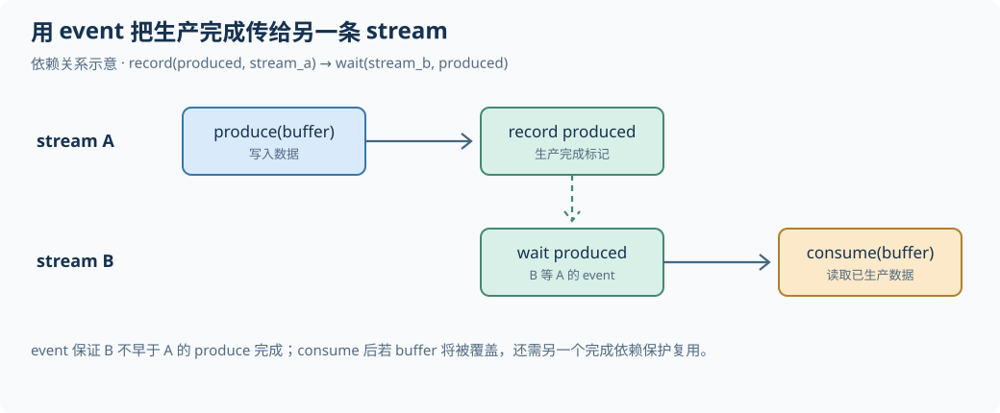
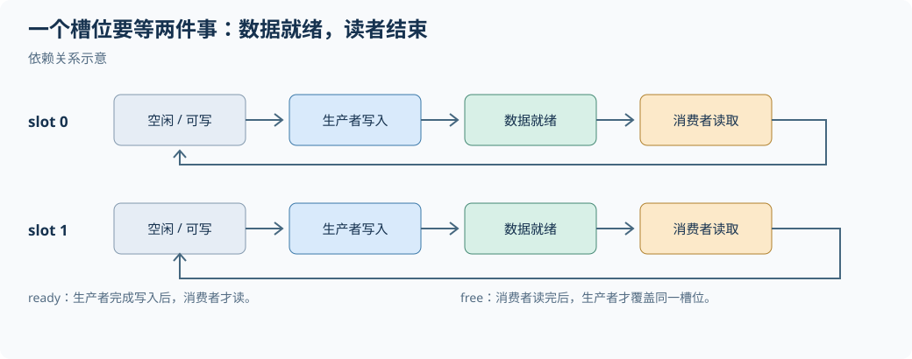
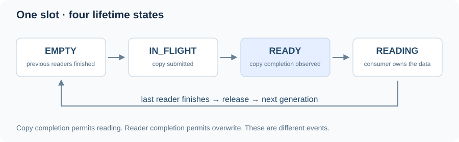
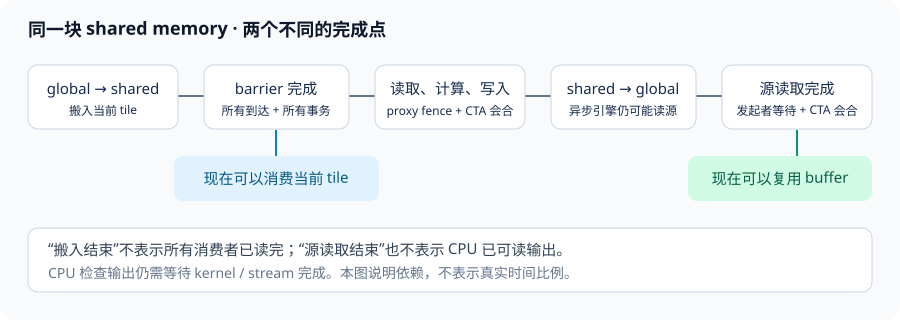
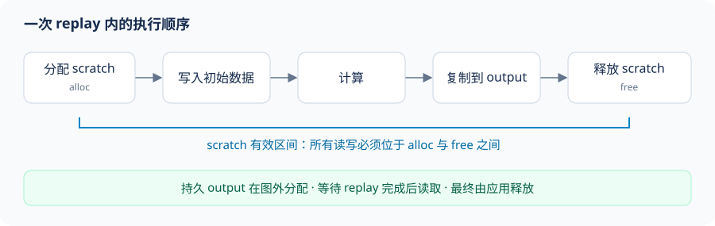

# 第四章 线程协作、同步与异步执行

先跟踪一份数据从写入到读取，再判断它何时能被覆盖。以两个线程共用一格 shared memory 为例：线程 0 写入后，线程 1 才能读；线程 1 读完后，线程 0 才能把这格位置交给下一份数据。这两条边分别回答“数据何时可读”和“空间何时可复用”。同步原语把这些先后关系落实到线程、stream 或异步引擎。

本章按依赖范围递进：先看 block 内归约与 warp 内交换，再看 stream/event 如何连接不同队列；随后把同样的生产、消费、复用关系扩展到双缓冲、`cp.async`、barrier 和 TMA。后半部分介绍 Graph、内存分配、跨进程及图形 API 互操作，读者可以沿用同一问题检查对象在哪创建、谁在读写、由什么完成点保护释放。

## 1. 两个线程交接 shared 数据

设一个 block 中的线程 0 负责写入 `tile[0]`，线程 1 随后读取它。若没有同步，线程 1 可能在写入前读取旧值。`__syncthreads()` 让 block 中未退出的线程在同一点会合，并使 barrier 前的 shared 写入可供 barrier 后的线程读取。

```cpp
__global__ void handoff(int* output) {
__shared__ int tile[2];

if (threadIdx.x == 0) tile[0] = 20;
__syncthreads();
if (threadIdx.x == 1) tile[1] = tile[0] + 22;
__syncthreads();
if (threadIdx.x == 0) output[blockIdx.x] = tile[1];
}
```

该片段使用一维 block，线程数至少为 2（`blockDim.x >= 2` 且 `blockDim.y == blockDim.z == 1`），这样 thread 1 才存在，且只有一个 `threadIdx.x == 0` 负责写入。所有线程按相同顺序经过两个 barrier：第一个等线程 0 写完，第二个等线程 1 写完。`__syncthreads()` 的范围是当前 block；不同 block 的依赖需放在 kernel launch 或其他全局同步机制上建立。

把两次交接具体走一遍：线程 0 把 20 写进 `tile[0]`，第一个 `__syncthreads()` 等 block 中线程到齐后，线程 1 才计算出 42 并写入 `tile[1]`。第二个 barrier 等线程 1 完成这次写入，线程 0 才把 42 写到 global output。若线程 0 还要在下一轮覆写 `tile[1]`，则必须先确认线程 1 已经读完；这就是后面双缓冲里的“可复用”依赖。

这也是 shared-memory 归约的基本结构：线程先写各自输入或单位元，再同步；随后某些线程写部分和，下一轮读取前再同步。同步点由共享数据的生产—消费关系决定。

## 2. Block 内归约与共享数据依赖

长度不是 block size 整数倍时，尾部线程没有输入值，但归约仍需要完整定义 shared tile 的初始内容。求和应写入单位元 `0`，求最大值应写入 `-infinity`；若线程未写入，归约线程随后可能读取未初始化的 shared 值，结果不确定。

尾部线程是否能退出，要逐一检查两件事：它之后是否仍属于某个 barrier 的参与集合，以及其他线程是否会读取它负责的 shared 位置。退出规则和数据正确性是两个问题；即使剩余线程能通过 barrier，也必须确保归约读到的是有效输入或单位元。

`examples/reduction_tail.cu` 使用 256-thread block 对 `n=100003` 的数组求和。每个线程先把有效元素或单位元写入 shared memory，之后每一轮二分归约都由所有线程执行 `__syncthreads()`，只有读写范围由 `if (tid < stride)` 缩小。线程块结果再由 host 做最后的 CPU 合并，因此代码可以把“block 内同步正确性”和“跨 block 没有隐式 barrier”分别讲清楚。

完整的 block kernel 使用 256 个线程。越界线程仍写入求和单位元；每轮完成部分和后，barrier 才让下一轮读取：

<!-- source-check: examples/reduction_tail.cu -->
~~~cpp
constexpr int kThreads = 256;
~~~

<!-- source-check: examples/reduction_tail.cu -->
~~~cpp
__global__ void block_sum(const float* input, float* partial, int n) {
  __shared__ float tile[kThreads];
  const int tid = threadIdx.x;
  const int index = blockIdx.x * blockDim.x + tid;

  // Tail lanes still execute the barrier protocol. They contribute the
  // identity value instead of returning early.
  tile[tid] = index < n ? input[index] : 0.0f;
  __syncthreads();

  for (int stride = blockDim.x / 2; stride > 0; stride >>= 1) {
    if (tid < stride) {
      tile[tid] += tile[tid + stride];
    }
    // The barrier separates this phase from the next one. After stride==1
    // there is no later shared-memory phase, so the final barrier is optional.
    if (stride > 1) {
      __syncthreads();
    }
  }

  if (tid == 0) {
    partial[blockIdx.x] = tile[0];
  }
}
~~~

主机将输入分成 `ceil(n/256)` 个 block。下面摘出原例程的输入长度、block 数计算与 launch：

<!-- source-check: examples/reduction_tail.cu -->
~~~cpp
int main() {
  const int n = 100003;  // deliberately not divisible by the block size
  std::vector<float> host_input(n);
  for (int i = 0; i < n; ++i) {
    host_input[i] = 0.25f + static_cast<float>((i * 17) % 101) * 0.01f;
  }

  const int blocks = (n + kThreads - 1) / kThreads;
  float* device_input = nullptr;
  float* device_partial = nullptr;
  CUDA_CHECK(cudaMalloc(&device_input, n * sizeof(float)));
  CUDA_CHECK(cudaMalloc(&device_partial, blocks * sizeof(float)));
  CUDA_CHECK(cudaMemcpy(device_input, host_input.data(), n * sizeof(float),
                        cudaMemcpyHostToDevice));

  block_sum<<<blocks, kThreads>>>(device_input, device_partial, n);
  CUDA_CHECK(cudaGetLastError());
  CUDA_CHECK(cudaDeviceSynchronize());
~~~

每个 block 只写一个 `partial[blockIdx.x]`。本地例程将 partial 拷回 CPU，再以 double 累加：

<!-- source-check: examples/reduction_tail.cu -->
~~~cpp
  std::vector<float> host_partial(blocks);
  CUDA_CHECK(cudaMemcpy(host_partial.data(), device_partial,
                        blocks * sizeof(float), cudaMemcpyDeviceToHost));
  const double gpu_sum = std::accumulate(host_partial.begin(), host_partial.end(), 0.0);
  const double cpu_sum = std::accumulate(host_input.begin(), host_input.end(), 0.0);
  const double error = std::abs(gpu_sum - cpu_sum);
  const double tolerance = 1e-4 + 1e-6 * std::abs(cpu_sum);
  const bool valid = std::isfinite(gpu_sum) && std::isfinite(cpu_sum) &&
                     std::isfinite(error) && error <= tolerance;
  std::printf("n=%d blocks=%d gpu_sum=%.7f cpu_sum=%.7f abs_error=%.7g\n",
              n, blocks, gpu_sum, cpu_sum, error);
~~~

<details>
<summary>完整 CUDA C++ 归约程序：kernel 与 host 验证</summary>

<!-- source-check: examples/reduction_tail.cu -->

```cpp
#include <cuda_runtime.h>

#include <cmath>
#include <cstdio>
#include <cstdlib>
#include <numeric>
#include <vector>

namespace {

constexpr int kThreads = 256;

#define CUDA_CHECK(call)                                                       \
  do {                                                                         \
    cudaError_t status = (call);                                              \
    if (status != cudaSuccess) {                                              \
      std::fprintf(stderr, "%s:%d CUDA error: %s\n", __FILE__, __LINE__,    \
                   cudaGetErrorString(status));                               \
      std::exit(EXIT_FAILURE);                                                 \
    }                                                                          \
  } while (false)

__global__ void block_sum(const float* input, float* partial, int n) {
  __shared__ float tile[kThreads];
  const int tid = threadIdx.x;
  const int index = blockIdx.x * blockDim.x + tid;

  // Tail lanes still execute the barrier protocol. They contribute the
  // identity value instead of returning early.
  tile[tid] = index < n ? input[index] : 0.0f;
  __syncthreads();

  for (int stride = blockDim.x / 2; stride > 0; stride >>= 1) {
    if (tid < stride) {
      tile[tid] += tile[tid + stride];
    }
    // The barrier separates this phase from the next one. After stride==1
    // there is no later shared-memory phase, so the final barrier is optional.
    if (stride > 1) {
      __syncthreads();
    }
  }

  if (tid == 0) {
    partial[blockIdx.x] = tile[0];
  }
}

}  // namespace

int main() {
  const int n = 100003;  // deliberately not divisible by the block size
  std::vector<float> host_input(n);
  for (int i = 0; i < n; ++i) {
    host_input[i] = 0.25f + static_cast<float>((i * 17) % 101) * 0.01f;
  }

  const int blocks = (n + kThreads - 1) / kThreads;
  float* device_input = nullptr;
  float* device_partial = nullptr;
  CUDA_CHECK(cudaMalloc(&device_input, n * sizeof(float)));
  CUDA_CHECK(cudaMalloc(&device_partial, blocks * sizeof(float)));
  CUDA_CHECK(cudaMemcpy(device_input, host_input.data(), n * sizeof(float),
                        cudaMemcpyHostToDevice));

  block_sum<<<blocks, kThreads>>>(device_input, device_partial, n);
  CUDA_CHECK(cudaGetLastError());
  CUDA_CHECK(cudaDeviceSynchronize());

  std::vector<float> host_partial(blocks);
  CUDA_CHECK(cudaMemcpy(host_partial.data(), device_partial,
                        blocks * sizeof(float), cudaMemcpyDeviceToHost));
  const double gpu_sum = std::accumulate(host_partial.begin(), host_partial.end(), 0.0);
  const double cpu_sum = std::accumulate(host_input.begin(), host_input.end(), 0.0);
  const double error = std::abs(gpu_sum - cpu_sum);
  const double tolerance = 1e-4 + 1e-6 * std::abs(cpu_sum);
  const bool valid = std::isfinite(gpu_sum) && std::isfinite(cpu_sum) &&
                     std::isfinite(error) && error <= tolerance;
  std::printf("n=%d blocks=%d gpu_sum=%.7f cpu_sum=%.7f abs_error=%.7g\n",
              n, blocks, gpu_sum, cpu_sum, error);

  CUDA_CHECK(cudaFree(device_partial));
  CUDA_CHECK(cudaFree(device_input));
  return valid ? EXIT_SUCCESS : EXIT_FAILURE;
}
```

</details>

这是 block 同步的教学例程。它把每个 block 的部分和拷回 CPU 合并；LeetGPU 题还要求最终结果写入设备端 `output[0]`，因此需继续在 GPU 上分层归约 partial。普通 kernel launch 之间的同 stream 顺序可作为全局阶段边界；跨 block 协作应使用题目支持的全局同步机制。

编译和运行本地示例：

```bash
cd <AIINFFRA>/roadmap/curriculum/gpu/04-synchronization-and-asynchronous-execution
nvcc -std=c++17 -O2 examples/reduction_tail.cu -o reduction_tail
./reduction_tail
```

如果 `index >= n` 的线程在写单位元前退出，归约线程会读到未初始化位置。本例让全部 256 个线程在每一轮写入或读取后按相同顺序经过 block barrier，因此参与集合固定。需要可变参与集合时，`cuda::barrier` 和 Cooperative Groups 提供显式的到达与退出机制，代码必须按各自规则更新预期参与数。

### 2.1 CPU 参考与边界算例

上例的 CPU 参考用 `std::accumulate(host_input.begin(), host_input.end(), 0.0)` 对已存储的 float 输入做 double 累加；GPU block 内采用 float 树归约，块间结果在 host 以 double 合并。验证检查有限值及 `abs_error <= 1e-4 + 1e-6 * abs(reference)`，容纳归约次序造成的舍入差异。扩展时还应检查 `n=0`、`n=1` 和 `n=block_size+1`；当前例程用 `n=100003` 产生尾部数据。

每轮归约产生的部分和会在下一轮读取，因此线程需在阶段之间会合。最后一轮之后没有其他线程再读 shared tile，线程 0 可直接写出 block partial。

## 3. Warp 内交换与归约结果

Shuffle 在寄存器之间交换 lane 值，避免把每个中间值写入 shared memory。它不自动知道哪些 lane 的值有效，因此 mask 是算法输入的一部分。正确的前置条件是：传给 `_sync` 变体的 mask 中所有 lane 都执行该 intrinsic，并且调用者对 mask 的含义一致。本章的 19 元素教学例程让 32 个 lane 都参与并把无效元素置为 0；如果采用动态 active mask，则必须额外保证参与 lane 一致执行，并对源 lane 范围做边界处理。

`examples/warp_mask_reduce.cu` 对 19 个有效元素做一 warp reduction。这里采用最简单、最容易证明的方案：32 个 lane 都执行每一次 shuffle，无效 lane 把输入设为求和单位元 0，因此使用固定的 full mask 是正确的：

```cpp
float value = lane < active_count ? input[lane] : 0.0f;
for (int offset = 16; offset > 0; offset >>= 1) {
  value += __shfl_down_sync(0xffffffffu, value, offset);
}
if (lane == 0) output[blockIdx.x] = value;
```

这段树形归约完成后，只有 lane 0 持有完整和；其余 lane 的 `value` 只是部分和。若算法要求 warp 内每个 lane 都得到总和，可在归约后用一次适当的 shuffle 将 lane 0 的结果广播。当前例程只由 lane 0 写出，避免重复写同一输出位置。

```bash
cd <AIINFFRA>/roadmap/curriculum/gpu/04-synchronization-and-asynchronous-execution
nvcc -std=c++17 -O2 examples/warp_mask_reduce.cu -o warp_mask_reduce
./warp_mask_reduce
```

使用 `__shfl_down_sync(0xffffffffu, value, offset)` 时，32 个 lane 都要执行该 intrinsic。warp 内的 shared-memory 写入与读取之间，则用 `__syncwarp(mask)` 建立会合点。shuffle 的 mask 指定参与 lane；shared-memory 交接还需保证生产者已写完、消费者再读取。

本例使用 full mask，是因为 32 个 lane 都执行 shuffle，并将无效输入设为 0。若改用只覆盖 19 个 lane 的 mask，还须保证 mask 内线程全部执行该 intrinsic，并显式处理 shuffle 源 lane 超出有效范围的情况。

### Reduction 练习

本节的平台练习是 [LeetGPU Reduction](https://leetgpu.com/challenges/reduction)，对应的公开题面实现见 [Reduction #4 源码](https://github.com/AlphaGPU/leetgpu-challenges/tree/main/challenges/medium/4_reduction)。题目对 32-bit float 向量求总和，输入长度为 1 至 100,000,000，输出为设备端 `output[0]`；N=4,194,304 是性能形状，误差阈值为 `atol=rtol=1e-5`，参考结果为 `torch.sum(input.double()).float()`。请在平台空题面自行实现，不把本地示例误当作提交答案。

本地 `reduction_tail.cu` 在 block 内归约后，由 CPU 合并 partial。平台版本则逐层在 GPU 上归约 partial，直到一个值写入 `output[0]`：每个 block 读取一段 partial 并写出下一层结果，重复启动 kernel 直到输出数量为 1。同一 stream 中相邻 kernel 按顺序执行，可用作各层归约的边界。

若在服务器验证自写的完整 GPU reduction，以下记录只填实测值。形状和数值阈值沿用题面，kernel 配置与实测设备由运行时填写：

| 输入 / 配置 | GPU / CC | 正确性（max abs error） | kernel time | 有效带宽 | 备注（partial passes） |
|---|---|---|---|---|---|
| `N=4,194,304`、FP32、输出 `output[0]`、`atol=rtol=1e-5` | — | — | — | — | — |

本地可编译运行 `examples/reduction_tail.cu` 和 `examples/warp_mask_reduce.cu` 检查 block/warp 归约正确性；服务器性能测量应在完成正确性检查后单独进行，不把 Graph 或异步拷贝当作该题的验收内容。

<details>
<summary>进阶：原子 flag、作用范围与 release/acquire</summary>

<span id="chapter-4-section-1" class="legacy-anchor" aria-hidden="true"></span>
<span id="chapter-4-section-22" class="legacy-anchor" aria-hidden="true"></span>

block barrier 适合全 block 在同一阶段会合。若只需等待某个线程发布数据，可以用 flag 通知：生产者先写 payload，再发布 flag；消费者读到 flag 后读取 payload。原子操作（atomic operation）保证 flag 上的更新不可被并发操作拆开；release/acquire 内存序（memory order）传递 payload 的先行关系；作用范围（scope）必须覆盖两方线程。

`examples/message_passing.cu` 让 thread 0 与另一 warp 的 thread 32 交接 shared payload，scope 因而设为 block：

```cpp
__global__ void message_passing(int* output) {  // 一维block，blockDim.x == 64
__shared__ int shared_ready;
__shared__ int shared_payload[2];
if (threadIdx.x == 0) shared_ready = 0;
__syncthreads();  // flag初始化完成后再进入生产者/消费者分支
cuda::atomic_ref<int, cuda::thread_scope_block> flag(shared_ready);
if (threadIdx.x == 0) {
    shared_payload[0] = 19;
    shared_payload[1] = 23;
    flag.store(1, cuda::memory_order_release);  // 发布此前的payload写入
} else if (threadIdx.x == 32) {
    while (flag.load(cuda::memory_order_acquire) != 1) {
    }
    const int result = shared_payload[0] + shared_payload[1];
    output[blockIdx.x] = result;
}
}
```

thread 0 发布两个 shared 值，thread 32 在读到 flag 后写出它们的和；其余 62 个线程只参与初始化同步。release store 之前的 payload 写入会在匹配的 acquire load 观察到该值后对消费者可见。普通 flag 有数据竞争；relaxed atomic 只保证 flag 操作本身的原子性，不发布 payload；`__threadfence()` 只约束内存顺序，不让消费者等待。跨 block 通知还要求 payload 位于两 block 均可访问的地址空间，并使用 device scope；同时须确认设备支持对应原子类型。

<span id="chapter-4-section-2" class="legacy-anchor" aria-hidden="true"></span>

barrier 使参与者会合；fence 约束指定范围内的内存操作顺序；atomic 保护特定对象上的并发操作。三者作用不同，选择时应先确认参与者范围和数据依赖。例程需要包含 `cuda/atomic` 的 CUDA Toolkit 与 CC 7.0+ 目标，可在本章目录用 `nvcc -std=c++17 -O2 examples/message_passing.cu -o message_passing` 编译运行；它检查 `ready=1`、`result=42`，不测性能。

</details>

## 4. Stream、event 与主机等待

Stream（流）是有序命令队列：同一 stream 内的 kernel、copy 和 event 按入队顺序执行。不同 stream 是否重叠，取决于数据依赖、copy engine、kernel 资源和 runtime 规则。Event（事件）是插入 stream 的完成标记，可用于跨 stream 建立依赖或测量 GPU 时间。异步 API 返回表示操作已提交；操作何时开始和完成，由设备执行进度决定。

涉及 CPU 内存的 `cudaMemcpyAsync` 使用 pinned/page-locked（页锁定）内存时，才具备设备侧异步传输的条件；pageable（可分页）内存可能先经过 host staging。CUDA 还区分 legacy default stream 与 per-thread default stream：未显式指定 stream 的 kernel 或同步 copy 会进入默认 stream，legacy default stream 与 blocking stream 之间可能发生额外同步。

### 4.1 用 event 建立跨 stream 依赖

把数据交接扩展到两条 stream：A 完成生产后记录 event；B 等到该 event 后才启动消费者。`cudaEventRecord` 把完成标记排在 A 的生产操作之后，`cudaStreamWaitEvent` 将依赖排进 B。这样，B 等待的是这项生产工作。

<figure class="diagram-frame">

<figcaption>跨 stream event 交接顺序。</figcaption>
</figure>

假设 stream A 产生 `buffer`，stream B 消费 `buffer`，安全协议是：

```cpp
produce<<<grid, block, 0, stream_a>>>(buffer);
cudaEventRecord(produced, stream_a);
cudaStreamWaitEvent(stream_b, produced, 0);
consume<<<grid, block, 0, stream_b>>>(buffer);
```

省略 `cudaStreamWaitEvent` 时，B 没有等候 A 写完的依赖，可能在生产完成前读取 buffer。把两个 kernel 放在同一 stream 可由 stream 顺序保证先后；host 调用 `cudaDeviceSynchronize()` 则会等全设备工作完成，范围大于只等待 A 的生产阶段。

`cudaEventRecord` 后的 `cudaEventSynchronize` 让 host 等待事件；`cudaStreamWaitEvent` 则把依赖加入设备命令队列。测量跨 stream 工作时，将结束 event 放在覆盖全部被测工作的 stream，或先把各 stream 的完成依赖汇合到计时 stream。

### 4.2 批量内存拷贝：stream 顺序、源访问顺序与属性分段

许多互不依赖的小 buffer 可用 `cudaMemcpyBatchAsync` 一次提交。批次作为整体排在指定 stream 的前序和后序工作之间；批内拷贝没有逐项顺序保证，因此必须彼此独立。若 B 的 source 是 A 的 destination，应拆成两个批次，并用 stream 顺序或 event 建立 A 到 B 的依赖。

<details>
<summary>批量复制的参数、版本差异与完整程序</summary>

以 CUDA Runtime API 13.3.0 为目标时，C 接口的真实声明是：

```cpp
cudaError_t cudaMemcpyBatchAsync(
    const void **dsts, const void **srcs, const size_t *sizes,
    size_t count, cudaMemcpyAttributes *attrs, size_t *attrsIdxs,
    size_t numAttrs, cudaStream_t stream);
```

`dsts[i]`、`srcs[i]`、`sizes[i]` 定义第 i 项。`attrsIdxs` 保存属性分段的起点。例如 `count=5`、`attrsIdxs={0,3}` 表示 `attrs[0]` 用于拷贝 0–2，`attrs[1]` 用于拷贝 3–4。起点从 0 开始并严格递增，最后一个小于 `count`，且 `numAttrs <= count`；数组中的每一项都须落在一个属性段内。

每段属性中的 `srcAccessOrder` 是对 source 生命周期和访问时序的承诺：

- `cudaMemcpySrcAccessOrderStream`：source 按 stream 顺序读取。对于 pinned host source，API 返回后 copy 仍可能进行；host 应等该 stream 完成后再覆盖或释放 source。本例用 `cudaStreamSynchronize` 建立回收点。
- `cudaMemcpySrcAccessOrderDuringApiCall`：API 返回前完成对 source 的读取，读取顺序可不同于 stream 顺序。适合调用期间有效的临时栈数据；device destination 的操作仍可能在 API 返回后继续。
- `cudaMemcpySrcAccessOrderAny`：source 可在 API 返回后读取，且读取顺序不受 stream 限制。适合由 `malloc` 等 CUDA 外部方式分配、调用期间没有其他访问者的 host source；调用者应保持 source 不变，直到 stream/event 确认读取完成。

例程用三个 pinned H2D source 和一个调用期栈 source 示范两个属性段。4 个目的地址互不重叠，拷贝之间没有数据依赖。该接口不接受 legacy NULL stream，因此例程使用 non-blocking stream，并在同步后读取结果和释放 pinned buffers。

<details>
<summary>完整 CUDA C++ 程序：pinned H2D 与临时 source 分段</summary>

<!-- source-check: examples/memcpy_batch_async.cu -->

```cpp
#include <cuda_runtime.h>

#include <array>
#include <cstddef>
#include <cstdio>

namespace {
constexpr std::size_t kCopies = 4;
constexpr std::size_t kPinnedCopies = 3;
constexpr std::size_t kElements = 16;
constexpr std::size_t kBytes = kElements * sizeof(int);

bool check(cudaError_t status, const char *where) {
    if (status == cudaSuccess) return true;
    std::fprintf(stderr, "%s: %s\n", where, cudaGetErrorString(status));
    return false;
}
}  // namespace

int main() {
    std::array<int *, kPinnedCopies> pinned{};
    std::array<void *, kCopies> device{};
    std::array<const void *, kCopies> srcs{};
    std::array<const void *, kCopies> dsts{};
    std::array<std::size_t, kCopies> sizes{};
    std::array<int, kElements> ephemeral{};
    cudaStream_t stream = nullptr;
    bool ok = check(cudaSetDevice(0), "cudaSetDevice");

    if (ok) ok = check(cudaStreamCreateWithFlags(
                         &stream, cudaStreamNonBlocking),
                       "cudaStreamCreateWithFlags");

    for (std::size_t i = 0; ok && i < kPinnedCopies; ++i) {
        ok = check(cudaMallocHost(reinterpret_cast<void **>(&pinned[i]), kBytes),
                   "cudaMallocHost");
        if (!ok) break;
        ok = check(cudaMalloc(&device[i], kBytes), "cudaMalloc");
        if (!ok) break;
        for (std::size_t j = 0; j < kElements; ++j)
            pinned[i][j] = static_cast<int>(100 * i + j);
        srcs[i] = pinned[i];
        dsts[i] = device[i];
        sizes[i] = kBytes;
    }

    if (ok) {
        ok = check(cudaMalloc(&device[kPinnedCopies], kBytes), "cudaMalloc");
        for (std::size_t j = 0; ok && j < kElements; ++j)
            ephemeral[j] = static_cast<int>(900 + j);
        srcs[kPinnedCopies] = ephemeral.data();
        dsts[kPinnedCopies] = device[kPinnedCopies];
        sizes[kPinnedCopies] = kBytes;
    }

    if (ok) {
        cudaMemcpyAttributes attrs[2]{};
        attrs[0].srcAccessOrder = cudaMemcpySrcAccessOrderStream;
        attrs[1].srcAccessOrder = cudaMemcpySrcAccessOrderDuringApiCall;
        std::size_t attrsIdxs[2] = {0, kPinnedCopies};

        // CUDA Runtime API 13.3.0: 8 arguments and const void** pointer arrays.
        ok = check(cudaMemcpyBatchAsync(
                       dsts.data(), srcs.data(), sizes.data(), kCopies,
                       attrs, attrsIdxs, 2, stream),
                   "cudaMemcpyBatchAsync");
    }

    if (stream != nullptr) {
        // Required before host reads device results or releases pinned sources.
        const bool syncOk = check(cudaStreamSynchronize(stream),
                                  "cudaStreamSynchronize");
        ok = ok && syncOk;
    }

    for (std::size_t i = 0; ok && i < kCopies; ++i) {
        std::array<int, kElements> actual{};
        ok = check(cudaMemcpy(actual.data(), device[i], kBytes,
                             cudaMemcpyDeviceToHost),
                   "cudaMemcpy D2H");
        for (std::size_t j = 0; ok && j < kElements; ++j) {
            const int expected = static_cast<int>(
                i < kPinnedCopies ? 100 * i + j : 900 + j);
            if (actual[j] != expected) {
                std::fprintf(stderr,
                             "mismatch at copy %zu element %zu: got %d, expected %d\n",
                             i, j, actual[j], expected);
                ok = false;
            }
        }
    }

    // Synchronization above makes these releases safe even after a failed check.
    for (void *ptr : device)
        if (ptr != nullptr) ok = check(cudaFree(ptr), "cudaFree") && ok;
    for (int *ptr : pinned)
        if (ptr != nullptr) ok = check(cudaFreeHost(ptr), "cudaFreeHost") && ok;
    if (stream != nullptr)
        ok = check(cudaStreamDestroy(stream), "cudaStreamDestroy") && ok;

    if (ok) std::puts("PASS: four independent H2D copies verified");
    return ok ? 0 : 1;
}
```

</details>

这四份数据的 CPU 期望值是 `copy 0..2: 100*i+j`、`copy 3: 900+j`，其中 `0 <= j < 16`；设备回读逐元素检查同一映射。以下命令从仓库根目录运行：

```bash
nvcc --version
nvcc -std=c++17 -O2 roadmap/curriculum/gpu/04-synchronization-and-asynchronous-execution/examples/memcpy_batch_async.cu -o memcpy_batch_async
./memcpy_batch_async
```

此程序按 CUDA Runtime API 13.3.0 reference 的签名编写：`dsts`、`srcs` 都是 `const void **`，共 8 个参数。CUDA 13.4 保留 8 个参数，但指针数组限定符改为 `void *const *dsts` 和 `const void *const *srcs`。编译时应核对安装版本的 `cuda_runtime_api.h` 和对应 reference。CUDA 12.8/12.9 的原型含 `size_t *failIdx`；CUDA 13.0 起改为不带该参数的 rich error reporting 接口。旧版 `failIdx` 报告单项失败的 copy index；错误不对应单一拷贝时为 `SIZE_MAX`，传 `nullptr` 则不记录索引。13.x 应检查 API 返回码，并按需检查 `cudaStreamSynchronize` 返回的异步错误。

以 `attrsIdxs={0,2}` 代替 `{0,3}` 会让两个属性段从第 2 项重叠。`DuringApiCall` source 必须在调用期间已初始化；`Stream` 或 `Any` source 要保持不变，直到读取完成。依赖 header copy 的 payload copy 应放入后续批次，并由 stream/event 排定顺序。

</details>

## 5. 双缓冲与缓冲区复用

<figure class="diagram-frame">

<figcaption>缓冲区读写顺序。</figcaption>
</figure>

> [!IMPORTANT] 缓冲区复用时机
> 先写入，再等操作完成，然后读取；最后一个读者结束后，缓冲区才能覆盖。event 的记录位置决定等待覆盖哪些操作。

`examples/stream_event_pipeline.cu` 是两 stream 示例：每个 chunk 选择 `slot = chunk % 2`，在对应 stream 上依次排入 H2D、scale kernel 和 D2H，并在 D2H 后记录 `completed[slot]`。

chunk 0 使用 slot 0：H2D 读取 host 输入，kernel 读取 device 输入并写结果，D2H 写入 host 输出，随后记录 `completed[0]`。chunk 1 使用 slot 1，读写顺序独立。chunk 2 回到 slot 0，host 先等 `completed[0]`，再改写输入。两槽让不同 chunk 可以分别推进；实际重叠情况由传输引擎、SM 资源和 pinned/pageable 内存路径决定。

编译和运行：

```bash
cd <AIINFFRA>/roadmap/curriculum/gpu/04-synchronization-and-asynchronous-execution
nvcc -std=c++17 -O2 examples/stream_event_pipeline.cu -o stream_event_pipeline
./stream_event_pipeline
./stream_event_pipeline --pageable
```

默认使用 pinned host buffer；`--pageable` 切换为普通 host allocation，用于比较语义和时间线。例程包含 CPU reference，并检查每个 chunk 乘以 `3.0f` 后的结果。正式性能测试还应记录预热次数、event 计时范围、PCIe/互联状态、chunk size 和 stream 数。

`completed[slot]` 记录在 D2H 之后，所以 host 等待它时，H2D 已不再读取输入，D2H 也已写完输出。若把 event 提前到 D2H 之前，CPU 可能与传输同时改写输入或覆盖输出。逐 chunk 调用 `cudaDeviceSynchronize()` 会等待全设备工作；本例只在复用对应 slot 前等待其完成 event。

双缓冲能否隐藏传输延迟，取决于 H2D、kernel 和 D2H 对硬件引擎与 SM 的占用；pageable host memory 还可能先经过 host staging。用 Nsight Systems 时间线或 event/engine 数据检查实际重叠。

[NVIDIA CUDA Samples 的 simpleStreams 示例](https://github.com/NVIDIA/cuda-samples/tree/5443602d89ed99aede2e4b7bf329daddeadb320e/cpp/0_Introduction/simpleStreams)把页锁定的主机缓冲区切成若干块，每条 stream 对自己的块依次提交 H2D、kernel 和 D2H。单条 stream 内的顺序保护块内数据；不同块彼此独立时，复制与计算才有机会重叠。本节的 `stream_event_pipeline.cu` 进一步将两个缓冲区的复用时刻放在 D2H 之后记录的 event 上，避免主机提前改写仍在传输的输入或输出。

评估时间线时，比较各 stream 上的 H2D、kernel、D2H 区间和 slot 等待点，并记录所有 stream 的同步范围与计时方法。

服务器对照保持 chunk 数和计算一致，只切换 pinned/pageable host buffer，并从时间线确认是否重叠。表内数值由实际运行填写：

| 配置 | GPU / CC | 正确性 | 单 chunk 耗时 | H2D / D2H 带宽 | 时间线观察 |
|---|---|---|---|---|---|
| pinned，2 streams，`--pageable` 关闭 | — | — | — | — | — |
| pageable，2 streams，`--pageable` 开启 | — | — | — | — | — |

## 6. `cp.async`：异步搬运与计算重叠

先看一个 tile 的交接：线程把 global memory 数据搬到 shared memory。搬运期间可执行不依赖该 tile 的工作；确认搬运完成后再读 shared。使用两个槽位时，计算当前槽位的同时可尝试填充另一槽；覆盖旧槽前，先等读者结束。是否重叠取决于这段独立工作和硬件资源。

CUDA 13.3 §4.11.1 将 LDGSTS（Load Global to Shared，global 到 shared 的异步加载路径）列为 CC 8.0+ 的逐元素搬运机制，单次元素宽度支持 4、8、16 字节，源和目的地址须满足相应对齐。高层 `cuda::memcpy_async`、Cooperative Groups `memcpy_async` 与低层 `__pipeline_memcpy_async` 提供不同接口；具体生成指令和完成协议要按所用接口检查。发起线程等到自己的搬运完成后，若 tile 由其他线程消费，还须建立线程间可见和会合关系。

异步 API 允许线程先继续执行，但当前形状是否有可重叠的工作、硬件是否并行搬运，都取决于依赖、资源和实现。增加 stage 可能覆盖部分 global-to-shared 等待，也会增加 shared、barrier 和 register 用量；应对照编译资源、实际指令和时间线，再判断收益。

### 6.1 拷贝完成与线程间同步

低层 pipeline wait 默认等待调用线程发起的拷贝。若一个 tile 由 128 个线程共同搬入，每个线程只等自己的拷贝后就去读别人的位置，仍缺少跨线程会合。

本例故意让每个线程读取自己和相邻线程搬入的数据，迫使我们把两个条件写清：每个线程先完成自己的 wait，再由整个 block 同步，才能消费这个共享 tile。消费结束后还需一次 block 同步，才能允许任何线程覆盖旧槽位。



读取当前 tile 前，先等待它对应的搬运 batch。若当前 tile 已就绪，代码却先等待未来 tile，等待期间便没有当前 tile 的计算可执行。分析时按 wait 所属 batch 判断它保护哪段数据。

### 6.2 完整环形 stage 的 kernel

下面用 1、2、3 个 stage 执行相同算法。每个 tile 有 128 个 float，输出为当前位置与下一位置之和；最后一个 lane 环回 tile 的第一个位置，尾部无效位置按零处理。例子只读取当前 tile 内的相邻元素。

<!-- source-check: examples/cp_async_ring.cu -->
~~~cpp
template <int STAGES>
__global__ void cp_async_ring_kernel(const float* in, float* out, int count) {
    static_assert(STAGES >= 1 && STAGES <= 3, "STAGES must be in [1, 3]");
    __shared__ __align__(16) float buffer[STAGES][128];
    const int lane = threadIdx.x;
    const int total_tiles = (count + 127) / 128;
    const int initial = total_tiles < STAGES ? total_tiles : STAGES;

#if __CUDA_ARCH__ >= 800
    for (int t = 0; t < initial; ++t) {
        const int idx = t * 128 + lane;
        const bool valid = idx < count;
        const float* source = valid ? (in + idx) : in;
        __pipeline_memcpy_async(&buffer[t % STAGES][lane], source, 4, valid ? 0 : 4);
        __pipeline_commit();
    }
    for (int t = 0; t < total_tiles; ++t) {
        const int remaining = total_tiles - t;
        if (remaining < STAGES) __pipeline_wait_prior(0);
        else __pipeline_wait_prior(STAGES - 1);
        __syncthreads();

        const int idx = t * 128 + lane;
        const int next_lane = (lane + 1) % 128;
        const float self = buffer[t % STAGES][lane];
        const float next = buffer[t % STAGES][next_lane];
        if (idx < count) out[idx] = self + next;

        __syncthreads();
        const int refill = t + STAGES;
        if (refill < total_tiles) {
            const int refill_idx = refill * 128 + lane;
            const bool valid = refill_idx < count;
            const float* source = valid ? (in + refill_idx) : in;
            __pipeline_memcpy_async(&buffer[refill % STAGES][lane], source, 4, valid ? 0 : 4);
            __pipeline_commit();
        }
    }
#else
    (void)in; (void)out; (void)count;
    asm volatile("trap;");
#endif
}
~~~

每个 stage 占 128×4=512 bytes，行首及每个 float 地址都满足 4-byte 拷贝的对齐要求。每个线程发起自己的拷贝；越界线程提交零填充操作，source 使用合法的 `in` 地址。

先填入 `min(STAGES,total_tiles)` 个 batch，再开始消费。稳态时保留最新的 `STAGES−1` 个 batch 在途，并等待最早的 batch 完成。尾部待处理 batch 减少后，`wait_prior(0)` 等待所有较新的 batch 完成。参数表示允许保留的在途 batch 数；槽位仍由 `t % STAGES` 选择。

两次 `__syncthreads()` 分别保护两个交接点：

- 第一次在各线程 wait 之后，确认所有生产者都已完成，再跨线程读取 tile。
- 第二次在读取之后，确认所有消费者都已结束，再向同一个 slot 发起下一轮拷贝。

尾部线程虽然不写有效输出，仍须参加两次同步。执行 `if (idx >= count) return` 会让这些线程跳过后续 barrier，破坏 block 的参与协议。

### 6.3 拷贝批次、缓冲槽位与尾块

设 `STAGES=3`，共 7 个 tile。初始 batch 0/1/2 分别放入槽 0/1/2。消费 0 后将 3 放入槽 0；消费 1 后将 4 放入槽 1；消费 2 后将 5 放入槽 2；消费 3 后将 6 放入槽 0。

处理完 tile 3 后，槽 0/1/2 分别存放 6/4/5；接下来的消费顺序仍是 4/5/6。槽位会循环使用，因此推导时同时记录 `slot=t%3` 和 `generation=t//3`。API 通过 batch、phase 或 token 追踪对应轮次。

分支会影响 warp 的 pipeline 序列。若线程在分歧路径中执行 commit，各线程看到的 batch 序列可能不同，从而产生额外等待。本例所有线程提交和等待相同次数；数据 predicate 只选择复制有效值或零，不改变参与次数。其他控制流应按所用 API 的要求重新会合后再提交。

### 6.4 正确性程序与性能结论分开

完整程序比较 count=1、128、129、1025 和三个 stage 配置。CPU 参考采用相同的 tile 内环回与尾部规则计算输出；程序打印设备名称和 Compute Capability，不支持的设备会返回 skip 状态。

下面以 `sm_80` 为编译目标示例；应根据 Toolkit 和验证设备选择支持的目标。较旧架构分支不执行异步搬运路径。以下命令从仓库根目录运行：

~~~bash
nvcc -O3 -lineinfo -arch=sm_80 roadmap/curriculum/gpu/04-synchronization-and-asynchronous-execution/examples/cp_async_ring.cu -o cp_async_ring
./cp_async_ring
compute-sanitizer --tool memcheck ./cp_async_ring
compute-sanitizer --tool racecheck ./cp_async_ring
compute-sanitizer --tool synccheck ./cp_async_ring
~~~

这组程序检查正确性，不包含计时。验证输出后，先检查生成代码是否使用 LDGSTS/cp.async，再用足够大的工作量与同步搬运版本比较，并固定工作量、布局、线程数和计时范围。当前示例只有一个 CTA，用于讲解协议。


## 7. 异步屏障：阶段、计数与参与线程

生产者写完后通知消费者数据已就绪；消费者读完后通知生产者槽位可覆盖。每个槽位都要分别走完这两次交接。

`cuda::barrier`（异步屏障）让线程先到达，再用 token 等待同一阶段完成。初始化时指定预期到达次数；所有到达计数满足后，阶段推进并重置计数。初始化必须早于任何线程参与，常由一个线程初始化，再用 block sync 让其他线程看到 barrier。带 transaction count 的 barrier 还要等异步传输字节数完成，因此“线程已到齐”和“数据已搬完”都满足后，消费者才可读取。

双缓冲通常为每个槽位维护独立阶段，分别表示“数据已就绪”和“读者已结束”。增加 stage 时，同步状态和 shared memory 用量也随槽位数增加。

参与集合变化时，退出线程必须按所用 API 更新后续到达人数。使用 `cuda::barrier` 时，`arrive_and_drop()` 先计入当前阶段的到达，再把下一阶段的预期到达数减一；例如尾部线程完成当前轮后返回，需在返回前调用它，其他线程下一轮按减少后的数量到达。使用 `cuda::pipeline` 的线程则在退出前调用 `cuda::pipeline::quit()`。Cooperative Groups 的组屏障要求组内线程每阶段都参与；归约尾部线程仍应写入单位元并继续到达屏障。

### 7.1 屏障阶段的完成条件

普通 arrive/wait 在参与线程全部到达后完成当前阶段。若 barrier 还追踪异步事务，则对应 transaction count 也须归零。比如 A、B 两块输入合计预期传输 X bytes，只完成 A 时，即使发起线程已经 arrive，stage 仍未就绪。

token 与它取得时的 phase 关联。槽位进入下一轮后，旧 token 对应的完成状态不再描述新数据；等待、消费和释放都要跟踪当前轮次。

尾部归约若让线程提前返回，需按 barrier 或 pipeline 的退出规则处理参与人数；本章归约例程让越界线程写入单位元并参与每轮同步，因此参与集合保持固定。

## 8. TMA、tensor map、swizzle 与 cluster/DSM

TMA（Tensor Memory Accelerator，张量内存加速器）提供 CC 9.0+ 的多维异步批量搬运。搬运多维 global/shared tile 时，host 创建 tensor map，描述矩阵形状、行跨度、搬运块、swizzle 和内存布局，再将其作为 `__grid_constant__` kernel 参数传入。global-to-shared 完成状态通常由 shared-memory barrier 跟踪；shared-to-global 和 shared-to-distributed-shared-memory（DSM，分布式 shared memory）使用不同的完成机制与发起要求。

TMA 将重复的多维地址计算与搬运交给专用机制，同时引入 descriptor、对齐、barrier phase、stage 生命周期和架构要求。CUDA Programming Guide §4.11.2 将版本范围列为 CC 9.0+；§4.11.2.2 用 `cuTensorMapEncodeTiled` 创建多维 tensor map。swizzle 用于匹配 shared-memory 布局与 bank/传输粒度；128B、64B、32B 模式各有内维、重复方式和 shared/global 对齐条件，应按 tensor map 与目标 CC 配置。

Thread Block Cluster（线程块集群）把一组 CTA 作为更高层的调度与同步单位；DSM 允许 cluster 内 block 访问各 block 的 shared memory，同步范围限于同一 cluster。CUDA Programming Guide §4.11.2 列出 global 到 `shared::cluster` 的 TMA 路径，§4.11.3 的 STAS 展示 register 到 cluster DSM 的小数据搬运。这些路径要求 CC 9.0+ 和对应编译/runtime 支持；应检查编译目标、生成指令、数据依赖及时间线。

### 8.1 TMA 的两个方向，完成含义不同

global→shared 搬运完成后，消费者可以读取目的 tile。shared→global 搬运时，生产者要复用 shared 源槽，应等待 TMA 读完源数据；host 或其他设备读取最终 global 写入还需对应的 kernel/stream 同步。

| 阶段 | 必须建立的关系 | 常见误用 |
|---|---|---|
| 初始化 barrier | 初始化对所有参与者可见 | 其他线程先 arrive、后才看到 init |
| global→shared | 预期事务完成，再允许消费 | 只等线程 arrive，不追踪传输完成 |
| 计算后写 shared | generic 写入对 async proxy 可见 | 把普通 block barrier 当成全部 proxy 协议 |
| shared→global | 等源 shared 读取完成，再允许覆盖 | 提交后立即把源槽位写成下一 tile |
| kernel 外消费 global | 建立正确的 kernel/stream/event 依赖 | 把 source-read completion 当成 host 可读 |

generic proxy 指普通线程的内存访问路径，async proxy 指异步搬运路径。普通线程写 shared 后，异步引擎读取前须按 API 要求执行 proxy fence；`__syncthreads()` 负责 block 内线程会合，proxy fence 则让异步路径观察到这些写入。

CUDA Programming Guide 的 shared→global 示例先对普通 shared 写入执行 async proxy fence，再让 block 会合；随后由发起线程提交 bulk copy 并等待 bulk group 读完 shared。这个 read-completion 边界允许复用源缓冲；外部消费者仍须遵循 kernel/stream 的同步顺序。

### 8.2 tensor map、swizzle 与矩阵加载的布局

二维行主序矩阵的地址由 base、形状、元素大小和行跨度共同决定。tensor map 将这些信息连同 box、swizzle 等布局描述交给硬件。

若 TMA 用 swizzle 把 tile 写入 shared，consumer 就要按对应布局读取。相同数学下标可能落在不同物理 shared 坐标。先用坐标标识值逐项核对 producer 写入和 consumer 读出的映射，再测 bank 行为与吞吐。

分析 swizzle 时，按实际指令的 lane 集合、元素大小、地址和布局检查 bank 行为；FP16 矩阵加载需根据其指令访问重新计算。

### 8.3 矩阵计算也可能尚未读完 shared

同步 WMMA 教学例子先把输入载入 fragment，再做矩阵乘。异步矩阵指令发起后，矩阵单元可能继续读取 shared，而发起线程已执行后续指令。因此要区分两个完成点：copy 完成后 consumer 可开始；矩阵单元读完后 producer 才能覆盖该槽位。

TMA 完成后，矩阵单元仍可能在读取 shared。异步 MMA 按对应指令族的 warpgroup 参与方式和 commit/wait 协议管理寄存器与 shared 生命周期；不同代际的矩阵接口也可能使用不同存储对象，需按目标接口建立槽位依赖。

### 8.4 Attention 的数据复用与同步

FlashAttention（FA）中，CTA/program 如何映射 Q tile 与 K/V tile，取决于算法组织和具体实现。FA1 与 FA2 都以 Q/K/V 分块和 online softmax 减少片外访存；FA2 还可把同一 head 的多个 Q tile 分给不同 thread block，调整 block 内 warp 分工并减少非矩阵计算。一个 program 可固定负责 `Q_i`，再依次读取多个 `K_j,V_j`；实际 CTA 组织还取决于 batch/head、causal mask、warp specialization、pipeline 和目标架构。

阅读 CUDA/Triton 代码时，沿着 `pid` 到 batch/head/Q tile 的索引，确认 `Q_i` 的行数、`K_j,V_j` 的列数、score tile 是否写入 shared、online state `m,l,U` 由哪些线程持有，以及 barrier 保护哪个 buffer。一个 program 对应一个 Q tile 时，仍需继续查看 block 内 warp 分工和物理缓冲区布局。

### 8.5 从一次 TMA 搬入，到安全地复用同一块 shared

下面的程序把前面的协议连起来：将 1024 个 int 从 global 搬到 shared，所有线程分别加一，再用 bulk copy 写入另一块 global 数组，最后复用同一个 shared buffer 处理下一 tile。输入输出不重叠；一个 CTA 有 128 个线程，每个线程处理八个元素。

这个例程检查两个完成点：第一次等待确认数据已经搬入；第二次等待确认异步引擎已经读完 shared。第二次等待完成后，下一 tile 才能复用该槽位。



barrier 的到达计数和事务计数要分别计算。假设当前阶段有 128 个线程需要到达，搬入量为 4096 字节。硬件必须观察到全部线程到达，同时搬运事务完成，才可以完成这一阶段。如果线程先到齐，仍要等数据；如果数据先完成，仍要等参与者。

这里的 `cuda::memcpy_async` 绑定 barrier，并自动登记本次异步搬运；同一笔 4096 字节传输无需再登记一次。更底层的 `memcpy_async_tx` 或 PTX bulk 接口则由程序显式设置事务计数。登记次数应与实际传输量对应，否则 barrier 可能一直等待，或在数据就绪前完成。

下面是程序的核心 kernel。leader 在 warp 0 内选出，负责发起搬运；整个 block 的线程都参与 barrier 和后续计算。

<!-- source-check: examples/tma_roundtrip.cu -->
~~~cpp
#include <cuda_runtime.h>
#include <cuda/barrier>
#include <cuda/ptx>
#include <cstdio>
#include <cstdlib>
#include <cstring>
#include <utility>
#include <vector>

namespace ptx = cuda::ptx;
using barrier_t = cuda::barrier<cuda::thread_scope_block>;
constexpr int Tile = 1024;
constexpr int Threads = 128;

#define CHECK(call) do { \
    cudaError_t error = (call); \
    if (error != cudaSuccess) { \
        std::fprintf(stderr, "%s:%d %s: %s\n", __FILE__, __LINE__, \
                     #call, cudaGetErrorString(error)); \
        std::exit(1); \
    } \
} while (0)

__global__ void tma_roundtrip(const int* input, int* output, int tiles) {
#if defined(__CUDA_ARCH__) && __CUDA_ARCH__ >= 900
    __shared__ alignas(16) int buffer[Tile];
#pragma nv_diag_suppress static_var_with_dynamic_init
    __shared__ barrier_t full;
    if (threadIdx.x == 0) init(&full, blockDim.x);
    __syncthreads();

    // All lanes participate in the shuffle; only warp 0 performs election.
    const unsigned warp = __shfl_sync(0xffffffffu, threadIdx.x / 32, 0);
    const bool leader = warp == 0 && ptx::elect_sync(0xffffffffu);
    for (int t = 0; t < tiles; ++t) {
        const int offset = t * Tile;
        if (leader) {
            // This overload accounts for the transfer automatically.
            cuda::memcpy_async(buffer, input + offset,
                               cuda::aligned_size_t<16>(sizeof(buffer)), full);
        }
        auto token = full.arrive();
        full.wait(std::move(token));

        for (int i = threadIdx.x; i < Tile; i += blockDim.x) {
            buffer[i] += 1;
        }
        // Every writer publishes its own generic-proxy shared writes.
        ptx::fence_proxy_async(ptx::space_shared);
        __syncthreads();

        if (leader) {
            ptx::cp_async_bulk(ptx::space_global, ptx::space_shared,
                               output + offset, buffer, sizeof(buffer));
            ptx::cp_async_bulk_commit_group();
            ptx::cp_async_bulk_wait_group_read(ptx::n32_t<0>{});
        }
        // Publish the issuing thread's source-read completion to the whole CTA.
        // Only after this point may the next iteration overwrite buffer.
        __syncthreads();
    }
#else
    // Never silently substitute an empty kernel for the unsupported device path.
    asm volatile("trap;");
#endif
}
~~~

逐段看复用边界：

1. init 后 CTA 会合，使所有线程在使用 full 前看到初始化结果。full 在循环各轮之间复用。
2. memcpy_async 之后，所有线程 arrive 并持 token 等待对应阶段。读取 shared 必须放在等待之后。
3. 每个写线程执行 proxy fence，再进行 CTA 会合。前者发布本线程的普通 shared 写入，后者把所有写者的完成关系传递给发起输出搬运的 leader；仅由 leader 执行 fence 不足以替其他线程发布写入。
4. leader 提交 shared→global bulk copy，并用 bulk group 的 read wait 等异步引擎读完 shared。此 wait 保护源槽位；前面的 full barrier 则协调 CTA 线程。
5. 最后的 CTA 会合把 leader 的等待结果通知其他线程。下一轮才允许写同一 buffer。CPU 读取最终输出，仍在 stream 同步之后。

最后一步不只保护下一次 TMA 写入，还防止其他线程过早进入下一轮的 shared 读写。只让 leader 等待、其余线程继续覆盖，是常见的“加了 wait 仍然错误”。

### 8.6 对齐和尾块：本例显式补齐，不依赖隐式填零

一维 bulk copy 的源地址和目标 shared 地址按 16 字节对齐，传输大小也为 16 的倍数。1024 个 int 共 4096 字节，下一 tile 的偏移继续满足对齐；`cudaMalloc` 基址与显式 shared 对齐满足本例要求。`aligned_size_t` 用于声明对齐条件，实际地址需由程序确保。

实际长度为 1025 时，本例分配两个完整 tile，共 2048 个 int。前 1025 个是有效输入，其余由 host 填入 -71。kernel 对所有元素加一，因此 padding 区的预期输出为 -70。输出末尾另分配 16 个 guard 元素并填入 -999，kernel 应保持这些值不变。

<!-- source-check: examples/tma_roundtrip.cu -->
~~~cpp
        const int tiles = (n + Tile - 1) / Tile;
        const int padded = tiles * Tile;
        const int guard = 16;
        std::vector<int> input(padded, -71);
        std::vector<int> output(padded + guard, -999);
        for (int i = 0; i < n; ++i) input[i] = (i % 257) - 128;
        int *device_in = nullptr, *device_out = nullptr;
        CHECK(cudaMalloc(reinterpret_cast<void**>(&device_in), padded * sizeof(int)));
        CHECK(cudaMalloc(reinterpret_cast<void**>(&device_out), output.size() * sizeof(int)));
        // Synchronous copies are outside the experiment; pageable host vectors are fine.
        CHECK(cudaMemcpy(device_in, input.data(), padded * sizeof(int), cudaMemcpyHostToDevice));
        CHECK(cudaMemcpy(device_out, output.data(), output.size() * sizeof(int), cudaMemcpyHostToDevice));
        tma_roundtrip<<<1, Threads, 0, stream>>>(device_in, device_out, tiles);
        CHECK(cudaGetLastError());
        CHECK(cudaStreamSynchronize(stream));
        CHECK(cudaMemcpy(output.data(), device_out, output.size() * sizeof(int), cudaMemcpyDeviceToHost));
        bool case_ok = true;
        for (int i = 0; i < padded + guard; ++i) {
            const int expected = i < padded ? input[i] + 1 : -999;
            if (output[i] != expected) {
                std::fprintf(stderr, "FAIL n=%d i=%d got=%d expected=%d\n",
                             n, i, output[i], expected);
                case_ok = false;
                break;
            }
        }
~~~

程序分别检查有效结果 `input+1`、padding 的 -70 和 guard 的 -999。guard 检查捕获 tile 范围外的写入；另外两项可定位错读 tile、漏算或重复计算。长度 3077 会复用 shared buffer 四次。

本例用完整且合法的一维传输检查 buffer 生命周期。二维 tensor-map copy 的越界处理依接口和矩阵算法而定，需单独设置。

### 8.7 从协议正确到重叠执行

上述单 buffer 程序每轮依次等待搬入、计算、等待源读取完成。若要让相邻 tile 的搬运和计算重叠，至少需要另一个槽位供下一 tile 写入，让 producer 能在 consumer 计算时继续推进。

每个槽位都要分别标记“数据已就绪”和“读者已结束”。若把 shared→global 搬运换成异步矩阵指令，矩阵单元会成为 shared 源的最后一个读者；槽位释放需等待该指令族自己的完成事件。

线程块集群（Thread Block Cluster）会扩大读者集合。本 CTA 的 shared 若被同一 cluster 内其他 CTA 通过 DSM（Distributed Shared Memory，分布式共享内存）读取，应等这些远端读者完成后再复用或退出。本地 `__syncthreads()` 只等待本 CTA 的线程；cluster 中的读者还需 cluster 范围的同步。增加 cluster、stage 或异步计算时，应重新核对槽位的最后一个读者。

### 8.8 二维 tensor map：形状、行跨度与 tile 坐标

一维 bulk copy 用连续地址和字节数描述。二维矩阵 tile 跨越多行，每行还可能有 tile 外元素或 padding；tensor map 因而要描述矩阵逻辑大小、物理行跨度、tile 形状和布局，加载时再给出 tile 起点。

以 int32 行主序矩阵 X 为例：逻辑形状为 rows×cols，每个 tile 为 8 行、32 列，不启用 interleave 或 swizzle。物理每行预留 pitch 个元素，地址为：

$$
\operatorname{addr}(r,c)=\operatorname{base}+4(r\cdot\operatorname{pitch}+c).
$$

这里 base 以字节计，4 是一个 int32 的字节数。C++ 对 int 指针做加法时使用 `input+r*pitch+c`，指针步长已经按元素计。

Tensor map 按最快变化维度优先排列。因此行主序的列维在前，维度顺序为 `{cols, rows}`：

| 描述项 | 本例传入值 | 单位和含义 |
|---|---|---|
| globalDim | {cols, rows} | 元素数，描述逻辑矩阵 |
| globalStrides | {pitch × 4} | 字节数，跨到下一行 |
| boxDim | {32, 8} | 元素数，描述一次加载的 tile |
| elementStrides | {1, 1} | 采样步长，单位为元素 |
| tensorCoords | {bx × 32, by × 8} | tile 起点的元素坐标 |

例如 rows=9、cols=33 时，取 pitch=36，行跨度为 144 字节，满足本例的 16 字节对齐要求。grid 为 2×2。右下 tile 的起点是列 32、行 8，也就是坐标 {32,8}，其中只有局部位置 [0][0] 有效，其余位置都在逻辑矩阵外。

输入分配 `rows*pitch` 个元素，逻辑列数仍是 `cols`。例如 pitch=36 时，`globalDim[0]` 应为 33；填 36 会把 padding 当成有效列。`globalStrides` 则以字节计，本例应为 144；填 36 会把行跨度设错，descriptor 可能因此编码失败。

### 8.9 完整二维加载例子：把 shared tile 导出检查

程序先在 host 创建 descriptor，再通过 `const __grid_constant__` 参数传给 kernel。输入分配须存活到 kernel 完成；descriptor 记录访问信息，不复制或拥有输入。本例用 CUDA Driver API 的 `cuTensorMapEncodeTiled` 创建 descriptor，其余主机内存分配和 kernel launch 使用 Runtime API。

下面的程序创建 descriptor 并实现 kernel。每个 CTA 加载一个 tile，等待完成后用普通 global store 导出 256 个元素，包括逻辑越界位置的零值。输出用于检查布局。

<!-- source-check: examples/tma_tensor_map.cu -->
~~~cpp
#include <cuda.h>
#include <cuda_runtime.h>
#include <cuda/barrier>
#include <cuda/ptx>
#include <cstdint>
#include <cstdio>
#include <cstdlib>
#include <cstring>
#include <utility>
#include <vector>

constexpr int TileRows = 8, TileCols = 32;
namespace ptx = cuda::ptx;
using Barrier = cuda::barrier<cuda::thread_scope_block>;

void runtime_check(cudaError_t code) {
    if (code != cudaSuccess) {
        std::fprintf(stderr, "runtime: %s\n", cudaGetErrorString(code));
        std::exit(1);
    }
}
void driver_check(CUresult code) {
    if (code != CUDA_SUCCESS) {
        const char* message = nullptr;
        cuGetErrorString(code, &message);
        std::fprintf(stderr, "driver: %s\n", message ? message : "unknown error");
        std::exit(1);
    }
}

CUtensorMap make_map(int* input, int rows, int cols, int pitch_elements) {
    alignas(64) CUtensorMap map{};
    const uint64_t dimensions[2] = {uint64_t(cols), uint64_t(rows)};
    const uint64_t strides[1] = {uint64_t(pitch_elements) * sizeof(int)};
    const uint32_t box[2] = {TileCols, TileRows};
    const uint32_t element_strides[2] = {1, 1};
    driver_check(cuTensorMapEncodeTiled(
        &map, CU_TENSOR_MAP_DATA_TYPE_INT32, 2, input,
        dimensions, strides, box, element_strides,
        CU_TENSOR_MAP_INTERLEAVE_NONE, CU_TENSOR_MAP_SWIZZLE_NONE,
        CU_TENSOR_MAP_L2_PROMOTION_NONE, CU_TENSOR_MAP_FLOAT_OOB_FILL_NONE));
    return map;
}

__global__ void gather_tiles(const __grid_constant__ CUtensorMap map, int* tiles) {
#if defined(__CUDA_ARCH__) && __CUDA_ARCH__ >= 900
    __shared__ alignas(128) int tile[TileRows][TileCols];
#pragma nv_diag_suppress static_var_with_dynamic_init
    __shared__ Barrier ready;
    if (threadIdx.x == 0) init(&ready, blockDim.x);
    __syncthreads();
    const unsigned warp = __shfl_sync(0xffffffffu, threadIdx.x / 32, 0);
    const bool leader = warp == 0 && ptx::elect_sync(0xffffffffu);
    Barrier::arrival_token token;
    if (leader) {
        const int32_t coordinates[2] = {
            int32_t(blockIdx.x * TileCols), int32_t(blockIdx.y * TileRows)};
        ptx::cp_async_bulk_tensor(ptx::space_shared, ptx::space_global,
                                 &tile, &map, coordinates,
                                 cuda::device::barrier_native_handle(ready));
        token = cuda::device::barrier_arrive_tx(ready, 1, sizeof(tile));
    } else {
        token = ready.arrive();
    }
    ready.wait(std::move(token));
    // Export every shared element, including zero-filled OOB positions.
    const size_t tile_id = size_t(blockIdx.y) * gridDim.x + blockIdx.x;
    for (int i = threadIdx.x; i < TileRows * TileCols; i += blockDim.x) {
        tiles[tile_id * TileRows * TileCols + i] = tile[i / TileCols][i % TileCols];
    }
#else
    asm volatile("trap;");
#endif
}
~~~

注意这里使用的是底层 cp_async_bulk_tensor，所以 leader 必须显式登记事务。它通过 barrier_arrive_tx 同时完成自己的那一次 arrive，并登记整个 tile 的字节数；其他线程只做普通 arrive。**Leader 不再额外调用一次 ready.arrive，否则同一线程会被计数两次。**

部分 tile 可能只有一个有效元素，但 shared 目的地仍是完整的 8×32 int32 tile，事务字节按整个 tile 计算；其余逻辑越界位置由此次加载补零。本例 shared 对齐为 128 字节。

等待后，普通线程读取 tile 并写入各自独占的输出区域。这里使用普通 global store，没有 shared→global 异步 bulk store，因此不涉及 bulk-group read wait。

### 8.10 怎样证明 padding 没有混进矩阵

每个有效元素设为 `1000*r+c+1`，便于识别行列错误；物理行 padding 填 -77。输出先填 -999，所有 tile 之后再留 16 个 guard 元素。检查有效值、逻辑越界处的零值，以及 guard 是否保持原值。

<!-- source-check: examples/tma_tensor_map.cu -->
~~~cpp
bool run_case(int rows, int cols) {
    const int pitch = ((cols + 3) / 4) * 4;
    const int grid_x = (cols + TileCols - 1) / TileCols;
    const int grid_y = (rows + TileRows - 1) / TileRows;
    const size_t tile_elements = size_t(grid_x) * grid_y * TileRows * TileCols;
    std::vector<int> input(size_t(rows) * pitch, -77);
    std::vector<int> result(tile_elements + 16, -999);
    for (int r = 0; r < rows; ++r)
        for (int c = 0; c < cols; ++c) input[size_t(r) * pitch + c] = 1000 * r + c + 1;
    int *device_input = nullptr, *device_tiles = nullptr;
    runtime_check(cudaMalloc(reinterpret_cast<void**>(&device_input), input.size() * sizeof(int)));
    runtime_check(cudaMalloc(reinterpret_cast<void**>(&device_tiles), result.size() * sizeof(int)));
    runtime_check(cudaMemcpy(device_input, input.data(), input.size() * sizeof(int), cudaMemcpyHostToDevice));
    runtime_check(cudaMemcpy(device_tiles, result.data(), result.size() * sizeof(int), cudaMemcpyHostToDevice));
    const CUtensorMap map = make_map(device_input, rows, cols, pitch);
    gather_tiles<<<dim3(grid_x, grid_y), 128>>>(map, device_tiles);
    runtime_check(cudaGetLastError());
    runtime_check(cudaDeviceSynchronize());
    runtime_check(cudaMemcpy(result.data(), device_tiles, result.size() * sizeof(int), cudaMemcpyDeviceToHost));
    bool ok = true;
    for (int by = 0; by < grid_y; ++by) {
        for (int bx = 0; bx < grid_x; ++bx) {
            for (int y = 0; y < TileRows; ++y) {
                for (int x = 0; x < TileCols; ++x) {
                    const int r = by * TileRows + y, c = bx * TileCols + x;
                    const int expected = r < rows && c < cols ? 1000 * r + c + 1 : 0;
                    const size_t index = (size_t(by) * grid_x + bx) * TileRows * TileCols + y * TileCols + x;
                    if (result[index] != expected) {
                        std::fprintf(stderr, "FAIL %dx%d tile=(%d,%d) local=(%d,%d) got=%d expected=%d\n",
                                     rows, cols, by, bx, y, x, result[index], expected);
                        ok = false;
                    }
                }
            }
        }
    }
    for (size_t i = tile_elements; i < result.size(); ++i) {
        if (result[i] != -999) { std::fprintf(stderr, "FAIL output guard\n"); ok = false; }
    }
    runtime_check(cudaFree(device_tiles));
    runtime_check(cudaFree(device_input));
    std::printf("%dx%d pitch=%d grid=%dx%d: %s\n", rows, cols, pitch, grid_x, grid_y, ok ? "PASS" : "FAIL");
    return ok;
}
~~~

右下 tile 若读到 -77，应检查逻辑宽度、坐标和边界处理；若仍为 -999，说明该位置未写入；若读到下一行标识值，应检查维度顺序和行跨度。memcheck 可进一步检查实际越界访问。

程序入口查询设备能力，并覆盖 1×1、8×32、9×33、17×65。零维矩阵由 host 单独处理；本例不创建零大小 descriptor。完整入口如下：

<!-- source-check: examples/tma_tensor_map.cu -->
~~~cpp
int main(int argc, char** argv) {
    if (argc == 2 && std::strcmp(argv[1], "--help") == 0) {
        std::puts("Usage: tma_tensor_map [--help]\n"
                  "CUDA 13.3 headers; supported CC9.0+ target; link CUDA driver (-lcuda).\n"
                  "Checks 2-D tensor-map coordinates, pitched rows, logical OOB zero fill and guards.");
        return 0;
    }
    if (argc != 1) return 2;
    int count = 0;
    const auto status = cudaGetDeviceCount(&count);
    if (status == cudaErrorNoDevice || (status == cudaSuccess && count == 0)) {
        std::puts("SKIP: no CUDA device"); return 77;
    }
    runtime_check(status);
    runtime_check(cudaSetDevice(0));
    driver_check(cuInit(0));
    cudaDeviceProp prop{};
    runtime_check(cudaGetDeviceProperties(&prop, 0));
    if (prop.major < 9) { std::puts("SKIP: tensor TMA needs supported CC9.0+"); return 77; }
    std::printf("GPU=%s CC=%d.%d tile=%dx%d\n", prop.name, prop.major, prop.minor, TileRows, TileCols);
    bool ok = true;
    for (auto shape : {std::pair<int,int>{1,1}, {8,32}, {9,33}, {17,65}})
        ok = run_case(shape.first, shape.second) && ok;
    return ok ? 0 : 1;
}
~~~

在第 4 章目录中运行以下二维 tensor-map 和一维 TMA roundtrip 命令。CPU 坐标脚本核对地址模型；设备支持、kernel 正确性与执行情况由 CUDA 程序检查。

```bash
nvcc -O2 -std=c++17 -lineinfo -arch=sm_90 examples/tma_tensor_map.cu -lcuda -o tma_tensor_map
./tma_tensor_map
compute-sanitizer --tool memcheck --error-exitcode=1 ./tma_tensor_map
python examples/tensor_map_checks.py

nvcc -O2 -std=c++17 -lineinfo -arch=sm_90 examples/tma_roundtrip.cu -o tma_roundtrip
./tma_roundtrip
compute-sanitizer --tool memcheck --error-exitcode=1 ./tma_roundtrip
compute-sanitizer --tool racecheck --error-exitcode=1 ./tma_roundtrip
```

若要测吞吐，保持输入长度和访问过程一致，再比较单缓冲与多 stage 版本。本例用于正确性检查，性能数据待实测：

| 输入 / stage | GPU / CC | correctness / guard | kernel time | 有效带宽 | overlap（Nsight Systems） |
|---|---|---|---|---|---|
| `n=3077` int32，单 shared buffer、逐 tile roundtrip | — | — | — | — | — |

### 8.11 从这个例子接到 GEMM，还需要改变什么

对 A[M,N]、B[N,K] 分别创建 descriptor。A 的最快维是 N，B 的最快维是 K，因此两者的维度与 stride 描述不同。若输出 tile 为 BM×BK、归约块为 BN，第 t 轮 A 起点为 `{t*BN,bm*BM}`，B 起点为 `{bk*BK,t*BN}`，对应 box 分别为 `{BN,BM}` 和 `{BK,BN}`。

这里假设 A/B 均为行主序、内维连续，且行跨度符合接口要求。转置 view、非连续切片等布局需重新确认 descriptor 能否表达其物理访问；必要时先转换布局。

本例关闭 swizzle，因此 shared 可按 `tile[row][col]` 解读。开启 swizzle 后，矩阵指令的 shared 索引须与 TMA 写入布局对应。先用坐标标识值逐项检查 producer→consumer 的数据，再核对 bank 行为与矩阵加载指令。

二维 tensor map 负责规则矩阵搬运。完整 GEMM 还需组合多槽位、矩阵 fragment/descriptor、计算完成通知和 epilogue；每个部分都要按其数据依赖验证。

<details>
<summary>拓展：Stream-ordered allocation 与 CUDA Graph</summary>

## 9. Stream-ordered allocation：按流顺序分配与释放

kernel 的读写、内存分配和释放都可以排进 stream。`cudaMallocAsync` 与 `cudaFreeAsync` 的 stream 参数指定分配可用和释放生效的顺序；主机函数返回时，设备操作仍可能在执行。

对一块缓冲区 p，必须满足：

$$
\operatorname{alloc}(p)\prec
\operatorname{all\ uses}(p)\prec
\operatorname{free}(p).
$$

这里的 all uses 包括 kernel、异步复制和其他 stream 的访问。主机调用顺序确定提交先后；跨 stream 访问还需 event 等依赖建立执行顺序。

### 9.1 一份缓冲区，三条 stream

用三个角色看这段生命周期：producer 分配并写入；consumer 修改数据并拷回 host；reclaimer 等所有访问结束后释放。依赖如下：

| stream | 排队的操作 | 依赖由谁建立 |
|---|---|---|
| producer | alloc、produce、record ready | 同 stream 保序 |
| consumer | wait ready、consume、D2H、record done | ready 保证数据可读 |
| reclaimer | wait done、free | done 保证最后一次复制已经结束 |
| CPU | 等待 reclaimer 完成后检查 host | 该等待传递地覆盖前两条 stream |

`ready` 记录在 produce 后，保证 consumer 读到已写数据；`done` 记录在 D2H 后，覆盖异步复制对 device buffer 的最后一次读取。多个 consumer 都访问该分配时，reclaimer 等待每个 consumer 的完成事件。

完整程序为三个 stream 显式设置 non-blocking 属性，并把输出放在 pinned host memory 中，明确呈现每条 stream 的依赖。

<!-- source-check: examples/stream_ordered_lifetime.cu -->
~~~cpp
#include <cuda_runtime.h>
#include <cstdio>
#include <cstdlib>

#define CUDA_CHECK(call) do { \
    cudaError_t status = (call); \
    if (status != cudaSuccess) { \
        std::fprintf(stderr, "%s: %s\n", #call, cudaGetErrorString(status)); \
        std::exit(1); \
    } \
} while (0)

__global__ void produce(int* values, int n) {
    int i = blockIdx.x * blockDim.x + threadIdx.x;
    if (i < n) values[i] = 2 * i;
}

__global__ void consume(int* values, int n) {
    int i = blockIdx.x * blockDim.x + threadIdx.x;
    if (i < n) values[i] += 1;
}

int main() {
    int count = 0;
    cudaError_t init = cudaGetDeviceCount(&count);
    if (init != cudaSuccess || count == 0) {
        std::printf("SKIP: no usable CUDA device (%s)\n", cudaGetErrorString(init));
        return 0;
    }
    CUDA_CHECK(cudaSetDevice(0));
    int supported = 0;
    CUDA_CHECK(cudaDeviceGetAttribute(&supported, cudaDevAttrMemoryPoolsSupported, 0));
    if (!supported) {
        std::puts("SKIP: stream-ordered memory pools are unsupported");
        return 0;
    }
    constexpr int n = 1025;
    constexpr size_t bytes = n * sizeof(int);
    cudaStream_t producer, consumer, reclaimer;
    cudaEvent_t ready, done;
    CUDA_CHECK(cudaStreamCreateWithFlags(&producer, cudaStreamNonBlocking));
    CUDA_CHECK(cudaStreamCreateWithFlags(&consumer, cudaStreamNonBlocking));
    CUDA_CHECK(cudaStreamCreateWithFlags(&reclaimer, cudaStreamNonBlocking));
    CUDA_CHECK(cudaEventCreateWithFlags(&ready, cudaEventDisableTiming));
    CUDA_CHECK(cudaEventCreateWithFlags(&done, cudaEventDisableTiming));
    int* host = nullptr;
    int* device = nullptr;
    CUDA_CHECK(cudaMallocHost(reinterpret_cast<void**>(&host), bytes));

    CUDA_CHECK(cudaMallocAsync(reinterpret_cast<void**>(&device), bytes, producer));
    produce<<<(n + 255) / 256, 256, 0, producer>>>(device, n);
    CUDA_CHECK(cudaGetLastError());
    CUDA_CHECK(cudaEventRecord(ready, producer));

    CUDA_CHECK(cudaStreamWaitEvent(consumer, ready, 0));
    consume<<<(n + 255) / 256, 256, 0, consumer>>>(device, n);
    CUDA_CHECK(cudaGetLastError());
    CUDA_CHECK(cudaMemcpyAsync(host, device, bytes, cudaMemcpyDeviceToHost, consumer));
    CUDA_CHECK(cudaEventRecord(done, consumer));

    CUDA_CHECK(cudaStreamWaitEvent(reclaimer, done, 0));
    CUDA_CHECK(cudaFreeAsync(device, reclaimer));
    CUDA_CHECK(cudaStreamSynchronize(reclaimer));
    // This synchronization transitively covers produce, consume and the D2H copy.
    for (int i = 0; i < n; ++i) {
        if (host[i] != 2 * i + 1) {
            std::fprintf(stderr, "FAIL: index=%d actual=%d expected=%d\n",
                         i, host[i], 2 * i + 1);
            return 1;
        }
    }
    CUDA_CHECK(cudaFreeHost(host));
    CUDA_CHECK(cudaEventDestroy(done));
    CUDA_CHECK(cudaEventDestroy(ready));
    CUDA_CHECK(cudaStreamDestroy(reclaimer));
    CUDA_CHECK(cudaStreamDestroy(consumer));
    CUDA_CHECK(cudaStreamDestroy(producer));
    std::puts("PASS: cross-stream allocation, data dependency, copy and reclamation");
    return 0;
}

~~~

程序处理 1025 个元素，覆盖完整 block 和尾 block。预期输出为 `2*i+1`；检查发生在 reclaimer 同步之后。reclaimer 等待 `done`，而 `done` 位于 consumer stream 中，consumer 又等待 `ready`，因此该同步沿依赖链覆盖 producer、consumer 和 D2H。

在有 CUDA Toolkit 和受支持设备的环境中，从仓库根目录编译运行：

~~~bash
nvcc -O2 -std=c++17 roadmap/curriculum/gpu/04-synchronization-and-asynchronous-execution/examples/stream_ordered_lifetime.cu -o stream_ordered_lifetime
./stream_ordered_lifetime
~~~

这个程序检查生命周期。输出 `SKIP` 表示设备或 memory-pool 能力不可用。性能测量应分别记录冷启动、首次扩池和稳定复用时间。

### 9.2 cudaFree 的释放条件

释放 `cudaMallocAsync` 分配前，应用需先确认所有访问都已完成，再调用 `cudaFree`。

主机排入 `cudaFreeAsync` 后，该指针已进入释放流程。对象何时结束由 stream 中的操作和依赖决定，不能通过指针数值或 `cudaPointerGetAttributes` 判断后续可访问性。

跨 stream 生命周期应由 alloc→use→free 的依赖链保证。`sleep` 延时无法表达这条顺序，调度改变后也无法保证访问已完成。

### 9.3 内存池的已用容量、保留容量与释放阈值

内存池可保留已释放的物理内存，为后续请求复用：

| 量 | 含义 |
|---|---|---|
| UsedMemCurrent | 当前分配中尚不可复用的容量 |
| ReservedMemCurrent | pool 当前持有的物理内存容量 |
| ReleaseThreshold | 同步点尝试归还内存时的保留阈值，影响 pool 保留量 |
| MemHigh 属性 | 历史分配高水位 |

热循环若每次同步后都缩池，下次分配可能重新向系统申请。提高保留阈值可减少重复分配，也会保留更多容量。显存紧张时，确认相关访问结束后可用 `cudaMemPoolTrimTo` 请求收缩；活跃分配仍按其生命周期保留。

分析服务 OOM 时，同时查看 pool reserved、used、活跃 KV、workspace 和其他分配来源。CUDA pool 统计只覆盖该 pool 的分配；PyTorch 或其他 allocator 使用不同路径时，需分别查看。

### 9.4 复用策略也会影响性能时间线

同一 stream 中，释放后再分配可按队列顺序复用内存；跨 stream 则通过显式 event 建立依赖。启用 opportunistic reuse 后，分配器会参考其他 stream 的实际进度；启用 internal dependencies 后，分配器也可能插入等待以复用内存。

复用策略可能同时降低内存占用并增加等待。检查时间线中新增的依赖边，并结合内存容量与并发度选择策略；关闭所有自动复用也可能增加容量和系统分配压力。

多 GPU 的 pool allocation 通过 `cudaMemPoolSetAccess` 等 pool API 授予 peer 访问。设置前检查设备间 peer 能力；访问权限与 stream 生命周期是两项条件，读取前仍需等待分配和数据生产完成。


## 10. CUDA Graph：重放、动态长度与内存生命周期

一次计算若依次执行几十个短 kernel，CPU 需要逐个准备参数并提交任务。GPU 完成一个短任务后可能要等后续提交，因此整段计算会受主机提交开销影响。

CUDA Graph 先记录一组操作及其依赖，再将其实例化，并用一次 graph launch 提交。重复执行时可减少主机调度与提交工作。Graph 保留原有 kernel 和中间 tensor 读写；减少这些读写需融合算子，提升单个 GEMM 则需优化计算与数据复用。

### 10.1 图定义、实例化与执行

`cudaGraph_t` 描述节点、节点依赖和 kernel 参数；`cudaGraphExec_t` 是实例化后的可执行图；`cudaGraphLaunch` 将它排入 stream。这三个对象分别负责构图、执行准备和提交。

显式 Graph API 逐个添加节点并保存 node handle，适合直接管理节点；Stream capture 则记录已有的异步 stream 操作，适合由库调用组成的工作流。Capture 期间，GPU 操作被记录进图，CPU 普通 C++ 语句仍照常执行。

~~~cpp
// d_x/d_tmp/d_y 已分配；stream 为显式创建的 non-blocking stream。
cudaGraph_t graph = nullptr;
CUDA_CHECK(cudaStreamBeginCapture(stream, cudaStreamCaptureModeGlobal));
affine<<<blocks, 256, 0, stream>>>(d_x, d_tmp, n, alpha);
relu<<<blocks, 256, 0, stream>>>(d_tmp, d_y, n);
CUDA_CHECK(cudaStreamEndCapture(stream, &graph));

cudaGraphExec_t exec = nullptr;
CUDA_CHECK(cudaGraphInstantiateWithFlags(&exec, graph, 0));
CUDA_CHECK(cudaGraphLaunch(exec, stream));
CUDA_CHECK(cudaStreamSynchronize(stream));
~~~

两次 launch 之间把 `alpha` 改为 `3.0f`，图中保存的 kernel 参数仍是旧值，需更新节点参数。若 `d_x` 地址不变，并在 replay 前按 stream 顺序写入新数据，下一次 replay 会读取该地址中的新内容。图保存指针参数；设备数组内容由排在 replay 前的操作更新。

### 10.2 图中的参数与设备数据

以下三类对象分别保存参数值、设备地址和地址中的数据：

| 对象 | Graph 保存什么 | 下一轮改变它需要什么 |
|---|---|---|
| `int n`、`float alpha` | 添加或更新节点时的参数值 | 更新对应 exec node，或重建/更新整图 |
| `float* d_x` | 这个设备指针的值 | 指针换地址时更新节点；旧地址用完才能释放 |
| `d_x[0:n]` | 图定义不包含数组内容 | 在 replay 读取前写入数据 |

显式 kernel node 的参数数组保存参数值所在的 host 地址。传指针参数时放 `&d_x`，传整数参数时放 `&n`：

~~~cpp
void* arguments[] = {&d_x, &d_tmp, &n, &alpha};
cudaKernelNodeParams params{};
params.func = reinterpret_cast<void*>(affine);
params.gridDim = dim3((n + 255) / 256);
params.blockDim = dim3(256);
params.sharedMemBytes = 0;
params.kernelParams = arguments;

cudaGraphNode_t affine_node = nullptr;
CUDA_CHECK(cudaGraphAddKernelNode(&affine_node, graph, nullptr, 0, &params));
~~~

CUDA 在添加或更新节点时读取参数值。之后 launch 使用图中保存的值；参数指向的 device allocation 则须在执行期间保持有效。Host 参数数组和 device buffer 的生命周期分别管理。

使用 pinned host input 时，等 H2D 完成后再改写输入；等 D2H 完成后再读取 host output。Graph launch 返回时操作已提交，完成状态由 stream/event 同步确认。

### 10.3 动态长度不一定需要重建图

计算 `y[i]=max(alpha*x[i]+bias,0)`，设备缓冲区预留 1025 个元素，实际长度依次为 1、257、1025。图始终包含 affine→ReLU 两个节点；每轮更新 n、alpha、bias 和 grid，节点连接关系保持不变。

当 `n=257` 时，两个 kernel 都启动两个 256-thread block，并检查 `i<n`。affine 与 ReLU 节点的 n 和 grid 都要同步更新，确保有效元素全被处理，尾区保持原值。

本节程序每轮先将整个输出填为哨兵值，再检查前 n 个计算结果和 n 之后的尾区。正确结果和未改写的尾区分别验证数值与边界；每轮更新输入，检查固定 device 地址读取的是新内容。

<!-- source-check: examples/graph_replay.cu -->
~~~cpp
#include <cuda_runtime.h>

#include <cmath>
#include <cstdio>
#include <cstdlib>
#include <string>

namespace {

constexpr int kCapacity = 1025;
constexpr int kThreads = 256;
constexpr float kTailSentinel = -12345.25f;

bool check_cuda(cudaError_t status, const char* expression) {
  if (status == cudaSuccess) {
    return true;
  }
  std::fprintf(stderr, "CUDA error in %s: %s\n", expression,
               cudaGetErrorString(status));
  return false;
}

__global__ void affine_kernel(const float* input, float* output, int n,
                              float alpha, float bias) {
  const int index = blockIdx.x * blockDim.x + threadIdx.x;
  if (index < n) {
    output[index] = alpha * input[index] + bias;
  }
}

__global__ void relu_kernel(float* values, int n) {
  const int index = blockIdx.x * blockDim.x + threadIdx.x;
  if (index < n && values[index] < 0.0f) {
    values[index] = 0.0f;
  }
}

void print_help(const char* program) {
  std::printf("Usage: %s [--help]\n"
              "Build one affine->ReLU CUDA graph and replay it for n=1,257,1025.\n"
              "Host-to-device and device-to-host copies remain outside the graph.\n",
              program);
}

}  // namespace

int main(int argc, char** argv) {
  if (argc > 1) {
    if (argc == 2 && std::string(argv[1]) == "--help") {
      print_help(argv[0]);
      return EXIT_SUCCESS;
    }
    std::fprintf(stderr, "unknown argument\n");
    return EXIT_FAILURE;
  }

  int device_count = 0;
  cudaError_t status = cudaGetDeviceCount(&device_count);
  if (status == cudaErrorNoDevice || (status == cudaSuccess && device_count == 0)) {
    std::puts("SKIP: no usable CUDA device");
    return 77;
  }
  if (status != cudaSuccess) {
    std::fprintf(stderr, "cudaGetDeviceCount: %s\n", cudaGetErrorString(status));
    return EXIT_FAILURE;
  }

  int rc = EXIT_FAILURE;
  cudaStream_t stream = nullptr;
  cudaGraph_t graph = nullptr;
  cudaGraphExec_t exec = nullptr;
  cudaGraphNode_t affine_node = nullptr;
  cudaGraphNode_t relu_node = nullptr;
  float* host_input = nullptr;
  float* host_output = nullptr;
  float* device_input = nullptr;
  float* device_values = nullptr;
  int n = 1;
  float alpha = 1.0f;
  float bias = -0.25f;
  dim3 block(kThreads);
  dim3 grid(1);
  void* affine_args[5] = {&device_input, &device_values, &n, &alpha, &bias};
  void* relu_args[2] = {&device_values, &n};
  cudaKernelNodeParams affine_params{};
  cudaKernelNodeParams relu_params{};

#define CUDA_TRY(call) \
  do { \
    if (!check_cuda((call), #call)) { \
      goto cleanup; \
    } \
  } while (false)

  CUDA_TRY(cudaSetDevice(0));
  CUDA_TRY(cudaStreamCreateWithFlags(&stream, cudaStreamNonBlocking));
  CUDA_TRY(cudaMallocHost(reinterpret_cast<void**>(&host_input),
                          kCapacity * sizeof(float)));
  CUDA_TRY(cudaMallocHost(reinterpret_cast<void**>(&host_output),
                          kCapacity * sizeof(float)));
  CUDA_TRY(cudaMalloc(reinterpret_cast<void**>(&device_input),
                      kCapacity * sizeof(float)));
  CUDA_TRY(cudaMalloc(reinterpret_cast<void**>(&device_values),
                      kCapacity * sizeof(float)));

  affine_params.func = reinterpret_cast<void*>(affine_kernel);
  affine_params.gridDim = grid;
  affine_params.blockDim = block;
  affine_params.sharedMemBytes = 0;
  affine_params.kernelParams = affine_args;
  affine_params.extra = nullptr;

  relu_params.func = reinterpret_cast<void*>(relu_kernel);
  relu_params.gridDim = grid;
  relu_params.blockDim = block;
  relu_params.sharedMemBytes = 0;
  relu_params.kernelParams = relu_args;
  relu_params.extra = nullptr;

  CUDA_TRY(cudaGraphCreate(&graph, 0));
  // Keep the node handles: replay-time updates target these exact nodes.
  CUDA_TRY(cudaGraphAddKernelNode(&affine_node, graph, nullptr, 0,
                                  &affine_params));
  CUDA_TRY(cudaGraphAddKernelNode(&relu_node, graph, &affine_node, 1,
                                  &relu_params));
  CUDA_TRY(cudaGraphInstantiate(&exec, graph, nullptr, nullptr, 0));

  {
    const int sizes[] = {1, 257, kCapacity};
    for (int case_index = 0; case_index < 3; ++case_index) {
      // The previous D2H must finish before reusing the same pinned host arrays.
      CUDA_TRY(cudaStreamSynchronize(stream));

      n = sizes[case_index];
      alpha = 0.75f + static_cast<float>(case_index);
      bias = case_index == 1 ? -2.0f : 0.5f * static_cast<float>(case_index);
      for (int i = 0; i < n; ++i) {
        host_input[i] = static_cast<float>((i % 11) - 5) * 0.5f +
                        static_cast<float>(case_index);
      }
      for (int i = 0; i < kCapacity; ++i) {
        host_output[i] = kTailSentinel;
      }

      grid = dim3((n + kThreads - 1) / kThreads);
      affine_params.gridDim = grid;
      relu_params.gridDim = grid;
      // Changing a CPU scalar alone does not mutate an instantiated graph.
      // SetParams is required; both calls also carry the new grid and n.
      CUDA_TRY(cudaGraphExecKernelNodeSetParams(exec, affine_node,
                                                &affine_params));
      CUDA_TRY(cudaGraphExecKernelNodeSetParams(exec, relu_node, &relu_params));

      CUDA_TRY(cudaMemcpyAsync(device_input, host_input,
                               n * sizeof(float), cudaMemcpyHostToDevice,
                               stream));
      CUDA_TRY(cudaMemcpyAsync(device_values, host_output,
                               kCapacity * sizeof(float),
                               cudaMemcpyHostToDevice, stream));
      CUDA_TRY(cudaGraphLaunch(exec, stream));
      CUDA_TRY(cudaMemcpyAsync(host_output, device_values,
                               kCapacity * sizeof(float),
                               cudaMemcpyDeviceToHost, stream));
      CUDA_TRY(cudaStreamSynchronize(stream));

      for (int i = 0; i < n; ++i) {
        const float input = host_input[i];
        const float affine = alpha * input + bias;
        const float expected = affine > 0.0f ? affine : 0.0f;
        if (!std::isfinite(host_output[i]) ||
            std::fabs(host_output[i] - expected) > 1.0e-6f) {
          std::fprintf(stderr,
                       "FAIL: case=%d index=%d actual=%g expected=%g\n",
                       case_index, i, host_output[i], expected);
          goto cleanup;
        }
      }
      for (int i = n; i < kCapacity; ++i) {
        if (host_output[i] != kTailSentinel) {
          std::fprintf(stderr,
                       "FAIL: case=%d tail index=%d was overwritten (%g)\n",
                       case_index, i, host_output[i]);
          goto cleanup;
        }
      }
    }
  }

  rc = EXIT_SUCCESS;
  std::puts("PASS: explicit affine/ReLU graph nodes updated and replayed for 3 sizes");

cleanup:
  bool cleanup_ok = true;
  // The stream is synchronized before releasing buffers that may be referenced by it.
  if (stream != nullptr) {
    cleanup_ok = check_cuda(cudaStreamSynchronize(stream),
                            "cudaStreamSynchronize(cleanup)") && cleanup_ok;
  }
  if (exec != nullptr) {
    cleanup_ok = check_cuda(cudaGraphExecDestroy(exec),
                            "cudaGraphExecDestroy(cleanup)") && cleanup_ok;
  }
  if (graph != nullptr) {
    cleanup_ok = check_cuda(cudaGraphDestroy(graph),
                            "cudaGraphDestroy(cleanup)") && cleanup_ok;
  }
  if (device_values != nullptr) {
    cleanup_ok = check_cuda(cudaFree(device_values),
                            "cudaFree(device_values)") && cleanup_ok;
  }
  if (device_input != nullptr) {
    cleanup_ok = check_cuda(cudaFree(device_input),
                            "cudaFree(device_input)") && cleanup_ok;
  }
  if (host_output != nullptr) {
    cleanup_ok = check_cuda(cudaFreeHost(host_output),
                            "cudaFreeHost(host_output)") && cleanup_ok;
  }
  if (host_input != nullptr) {
    cleanup_ok = check_cuda(cudaFreeHost(host_input),
                            "cudaFreeHost(host_input)") && cleanup_ok;
  }
  if (stream != nullptr) {
    cleanup_ok = check_cuda(cudaStreamDestroy(stream),
                            "cudaStreamDestroy(cleanup)") && cleanup_ok;
  }
  if (!cleanup_ok) {
    rc = EXIT_FAILURE;
  }

#undef CUDA_TRY
  return rc;
}
~~~

此例将 H2D、输出初始化和 D2H 放在图外，只把两个计算节点放入图中；同一 stream 排定全部操作，以便单独观察 node 参数更新。图内 memcpy 若改变长度或地址，需按其维度、内存类型、设备/context 等 API 条件检查。

`cudaGraphExecKernelNodeSetParams` 更新可执行图；`cudaGraphKernelNodeSetParams` 更新图定义。若要更新已实例化的图，应调用前者。单节点更新需要原图中的 node handle，因此例程保留原图供后续定位节点。

### 10.4 参数更新与重新实例化

改动少且持有 node handle 时，可直接更新节点。重新 capture 得到参数变化但拓扑相同的新图时，可尝试 `cudaGraphExecUpdate`；更新要求节点类型、依赖和构图/捕获顺序符合 API 条件。

CUDA 12+ Runtime API 的结果结构写法如下，假定 `updated_graph` 已成功创建，`stream` 是此例唯一执行 stream：

~~~cpp
CUDA_CHECK(cudaStreamSynchronize(stream));
cudaGraphExecUpdateResultInfo info{};
cudaError_t status = cudaGraphExecUpdate(exec, updated_graph, &info);
if (status == cudaErrorGraphExecUpdateFailure) {
    // 参数/结构不满足更新合同：为新图建立新的可执行对象。
    std::fprintf(stderr, "graph update rejected: result=%d\n", int(info.result));
    CUDA_CHECK(cudaGraphExecDestroy(exec));
    exec = nullptr;
    CUDA_CHECK(cudaGraphInstantiateWithFlags(&exec, updated_graph, 0));
} else {
    // 驱动、上下文等其他错误不应被吞掉，不能统统当成更新不兼容。
    CUDA_CHECK(status);
}
~~~

例子先同步，以便明确资源更换时点。参数更新作用于之后提交的 launch；已排队或正在运行的 launch 继续使用提交时的参数与缓冲区。多个 host 线程访问同一 graph 对象时，应由应用串行安排更新。

增加 kernel、改变节点类型或依赖拓扑时，通常重新实例化，或选择缓存中的另一张图。数据相关分支可用 conditional node：设备端写入条件，由 IF/WHILE/SWITCH 选择预先定义的 body graph。可用节点和更新方式按 API 规定。

### 10.5 按容量档选择 CUDA Graph

服务可将请求数或 token 数归入若干容量档。例如准备容量为 128、256、512 的图，实际有 193 个 token 就选 256 档。选择函数只寻找能容纳当前请求的最小容量：

~~~python
def choose_bucket(size, buckets=(128, 256, 512)):
    if size < 0:
        raise ValueError("size must be non-negative")
    if size == 0:
        return None
    for capacity in buckets:
        if size <= capacity:
            return capacity
    return None  # 更大请求走普通执行路径，或显式建立更大容量的图。
~~~

193/256 约为 75.4%，表示有效元素占预留容量的比例。实际开销还取决于尾部掩码、kernel 是否处理整块矩阵、额外打包操作和 active sequence 元数据读取。增加容量档可减少 padding，也会增加实例化、缓存和维护成本。

固定容量档可把实际长度、slot mapping 等元数据放在固定地址的 device buffer 中，每轮更新其中内容。Kernel 从该 buffer 读取真实长度，可保持 launch 参数不变；归约、KV 更新和 sampling 等每个步骤都要按实际长度处理。

Graph 缓存键应包含会改变执行路径或地址要求的条件，例如 batch size、数据类型、布局、attention backend、workspace、设备和模型权重版本。KV 页表内容变化与页表 buffer 地址变化分开处理。

### 10.6 图内分配：临时存储的生命周期

前例把 device buffer 长期分配在图外。也可在 capture 中使用 `cudaMallocAsync` 和 `cudaFreeAsync`，将分配、使用和释放记录为图节点；临时存储按图的执行位置开始和结束：



创建分配节点时，CUDA 会提供虚拟地址供后续 kernel 节点设置参数。GPU 执行到 alloc 节点时分配才生效，执行到对应 free 节点时生命周期结束；host 或图外访问应排在图内分配完成之后。

每次 replay 都重新经历分配到释放的生命周期。相同指针地址不保留上一轮数据，下一轮需重新初始化将读取的内容。例程先将中间结果复制到图外的持久输出，再释放 scratch；完成后检查持久输出。

下面展示 kernel，以及从 capture 到逐轮检查的代码。host 预先分配 device_output 和 pinned host_output，scratch 由图管理；`CUDA_TRY` 失败时进入统一清理路径，并在 capture 未结束时先结束 capture。

<!-- source-check: examples/graph_memory.cu -->
~~~cpp
__global__ void fill_transform(int* values, int n) {
  const int index = blockIdx.x * blockDim.x + threadIdx.x;
  if (index < n) {
    values[index] = 3 * index + 7;
  }
}
~~~

<!-- source-check: examples/graph_memory.cu -->
~~~cpp
  CUDA_TRY(cudaStreamBeginCapture(stream, cudaStreamCaptureModeGlobal));
  capturing = true;
  // This allocation and its matching free become graph nodes.  The pointer is
  // only used by captured operations; it is never dereferenced after capture.
  CUDA_TRY(cudaMallocAsync(reinterpret_cast<void**>(&graph_scratch),
                           kElements * sizeof(int), stream));
  fill_transform<<<(kElements + kThreads - 1) / kThreads, kThreads, 0, stream>>>(
      graph_scratch, kElements);
  CUDA_TRY(cudaMemcpyAsync(device_output, graph_scratch,
                           kElements * sizeof(int), cudaMemcpyDeviceToDevice,
                           stream));
  CUDA_TRY(cudaFreeAsync(graph_scratch, stream));
  status = cudaStreamEndCapture(stream, &graph);
  capturing = false;
  if (!check_cuda(status, "cudaStreamEndCapture")) {
    goto cleanup;
  }
  CUDA_TRY(cudaGetLastError());

  // A graph replay may keep a fixed virtual address for scratch, but that does
  // not promise its old contents.  Its lifetime ends at the captured free.
  graph_scratch = nullptr;
  CUDA_TRY(cudaGraphInstantiate(&exec, graph, nullptr, nullptr, 0));

  for (int replay = 0; replay < 2; ++replay) {
    CUDA_TRY(cudaMemsetAsync(device_output, 0xA5,
                             kElements * sizeof(int), stream));
    CUDA_TRY(cudaGraphLaunch(exec, stream));
    CUDA_TRY(cudaMemcpyAsync(host_output, device_output,
                             kElements * sizeof(int),
                             cudaMemcpyDeviceToHost, stream));
    CUDA_TRY(cudaStreamSynchronize(stream));

    // Only the persistent output is inspected.  Scratch was freed by the graph.
    for (int i = 0; i < kElements; ++i) {
      const int expected = 3 * i + 7;
      if (host_output[i] != expected) {
        std::fprintf(stderr,
                     "FAIL: replay=%d index=%d actual=%d expected=%d\n",
                     replay, i, host_output[i], expected);
        goto cleanup;
      }
    }
  }
~~~

graph allocation 若保留到图外使用，访问排在分配之后，释放排在全部消费者之后；跨 stream 访问仍用 event 建立依赖。kernel 内轮询 flag 不会建立 allocator 所需的操作顺序。

`cudaGraphInstantiateFlagAutoFreeOnLaunch` 可在下一次 launch 时释放上次留下的 graph allocation。外部消费者仍须先完成访问；最后一次使用后也要安排释放。销毁 graph 对象本身不会释放仍存活的 graph allocation。

所需 scratch 超过原容量时，选择更大容量的图、重建图，或将 workspace 移到图外管理。节点级 allocation/free 参数更新按对应 API 能力处理。

### 10.7 Capture 的依赖必须闭合

Capture 区间内记录的是图结构，GPU 操作尚未按普通调用执行；此时调用 stream/device synchronize 会使 capture 失败。默认 stream 隐式依赖和不支持 capture 的库调用也会中断 capture。发生错误后，结束 capture 并处理返回状态，再决定是否实例化。

跨 stream capture 可用 event 纳入第二条 stream。结束前把支路汇回 origin stream：主路记录 ready，支路等待后执行工作并记录 done，主路等待 done，最后在主路调用 EndCapture。

库初始化、JIT 编译和 workspace 选择应在 capture 前完成。用相同配置预热后再开始 capture；只在 capture 支持的 host/API 操作会记录为图节点。

### 10.8 Graph 的正确性检查与计时

将总时间分为构图/实例化与首次上传、稳定 replay、每轮输入准备与输出消费三部分。GPU event 测量设备时间线区间；主机时钟包含 CPU 提交和同步路径。记录各项是否包含拷贝、更新与等待。

设普通路径稳定每轮为 T_e，Graph 路径每轮为 T_g，额外的一次性建立成本为 C，忽略其他变化时，需要重复次数 R 满足：

$$
C+RT_g<RT_e
\quad\Longrightarrow\quad
R>\frac{C}{T_e-T_g},\qquad T_e>T_g.
$$

该公式说明一次性成本的摊销条件。若每轮重新 capture 或实例化，相应开销应计入每轮成本。若某容量档的请求次数少，较快的 replay 也可能抵不过建图成本。

对照时让普通路径异步提交相同 kernel 序列，并在末尾统一等待。固定预热、输入、精度和计时范围后，用 Nsight Systems 查看 CPU launch 间隙和 GPU 工作连续性；用 Nsight Compute 分析单个 kernel 时，注意 profiler replay 会改变执行过程。

计算量大的 GEMM 中，提交开销占比可能较小；Decode 包含大量短任务时，提交路径可能更显著。KV 带宽、batch、CPU 调度和 kernel 融合也会改变这一占比，需按实际负载测量。

从第 4 章目录运行以下命令，分别检查参数更新、图内临时分配及 child/conditional/device graph 功能。它们用于正确性检查。

```bash
nvcc -O2 -std=c++17 -lineinfo examples/graph_replay.cu -o graph_replay
nvcc -O2 -std=c++17 -lineinfo examples/graph_memory.cu -o graph_memory
nvcc -O2 -std=c++17 -rdc=true -arch=sm_80 examples/graph_advanced.cu -o graph_advanced
./graph_replay
./graph_memory
./graph_advanced child
./graph_advanced conditional
./graph_advanced device
```

若比较 Graph 提交开销，用 `graph_replay.cu` 中 affine→ReLU 两节点和 `n=1,257,1025`，与普通路径保持相同 kernel、输入和等待位置；分别记录建图/实例化、首次 launch 与稳定 replay。性能数据留待目标设备实测：

| `n` / 路径 | GPU / CC | correctness | build / instantiate | replay time | host wall time |
|---|---|---|---|---|---|
| `1`，ordinary / graph | — | — | — | — | — |
| `257`，ordinary / graph | — | — | — | — | — |
| `1025`，ordinary / graph | — | — | — | — | — |

### 10.9 Child graph：在父图中组合子图

Child graph node 将已构造好的图嵌入父图。父图可让后续节点等待子图完成。子图由 host 构造，不由 GPU 代码发起；这与 CUDA Dynamic Parallelism 的运行时 child grid 不同。

下面分开演示 child、conditional 和 device launch。每种模式只对一个 int 加上指定值，便于追踪执行顺序。辅助函数在 CUDA 调用失败时返回错误：

<!-- source-check: examples/graph_advanced.cu -->
~~~cpp
#include <cuda_runtime.h>
#include <cstdio>
#include <cstring>
#include <stdexcept>
#include <string>

struct CudaFailure : std::runtime_error {
    cudaError_t code;
    CudaFailure(cudaError_t c, const char* call)
        : std::runtime_error(std::string(call) + ": " + cudaGetErrorString(c)), code(c) {}
};
void checked(cudaError_t status, const char* call) {
    if (status != cudaSuccess) throw CudaFailure(status, call);
}
#define CHECK(call) checked((call), #call)

__global__ void add_value(int* output, int value) {
    if (threadIdx.x == 0 && blockIdx.x == 0) *output += value;
}
__global__ void launch_device_graph(cudaGraphExec_t child, int* status) {
    if (threadIdx.x == 0 && blockIdx.x == 0)
        *status = int(cudaGraphLaunch(child, cudaStreamGraphFireAndForget));
}

cudaGraphNode_t add_kernel(cudaGraph_t graph, cudaGraphNode_t dependency,
                           int* output, int value) {
    void* args[] = {&output, &value};
    cudaKernelNodeParams params{};
    params.func = reinterpret_cast<void*>(add_value);
    params.gridDim = dim3(1); params.blockDim = dim3(1);
    params.kernelParams = args;
    cudaGraphNode_t node{};
    CHECK(cudaGraphAddKernelNode(&node, graph, dependency ? &dependency : nullptr,
                                 dependency ? 1 : 0, &params));
    return node;
}

void verify(int* output, int expected, cudaStream_t stream, const char* label) {
    CHECK(cudaStreamSynchronize(stream));
    int actual = -1;
    CHECK(cudaMemcpy(&actual, output, sizeof(int), cudaMemcpyDeviceToHost));
    if (actual != expected) throw std::runtime_error(std::string(label) + " value mismatch");
    std::printf("PASS %s: %d\n", label, actual);
}
~~~

Child 模式在子图中执行“加七”，父图再依赖该子图节点执行“加二”。初值为零，最终结果为九。普通 child node 嵌入源子图的副本，因此销毁源 child 对象后，父图中的节点仍保留。此例未使用图内分配节点。

<!-- source-check: examples/graph_advanced.cu -->
~~~cpp
void run_child(int* output, cudaStream_t stream) {
    cudaGraph_t child{}, parent{};
    cudaGraphExec_t exec{};
    CHECK(cudaGraphCreate(&child, 0)); CHECK(cudaGraphCreate(&parent, 0));
    add_kernel(child, nullptr, output, 7);
    cudaGraphNode_t embedded{};
    CHECK(cudaGraphAddChildGraphNode(&embedded, parent, nullptr, 0, child));
    // The child node owns an embedded copy; the source graph may now be destroyed.
    CHECK(cudaGraphDestroy(child));
    add_kernel(parent, embedded, output, 2);
    CHECK(cudaGraphInstantiateWithFlags(&exec, parent, 0));
    CHECK(cudaMemsetAsync(output, 0, sizeof(int), stream));
    CHECK(cudaGraphLaunch(exec, stream));
    verify(output, 9, stream, "child then dependent kernel");
    CHECK(cudaGraphExecDestroy(exec)); CHECK(cudaGraphDestroy(parent));
}
~~~

两个节点即使使用同一 device pointer，执行顺序仍由图依赖定义。移除“加二”对 child node 的依赖后，两个节点会并发访问同一输出。

### 10.10 Conditional node：条件可变，图的结构仍需事先确定

Conditional node（条件节点）读取设备端条件值，决定是否执行 body graph。本例分别以 0 和 1 创建两张图，各重放两次。每次先清零输出；条件为 0 时结果为 0，为 1 时执行“加七”并得到 7。

`cudaGraphCondAssignDefault` 会在每次 graph execution 时重设默认条件。采用设备计算结果控制分支时，由上游 kernel 调用 `cudaGraphSetConditional`，并用图依赖确保条件节点在该计算之后执行。

<!-- source-check: examples/graph_advanced.cu -->
~~~cpp
void run_conditional(int* output, cudaStream_t stream) {
    for (unsigned condition : {0u, 1u}) {
        cudaGraph_t graph{}; cudaGraphExec_t exec{};
        CHECK(cudaGraphCreate(&graph, 0));
        cudaGraphConditionalHandle handle{};
        CHECK(cudaGraphConditionalHandleCreate(&handle, graph, condition, cudaGraphCondAssignDefault));
        cudaGraphNodeParams params{};
        params.type = cudaGraphNodeTypeConditional;
        params.conditional.handle = handle;
        params.conditional.type = cudaGraphCondTypeIf;
        params.conditional.size = 1;
        cudaGraphNode_t node{};
        CHECK(cudaGraphAddNode(&node, graph, nullptr, nullptr, 0, &params));
        add_kernel(params.conditional.phGraph_out[0], nullptr, output, 7);
        CHECK(cudaGraphInstantiateWithFlags(&exec, graph, 0));
        for (int replay = 0; replay < 2; ++replay) {
            CHECK(cudaMemsetAsync(output, 0, sizeof(int), stream));
            CHECK(cudaGraphLaunch(exec, stream));
            verify(output, condition ? 7 : 0, stream, "conditional default reset per replay");
        }
        CHECK(cudaGraphExecDestroy(exec)); CHECK(cudaGraphDestroy(graph));
    }
}
~~~

Body graph 由受支持的图节点组成，host 侧 Python 分支和文件读写不属于可执行节点。IF、WHILE、SWITCH 选择预先构造的 body graph；WHILE 的退出条件由应用保证。

Conditional node 与 device launch 使用不同的节点和执行规则；组合前须核对各自支持的节点类型与嵌套方式。

### 10.11 Device graph launch：先上传，从另一张图中发起

设备端发起需先由 host 构造 child graph，用 DeviceLaunch 标志实例化，再上传执行资源。负责发起的 kernel 本身也须作为另一张图的节点运行。

本例使用 `cudaStreamGraphFireAndForget`，并由一个线程发起 device graph。发起函数返回时只得到提交状态；读取 child 输出前，host 等待父图 stream 完成。

<!-- source-check: examples/graph_advanced.cu -->
~~~cpp
void run_device(int* output, cudaStream_t stream) {
    cudaGraph_t child{}, parent{};
    cudaGraphExec_t child_exec{}, parent_exec{};
    int* device_status = nullptr;
    CHECK(cudaMalloc(&device_status, sizeof(int)));
    CHECK(cudaGraphCreate(&child, 0));
    add_kernel(child, nullptr, output, 7);
    CHECK(cudaGraphInstantiateWithFlags(&child_exec, child, cudaGraphInstantiateFlagDeviceLaunch));
    CHECK(cudaGraphUpload(child_exec, stream));
    CHECK(cudaStreamSynchronize(stream));

    // Device launch must originate inside another graph, not an ordinary launch.
    CHECK(cudaGraphCreate(&parent, 0));
    void* args[] = {&child_exec, &device_status};
    cudaKernelNodeParams params{};
    params.func = reinterpret_cast<void*>(launch_device_graph);
    params.gridDim = dim3(1); params.blockDim = dim3(1);
    params.kernelParams = args;
    cudaGraphNode_t node{};
    CHECK(cudaGraphAddKernelNode(&node, parent, nullptr, 0, &params));
    CHECK(cudaGraphInstantiateWithFlags(&parent_exec, parent, 0));
    CHECK(cudaMemsetAsync(output, 0, sizeof(int), stream));
    CHECK(cudaMemsetAsync(device_status, 0xff, sizeof(int), stream));
    CHECK(cudaGraphLaunch(parent_exec, stream));
    // Parent stream completion includes its fire-and-forget child environment.
    CHECK(cudaStreamSynchronize(stream));
    int launch_status = -1;
    CHECK(cudaMemcpy(&launch_status, device_status, sizeof(int), cudaMemcpyDeviceToHost));
    if (launch_status != int(cudaSuccess))
        throw CudaFailure(cudaError_t(launch_status), "device cudaGraphLaunch");
    verify(output, 7, stream, "device fire-and-forget child");
    CHECK(cudaGraphExecDestroy(parent_exec)); CHECK(cudaGraphDestroy(parent));
    CHECK(cudaGraphExecDestroy(child_exec)); CHECK(cudaGraphDestroy(child));
    CHECK(cudaFree(device_status));
}
~~~

Host 等待父图所属 stream 完成后再检查结果；该完成点也覆盖 fire-and-forget child 的执行。若父图内还有节点读取 child 结果，需按设备图执行环境规定的 tail-launch 等机制建立依赖。

更新 device graph 后，host 需重新上传。相同 device graph 的重叠设备端 launch，以及 host 与 device 同时发起同一 graph，都受 API 约束；更新时应同时检查图结构、资源生命周期和执行环境。

<details>
<summary>展开三个模式的完整命令行入口</summary>

<!-- source-check: examples/graph_advanced.cu -->
~~~cpp
int main(int argc, char** argv) {
    const std::string mode = argc == 2 ? argv[1] : "all";
    if (mode == "--help") {
        std::puts("Usage: graph_advanced [all|child|conditional|device]\n"
                  "CUDA13.3 headers, compile example for sm_80 with -rdc=true.\n"
                  "Each mode validates an integer result; no performance claim.");
        return 0;
    }
    if (argc > 2 || (mode != "all" && mode != "child" && mode != "conditional" && mode != "device")) return 2;
    try {
        int count = 0;
        const auto status = cudaGetDeviceCount(&count);
        if (status == cudaErrorNoDevice || (status == cudaSuccess && count == 0)) {
            std::puts("SKIP: no CUDA device"); return 77;
        }
        CHECK(status); CHECK(cudaSetDevice(0));
        cudaDeviceProp prop{}; CHECK(cudaGetDeviceProperties(&prop, 0));
        if (prop.major < 8 || !prop.unifiedAddressing) {
            std::puts("SKIP: this build targets CC8.0+ and requires UVA"); return 77;
        }
        std::printf("GPU=%s CC=%d.%d\n", prop.name, prop.major, prop.minor);
        int* output = nullptr; cudaStream_t stream{};
        CHECK(cudaMalloc(&output, sizeof(int)));
        CHECK(cudaStreamCreateWithFlags(&stream, cudaStreamNonBlocking));
        if (mode == "all" || mode == "child") run_child(output, stream);
        if (mode == "all" || mode == "conditional") run_conditional(output, stream);
        if (mode == "all" || mode == "device") run_device(output, stream);
        CHECK(cudaStreamDestroy(stream)); CHECK(cudaFree(output));
    } catch (const CudaFailure& e) {
        std::fprintf(stderr, "%s\n", e.what());
        return e.code == cudaErrorNotSupported ? 77 : 1;
    } catch (const std::exception& e) {
        std::fprintf(stderr, "%s\n", e.what()); return 1;
    }
    return 0;
}
~~~

</details>

### 10.12 Dynamic Parallelism：device runtime 发起 child grid

CUDA Dynamic Parallelism（CDP，动态并行）允许 GPU 上运行的 parent kernel 通过 CUDA Device Runtime 调用 `child<<<grid, block, shared, stream>>>(...)` 创建 child grid。它适合工作规模由设备数据决定的递归或不规则任务，可省去将决策结果拷回 host 再逐层 launch 的步骤。CDP 运行时创建 kernel grid；`cudaGraphAddChildGraphNode` 将 host 构造的子图嵌入父图；device graph launch 则重放 host 已实例化并上传的图。

CUDA 12.0 起默认使用 CDP2；CC 9.0 及更新设备支持 CDP2。CDP1 是旧目标上的 legacy 路径，当前文档标记为计划移除。以下例程面向 CUDA 13.3 与 `sm_90`，需 separate compilation（`-rdc=true`）以及支持 device-side kernel launch 的 GPU。

Parent 发起 child grid 后，parent grid 要等所有 child grid 完成才结束。launch 对发起线程异步返回；parent 与 child 是否并发取决于资源和调度。全局内存依赖按规定的 launch/completion 边界建立。每个 CTA 的 shared memory 和每个 thread 的 local memory 属于各自执行范围，child grid 使用自己的存储。

<details>
<summary>完整 CUDA C++ 程序：parent 发起 child grid 并验证全局内存结果</summary>

<!-- source-check: examples/dynamic_parallelism.cu -->

```cpp
#include <cuda_runtime.h>

#include <cstdio>
#include <vector>

__global__ void child_grid(int *output, int count) {
    const int i = blockIdx.x * blockDim.x + threadIdx.x;
    if (i < count) output[i] = 7 * i + 1;
}

__global__ void parent_grid(int *output, int count, int child_blocks,
                            int *child_launch_status) {
    if (blockIdx.x == 0 && threadIdx.x == 0) {
        child_grid<<<child_blocks, 128>>>(output, count);
        // Preserve the device-runtime launch result for the host.
        *child_launch_status = static_cast<int>(cudaGetLastError());
    }
}

int main() {
    constexpr int count = 257;
    constexpr int threads = 128;
    const int child_blocks = (count + threads - 1) / threads;
    int *device_output = nullptr;
    int *device_launch_status = nullptr;
    std::vector<int> host_output(count, -777);  // sentinel catches missing child work
    constexpr int kStatusSentinel = -1;
    int host_child_launch_status = kStatusSentinel;

    cudaError_t status = cudaSetDevice(0);
    if (status == cudaSuccess)
        status = cudaMalloc(&device_output, count * sizeof(int));
    if (status == cudaSuccess)
        status = cudaMalloc(&device_launch_status, sizeof(int));
    if (status == cudaSuccess)
        status = cudaMemcpy(device_output, host_output.data(),
                            count * sizeof(int), cudaMemcpyHostToDevice);
    if (status == cudaSuccess)
        status = cudaMemcpy(device_launch_status, &kStatusSentinel,
                            sizeof(int), cudaMemcpyHostToDevice);
    if (status == cudaSuccess) {
        parent_grid<<<1, 1>>>(device_output, count, child_blocks,
                              device_launch_status);
        status = cudaGetLastError();
    }
    // Parent completion includes its nested children. Read the separate device
    // launch status even if child execution reports another asynchronous error.
    if (status == cudaSuccess) {
        const cudaError_t execution_status = cudaDeviceSynchronize();
        const cudaError_t read_status = cudaMemcpy(
            &host_child_launch_status, device_launch_status, sizeof(int),
            cudaMemcpyDeviceToHost);
        if (read_status != cudaSuccess) status = read_status;
        else if (host_child_launch_status == kStatusSentinel)
            status = cudaErrorUnknown;
        else if (host_child_launch_status != static_cast<int>(cudaSuccess))
            status = static_cast<cudaError_t>(host_child_launch_status);
        else
            status = execution_status;
    }
    if (status == cudaSuccess)
        status = cudaMemcpy(host_output.data(), device_output,
                            count * sizeof(int), cudaMemcpyDeviceToHost);

    if (status == cudaSuccess) {
        for (int i = 0; i < count; ++i) {
            if (host_output[i] != 7 * i + 1) {
                std::fprintf(stderr, "mismatch at %d\n", i);
                status = cudaErrorUnknown;
                break;
            }
        }
    }
    if (device_output != nullptr) {
        const cudaError_t free_status = cudaFree(device_output);
        if (status == cudaSuccess) status = free_status;
    }
    if (device_launch_status != nullptr) {
        const cudaError_t free_status = cudaFree(device_launch_status);
        if (status == cudaSuccess) status = free_status;
    }
    if (status != cudaSuccess) {
        if (host_child_launch_status != kStatusSentinel &&
            host_child_launch_status != static_cast<int>(cudaSuccess))
            std::fprintf(stderr, "child launch failed: %s\n",
                         cudaGetErrorString(
                             static_cast<cudaError_t>(host_child_launch_status)));
        std::fprintf(stderr, "CUDA/verification error: %s\n",
                     cudaGetErrorString(status));
        return 1;
    }
    std::puts("PASS: parent-child grid output verified");
    return 0;
}
```

</details>

从仓库根目录编译并运行：

```bash
nvcc --version
nvcc -std=c++17 -O2 -arch=sm_90 -rdc=true \
  roadmap/curriculum/gpu/04-synchronization-and-asynchronous-execution/examples/dynamic_parallelism.cu \
  -o dynamic_parallelism
./dynamic_parallelism
```

设备侧 launch 错误写入独立的 global status 字，由 host 在 parent/child 完成后读回；输出和 status 都以 sentinel 初始化，避免 launch 未发生时误读未定义数据。host 还要分别检查 parent 的 host launch 状态、device 侧 child launch 状态和 `cudaDeviceSynchronize` 的异步执行错误。每个 thread 都无条件发 child、把一两个元素也拆成独立 grid，常会把动态调度成本放大到主计算之上。动态 parallelism 还消耗 device runtime 的 launch tracking 资源；先用 CPU 参考验证递归/分工语义，再在目标 GPU 比较扁平化 kernel、分层批量 child launch 与 host launch 的端到端成本。

需避免的情况包括：child 读取 parent CTA 的 shared/local 指针；parent 与 child 通过 flag 忙等并假设调度器必定同时驻留双方；或在 device graph kernel 中尝试用 CDP 动态 launch（CUDA 当前不支持后一种组合）。已知的分支与循环可先考虑 conditional node 或 device graph；只有嵌套 grid 的规模由设备端数据决定时，再考虑 CDP。

</details>

<details>
<summary>拓展：VMM 与跨进程内存共享</summary>

## 11. CUDA VMM：虚拟地址、物理分配、映射与权限

`cudaMalloc` 将多项底层操作合并为一次调用。CUDA Virtual Memory Management（VMM，虚拟内存管理）则分别处理虚拟地址预留、物理 backing allocation 创建、映射和设备访问授权，让 allocator 能保留稳定 VA 并按需替换或拼接物理块。使用 VMM 时，程序直接管理这些地址与存储关系。

建立可访问的 VMM 区域依次执行：查询粒度并向上取整；`cuMemAddressReserve` 预留 VA；`cuMemCreate` 创建 pinned physical allocation object；`cuMemMap` 建立映射；`cuMemSetAccess` 授予设备访问权限。映射完成后再设置权限，随后 kernel 或设备操作才能访问。下例只授予当前 GPU 读写权限，并用 `cuMemsetD32` 与 `cuMemcpyDtoH` 检查映射范围。

<!-- source-check: examples/vmm_roundtrip.cu -->
```cpp
    property.type = CU_MEM_ALLOCATION_TYPE_PINNED;
    property.location.type = CU_MEM_LOCATION_TYPE_DEVICE;
    property.location.id = device;
    CU_CHECK(cuMemGetAllocationGranularity(&granularity, &property,
                                          CU_MEM_ALLOC_GRANULARITY_MINIMUM));
    allocation_bytes = ((kLogicalBytes + granularity - 1) / granularity) * granularity;

    // VA reservation, physical allocation, mapping, and access permission are
    // separate operations.  A mapped range is not usable until access is set.
    CU_CHECK(cuMemAddressReserve(&address, allocation_bytes, 0, 0, 0));
    CU_CHECK(cuMemCreate(&allocation, allocation_bytes, &property, 0));
    CU_CHECK(cuMemMap(address, allocation_bytes, 0, allocation, 0));
    mapped = true;
    access.location = property.location;
    access.flags = CU_MEM_ACCESS_FLAGS_PROT_READWRITE;
    CU_CHECK(cuMemSetAccess(address, allocation_bytes, &access, 1));

    // Exercise the mapped device range through a Driver API device operation.
    CU_CHECK(cuMemsetD32(address, 0xA5A5A5A5u, kElements));
    CU_CHECK(cuCtxSynchronize());
    CU_CHECK(cuMemcpyDtoH(host.data(), address, kLogicalBytes));
```

allocation size 和 map/unmap offset 按 VMM allocation granularity 对齐。逻辑长度向上取整到该粒度以预留地址空间和 physical backing；kernel 仍按逻辑长度访问。清理按建立的逆序执行：等待在途 consumer 完成，`cuMemUnmap`，`cuMemRelease` physical allocation handle，再由 `cuMemAddressFree` 释放已解除映射的完整 reservation。异常路径按 reserve/create/map 已完成的阶段清理对象。

```bash
nvcc -std=c++17 -O2 roadmap/curriculum/gpu/04-synchronization-and-asynchronous-execution/examples/vmm_roundtrip.cu -lcuda -o vmm_roundtrip
./vmm_roundtrip --help
./vmm_roundtrip
```

从仓库根目录运行以下命令。示例查询 `CU_DEVICE_ATTRIBUTE_VIRTUAL_MEMORY_MANAGEMENT_SUPPORTED`，设备不支持时返回 77。它检查本设备上的 reserve/create/map/access 和读写生命周期；跨设备、跨进程导入、fabric 与 allocator 性能需另行验证。相关 API 还要求 UVA 和兼容的 CUDA Driver/Toolkit。

### 11.1 多 GPU VMM：共享 backing、独立 VA 与逐设备授权

VMM 分别管理三个对象：`CUmemGenericAllocationHandle` 标识物理 backing；`cuMemAddressReserve` 在当前进程预留 VA；`cuMemMap` 将 backing 的一段 offset 映射到该 VA。每个映射再通过 `cuMemSetAccess` 设置权限。一个 shareable backing 可多次映射为不同虚拟地址（virtual aliases/proxies），也可映射到其他 GPU 或进程各自的 VA。

同一进程使用两张 GPU 时，先查询两卡的 VMM 与 peer 可达能力。下面将 GPU 0 创建的 allocation 映射为两个 alias，再分别授权 GPU 0 和 GPU 1。实际代码还需按每卡的 VMM allocation granularity 校验 `bytes` 并处理 API 返回值：

```cpp
int vmm0 = 0, vmm1 = 0, peer01 = 0;
CU_CHECK(cuDeviceGetAttribute(
    &vmm0, CU_DEVICE_ATTRIBUTE_VIRTUAL_MEMORY_MANAGEMENT_SUPPORTED, device0));
CU_CHECK(cuDeviceGetAttribute(
    &vmm1, CU_DEVICE_ATTRIBUTE_VIRTUAL_MEMORY_MANAGEMENT_SUPPORTED, device1));
CU_CHECK(cuDeviceCanAccessPeer(&peer01, device1, device0));
if (!vmm0 || !vmm1 || !peer01) return 77;

CUmemGenericAllocationHandle backing{};
CUmemAllocationProp prop{};
prop.type = CU_MEM_ALLOCATION_TYPE_PINNED;
prop.location.type = CU_MEM_LOCATION_TYPE_DEVICE;
prop.location.id = device0;
// For same-node process IPC use a supported OS handle type when exporting.
size_t granularity = 0;
CU_CHECK(cuMemGetAllocationGranularity(
    &granularity, &prop, CU_MEM_ALLOC_GRANULARITY_MINIMUM));
const size_t bytes = round_up(logical_bytes, granularity);
CU_CHECK(cuMemCreate(&backing, bytes, &prop, 0));

CUdeviceptr alias0{}, alias1{};
CU_CHECK(cuMemAddressReserve(&alias0, bytes, 0, 0, 0));
CU_CHECK(cuMemAddressReserve(&alias1, bytes, 0, 0, 0));
CU_CHECK(cuMemMap(alias0, bytes, 0, backing, 0));
CU_CHECK(cuMemMap(alias1, bytes, 0, backing, 0));

CUmemAccessDesc rights[2]{};
rights[0].location = {CU_MEM_LOCATION_TYPE_DEVICE, device0};
rights[1].location = {CU_MEM_LOCATION_TYPE_DEVICE, device1};
rights[0].flags = CU_MEM_ACCESS_FLAGS_PROT_READWRITE;
rights[1].flags = CU_MEM_ACCESS_FLAGS_PROT_READWRITE;
CU_CHECK(cuMemSetAccess(alias0, bytes, rights, 2));
CU_CHECK(cuMemSetAccess(alias1, bytes, rights, 2));
```

两张 alias 指向同一 backing，但访问顺序仍需显式建立。经一个 proxy 写入的数据，要等该 device operation 完成后，另一 proxy 才能读取一致的数据。同一 kernel/grid 同时通过 `alias0` 写、通过 `alias1` 读会产生未定义行为。正确顺序是生产 GPU 完成写入，经跨设备 event/stream dependency 或进程间 semaphore 通知后，再启动消费者 GPU 读取。没有先后关系的并发读写仍构成数据竞争。

不同进程各自使用本地 `CUdeviceptr`。生产者按平台选择 POSIX FD/Win32 或 fabric shareable handle，并调用 `cuMemExportToShareableHandle`；消费者用 `cuMemImportFromShareableHandle` 导入 allocation handle，再预留本地 VA、映射并调用 `cuMemSetAccess`。跨进程/节点按以下顺序交接：

```text
producer: create backing -> export shareable handle -> send OS handle
consumer: import handle -> reserve local VA -> map -> set device access
consumer: signal ready after producer's allocation/data operation is complete
consumer: read/write through its local VA -> signal last-use completion
producer/consumer: wait for all users -> unmap each VA -> release imported/exported handle refs -> free reservations
```

CUDA 12.4 起 Driver API 提供 `CU_MEM_HANDLE_TYPE_FABRIC`，仅适用于受支持的 GPU fabric/platform；多节点导出还需系统配置 IMEX 服务/通道。POSIX FD/Win32 与 fabric handle 的能力范围不同，同节点 OS handle 不用于跨节点共享。VMM fabric 映射让 kernel 通过普通地址 load/store 访问已映射的 peer allocation，不包含 collective、reduce 或消息完成通知。大规模 put/get/reduction 通信可评估 NCCL、NVSHMEM 或 Compute Fabric Transport。

## 12. CUDA IPC：跨进程共享设备内存

CUDA IPC memory handle 让另一个进程导入可共享的 device allocation。生产者用 `cudaIpcGetMemHandle` 导出 handle，经 pipe、Unix socket 或共享内存等 OS IPC 通道传递；消费者选择相同 device 后调用 `cudaIpcOpenMemHandle`，取得本进程的 device pointer。跨进程交接和使用都通过导入的 handle 完成，pointer 在消费者进程内有效。

下面的父/子进程例程在 fork 后立即 exec 同一可执行文件。fork 前不调用 CUDA；exec 后子进程选择 device 0、导入 handle、同步复制并检查数据。生产者完成 HtoD 后发送 handle；消费者完成 DtoH 后调用 `cudaIpcCloseMemHandle`，再发送 close-ack。父进程收到 ack 并通过 `waitpid` 确认子进程退出后，才释放 allocation。异常路径也先关闭 pipe 并等待子进程退出，再释放内存。

<!-- source-check: examples/ipc_memory_lifecycle.cu -->
```cpp
    CUDA_CHECK(cudaSetDevice(0));
    void* imported = nullptr;
    if (!cuda_ok(cudaIpcOpenMemHandle(&imported, message.handle,
                                     cudaIpcMemLazyEnablePeerAccess),
                 "cudaIpcOpenMemHandle", __LINE__)) {
        (void)transfer_all(write_fd, &ack, sizeof(ack), true);
        ::close(write_fd);
        return EXIT_FAILURE;
    }

    std::vector<float> host(message.elements);
    const cudaError_t copy_status = cudaMemcpy(
        host.data(), imported, message.elements * sizeof(float),
        cudaMemcpyDeviceToHost);
    bool values_ok = copy_status == cudaSuccess;
```

```cpp
    // The synchronous D2H copy is complete here.  Close the imported mapping
    // before acknowledging; the producer waits for this message before free.
    const cudaError_t close_status = cudaIpcCloseMemHandle(imported);
    if (!cuda_ok(close_status, "cudaIpcCloseMemHandle", __LINE__)) values_ok = false;
    ack.status = values_ok ? 0 : 1;
    const bool sent = transfer_all(write_fd, &ack, sizeof(ack), true);
```

IPC producer 的对应顺序是“数据准备完成 → 导出并发送 handle → 等 close-ack/consumer 退出 → 释放 producer allocation”：

<!-- source-check: examples/ipc_memory_lifecycle.cu -->
```cpp
    if (!cuda_ok(cudaMemcpy(device_buffer, host.data(), kBytes,
                            cudaMemcpyHostToDevice),
                 "cudaMemcpy(host to device)", __LINE__)) goto parent_cleanup;

    message.elements = kElements;
    if (!cuda_ok(cudaIpcGetMemHandle(&message.handle, device_buffer),
                 "cudaIpcGetMemHandle", __LINE__)) goto parent_cleanup;
    if (!transfer_all(producer_to_consumer[1], &message, sizeof(message), true)) {
        std::perror("send IPC handle");
        goto parent_cleanup;
    }
```

```cpp
    // Close-ack is the normal lifetime boundary; waitpid also makes every
    // error path safe before freeing the producer allocation.
    if (allocated) {
        const cudaError_t free_status = cudaFree(device_buffer);
        if (!cuda_ok(free_status, "cudaFree after consumer exit", __LINE__)) {
            exit_code = EXIT_FAILURE;
        }
    }
```

Legacy `cudaIpc*` memory sharing 仅支持 Linux，不支持 `cudaMallocManaged`；producer/consumer 应使用兼容的 driver/runtime。导出 `cudaMalloc` 子分配块时，handle 可能暴露底层较大的共享块；示例按 2 MiB 对齐的分配尺寸处理这一边界。IPC handle 建立 allocation 导入路径；多轮生产—消费还需逐轮 event/semaphore/sequence 同步，并让 producer allocation 存活到所有 importer 关闭。以下命令在 Linux 仓库根目录运行。

```bash
# Linux，须以 ./ 路径运行，使 exec 能重新启动同一个文件
nvcc -std=c++17 -O2 roadmap/curriculum/gpu/04-synchronization-and-asynchronous-execution/examples/ipc_memory_lifecycle.cu -o ipc_memory_lifecycle
./ipc_memory_lifecycle --help
./ipc_memory_lifecycle
```

### 12.1 Stream-ordered memory-pool IPC：共享 pool 与单个 allocation

`cudaMemPoolExportToShareableHandle`/`cudaMemPoolImportFromShareableHandle` 共享 IPC-capable memory pool；`cudaMemPoolExportPointer`/`cudaMemPoolImportPointer` 再共享该 pool 中的一份 allocation。此路径使用 memory-pool IPC API；legacy `cudaIpcGetMemHandle`/`cudaIpcOpenMemHandle` 管理另一种 allocation 生命周期。

CUDA 13.3/13.4 Runtime API 的 pool IPC 顺序如下。生产进程创建 pool 时设置非 `cudaMemHandleTypeNone` 的 handle type；Linux 同机进程可用 POSIX FD，并通过 Unix-domain socket 的 `SCM_RIGHTS` 传递 OS handle。`cudaMemPoolPtrExportData` 是 allocation 元数据，可随普通 IPC 消息传递。

```cpp
// Producer: create an IPC-capable pool and share the pool object.
cudaMemPoolProps props{};
props.allocType = cudaMemAllocationTypePinned;
props.handleTypes = cudaMemHandleTypePosixFileDescriptor;
props.location.type = cudaMemLocationTypeDevice;
props.location.id = producer_device;
cudaMemPool_t producer_pool{};
CUDA_CHECK(cudaMemPoolCreate(&producer_pool, &props));

int pool_fd = -1;
CUDA_CHECK(cudaMemPoolExportToShareableHandle(
    &pool_fd, producer_pool, cudaMemHandleTypePosixFileDescriptor, 0));

void *producer_ptr = nullptr;
CUDA_CHECK(cudaMallocFromPoolAsync(
    &producer_ptr, bytes, producer_pool, producer_stream));
produce<<<grid, block, 0, producer_stream>>>(producer_ptr);
CUDA_CHECK(cudaGetLastError());
cudaMemPoolPtrExportData allocation_info{};
CUDA_CHECK(cudaMemPoolExportPointer(&allocation_info, producer_ptr));
// Before sending READY, establish that allocation and producer writes completed.
CUDA_CHECK(cudaStreamSynchronize(producer_stream));
send_pool_fd_and_metadata(pool_fd, allocation_info);
send_ready_message();
```

```cpp
// Importer: import the pool first, then the allocation metadata.
cudaMemPool_t imported_pool{};
CUDA_CHECK(cudaMemPoolImportFromShareableHandle(
    &imported_pool, received_pool_handle,
    cudaMemHandleTypePosixFileDescriptor, 0));
void *imported_ptr = nullptr;
CUDA_CHECK(cudaMemPoolImportPointer(
    &imported_ptr, imported_pool, &allocation_info));
wait_ready_message();  // no device access before producer allocation/data completion
consume<<<grid, block, 0, consumer_stream>>>(imported_ptr);
CUDA_CHECK(cudaGetLastError());
CUDA_CHECK(cudaStreamSynchronize(consumer_stream));
CUDA_CHECK(cudaFreeAsync(imported_ptr, consumer_stream));
CUDA_CHECK(cudaStreamSynchronize(consumer_stream));
send_importer_free_ack();
```

生产者等每个 importer 停止访问并释放 imported pointer 后，再释放 producer allocation。可由 consumer 在 free 完成后发 ACK；producer 收齐 ACK 后调用 `cudaFreeAsync(producer_ptr, producer_stream)` 并同步该 stream。`cudaMemPoolDestroy` 遇到 outstanding allocation/free 时会延迟释放资源；imported pool 用于导入 allocation，不能作为对端 allocator，也不能设为当前 pool。

Pool IPC 负责导入和映射 allocation；producer 与 consumer 的先后顺序仍由同步对象建立。上例用 stream 同步后的 host READY 消息表示数据就绪；生产环境可使用支持的进程间 event 或 external semaphore，并分别标记 ready 与 last-use。多 GPU 同进程先查询 `cudaDeviceCanAccessPeer`，再用 `cudaMemPoolSetAccess` 授权；pool 默认只允许驻留 device 访问，权限由 pool API 设置。

早期 CUDA 12.x 的 legacy `cudaIpc*` memory sharing 仅支持 Linux，且不支持 `cudaMallocManaged`。Memory-pool IPC 按平台声明的 handle type 使用 OS shareable handle；还需核对平台能力、进程权限和 driver/runtime 兼容性。peer read/write 能力由设备拓扑和访问授权决定。

</details>

<details>
<summary>拓展：跨 kernel 的 programmatic launch 与 memory domains</summary>

## 13. Programmatic Dependent Launch：提前启动与数据依赖

PDL（Programmatic Dependent Launch，程序化依赖启动）允许同一 stream 中的 secondary kernel 在 primary 完全退出前开始。若 secondary 先有一段不依赖 primary 输出的准备工作，例如生成元数据或清零独立输出，就可在等待依赖数据前执行。primary 的每个 CTA 在合适位置调用 `cudaTriggerProgrammaticLaunchCompletion()`，通知运行时后继工作可提前调度。读取 primary 结果前，secondary 仍需通过 `cudaGridDependencySynchronize()` 等待依赖完成。

secondary 用 `cudaLaunchKernelEx` 和 `cudaLaunchAttributeProgrammaticStreamSerialization` 声明可程序化解除 stream serialization。它可先执行不读取 primary 输出的 preamble；读取依赖数据前，所有线程调用 `cudaGridDependencySynchronize()`。本例的数值结果不依赖两个 grid 并发驻留；实际重叠由运行时和资源条件决定。用 spin wait 假定另一 grid 必定并发驻留，资源不足时可能死锁。

<!-- source-check: examples/pdl_and_memory_domains.cu -->
```cpp
__global__ void primary_kernel(int* produced, int* independent, int n) {
    const int i = blockIdx.x * blockDim.x + threadIdx.x;
    if (i < n) produced[i] = 2 * i + 5;
    __syncthreads();

    // Every thread in every CTA reaches this point.  The trigger permits the
    // dependent grid to begin; it does not publish produced[] to that grid.
    cudaTriggerProgrammaticLaunchCompletion();

    if (i < n) independent[i] = i + 7;
}

__global__ void secondary_kernel(const int* produced,
                                 const int* independent,
                                 int* output, int n) {
    const int i = blockIdx.x * blockDim.x + threadIdx.x;
    volatile int* preamble_output = output;
    if (i < n) preamble_output[i] = i + 13;

    // Every secondary thread waits before reading data written by primary.
    cudaGridDependencySynchronize();

    if (i < n) {
        output[i] = preamble_output[i] + produced[i] + independent[i];
    }
}
```

```cpp
    cudaLaunchAttribute pdl_attribute{};
    pdl_attribute.id = cudaLaunchAttributeProgrammaticStreamSerialization;
    pdl_attribute.val.programmaticStreamSerializationAllowed = 1;
    cudaLaunchConfig_t secondary_config{};
    secondary_config.gridDim = dim3(blocks, 1, 1);
    secondary_config.blockDim = dim3(threads, 1, 1);
    secondary_config.dynamicSmemBytes = 0;
    secondary_config.stream = stream;
    secondary_config.attrs = &pdl_attribute;
    secondary_config.numAttrs = 1;

    primary_kernel<<<blocks, threads, 0, stream>>>(produced, independent, n);
    CUDA_CHECK(cudaGetLastError());
    CUDA_CHECK(cudaLaunchKernelEx(&secondary_config, secondary_kernel,
                                  produced, independent, output, n));
    CUDA_CHECK(cudaGetLastError());
```

PDL 需要 compute capability 9.0+。不支持的设备使用普通同 stream kernel 顺序。示例以 volatile 保留 preamble 写读，并检查同步与数值结果；trigger 允许后继工作提前发射，实际重叠需由目标设备时间线确认。

## 14. Memory Synchronization Domains：内存同步域

Memory synchronization domains（内存同步域）为 kernel launch 标记 fence 和写入所属域，以缩小不相关操作受到的同步范围。CUDA 12.0 与 CC 9.0（Hopper）开始支持多个物理域；旧设备通常查询到一个域。逻辑域 `Default`/`Remote` 通过 mapping 映射到物理域编号。下例查询 `cudaDevAttrMemSyncDomainCount`，仅当至少有两个域时，才将 kernel 标为 remote，并映射到物理域 1。

<!-- source-check: examples/pdl_and_memory_domains.cu -->
```cpp
    int domain_count = 0;
    CUDA_CHECK(cudaDeviceGetAttribute(&domain_count,
                                     cudaDevAttrMemSyncDomainCount, device));
    std::printf("memory synchronization domains reported: %d\n", domain_count);
    if (domain_count > 1) {
        cudaLaunchAttribute domain_attributes[2]{};
        domain_attributes[0].id = cudaLaunchAttributeMemSyncDomain;
        domain_attributes[0].val.memSyncDomain = cudaLaunchMemSyncDomainRemote;
        domain_attributes[1].id = cudaLaunchAttributeMemSyncDomainMap;
        domain_attributes[1].val.memSyncDomainMap.default_ = 0;
        domain_attributes[1].val.memSyncDomainMap.remote = 1;

        cudaLaunchConfig_t domain_config{};
        domain_config.gridDim = dim3(blocks, 1, 1);
        domain_config.blockDim = dim3(threads, 1, 1);
        domain_config.stream = stream;
        domain_config.attrs = domain_attributes;
        domain_config.numAttrs = 2;
        CUDA_CHECK(cudaLaunchKernelEx(&domain_config, mark_domain, output, n));
```

域选择只决定内存操作参与哪个 fence/order 范围，不改变地址访问权限。同一 GPU 的不同域之间建立先行关系时，使用 system-scope fencing/synchronization；device-scope fence 不会把另一域的写纳入可见性。代码审查时确认 producer/consumer 所属域，再检查 release/acquire scope、barrier/fence 和通信操作。域数、逻辑映射及 NCCL/NVSHMEM 等库的 launch 属性需一并核对；减少 fence interference 的效果由系统时间线和设备测量判断。

PDL 与 memory-domain 程序要求 CUDA Toolkit 12.0+。从仓库根目录用支持 PDL 的架构目标编译，并在设备上查询 CC 和 domain count：

```bash
nvcc -std=c++17 -O2 -arch=sm_90 roadmap/curriculum/gpu/04-synchronization-and-asynchronous-execution/examples/pdl_and_memory_domains.cu -o pdl_and_memory_domains
./pdl_and_memory_domains
```

</details>

<details>
<summary>拓展：Cluster Launch Control 与工作分配</summary>

## Cluster Launch Control：异步取消与工作精确覆盖

把 `N` 个独立 tile 按每 CTA 处理 `B` 个元素拆开，固定工作量的 grid 通常有 `G=ceil(N/B)` 个 CTA。grid-stride loop 可固定较小的 `G`，由 CTA `b` 依次处理 `b, b+G, b+2G,...`，从而摊薄 prologue/setup 开销；tile 耗时不均时，少数长 CTA 仍可能拖住尾部。Blackwell 的 Cluster Launch Control（CLC）提供另一种工作分配方式：grid 仍按 tile 数确定，已运行 CTA 可请求取消尚未启动的 CTA；请求成功后取得其 block index 并接手该 tile。CLC 调整 tile 的执行者，不搬运 CTA 间数据；跨 CTA 数据共享仍由 DSM 等机制承担。

三种 grid 组织方式的取舍如下：

| 组织方式 | 每 CTA 工作 | 优势 | 代价或限制 |
|---|---|---|---|
| 组织 | 每 CTA 工作 | 优势 | 代价或限制 |
|---|---|---|---|
| 固定每 CTA 工作量 | 一个 tile；grid 随问题规模增加 | 多轮 CTA 调度可平衡总工作量 | CTA 数和 prologue/setup 数随 tile 数增加 |
| 固定 CTA 数 / grid-stride | CTA 数固定；每 CTA 循环处理多个 tile | 摊薄 prologue，减少 CTA 调度数量 | tile 耗时不均时，尾部仍由长 CTA 决定 |
| CLC 工作接力 | 运行中的 CTA 接手被取消的未启动 tile | 缓解尾部负载不均，保留按 tile 分配工作 | 只能取消尚未启动的 CTA；request/barrier/proxy 遵循架构与 API 约束 |

CLC 在 Blackwell（CC 10.0+）引入，通过 libcu++ `cuda::ptx` 提供接口。下面按 CUDA 13.3、`sm_100`+ 展示 block 版 request/wait/decode 顺序；`process_tile` 和完整 launch/边界逻辑由具体问题实现。编译目标、PTX/API 版本和设备都需支持 CLC。

一个 CTA 按以下状态推进：

| 状态 | CTA 动作 | 下一步条件 |
|---|---|---|
| 初始化 | thread 0 初始化 shared mbarrier，arrival count 设为 1 | 全 CTA 越过初始化同步 |
| 当前 tile | 处理 `bx` 对应的数据 | 可与取消请求并行推进独立计算 |
| 取消请求 | 单线程调用 async `try_cancel`，登记 `uint4` transaction bytes | barrier phase 完成后读取结果 |
| 成功 | 取回被取消 CTA 的 index 并处理该 tile；用 proxy fence 管理 shared result | result 槽位可安全复用后继续请求 |
| 失败 | 结束当前 CTA 的 steal loop | scheduler 继续安排其他未启动 CTA |

API 顺序如下：一个线程发出请求并登记 `uint4` 结果的 transaction bytes；CTA 在等待期间处理当前 tile；barrier 完成后检查取消结果，成功时再读取 block index：

```cpp
#include <cooperative_groups.h>
#include <cuda/ptx>

namespace cg = cooperative_groups;
namespace ptx = cuda::ptx;

__shared__ uint4 cancel_result;
__shared__ uint64_t cancel_barrier;
int phase = 0;

if (cg::thread_block::thread_rank() == 0)
    ptx::mbarrier_init(&cancel_barrier, 1);
__syncthreads();

int bx = blockIdx.x;
while (true) {
    __syncthreads();  // result slot must be reusable before next request
    if (cg::thread_block::thread_rank() == 0) {
        ptx::fence_proxy_async_generic_sync_restrict(
            ptx::sem_acquire, ptx::space_cluster, ptx::scope_cluster);
        cg::invoke_one(cg::coalesced_threads(), [&] {
            ptx::clusterlaunchcontrol_try_cancel(&cancel_result,
                                                 &cancel_barrier);
        });
        ptx::mbarrier_arrive_expect_tx(
            ptx::sem_relaxed, ptx::scope_cta, ptx::space_shared,
            &cancel_barrier, sizeof(uint4));
    }

    process_tile(bx);  // independent of the still-pending cancellation result

    while (!ptx::mbarrier_try_wait_parity(
        ptx::sem_acquire, ptx::scope_cta, &cancel_barrier, phase)) {}
    phase ^= 1;

    const bool success =
        ptx::clusterlaunchcontrol_query_cancel_is_canceled(cancel_result);
    if (!success) break;
    bx = ptx::clusterlaunchcontrol_query_cancel_get_first_ctaid_x<int>(
        cancel_result);
    ptx::fence_proxy_async_generic_sync_restrict(
        ptx::sem_release, ptx::space_shared, ptx::scope_cluster);
}
```

`blockIdx.x` 是 CTA 的初始 tile index。每个 CTA 先完成自己的 tile，取消成功后再处理返回的未启动 index。取消失败表示没有可接手的 tile，或调度器正安排更高优先级工作；该 CTA 结束 steal loop，由 scheduler 启动剩余 CTA。API 对以下操作规定为 undefined behavior：

- 取消失败后调用 `clusterlaunchcontrol_query_cancel_get_first_ctaid_x` 读取 index。
- 同一 CTA 观察到取消失败后再次提交 cancel request。
- 多线程共享一个 result buffer/barrier 并同时发出请求。

Cluster 版还需先用 `cg::cluster_group::sync()` 确认 cluster 中所有 CTA 已存在。单个 cluster thread 发起请求，结果 multicast 给各 CTA；各 CTA 按 local block index 调整被取消的 global index，并使用 cluster scope 的 barrier。CLC 将未启动 tile 交给其他 CTA 执行；被取消 CTA 的 shared memory 不会因此延长生命周期。DSM 仍单独负责 cluster 内数据访问。

验证每个 tile 恰好完成一次。后附 CPU 协议检查枚举 CTA 启动顺序和取消选择，用 exact-cover 检查工作 index 无遗漏、无重复；该模型不模拟 Blackwell scheduler、PTX instruction 或 GPU timing。

下列协议检查可在无 CUDA runtime 的 CPU 环境运行。从仓库根目录启动；程序用抽象状态检查 copy 属性分段、CLC tile 精确覆盖、semaphore 提交/完成规则、pool importer 释放所有权、VMM alias 权限和 parent-child 生命周期。NvSciSync 平台属性不在模型范围内。

```bash
python -B -X utf8 roadmap/curriculum/gpu/04-synchronization-and-asynchronous-execution/examples/cuda_runtime_protocol_checks.py
```

<details>
<summary>完整 CPU 协议检查程序</summary>

```python
"""CPU-only protocol checks; these do not emulate CUDA hardware or timing."""

from itertools import permutations
import unittest


def attribute_owner(attrs_idxs, count):
    if count <= 0 or not attrs_idxs or attrs_idxs[0] != 0:
        raise ValueError("attribute segments must start at copy 0")
    if len(attrs_idxs) > count:
        raise ValueError("more attribute segments than copies")
    if any(a >= b for a, b in zip(attrs_idxs, attrs_idxs[1:])):
        raise ValueError("segment starts must be strictly increasing")
    if attrs_idxs[-1] >= count:
        raise ValueError("last segment must start before count")
    owners = []
    for i, start in enumerate(attrs_idxs):
        stop = attrs_idxs[i + 1] if i + 1 < len(attrs_idxs) else count
        owners.extend([i] * (stop - start))
    assert len(owners) == count
    return owners


def clc_exact_cover(order, steal_after_ctas):
    """Abstract CLC: each CTA does its own tile, then may steal one pending tile."""
    pending = set(order)
    processed = []
    cancelled = set()
    for cta in order:
        if cta not in pending:  # another CTA stole this not-yet-started block
            continue
        pending.remove(cta)
        processed.append(cta)
        if cta in steal_after_ctas and pending:
            stolen = min(pending)  # any unstarted index returned by a success
            pending.remove(stolen)
            cancelled.add(stolen)
            processed.append(stolen)
    return processed, cancelled, pending


class TimelineSemaphoreLifecycle:
    def __init__(self):
        self.issued = set()
        self.completed = set()
        self.waits = []
        self.completed_waits = []
        self.destroyed = False

    def signal(self, value):
        if self.destroyed or (self.issued and value <= max(self.issued)):
            raise ValueError("timeline signal values must increase")
        self.issued.add(value)

    def wait(self, value):
        if self.destroyed or value < 0:
            raise ValueError("invalid timeline wait")
        # Timeline waits may be enqueued before their future signal is issued.
        self.waits.append(value)

    def complete_signal(self, value):
        if value not in self.issued:
            raise ValueError("cannot complete an unissued signal")
        self.completed.add(value)

    def complete_wait(self, value):
        if value not in self.waits or not any(s >= value for s in self.completed):
            raise ValueError("timeline wait has not reached its target value")
        self.completed_waits.append(value)

    def destroy(self):
        if self.issued != self.completed or len(self.completed_waits) != len(self.waits):
            raise ValueError("cannot destroy with in-flight signal/wait")
        self.destroyed = True


class BinarySemaphoreLifecycle:
    def __init__(self):
        self.signaled = False
        self.destroyed = False

    def signal(self):
        if self.destroyed or self.signaled:
            raise ValueError("binary semaphore must be consumed before re-signal")
        self.signaled = True

    def wait(self):
        if self.destroyed or not self.signaled:
            raise ValueError("binary wait requires an earlier signal")
        self.signaled = False

    def destroy(self):
        if self.signaled:
            raise ValueError("cannot destroy a signaled binary semaphore")
        self.destroyed = True


class PoolAllocationLifetime:
    def __init__(self, importers):
        self.importers = set(importers)
        self.freed_importers = set()
        self.exporter_freed = False
        self.ready = False

    def access(self, importer):
        if not self.ready or importer not in self.importers:
            raise ValueError("allocation is not ready or not imported")

    def free_import(self, importer):
        if importer not in self.importers or self.exporter_freed:
            raise ValueError("invalid imported-allocation free")
        self.freed_importers.add(importer)

    def free_export(self):
        if self.freed_importers != self.importers:
            raise ValueError("exporter must wait for every importer free")
        self.exporter_freed = True


class ProtocolTests(unittest.TestCase):
    def test_memcpy_attrs_are_an_exact_partition(self):
        self.assertEqual(attribute_owner([0, 3], 5), [0, 0, 0, 1, 1])
        self.assertEqual(attribute_owner([0], 4), [0, 0, 0, 0])
        for starts, count in (([1], 4), ([0, 0], 4), ([0, 4], 4), ([0, 1], 1)):
            with self.assertRaises(ValueError):
                attribute_owner(starts, count)

    def test_clc_has_exactly_once_work_for_all_small_schedules(self):
        count = 5
        for order in permutations(range(count)):
            for mask in range(1 << count):
                stealers = {i for i in range(count) if mask & (1 << i)}
                processed, cancelled, pending = clc_exact_cover(order, stealers)
                self.assertFalse(pending)
                self.assertEqual(len(processed), len(set(processed)))
                self.assertEqual(sorted(processed), list(range(count)))
                self.assertTrue(cancelled.issubset(set(range(count))))

    def test_failed_cancel_has_no_index_and_terminates_that_worker_loop(self):
        success, returned_index = False, None
        decoded_index = returned_index if success else None
        self.assertIsNone(decoded_index)

    def test_timeline_wait_may_be_enqueued_before_future_signal(self):
        semaphore = TimelineSemaphoreLifecycle()
        semaphore.wait(10)
        with self.assertRaises(ValueError):
            semaphore.destroy()
        semaphore.signal(10)       # future Vulkan signal reaches wait target
        semaphore.complete_signal(10)
        semaphore.complete_wait(10)
        semaphore.signal(11)       # CUDA signals after its stream work
        semaphore.wait(11)         # Vulkan can queue this wait for a future value
        semaphore.complete_signal(11)
        semaphore.complete_wait(11)
        semaphore.destroy()
        self.assertTrue(semaphore.destroyed)

    def test_binary_semaphore_requires_signal_before_wait(self):
        semaphore = BinarySemaphoreLifecycle()
        with self.assertRaises(ValueError):
            semaphore.wait()
        semaphore.signal()
        semaphore.wait()
        semaphore.destroy()
        self.assertTrue(semaphore.destroyed)

    def test_pool_exporter_waits_for_all_imported_allocations_to_free(self):
        allocation = PoolAllocationLifetime({"consumer-a", "consumer-b"})
        with self.assertRaises(ValueError):
            allocation.access("consumer-a")
        allocation.ready = True
        allocation.access("consumer-a")
        allocation.free_import("consumer-a")
        with self.assertRaises(ValueError):
            allocation.free_export()
        allocation.free_import("consumer-b")
        allocation.free_export()
        self.assertTrue(allocation.exporter_freed)

    def test_alias_requires_permission_and_operation_completion(self):
        backing = bytearray([0])
        aliases = {"gpu0": backing, "gpu1": backing}
        rights = {"gpu0": {"gpu0"}, "gpu1": set()}
        with self.assertRaises(PermissionError):
            if "gpu1" not in rights["gpu1"]:
                raise PermissionError("cuMemSetAccess was not granted")
        rights["gpu1"].add("gpu1")
        aliases["gpu0"][0] = 7
        write_operation_complete = True  # stream/event dependency in this model
        self.assertTrue(write_operation_complete)
        self.assertEqual(aliases["gpu1"][0], 7)

    def test_parent_cannot_be_reclaimed_before_nested_child_finishes(self):
        parent_complete = False
        child_complete = False
        if child_complete:
            parent_complete = True
        self.assertFalse(parent_complete)
        child_complete = True
        if child_complete:
            parent_complete = True
        self.assertTrue(parent_complete)


if __name__ == "__main__":
    unittest.main(verbosity=2)

```

</details>

检查枚举 5 个 tile 的 120 种 CTA 启动顺序和 32 种 steal-request 子集，共 3,840 个抽象 schedule，并验证模型内 work index 无遗漏、无重复。它只检查 CPU 状态模型。

下例将 CLC 用于向量变换：每个元素用 `visits[i]` 计数，期望输出为 `3*(i % 113)+1`；kernel 完成后检查计数均为 1 且输出匹配。程序面向 CUDA Toolkit 13.3 与 Blackwell CC 10.0+，从仓库根目录编译运行。即使 steal count 为零，也会检查取消失败后的正常调度和精确覆盖。

```bash
nvcc --version
nvcc -std=c++17 -O2 -arch=sm_100 roadmap/curriculum/gpu/04-synchronization-and-asynchronous-execution/examples/cluster_launch_control_exact_cover.cu -o cluster_launch_control_exact_cover
./cluster_launch_control_exact_cover
```

没有 CUDA device、CC 低于 10.0、driver 不支持 CLC 或缺少目标 kernel image 时返回 77；其他运行错误或精确覆盖失败返回非零。完整程序在 host 分配/初始化所有数组，等待 kernel 和 child work 完成后执行逐元素计数/数值断言，再释放资源。

<details>
<summary>完整 CUDA C++ 程序：CLC vector transform exact-cover</summary>

<!-- source-check: examples/cluster_launch_control_exact_cover.cu -->

```cpp
#include <cuda_runtime.h>

#include <cooperative_groups.h>
#include <cuda/ptx>

#include <cstdio>
#include <vector>

namespace cg = cooperative_groups;
namespace ptx = cuda::ptx;

namespace {
constexpr int kCount = 1'000'003;
constexpr int kThreads = 256;
constexpr int kBlocks = (kCount + kThreads - 1) / kThreads;
constexpr int kOutputSentinel = -777;

bool check(cudaError_t status, const char *where) {
    if (status == cudaSuccess) return true;
    std::fprintf(stderr, "%s: %s\n", where, cudaGetErrorString(status));
    return false;
}

bool unsupported(cudaError_t status) {
    return status == cudaErrorNotSupported ||
           status == cudaErrorCallRequiresNewerDriver ||
           status == cudaErrorInsufficientDriver ||
           status == cudaErrorInitializationError ||
           status == cudaErrorNoKernelImageForDevice;
}

__device__ void process_tile(int bx, const int *input, int *output,
                             int *visits, int count, int *steal_count) {
    const int i = bx * blockDim.x + threadIdx.x;
    if (i < count) {
        atomicAdd(&visits[i], 1);
        output[i] = 3 * input[i] + 1;
    }
    if (threadIdx.x == 0 && bx != blockIdx.x)
        atomicAdd(steal_count, 1);
}

__global__ void clc_vector_transform(const int *input, int *output,
                                    int *visits, int count,
                                    int *steal_count) {
    __shared__ uint4 cancel_result;
    __shared__ uint64_t cancel_barrier;
    int phase = 0;

    if (cg::thread_block::thread_rank() == 0)
        ptx::mbarrier_init(&cancel_barrier, 1);
    __syncthreads();

    int bx = blockIdx.x;
    while (true) {
        __syncthreads();
        if (cg::thread_block::thread_rank() == 0) {
            ptx::fence_proxy_async_generic_sync_restrict(
                ptx::sem_acquire, ptx::space_cluster, ptx::scope_cluster);
            cg::invoke_one(cg::coalesced_threads(), [&] {
                ptx::clusterlaunchcontrol_try_cancel(
                    &cancel_result, &cancel_barrier);
            });
            ptx::mbarrier_arrive_expect_tx(
                ptx::sem_relaxed, ptx::scope_cta, ptx::space_shared,
                &cancel_barrier, sizeof(uint4));
        }

        // Useful tile work proceeds while the asynchronous cancellation is pending.
        process_tile(bx, input, output, visits, count, steal_count);

        while (!ptx::mbarrier_try_wait_parity(
            ptx::sem_acquire, ptx::scope_cta, &cancel_barrier, phase)) {}
        phase ^= 1;

        const bool success =
            ptx::clusterlaunchcontrol_query_cancel_is_canceled(cancel_result);
        if (!success) break;  // Never decode an index after a failed request.

        bx = ptx::clusterlaunchcontrol_query_cancel_get_first_ctaid_x<int>(
            cancel_result);
        ptx::fence_proxy_async_generic_sync_restrict(
            ptx::sem_release, ptx::space_shared, ptx::scope_cluster);
    }
}
}  // namespace

int main() {
    int device_count = 0;
    int device = 0;
    int *device_input = nullptr;
    int *device_output = nullptr;
    int *device_visits = nullptr;
    int *device_steal_count = nullptr;
    std::vector<int> input(kCount);
    std::vector<int> output(kCount, kOutputSentinel);
    std::vector<int> visits(kCount, 0);
    int steal_count = 0;
    int result = 1;
    auto cleanup_check = [&](cudaError_t cleanup_status, const char *where) {
        if (cleanup_status != cudaSuccess) {
            std::fprintf(stderr, "cleanup %s: %s\n", where,
                         cudaGetErrorString(cleanup_status));
            if (result == 0) result = 1;
        }
    };

    cudaError_t status = cudaGetDeviceCount(&device_count);
    if (status == cudaErrorNoDevice || unsupported(status) ||
        (status == cudaSuccess && device_count == 0)) {
        std::puts("SKIP: no CUDA device");
        return 77;
    }
    if (status != cudaSuccess) {
        if (unsupported(status)) {
            std::puts("SKIP: CUDA runtime/driver is unavailable");
            return 77;
        }
        (void)check(status, "cudaGetDeviceCount");
        return 1;
    }
    status = cudaSetDevice(device);
    if (unsupported(status)) {
        std::puts("SKIP: CUDA runtime/driver is unavailable");
        return 77;
    }
    if (!check(status, "cudaSetDevice")) return 1;

    cudaDeviceProp properties{};
    status = cudaGetDeviceProperties(&properties, device);
    if (unsupported(status)) {
        std::puts("SKIP: device properties are unavailable");
        return 77;
    }
    if (!check(status, "cudaGetDeviceProperties")) return 1;
    if (properties.major < 10) {
        std::puts("SKIP: Cluster Launch Control requires CC 10.0+");
        return 77;
    }

    for (int i = 0; i < kCount; ++i) input[i] = i % 113;
    do {
        if (!check(cudaMalloc(&device_input, kCount * sizeof(int)), "cudaMalloc input"))
            break;
        if (!check(cudaMalloc(&device_output, kCount * sizeof(int)), "cudaMalloc output"))
            break;
        if (!check(cudaMalloc(&device_visits, kCount * sizeof(int)), "cudaMalloc visits"))
            break;
        if (!check(cudaMalloc(&device_steal_count, sizeof(int)), "cudaMalloc steal_count"))
            break;

        if (!check(cudaMemcpy(device_input, input.data(), kCount * sizeof(int),
                              cudaMemcpyHostToDevice), "H2D input")) break;
        if (!check(cudaMemcpy(device_output, output.data(), kCount * sizeof(int),
                              cudaMemcpyHostToDevice), "initialize output sentinel")) break;
        if (!check(cudaMemcpy(device_visits, visits.data(), kCount * sizeof(int),
                              cudaMemcpyHostToDevice), "initialize visit counts")) break;
        if (!check(cudaMemcpy(device_steal_count, &steal_count, sizeof(int),
                              cudaMemcpyHostToDevice), "initialize steal count")) break;

        clc_vector_transform<<<kBlocks, kThreads>>>(
            device_input, device_output, device_visits, kCount,
            device_steal_count);
        status = cudaGetLastError();
        if (unsupported(status)) {
            std::puts("SKIP: runtime/driver does not support this CLC image");
            result = 77;
            break;
        }
        if (!check(status, "CLC kernel launch")) break;
        status = cudaDeviceSynchronize();
        if (unsupported(status)) {
            std::puts("SKIP: runtime/driver does not support CLC execution");
            result = 77;
            break;
        }
        if (!check(status, "cudaDeviceSynchronize")) break;

        if (!check(cudaMemcpy(output.data(), device_output, kCount * sizeof(int),
                              cudaMemcpyDeviceToHost), "D2H output")) break;
        if (!check(cudaMemcpy(visits.data(), device_visits, kCount * sizeof(int),
                              cudaMemcpyDeviceToHost), "D2H visit counts")) break;
        if (!check(cudaMemcpy(&steal_count, device_steal_count, sizeof(int),
                              cudaMemcpyDeviceToHost), "D2H steal count")) break;

        for (int i = 0; i < kCount; ++i) {
            if (visits[i] != 1 || output[i] != 3 * input[i] + 1) {
                std::fprintf(stderr,
                             "FAIL: index %d visits=%d output=%d expected=%d\n",
                             i, visits[i], output[i], 3 * input[i] + 1);
                goto cleanup;
            }
        }
        result = 0;
    } while (false);

cleanup:
    if (device_steal_count != nullptr)
        cleanup_check(cudaFree(device_steal_count), "cudaFree steal_count");
    if (device_visits != nullptr) cleanup_check(cudaFree(device_visits), "cudaFree visits");
    if (device_output != nullptr) cleanup_check(cudaFree(device_output), "cudaFree output");
    if (device_input != nullptr) cleanup_check(cudaFree(device_input), "cudaFree input");
    if (result == 0)
        std::printf("PASS: all %d elements processed once; CLC steals=%d\n",
                    kCount, steal_count);
    return result;
}

```

</details>

</details>

<details>
<summary>拓展：CUDA 与 graphics API 的外部资源互操作</summary>

## CUDA 外部资源互操作：graphics memory 与 semaphore 生命周期

CUDA 与 graphics API（例如 Vulkan）互操作时，memory handle 导入同一物理资源，semaphore 则建立 graphics queue 与 CUDA stream 的访问顺序。共享 allocation 前，平台创建并导出 Vulkan external-memory 和 external-semaphore 对象；CUDA 导入时匹配 handle type、分配大小和 GPU。Vulkan 与 CUDA 设备按物理 GPU UUID 对应。

CUDA 侧 memory 导入的结构如下（handle type、offset、size、dedicated 标志必须和 Vulkan export/allocation 一致）：

```cpp
cudaExternalMemoryHandleDesc memory_desc{};
memory_desc.type = cudaExternalMemoryHandleTypeOpaqueFd;
memory_desc.handle.fd = exported_memory_fd;
memory_desc.size = exported_allocation_bytes;
memory_desc.flags = dedicated_allocation ? cudaExternalMemoryDedicated : 0;
cudaExternalMemory_t cuda_memory{};
CUDA_CHECK(cudaImportExternalMemory(&cuda_memory, &memory_desc));

cudaExternalMemoryBufferDesc buffer_desc{};
buffer_desc.offset = buffer_offset;
buffer_desc.size = logical_buffer_bytes;
buffer_desc.flags = 0;
void *cuda_pointer = nullptr;
CUDA_CHECK(cudaExternalMemoryGetMappedBuffer(
    &cuda_pointer, cuda_memory, &buffer_desc));
```

`cudaExternalMemoryBufferDesc::flags` 设为 0，offset/size 按 Vulkan allocation 的对齐和范围设置。Linux Opaque-FD memory import 成功后，FD 所有权转给 CUDA；Win32 shared NT handle 仍由应用关闭。若 handle type 要求 dedicated flag，该设置与 exporter 创建 allocation 时一致。

以 Vulkan timeline semaphore 的一轮交接为例，双方按约定递增 timeline value。graphics 写入资源后 signal `v`；CUDA 在 stream 中 wait `v`，再启动 consumer/kernel；kernel 完成后 CUDA signal `v+1`；graphics queue wait `v+1` 后读取 CUDA 输出或复用资源：

```cpp
cudaExternalSemaphoreHandleDesc semaphore_desc{};
semaphore_desc.type = cudaExternalSemaphoreHandleTypeTimelineSemaphoreFd;
semaphore_desc.handle.fd = exported_timeline_fd;
cudaExternalSemaphore_t cuda_timeline{};
CUDA_CHECK(cudaImportExternalSemaphore(&cuda_timeline, &semaphore_desc));
// Successful TimelineSemaphoreFd import transfers this FD to CUDA.

cudaExternalSemaphoreWaitParams wait_params{};
wait_params.params.fence.value = v;  // Vulkan 已提交 signal(v)
CUDA_CHECK(cudaWaitExternalSemaphoresAsync(
    &cuda_timeline, &wait_params, 1, stream));
consume<<<grid, block, 0, stream>>>(cuda_pointer);
CUDA_CHECK(cudaGetLastError());

cudaExternalSemaphoreSignalParams signal_params{};
signal_params.params.fence.value = v + 1;
CUDA_CHECK(cudaSignalExternalSemaphoresAsync(
    &cuda_timeline, &signal_params, 1, stream));
// Vulkan submits a queue wait for value v+1 before using the CUDA result.
```

binary semaphore 每次 signal 对应一次 wait，提交 signal 后再提交配对 wait；wait 完成后 semaphore 回到 unsignaled。timeline semaphore 的 `wait(value)` 在计数达到或超过 value 时完成，可先入队等待未来 value，再由 Vulkan/CUDA 提交 signal。依赖图应确保 signal 最终可执行，且双方按协议递增 value，避免在途轮次重复使用。API 返回表示 wait/signal 已入队；另一侧按 semaphore value 和 queue/stream 依赖确认资源可用。

NvSciSync 使用导入的 NvSciSyncObj 和设备 attribute list，并声明 wait/signal 能力。`NvSciBuf` 的内存同步通常由 semaphore wait/signal 完成；skip-sync flag 只在确认无需跨驱动 coherence 时使用。deterministic fence 可在 signal 前排入 wait，按其 fence/value 规则管理。

几条互操作路径在设备匹配、handle 所有权和同步方式上各有要求：

| API 路径 | 设备匹配 | memory handle 与所有权 | 同步与一致性 |
|---|---|---|---|
| Vulkan external memory | 用 `VkPhysicalDeviceIDProperties::deviceUUID` 和 CUDA device UUID 匹配物理设备 | Linux Opaque FD 导入成功后由 CUDA 持有；Win32 shared handle 由应用释放。memory type、dedicated allocation、allocation size、buffer offset/size 按 Vulkan 导出配置；buffer descriptor flags 设为 0 | Vulkan pipeline barrier 与 external semaphore 建立跨 API 顺序。Binary semaphore 先提交 signal 再提交 wait；timeline semaphore 按 value 排列 wait/signal。CPU mapping 还需配合 `vkFlushMappedMemoryRanges`/`vkInvalidateMappedMemoryRanges` 和 Vulkan barrier |
| Direct3D 12 | 用 adapter LUID 匹配 CUDA device LUID | shared heap 与 committed resource 使用不同导入路径；D3D12 resource handle 设置 `cudaExternalMemoryDedicated`。NT handle 由应用调用 `CloseHandle` 释放 | D3D12 fence value 与 CUDA imported semaphore 配对；resource state transition 和 queue fence 仍由 D3D12 管理 |
| NvSciBuf + NvSciSync | 通过 NvSci 属性协商确认设备与对象兼容 | 使用 NvSciBuf object，并遵循 NvSci object/reference 生命周期 | `cudaDeviceGetNvSciSyncAttributes` 提供 wait/signal 属性，使用 NvSciSync fence 交接。wait/signal 默认对导入 NvSciBuf 执行跨驱动内存同步；确认无需 coherence 时才设置 skip-sync。deterministic fence 按其 pre-enqueue wait 条件使用 |
| OpenGL `cudaGraphics*` | 通过当前 GL context 和 `cudaGLGetDevices` 确认互操作设备 | 资源先 register；每轮 map 后重新查询 mapped pointer；unmap 后交回 GL，最后 unregister | 用 graphics-resource map/unmap 交接访问权。GL 在 CUDA unmap 后使用资源；下一轮重新查询映射地址 |

释放前先等待最后一个 Vulkan/CUDA consumer 完成，并停止向 semaphore 提交新操作。用 `cudaFree` 解除 CUDA mapped buffer pointer，再调用 `cudaDestroyExternalMemory`；所有 semaphore 操作完成后调用 `cudaDestroyExternalSemaphore`。销毁 external memory object 不会释放已映射的 device pointer/array。Linux Opaque-FD 和 TimelineSemaphore-FD import 成功后，FD 所有权转给 CUDA；Win32 shared handle 由应用释放。

OpenGL 的 `cudaGraphics*` 接口以 map/unmap 交接资源：先用 `cudaGraphicsGLRegisterBuffer` 注册一次；每轮 `cudaGraphicsMapResources` 后，通过 `cudaGraphicsResourceGetMappedPointer` 查询本轮 pointer，再将 CUDA kernel 排入同一 stream；随后用 `cudaGraphicsUnmapResources` 交还 GL。每轮 map 后重新查询 pointer，最终等待 CUDA/GL 队列使用完成，再 unregister/destroy。Vulkan/D3D external-memory 则通过 handle import 建立映射。

集成时检查 allocation offset/size、物理 device、binary semaphore 的 signal/wait 顺序、timeline wait 目标值、跨 API 读写顺序，以及资源释放前的所有在途操作。Vulkan external memory/semaphore 还需匹配 exporter/importer 的 handle type、queue family、allocation/offset/alignment、timeline/binary 类型和 dedicated allocation 设置。下列 Runtime API 片段展示 CUDA 侧用法；Vulkan 应用另按其 API 建立资源与队列依赖。

</details>

<span id="chapter-4-section-26" aria-hidden="true"></span>

## 参考阅读

[CUDA Programming Guide 13.3](../../../../downloads/cuda-programming-guide.pdf)、[Cluster Launch Control](https://docs.nvidia.com/cuda/cuda-programming-guide/04-special-topics/cluster-launch-control.html)、[CUDA Dynamic Parallelism](https://docs.nvidia.com/cuda/cuda-programming-guide/04-special-topics/dynamic-parallelism.html)、[CUDA Interoperability](https://docs.nvidia.com/cuda/cuda-programming-guide/04-special-topics/graphics-interop.html)、[CUDA VMM and virtual aliases](https://docs.nvidia.com/cuda/cuda-programming-guide/04-special-topics/virtual-memory-management.html)。API contract: [CUDA Runtime API 13.3.0 memory management](https://docs.nvidia.com/cuda/archive/13.3.0/cuda-runtime-api/group__CUDART__MEMORY.html)、[CUDA Runtime API 13.4 memory management](https://docs.nvidia.com/cuda/cuda-runtime-api/group__CUDART__MEMORY.html)、[CUDA Runtime API 13.4 memory pools](https://docs.nvidia.com/cuda/cuda-runtime-api/group__CUDART__MEMORY__POOLS.html)、[CUDA Runtime API 13.3.1 external-resource interop](https://docs.nvidia.com/cuda/archive/13.3.1/cuda-runtime-api/group__CUDART__EXTRES__INTEROP.html)、[CUDA Driver API 13.4 VMM](https://docs.nvidia.com/cuda/cuda-driver-api/group__CUDA__VA.html)。
