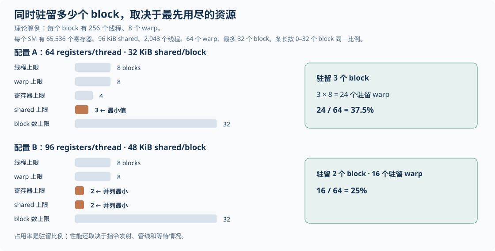
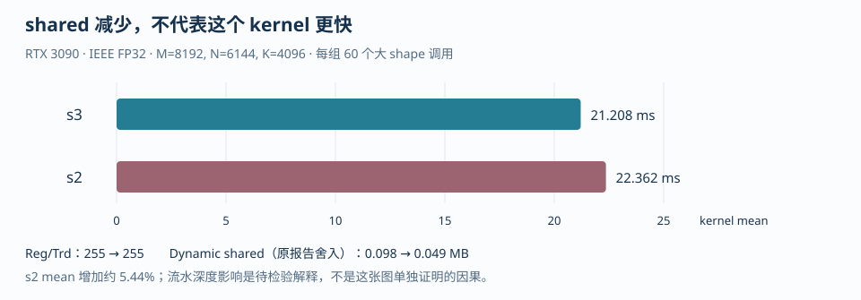

# 第五章 GPU kernel 的计时与性能分析

优化前先核对结果和精度要求，再确定计时范围、基线与测试形状。随后估算计算量和数据流量，再结合寄存器、共享内存与分析工具解释实际表现；第 5 节回到 MatMul，按这些指标检查已有测量并设计后续对照，最后在同一组形状上检查回归。

## 1. 计时范围与 CUDA Event

先用参考实现和误差阈值确认结果，再计时。浮点舍入和不同运算次序会带来数值差异，结果需满足题目或算子定义的精度要求。计时前检查地址、掩码、数据类型、非有限值和边界形状；正确性调用与计时样本分开，待比较实现使用同一组输入和精度设置。

再决定测 kernel，还是测包含主机调度、数据复制和同步的完整调用。`fn` 是每次执行一次待测算子的无参函数；预热用于让首次编译、模块加载等初始化离开稳态计时，重复次数用于收集样本。CUDA Event（CUDA 事件）记录设备时间线上的起止位置，因此不包含 Python 调用本身的全部主机耗时。

```python
warmup = 10
repeats = 50
fn = lambda: kernel(x, y)  # 一次待测算子调用；输入和输出已准备好

for _ in range(warmup):
    fn()
torch.cuda.synchronize()  # 等待预热工作结束
start = torch.cuda.Event(enable_timing=True)
end = torch.cuda.Event(enable_timing=True)
start.record()
for _ in range(repeats):
    fn()
end.record()
end.synchronize()
elapsed_ms = start.elapsed_time(end) / repeats
```

该方法测量同一 stream 中起止事件之间排入的 GPU 工作。若要测主机发起开销或整条服务请求，应另用主机时钟，并说明是否包含准备、排队与等待。计时前先用不规则形状检查正确性，正确性调用不计入性能样本。

同一批实验应使用相同输入、数值设置、预热次数、重复次数和等待范围。完成计时后，再结合编译器资源报告、Roofline 模型与性能分析工具判断瓶颈。

### 1.1 基线与测试形状

基线应完成相同计算，并使用相同的输入输出精度、布局和误差要求。Copy 可与设备内复制对照；GEMM 可与相同精度设置的 `torch.mm` 或 cuBLAS 对照；Attention 则固定掩码、head 数和实际选择的后端。若两个接口包含的布局转换、输出分配或融合操作不同，应分别测量 kernel 和完整调用。

测试形状应覆盖不同的计算特点。GEMM 至少包含较大矩阵、小输出行数、长归约维度和无法整除分块尺寸的形状；归约至少覆盖短行、长行及不同行数；Attention 同时改变序列长度、批量大小和 Query/KV head 数。各形状先通过正确性检查，再进入性能表。同一配置可能在某些形状上更快，却在其他形状上变慢或占用过多片上资源。

### 1.2 重复测量与跨形状回归

每轮测量重复调用 kernel，可降低计时粒度的影响；多轮独立测量用于观察波动。对同一形状，可在预热后交替测量基线 A 和候选 B，并保存每轮结果。温度、频率、其他进程、缓存和首次编译都可能影响比较，应记录运行条件，并把编译时间与稳态时间分开。

每种形状报告中位数和四分位范围，以展示典型耗时和波动。若收益与波动相近，应增加测量并检查环境。需要估计加速比置信区间时，应另用适合的统计方法。

设第 j 种形状的基线与候选中位数分别为 $t_{A,j}$、$t_{B,j}$，加速比如下：

$$
s_j=\frac{t_{A,j}}{t_{B,j}}.
$$

跨形状汇总时，可列出各项加速比及其几何平均，并同时报告最差回归：

$$
s_{\mathrm{geo}}=\exp\left(\frac1J\sum_{j=1}^{J}\log s_j\right).
$$

几何平均给每种形状相同权重。生产请求频率差异较大时，按真实负载重放并测量端到端时间；不同形状的毫秒数不宜直接平均成通用算子指标。

下面的函数只汇总传入的实测毫秒数，不产生性能样本：

```python
import math
import statistics


def summarize_ms(samples):
    values = [float(x) for x in samples]
    if len(values) < 5 or any(not math.isfinite(x) or x <= 0 for x in values):
        raise ValueError("at least five positive finite measurements required")
    q1, _, q3 = statistics.quantiles(values, n=4, method="inclusive")
    return {"median_ms": statistics.median(values), "q1_ms": q1, "q3_ms": q3}


def compare_shapes(baseline, candidate):
    if not baseline or baseline.keys() != candidate.keys():
        raise ValueError("both implementations must use the same nonempty shape set")
    reports = {}
    for shape in baseline:
        a, b = summarize_ms(baseline[shape]), summarize_ms(candidate[shape])
        reports[shape] = {"baseline": a, "candidate": b,
                          "speedup": a["median_ms"] / b["median_ms"]}
    ratios = [row["speedup"] for row in reports.values()]
    return reports, {"geomean_speedup": math.exp(statistics.mean(map(math.log, ratios))),
                     "worst_speedup": min(ratios)}
```

| 形状 / 精度 / 布局 | 正确性 | 基线中位数 / 四分位范围 | 候选中位数 / 四分位范围 | 加速比 | 寄存器、共享内存与实际瓶颈 |
|---|---|---|---|---|---|
| 大矩阵或长行 | — | — | — | — | — |
| 小矩阵或短行 | — | — | — | — | — |
| 非整除边界 | — | — | — | — | — |
| 模型实际出现的形状 | — | — | — | — | — |

最终报告应保留失败配置和退化形状。优化应针对测得的瓶颈；若调整资源后目标负载没有改善，或收益不足以抵消额外复杂度，就保留更简单的实现。

## 2. Roofline：计算强度与数据流量

算术强度（Arithmetic Intensity，AI）是运算量与数据流量的比值：

$$
AI=\frac{\mathrm{FLOPs}}{\mathrm{Bytes}}.
$$

给定有效显存带宽 $BW$ 和计算峰值 $P_{peak}$，简化 Roofline 上界为：

$$
P_{attainable}\le\min(P_{peak},AI\times BW).
$$

字节数要注明计算口径。算法最小流量假设每个输入和输出只从所分析的存储层读写一次；实际 kernel 可能因访问未合并、cache miss、重复读取、write-allocate、padding 或中间结果产生更多流量。结合 Nsight Compute 报告的 DRAM/L2 字节数与 requested/actual throughput，按观测流量重新计算算术强度。

### 2.1 Vector Add 数值算例

对 `C[i]=A[i]+B[i]`，每个元素有 1 次加法，FP32 最小流量是读取两个 4-byte 值并写回一个 4-byte 值，共 12 bytes：

$$
AI_{vector}=\frac{1}{12}=0.083333\ \mathrm{FLOP/byte}.
$$

课堂算例取有效带宽参照值 $BW=840$ GB/s。按最小流量假设计算，上界为：

$$
0.083333\times840=70\ \mathrm{GFLOP/s}.
$$

70 GFLOP/s 是将 840 GB/s 课堂参照值乘以每字节的运算量所得。报告实验有效带宽时，注明读写字节数和计时范围，并结合 Nsight Compute 的 DRAM/L2 流量确定数据来自哪一级存储。若有效带宽为 700 GB/s，可检查访问合并、网格大小、计时范围和 cache 重用。

本章脚本从参数读取带宽参照值和计算峰值：

```bash
cd <AIINFFRA>/roadmap/curriculum/gpu/05-performance-analysis-and-optimization
python examples/roofline_cases.py --bandwidth-gbps 840 --peak-tflops 20
```

### 2.2 GEMM 数值算例

对行主序矩阵 $A_{M\times N}B_{N\times K}=C_{M\times K}$，取仓库 MatMul 使用的 $M=8192,N=6144,K=4096$：

$$
\mathrm{FLOPs}=2MNK=412,316,860,416.
$$

如果 A、B、C 都按 FP32 存储，并采用每个矩阵只读/写一次的算法下界：

$$
\mathrm{Bytes}_{FP32}=4(MN+NK+MK)=436,207,616,
$$

因此：

$$
AI_{FP32}=945.230769\ \mathrm{FLOP/byte}.
$$

若存储类型为 FP16，三块矩阵的算法流量下界为 218,103,808 bytes，AI 增至 1,890.461538 FLOP/byte。该变化只反映存储字节数；累加精度、Tensor Core 指令路径和结果误差需分别核对。GEMM 的高 AI 来自分块复用：一个 A tile 被多个输出列复用，一个 B tile 被多个输出行复用。若 profiler 观测的字节数高于算法下界，应按实际流量重新计算 Roofline 点。

```bash
cd <AIINFFRA>/roadmap/curriculum/gpu/05-performance-analysis-and-optimization
python examples/roofline_cases.py --bandwidth-gbps 840 --peak-tflops 20
```

Roofline 给出理想上界，尚未计入 launch、地址计算、同步、指令依赖、占用率、bank conflict、频率变化和 cache 层级的影响。实测性能低于上界时，结合计数器与时间线定位限制来源。

## 3. Occupancy 与资源驻留上限

估出计算量和数据流量后，还要看一个 SM 能同时驻留多少个线程块和 warp。每个线程块都会占用线程名额、寄存器和一定的 shared memory；最先达到上限的资源决定驻留数量。一个 SM 上驻留 warp 数与硬件上限的比值称为 Occupancy（占用率）：

$$
\mathrm{Occupancy}=\frac{\mathrm{Active\ Warps\ per\ SM}}{\mathrm{Maximum\ Warps\ per\ SM}}.
$$

占用率表示能同时驻留多少 warp。每周期的指令发射情况另由 Issue utilization（指令发射利用率）描述，受可发射 warp 数、依赖链、内存延迟、barrier、执行管线和指令类型影响。例如，25% 占用率的 kernel 仍可能用满某条执行管线；100% 占用率时，warp 也可能都在等待 global memory。

设每个 block 有 $T_b$ 个线程、$W_b=\lceil T_b/32\rceil$ 个 warp、每线程使用 $R_t$ 个 32-bit 寄存器、每 block 使用 $S_b$ 字节 shared memory。一个 SM 的上限分别记为 $T_{SM}$（线程数）、$W_{SM}$（warp 数）、$R_{SM}$（32-bit 寄存器数）、$S_{SM}$（shared memory 字节数）和 $B_{SM}$（驻留 block 数）。忽略资源分配粒度时，驻留 block 上限可估为：

$$
B_T=\left\lfloor\frac{T_{SM}}{T_b}\right\rfloor,\quad
B_W=\left\lfloor\frac{W_{SM}}{W_b}\right\rfloor,\quad
B_R=\left\lfloor\frac{R_{SM}}{T_bR_t}\right\rfloor,\quad
B_S=\begin{cases}
\left\lfloor S_{SM}/S_b\right\rfloor,&S_b>0,\\
\infty,&S_b=0,
\end{cases}
\qquad
B_{\mathrm{resident}}=\min(B_T,B_W,B_R,B_S,B_{SM}).
$$

其中 $B_T$、$B_W$、$B_R$、$B_S$ 分别表示线程数、warp 数、寄存器和 shared memory 给出的上限。若 $S_b=0$，shared memory 不限制 block 数，该项取无穷大。

这里 $R_{SM}$ 以 32-bit 寄存器个数计，$S_{SM}$ 以字节计。估算暂不计寄存器和 shared memory 的分配粒度、每线程或每 block 的额外限制、编译器临时值及架构规则，因此结果是上界。实际驻留数量应查 `ptxas -v`、编译器 metadata、CUDA Occupancy API 或 Nsight Compute。

### 3.1 Occupancy 资源上限手算

图中比较两组课堂假设下各项资源给出的 block 上限，最终驻留数取最小值。

<figure class="diagram-frame">

<figcaption>理论资源计算。</figcaption>
</figure>

> [!IMPORTANT] 用 occupancy 解释驻留数量
> **37.5% 占用率表示驻留 warp 数占硬件上限的比例。** 判断性能还要结合指令依赖、访存、同步和耗时。

下面使用一组课堂假设：每个 SM 有 65,536 个 32-bit 寄存器、96 KiB shared memory、2,048 个线程、64 个 warp，最多驻留 32 个 block；每个 block 有 256 个线程，即 8 个 warp。比较 `64 registers/thread + 32 KiB shared/block` 和 `96 registers/thread + 48 KiB shared/block` 两种配置。

第一种配置逐约束计算：

$$
\begin{aligned}
B_T &= \lfloor 2048/256\rfloor=8,\\
B_W &= \lfloor 64/8\rfloor=8,\\
B_R &= \left\lfloor 65536/(256\times64)\right\rfloor=4,\\
B_S &= \lfloor 98304/32768\rfloor=3,\\
B_B &= 32.
\end{aligned}
$$

所以 $B_{resident}=\min(8,8,4,3,32)=3$，活跃 warp 数是 $3\times8=24$，占用率是 $24/64=37.5\%$。

第二种配置逐约束计算：

$$
\begin{aligned}
B_T &= 8,\\
B_W &= 8,\\
B_R &= \left\lfloor 65536/(256\times96)\right\rfloor=2,\\
B_S &= \lfloor 98304/49152\rfloor=2,\\
B_B &= 32.
\end{aligned}
$$

所以 $B_{resident}=\min(8,8,2,2,32)=2$，驻留 warp 数是 $2\times8=16$，占用率为 $16/64=25\%$。寄存器和 shared memory 在这组假设中并列限制驻留数量；分别调整其中一项后，再计算新的最小值。

可运行的算术复核在 `examples/occupancy_budget.py`：

```bash
cd <AIINFFRA>/roadmap/curriculum/gpu/05-performance-analysis-and-optimization
python examples/occupancy_budget.py
```

脚本按输入假设进行整数运算。编译器还会按架构规定的寄存器和 shared memory 粒度分配资源，因此 `65536/(256*96)=2` 是逻辑估算；实际驻留数应以编译报告或设备查询为准。寄存器用量从 64 增至 65 时，分配粒度可能使驻留数跨过一个台阶，故需同时记录 `ptxas` 或 Nsight 数据。

### 3.2 Occupancy 与 kernel 时间

例如，一个 256-thread GEMM block 缩小累加器分块后，寄存器用量从每线程 96 个降到 64 个，手算占用率从 25% 升至 37.5%。若这同时减少 A/B 数据复用，增加 global memory 读取或边界指令，kernel 仍可能变慢。较大的分块即使受寄存器限制而每 SM 只能驻留两个 block，也可能因减少 global memory 流量而提高吞吐。

调整分块尺寸或 warp 数时，同时记录：

```text
硬件机制：寄存器/ shared / warp 上限共同限制驻留
待比较参数：BLOCK_M、BLOCK_N、BLOCK_K、num_warps、num_stages
预期指标：registers/thread、shared/block、resident blocks、eligible warps、stall
结论依据：同一 shape、同一精度、同一 warmup/计时协议下的耗时与计数器
```

因此，`active warps / maximum warps` 表示驻留容量。warp 是否可发射、执行管线是否繁忙，应查看调度器与执行管线计数器；这些值无法从占用率推算。

[Triton 官方 fused-softmax 教程](https://triton-lang.org/main/getting-started/tutorials/02-fused-softmax.html)先读取编译后的寄存器和共享内存用量，再估算可并发的 program 数。分块尺寸与 warp 数是编译输入，资源用量则由编译器确定；每次调整后都应重新读取编译结果。kernel 未使用共享内存时，计算驻留上限可略过 shared memory 一项，最终再用目标设备工具核实。

## 4. 浮点精度与结果差异

IEEE FP32 使用 binary32 输入与结果格式，计算时仍按浮点规则舍入。编译器可能把乘加融合为 FMA，树形归约也会改变求和次序，因此结果可能与未融合或按另一顺序计算的参考值有差异。TF32（TensorFloat-32）通常保留 FP32 存储与累加器，在 Tensor Core 矩阵乘输入路径使用较短的有效尾数；其指令路径和误差表现与 IEEE FP32 不同，应分开测量。

仓库 `solutions/triton/matmul.py` 的严格 FP32 对照同时设置：

```python
torch.backends.cuda.matmul.allow_tf32 = False
tl.dot(tile_a, tile_b, input_precision="ieee")
```

MatMul 的 IEEE FP32 记录应列出 `shape=(8192,6144,4096)`、输入输出数据类型、`allow_tf32`、Triton 配置和误差阈值。TF32 对照另报 `max_abs_error`、`max_rel_error`，并使用相同预热与重复测量流程。这样可以分别看清精度路径和分块调整的影响；PyTorch 默认配置应从运行设置读取。

比较 `torch.mm` 与 Triton 时，固定 `allow_tf32`，并把 FP16、BF16/Tensor Core 与 FP32 路径分开记录，避免将精度和指令路径变化混入耗时差异。

### 正确性检查与计时样本

仓库 MatMul 脚本预热 10 次、同步设备，再在同一 stream 上用 CUDA Event 计时 50 次，并以总耗时除以重复次数。先对 `(1,1,1)`、整除形状、`(65,33,67)` 等非整除形状及目标性能形状检查正确性；误差和非有限值检查通过后，再运行计时循环。

主机用 `time.perf_counter()` 计时而未在设备工作前后同步时，测得的可能只是 launch 开销。正确性调用应在计时循环之外；各配置使用相同预热和重复次数，避免逐次全设备同步改变测量范围。测试集覆盖 `(1,1,1)`、整除尺寸、`(65,33,67)` 一类非整除尺寸和性能尺寸，并检查有限值与误差阈值。

在仓库根目录运行 MatMul：

```bash
python solutions/triton/matmul.py --config k256-128x32x256-w8-s3
```

### 不同 stream 仍串行：区分依赖、资源和提交队列

两条 stream 没有显式 event 依赖，也不保证并发执行。默认 NULL stream 的隐式同步、内存分配、未完成的输入传输，以及单个 kernel 占满的寄存器或 shared memory，都可能让另一条 stream 等待。先从时间线定位等待发生在主机提交、设备排队还是 kernel 内，再选择对应的调整方式。

软件 stream 映射到哪些底层工作队列，取决于运行时配置；多个 stream 可能共享提交资源，从而出现额外串行。`CUDA_DEVICE_MAX_CONNECTIONS` 调整可用连接配置，不决定 SM、warp 或并行 kernel 数量。时间线显示提交资源竞争时，再按当前工具链和驱动文档核对参数，重启实验进程并与未启用 profiler 的结果比较。

Stream priority 影响尚未开始的工作被选择的先后次序，不提高正在执行指令的吞吐。下面的配置先查询设备支持的优先级范围，再创建高优先级 non-blocking stream：

~~~cpp
int least_priority = 0, greatest_priority = 0;
CUDA_CHECK(cudaDeviceGetStreamPriorityRange(&least_priority, &greatest_priority));
cudaStream_t latency_stream{};
CUDA_CHECK(cudaStreamCreateWithPriority(
    &latency_stream, cudaStreamNonBlocking, greatest_priority));
// Submit the latency-sensitive work and its real data dependencies here.
CUDA_CHECK(cudaStreamSynchronize(latency_stream));
CUDA_CHECK(cudaStreamDestroy(latency_stream));
~~~

数值越小，优先级越高。正在执行的低优先级 block 不会因此立即停止；资源空出后，调度器才可优先选择高优先级工作。长 kernel 的 block 若持续时间较长，降低平均耗时与改善短请求尾延迟可能需要不同调整。Green Context、stream priority 和 Graph 分别涉及资源选择、调度提示和提交开销，应按各自的测量指标分析。

## 5. MatMul 案例：从配置表到性能证据

本节用已保存的 Triton MatMul 实现和服务器测量串起前面的分析。比较时同时核对形状、精度、配置、计时条件和设备。

`solutions/triton/matmul.py` 使用 `A[M,N] @ B[N,K] = C[M,K]` 的行主序布局。`BLOCK_M` 切输出行 M，`BLOCK_K` 切输出列 K，`BLOCK_N` 切归约维 N。阅读配置表时，对照源码指针公式和 `grid=(cdiv(M,BLOCK_M), cdiv(K,BLOCK_K))`，即可确认每个参数对应的维度。

第一批是固定 `M=8192,N=6144,K=4096`、IEEE FP32、`tl.dot(input_precision="ieee")` 且 PyTorch `allow_tf32=False` 的候选 sweep：

| 配置 | 结果 | 解释边界 |
|---|---:|---|
| `64x32x64,w4,s3` | 24.924 ms / 16,542.7 GFLOPS | 本批候选基线 |
| `128x32x64,w4,s3` | 22.298 ms / 18,491.3 GFLOPS | 同一形状与精度下快于本批基线 |
| `128x32x128,w4,s3` | 28.354 ms / 14,541.8 GFLOPS | 本批中慢于前一配置；原因待 profiler 检查 |
| `128x64x128,w4,s3` | 编译失败；shared 需要 131,072 B，大于 101,376 B 上限 | 超出编译资源上限 |
| `128x32x256,w8,s3` | 22.033 ms / 18,713.5 GFLOPS | 本批候选中耗时最低 |

同一复盘后续另存的一次结果为 20.830 ms / 19,794.1 GFLOPS，相当于 `torch.mm` 的 80.3%。这批结果对应自己的基准形状、IEEE FP32 设置和脚本批次，须与前一批 22.033 ms 分开比较。

### 5.1 P0-lite：Nsight Systems 流水深度记录

流水深度对比固定 `128x32x256,w8`，只改变 `num_stages`。从 Nsight Systems trace 排除正确性检查的 kernel 调用后，保留 60 次目标大形状调用：

| 配置 | Triton mean / median | Reg/Trd | Dynamic shared | 同次 CUTLASS mean |
|---|---:|---:|---:|---:|
| `s3` | 21.208 / 21.163 ms | 255 | 0.098 MB | 16.716 ms |
| `s2` | 22.362 / 22.317 ms | 255 | 0.049 MB | 16.682 ms |

这批形状、精度、配置和计时口径下，s2 比 s3 慢 5.44134%；动态 shared 减半，Reg/Trd 都为 255。AutoDL 当时没有可用的 NCU 硬件计数器，因此没有直接测得 achieved occupancy、stall reason 或 issue utilization。较浅流水可能减少 latency hiding，而 shared 减少没有改变寄存器用量；这两点是待检验的解释。Nsight Systems 记录了时间线和 launch metadata，不含上述 NCU 硬件计数器。

服务器重跑时，固定输入形状、IEEE FP32、预热与重复次数及进程状态，只改 `num_stages`。历史数据留在上表；新一批结果填写在下表：

| 配置 | GPU / CC | correctness | mean / median ms | GFLOP/s | registers/thread / shared |
|---|---|---|---|---|---|
| `k256-128x32x256-w8-s3` | — | — | — | — | — |
| `k256-128x32x256-w8-s2` | — | — | — | — | — |

### 5.2 逐行读原始 trace：先确认测的是什么

从 Nsight Systems trace 中选出两条同名 kernel 记录，查看下列字段：

| 记录 | Duration（ns） | Grid | Block | Reg/Trd | DymSMem（MB） |
|---|---:|---|---|---:|---:|
| 小形状调用 | 10,561 | 1×1×1 | 256×1×1 | 246 | 0.049 |
| 一次目标大形状调用 | 19,016,006 | 64×16×1 | 256×1×1 | 255 | 0.098 |

两行都显示为 `matrix_multiplication_kernel`，但对应不同输入规模。Duration 除以一百万后分别为 0.010561 ms 和 19.016006 ms；后者是单次观测。汇总前按形状筛选，排除小形状正确性检查，再另算 60 次目标调用的均值。

Grid 的 64×16 与源码相符：输出为 8192×4096，每块输出 128×256，因此行方向有 64 块、列方向有 16 块。Block 的 256 个线程对应 8 个 warp。Reg/Trd 是编译后的每线程寄存器用量；DymSMem 是该 kernel 的动态共享内存用量。

应当按以下顺序阅读这份报告：

1. 用kernel名称、Grid和Block辨认目标调用，并核对源码配置及输入形状。
2. 排除四次小规模正确性调用，再对60个目标样本计算均值、中位数和离散程度。
3. 对照Reg/Trd、共享内存与前面手算的驻留约束，提出可以检验的解释。
4. 需要解释stall或实际occupancy时，再使用硬件计数器；不从时间线字段推导不存在的测量值。

> [!TIP] 按形状筛选 trace
> 这份记录包含 4 次小形状调用和 60 次目标形状调用。先确认工作负载，再计算目标样本的统计值。

### 5.3 正确性检查与误差阈值

对浮点输出，常用判据是：

$$
|y-y_{\mathrm{ref}}|\le \mathrm{atol}+\mathrm{rtol}\,|y_{\mathrm{ref}}|.
$$

绝对阈值控制参考值接近零时的误差；相对阈值随参考值大小缩放。只看最大相对误差，可能把非常小的参考值放大成吓人的比率；只看平均误差，又可能掩盖少数位置的明显错误。应同时记录最大绝对误差、超阈值元素数量和非有限值。

参考实现的计算精度也要注明。CPU double 归约、GPU FP32 树归约和允许 TF32 输入的矩阵乘采用不同舍入路径。高精度参考用于评价误差；性能基线应使用相同精度设置。出现误差时，依次检查地址、掩码、输入精度和归约顺序，再按数值合同判断误差。

工具分别回答不同问题：

| 工具 | 主要用途 | 结果范围 |
|---|---|---|
| memcheck | 检查非法或未对齐访问等内存错误 | 不检查数学结果 |
| initcheck | 检查未初始化的设备全局内存读取 | 不覆盖所有同步问题 |
| racecheck | 检查其支持范围内的共享内存访问冲突 | 不覆盖任意全局内存数据竞争 |
| synccheck | 检查同步原语使用错误 | 不衡量算子性能 |

先按本章 §7 在本章目录编译 `reduction_tail`，再从同一目录运行下面两个检查：

~~~bash
compute-sanitizer --tool initcheck --error-exitcode=1 ./reduction_tail
compute-sanitizer --tool synccheck --error-exitcode=1 ./reduction_tail
~~~

检查工具会改变执行开销，因此其运行时间不用于优化比较。正确性输出与正常运行的基准数据分开保存。

### 5.4 在同一 MatMul 算例上复测

本章沿用 [LeetGPU Matrix Multiplication](https://leetgpu.com/challenges/matrix-multiplication) 题面和已归档代码。服务器入口在 `solutions/triton/matmul.py`。先检查不规则形状，再用固定的 `M=8192,N=6144,K=4096`、FP32、`allow_tf32=False` 比较配置；计时采用第 1 节的预热与 CUDA Event 流程。

| 配置 | GPU / CC | 正确性 / 最大误差 | kernel 平均耗时（ms） | GFLOP/s | NCU counters |
|---|---|---|---|---|---|
| `k256-128x32x256-w8-s3` | — | — | — | — | — |
| 相同配置、另一次独立运行 | — | — | — | — | — |

新记录注明 GPU、计算能力、形状、数据类型、精度开关、配置、预热次数、重复次数和软件版本。已有 20.830 ms、s3/s2 与 sweep 数字各自保留原测量条件，不与新表合并。


## 6. 优化假设、改动、指标证据

<figure class="diagram-frame">

<figcaption>RTX 3090 实测记录：每组 60 次目标形状调用。</figcaption>
</figure>

> [!TIP] 这批数据的观察
> s2 的 shared 减少、寄存器用量不变，耗时增加。原因仍待 profiler 计数器和相邻配置实验检验。

每次调整都记录假设、改动和对应指标：

| 假设 | 改动 | 当前证据或待查看指标 |
|---|---|---|
| 输出分块较小，数据复用不足 | `BLOCK_M:64→128`，固定 `N/K,w/s` | 24.924→22.298 ms；可继续查看 global load、eligible warps 和寄存器用量 |
| 增大 K 分块可增加 A/B 复用 | `BLOCK_K:64→128` | 22.298→28.354 ms；变慢原因需结合资源、流量和 stall 计数器检查 |
| 增大归约维分块可减少 N 维循环 | `BLOCK_N:32→64`（本代码中 N 为归约维，K 为输出列维） | 编译失败：131,072 B > 101,376 B shared memory 上限 |
| 增大 K 分块并增加 warp 可隐藏依赖 | `128x32x256,w8,s3` | 22.033 ms；需对照同批寄存器、shared memory 和 Roofline 数据 |
| 减少 stage 可释放 shared memory、增加驻留量 | `s3→s2` | shared 0.098→0.049 MB，Reg/Trd 均为 255，平均时间 21.208→22.362 ms；原因待查 |
| 二维排布导致 L2 重读 | grouped program ordering | 检查 L2 hit、DRAM 字节数与实测耗时 |
| IEEE FP32 计算受限，可用 TF32 换取速度 | 单独测 TF32 配置 | 记录速度、最大绝对/相对误差和 MMA 指令 |
| 减少寄存器可提高驻留量 | 缩小累加器或分块 | 检查寄存器/线程、驻留 block、spill 与实测耗时 |

表中尚未测得的指标仍是待检验项。比较时固定形状、精度、预热次数、重复次数和设备，再根据对应计数器判断假设。

## 7. 从源码到 PTX、SASS 与 profiler

从源码到机器指令有几层证据：源码展示算法和分块；`ptxas -v` 报告寄存器、local、shared 等编译资源；PTX 展示虚拟指令和 memory space；SASS 展示目标 GPU 的机器指令。Triton 会按配置即时编译；配置改变后需检查新产物，实际寄存器用量以编译结果为准。

```bash
cd <AIINFFRA>/roadmap/curriculum/gpu/05-performance-analysis-and-optimization
nvcc -std=c++17 -O3 -lineinfo -Xptxas=-v -arch=sm_XX \
  ../04-synchronization-and-asynchronous-execution/examples/reduction_tail.cu \
  -o reduction_tail
cuobjdump --dump-ptx reduction_tail
cuobjdump --dump-sass reduction_tail
```

把 `sm_XX` 替换成目标计算能力对应的编译目标，并按目标设备选择支持的架构。若需要更细的 SASS 反汇编，在生成 cubin 后使用：

```bash
cd <AIINFFRA>/roadmap/curriculum/gpu/05-performance-analysis-and-optimization
nvcc -std=c++17 -O3 -lineinfo -arch=sm_XX -cubin \
  ../04-synchronization-and-asynchronous-execution/examples/reduction_tail.cu \
  -o reduction_tail.cubin
nvdisasm reduction_tail.cubin
```

实际 profiling 命令：

```bash
cd <AIINFFRA>/roadmap/curriculum/gpu/05-performance-analysis-and-optimization
nsys profile --trace=cuda,nvtx,osrt --stats=true \
  --output=matmul_k256_nsys \
  python ../../../../solutions/triton/matmul.py \
  --config k256-128x32x256-w8-s3

cd <AIINFFRA>/roadmap/curriculum/gpu/05-performance-analysis-and-optimization
ncu --set roofline --target-processes all \
  --export=matmul_k256_ncu \
  python ../../../../solutions/triton/matmul.py \
  --config k256-128x32x256-w8-s3
```

Nsight Systems 显示主机提交、stream、kernel、H2D/D2H 与空闲区间的时间顺序；Nsight Compute 分析单个 kernel 的占用率、寄存器与 shared 用量、DRAM/L2 流量、warp stall、Roofline 和 MMA/FP32 管线。诊断时同时记录源码改动、相关计数器变化和未开启 profiler 时的 kernel 耗时。

`nvidia-smi` 显示当前设备、驱动和运行状态，其中的 CUDA 版本是驱动支持的最高版本。`nvcc --version` 显示已安装的 Toolkit 编译器版本；`-arch=sm_XX` 指定编译目标。分别记录设备与编译目标；编译成功确认目标文件已生成。

[GPU MODE 第一讲](https://github.com/gpu-mode/lectures/tree/main/lecture_001)从完整 PyTorch 调用入手，用性能工具确认实际执行的 kernel。下面的独立实验预先分配输入，比较三种逐元素平方写法；先检查结果并预热，再用 CUDA Event 计时，最后采集 CPU/CUDA 时间线。计时循环与 profiler 分开运行。

```python
import torch
from torch.profiler import ProfilerActivity, profile, record_function

x = torch.randn(1 << 20, device="cuda", dtype=torch.float32)
operations = {
    "torch.square": lambda: torch.square(x),
    "x * x": lambda: x * x,
    "x ** 2": lambda: x ** 2,
}
reference = x * x
for fn in operations.values():
    torch.testing.assert_close(fn(), reference)

for name, fn in operations.items():
    for _ in range(5):
        fn()
    torch.cuda.synchronize()
    start = torch.cuda.Event(enable_timing=True)
    end = torch.cuda.Event(enable_timing=True)
    start.record()
    for _ in range(100):
        fn()
    end.record()
    end.synchronize()
    print(f"{name}: {start.elapsed_time(end) / 100:.6f} ms")

with profile(activities=[ProfilerActivity.CPU, ProfilerActivity.CUDA],
             record_shapes=True) as prof:
    for name, fn in operations.items():
        with record_function(name):
            for _ in range(10):
                fn()
    torch.cuda.synchronize()
print(prof.key_averages().table(sort_by="cuda_time_total", row_limit=20))
prof.export_chrome_trace("square-trace.json")
```

这三种写法执行相同数学运算，实际 kernel 数量和实现以 trace 为准。汇总表显示框架算子的调用次数和累计时间；在 `square-trace.json` 中沿 `record_function` 标记查看 GPU 轨道，可记录 kernel 名称与次数。每种表达式采集 10 次，区分总调用数和单次调用的 kernel 数。CUDA Event 结果来自独立的计时循环。

| 表达式 | profiler 中的实际 kernel 名称 / 次数 | CUDA Event mean ms | GPU / CC |
|---|---|---|---|
| `torch.square(x)` | — | — | — |
| `x * x` | — | — | — |
| `x ** 2` | — | — | — |

计时按 event record、等待完成、读取 elapsed time 的顺序执行。系统时间线用 Nsight Systems 分析，kernel 硬件指标用 Nsight Compute 分析。

CUDA Sanitizer 用于先排除内存错误和同步错误，再解释性能：

```bash
cd <AIINFFRA>/roadmap/curriculum/gpu/05-performance-analysis-and-optimization
nvcc -std=c++17 -O2 \
  ../04-synchronization-and-asynchronous-execution/examples/reduction_tail.cu \
  -o reduction_tail
compute-sanitizer --tool memcheck --error-exitcode=1 ./reduction_tail
compute-sanitizer --tool racecheck --error-exitcode=1 ./reduction_tail
```

`CUDA_LAUNCH_BLOCKING=1` 可把异步 launch 错误定位到更接近的调用点；该设置会改变时间线，所得耗时不用于性能比较。只读工具采集脚本为 `examples/collect_cuda_tools.sh`：

```bash
cd <AIINFFRA>/roadmap/curriculum/gpu/05-performance-analysis-and-optimization
bash examples/collect_cuda_tools.sh
```

kernel 时间与服务请求时延的测量范围不同。以下拓展说明如何把算子测量放回模型请求时间线，并介绍常见推理指标。

<details>
<summary>拓展：从 kernel 时间走到 LLM 请求时延</summary>

## 请求时延与 kernel 时间的边界

请求时延与 kernel 时间使用不同的起止点。先根据请求时间戳计算指标，再看单算子优化怎样影响完整请求。

### TTFT、TPOT 与端到端时延的边界

设同一测量端观察到请求到达时间 a，以及 N 个输出 token 的时间 t_0,…,t_(N-1)。Time To First Token（TTFT，首 token 时延）和 Time Per Output Token（TPOT，首 token 之后的平均 token 间隔）为

$$
\mathrm{TTFT}=t_0-a,\qquad
\mathrm{TPOT}=\frac{t_{N-1}-t_0}{N-1}\quad(N>1).
$$

在同一端、同一条请求、以最后一个 token 为结束点的定义下，

$$
T_{\mathrm{end}}=t_{N-1}-a
=\mathrm{TTFT}+(N-1)\mathrm{TPOT}.
$$

只有一个输出 token 时没有 token 间隔，因此 TPOT 不定义。若请求终点取整个 HTTP 响应完成时间，还包含最后一个 token 之后的协议或传输时间，应另行报告。

例如 a=0 ms，输出时间为 [120,160,220] ms。TTFT 为 120 ms，两次间隔为 40 与 60 ms，TPOT 为 50 ms，最后 token 的端到端时延为 220 ms。TTFT 包含请求路径上的排队、tokenization、cache 查询、传输、Prefill、首 token 选择和返回过程；单个 Prefill kernel 的 CUDA Event 时间只是其中一段。客户端与服务端时间戳需先校准时钟再相减。

下面是配套检查实际使用的实现：

<!-- source-check: examples/cpu_metrics_case.py -->
~~~python
def request_metrics(arrival_ms, token_times_ms):
    times = list(token_times_ms)
    if not times or not all(math.isfinite(x) for x in [arrival_ms, *times]):
        raise ValueError("at least one token and finite timestamps required")
    if times[0] < arrival_ms or any(a > b for a, b in zip(times, times[1:])):
        raise ValueError("timestamps must be chronological")
    ttft = times[0] - arrival_ms
    e2e = times[-1] - arrival_ms
    tpot = (times[-1] - times[0]) / (len(times) - 1) if len(times) > 1 else None
    return ttft, tpot, e2e
~~~

分位数应从逐请求总时间计算。例：一半请求 TTFT=100、后续 Decode=1，另一半 TTFT=1、Decode=100。每条请求总时间都是 101；两个分项的 P95 各为 100，相加会得到 200。先求每条请求的总时延，再计算 P95。

### 单算子快两倍，模型为什么只快一点

在没有重叠、其他阶段不变的串行模型中，设某算子占原总时间比例 f，局部加速 s 倍。原总时间归一化为 1，新时间为

$$
T_{\mathrm{new}}=(1-f)+\frac f s,\qquad
\mathrm{Speedup}_{\mathrm{end}}=\frac{1}{(1-f)+f/s}.
$$

例如原来 100 ms 中有 20 ms 属于这个算子，算子从 20 ms 降到 10 ms，总时间是 90 ms，整体仅快 1.111 倍。把 kernel 提升比例直接写成模型吞吐提升，会忽略其余 80 ms。

并发执行时还要看关键路径。两条 stream 的 kernel 时间可能重叠；缩短非关键路径上的 kernel，端到端时间可能不变。融合也会改变 launch 间隙、存储竞争和同步位置，因此应重新测量时间线。请求时延按请求时间戳和关键路径计算；profiler 中各 kernel duration 可能彼此重叠。

### MFU 与带宽利用率要服务于瓶颈判断

Model FLOPs Utilization（MFU，模型浮点运算利用率）按模型有效运算量 $F_{model}$、测量时间 $\Delta t$ 和对应精度的设备总峰值 $P_{peak}$ 计算：

$$
\mathrm{MFU}=\frac{F_{\mathrm{model}}}{\Delta t\,P_{\mathrm{peak}}}.
$$

MoE 的理论工作量按实际参与的专家路径计算，并说明是否计入重算、padding 和索引计算。峰值计算能力应匹配运算精度与设备数，例如 IEEE FP32 kernel 使用 FP32 峰值，多卡运算使用参与设备的总峰值。模型有效计算的 MFU 与硬件指令利用率是不同指标。

Decode 中的小矩阵和 KV 扫描可能使 MFU 较低，而请求时延主要受带宽或 launch 时间影响。此时检查有效字节数、DRAM/L2 流量、kernel 数和空闲间隙，再结合时延目标选择 batch。Prefill 的瓶颈也随输入长度、batch、稀疏索引和 Attention 序列长度变化。

按 Nsight 流程落实这些判断：先用 Systems 找出排队、launch、拷贝和 kernel 的关键路径，再用 Compute 分析热点 kernel 的计算管线与存储事务，最后在关闭 profiler 的请求测试中核对 TTFT、TPOT 和吞吐。服务等级目标（SLO）下的有效并发需通过压测确定；显存预算用于估算容量。

从仓库根目录运行时间戳、P95 边界示例与 Amdahl 检查：

~~~bash
python roadmap/curriculum/gpu/05-performance-analysis-and-optimization/examples/cpu_metrics_case.py
~~~

</details>

<span id="chapter-5-section-27" aria-hidden="true"></span>

## 参考阅读

[CUDA Programming Guide 13.3](../../../../downloads/cuda-programming-guide.pdf) · [大模型推理实践](../../../../downloads/大模型推理实践.pdf)。
